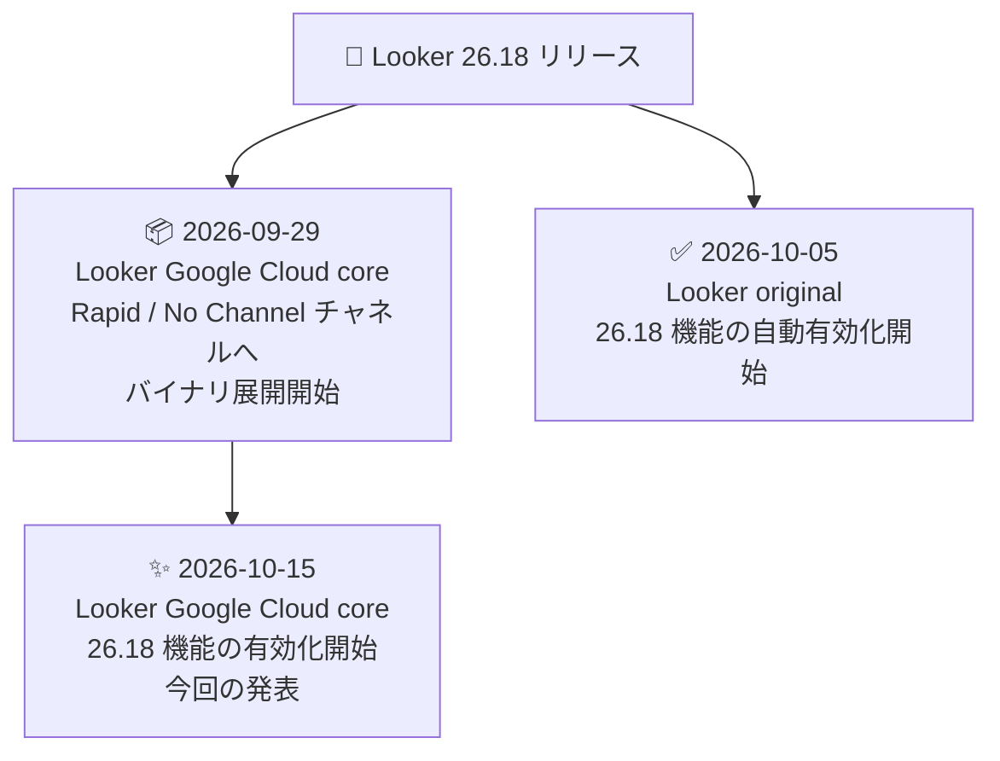

# Looker (Google Cloud core): Looker 26.18 機能の有効化開始

**リリース日**: 2026-10-15

**サービス**: Looker (Google Cloud core)

**機能**: Looker 26.18 の機能有効化ロールアウト

**ステータス**: 一般提供 (ロールアウト開始)

📊 [このアップデートのインフォグラフィックを見る](https://takech9203.github.io/google-cloud-news-summary/20261015-looker-26-18-rollout.html)

## 概要

2026 年 10 月 15 日、Looker (Google Cloud core) インスタンスに対して Looker 26.18 の機能の有効化が開始されました。Looker 26.18 のバイナリ自体は 2026 年 9 月 29 日から Rapid チャネルおよび No Channel チャネルのインスタンスへの展開が始まっていましたが、今回のアナウンスにより、26.18 で導入された新機能が Looker (Google Cloud core) インスタンスで順次利用可能になります。

Looker 26.18 は、ClickHouse 26+ と Dremio 26.0+ (Arrow Flight SQL) の新ダイアレクト対応、AI 支援機能「Starter questions」の GA、LookML リポジトリの診断・修復ツール、CI の Style Validator、Conversational Analytics のスケジュール型エージェントワークフロー (Preview)、Looker Data Apps (Preview) など、AI・開発者体験の両面で多くの機能強化を含むリリースです。

なお、Looker (original) インスタンスでは 2026 年 10 月 5 日から 26.18 機能の自動有効化が先行して開始されており、Looker (Google Cloud core) 向けの有効化は別途アナウンスされる旨が告知されていました。今回がその正式な有効化開始の発表にあたります。

**アップデート前の課題**

- Looker 26.18 の新機能は Looker (original) インスタンスでは 2026 年 10 月 5 日から有効化が始まっていた一方、Looker (Google Cloud core) インスタンスでは未有効だった
- Looker (Google Cloud core) では 26.18 のバイナリ展開 (9 月 29 日開始) と機能有効化のタイミングが分離されており、新機能を利用できなかった

**アップデート後の改善**

- Looker (Google Cloud core) インスタンスでも Looker 26.18 の新機能 (新ダイアレクト対応、AI 機能、開発ツール群) が順次利用可能になった
- Looker (original) と Looker (Google Cloud core) の両プラットフォームで 26.18 の機能セットが揃う

## アーキテクチャ図

Looker 26.18 は、まず Looker (Google Cloud core) へのバイナリ展開と Looker (original) での機能有効化が先行し、今回 Looker (Google Cloud core) でも機能有効化が開始されるという段階的なロールアウトになっています。

## サービスアップデートの詳細

### Looker 26.18 の主要機能

公式リリースノート (2026 年 10 月 9 日付) で確認できる、Looker (Google Cloud core) と Looker (original) の両方に適用される 26.18 の主な機能は以下のとおりです。

1. **ClickHouse 26+ ダイアレクト対応**
   - 近代化された JDBC ドライバーを使用する ClickHouse 26 以降への接続をサポート
   - [対称集計 (symmetric aggregates)](https://docs.cloud.google.com/looker/docs/reference/param-explore-symmetric-aggregates) に対応

2. **Dremio 26.0+ (Arrow Flight SQL) ダイアレクトの組み込みサポート**
   - バンドルされた Apache Arrow Flight SQL JDBC ドライバーを使用
   - カスタム JDBC ドライバー JAR ファイルを個別にインストールする必要がなくなった

3. **AI-Assisted Quick Starts (Starter questions) の GA**
   - 新しい Explore エクスペリエンスにおける「[Starter questions](https://docs.cloud.google.com/looker/docs/gemini-quick-starts)」機能が一般提供 (GA) に昇格

4. **Diagnose & Repair ツール**
   - [LookML プロジェクトリポジトリを 8 つの診断テスト](https://docs.cloud.google.com/looker/docs/diagnosing-and-repairing-git-projects)で評価 (個人開発環境・共有本番環境の両方に対応)
   - 古いロックファイルの削除、ファイル権限の修正、破損したオブジェクトインデックスの修復などを自動実行
   - 未コミットの変更を専用のリカバリブランチに退避しつつ、破損したリポジトリの再構築が可能

5. **Looker CI の Style Validator**
   - [Looker Continuous Integration (CI)](https://docs.cloud.google.com/looker/docs/continuous-integration) に [Style Validator](https://docs.cloud.google.com/looker/docs/ci-style-validator) が追加
   - LookML のコーディング標準、命名規則、構造的ベストプラクティスを強制
   - デフォルトの組み込みルールセットのほか、`lkmlstyle.yaml` 設定ファイルでルールの重大度、ファイル除外、カスタムルールなどをカスタマイズ可能

6. **Conversational Analytics のスケジュール型エージェントワークフロー (Preview)**
   - 従来のトリガー型に加えて[スケジュール型エージェントワークフロー](https://docs.cloud.google.com/looker/docs/conversational-analytics-scheduled-agentic-workflows)をサポート
   - 自然言語を使って、AI 生成のインサイトサマリー、データテーブル、可視化、PDF レポートをメールや Slack に定期配信可能
   - 受信者はワークフロー通知の「Investigate」からデータエージェントとのプライベートな会話を開始できる
   - 管理者は新しい Workflow Executions 管理ページでスケジュール実行の監視とトラブルシューティングが可能

7. **Looker Data Apps (Preview)**
   - [Looker Data Apps](https://docs.cloud.google.com/looker/docs/data-apps) は、Gemini CLI、Claude Code、Cursor などのローカル AI コーディングエージェントが自然言語プロンプトから構築するフリーフォームキャンバスダッシュボード
   - 絶対配置、要素の重ね合わせ、カスタム Web コンポーネントなど完全なビジュアルレイアウト制御が可能
   - Looker のガバナンスされた LookML セマンティックレイヤーとユーザー権限に準拠

### 主な修正 (Fixed)

26.18 には多数のバグ修正も含まれています。Looker (Google Cloud core) のみに適用される修正としては、セルフサービス分析での BigQuery / Snowflake への CSV・Excel アップロード時の失敗やデータ破損 (複数行ヘッダー、UTF-8 BOM、特殊文字など) の修正が含まれます。両プラットフォーム共通では、スケジュール配信の権限エラー、ダッシュボードの CSV / ZIP ダウンロード時の 500 エラー、LookML の `link` パラメータ利用時の 500 エラー、ピボットされたチャートでの系列ドラッグ時のクラッシュなどが修正されています。

## 技術仕様

### リリースチャネルと展開状況 (2026 年 9 月 29 日時点)

| リリースチャネル | バージョン |
|------|------|
| Rapid | Looker 26.18 |
| No Channel | Looker 26.18 |
| Regular | Looker 26.14 |

Looker (Google Cloud core) の[リリースプロセス](https://docs.cloud.google.com/looker/docs/looker-core-release-process#release_channels)では、バイナリの展開と機能の有効化が段階的に行われます。なお、Looker 26.16 は Looker (Google Cloud core) にはデプロイされず、代わりに 26.18 が 9 月 29 日からロールアウトされています。

## デメリット・制約事項

### 考慮すべき点

- **API 認証方式の変更**: Looker 26.18 のリリースに伴い、Looker 言語 SDK と Looker API の `/login` エンドポイントは、認証情報を HTTP リクエストボディでのみ受け付けるようになり、URL クエリパラメータでの受け渡しはサポートされなくなります (2026 年 3 月 23 日に事前アナウンス済み)。URL クエリパラメータで認証情報を渡しているスクリプトやアプリケーションは失敗するため、SDK をバージョン 26.4 以降にアップグレードし、カスタムスクリプトを修正する必要があります
- **レガシーワークフローの再作成**: Looker 26.14 より前のバージョンで作成された Conversational Analytics ワークフローは「Legacy Workflows」タブに表示され、再作成が必要です
- **機能の有効化は順次実施**: 「有効化が開始された」段階であり、すべての Looker (Google Cloud core) インスタンスで即座に利用可能になるわけではありません

## 関連サービス・機能

- **BigQuery / Snowflake**: セルフサービス分析の CSV・Excel アップロード修正や、分析モデルの DDL 生成修正の対象となるデータウェアハウス
- **Gemini (Conversational Analytics)**: Starter questions の GA やスケジュール型エージェントワークフローなど、Looker の AI 機能の基盤
- **Looker (original)**: 同じ 26.18 機能セットが 2026 年 10 月 5 日から先行して有効化されているセルフホスト / レガシー版 Looker

## 参考リンク

- 📊 [インフォグラフィック](https://takech9203.github.io/google-cloud-news-summary/20261015-looker-26-18-rollout.html)
- [公式リリースノート (Google Cloud Release Notes - October 15, 2026)](https://docs.cloud.google.com/release-notes#October_15_2026)
- [Looker リリースノート](https://docs.cloud.google.com/looker/docs/release-notes)
- [Looker (Google Cloud core) のリリースプロセスとリリースチャネル](https://docs.cloud.google.com/looker/docs/looker-core-release-process)
- [Looker Data Apps ドキュメント](https://docs.cloud.google.com/looker/docs/data-apps)
- [Diagnose & Repair ツール ドキュメント](https://docs.cloud.google.com/looker/docs/diagnosing-and-repairing-git-projects)
- [Looker CI Style Validator ドキュメント](https://docs.cloud.google.com/looker/docs/ci-style-validator)

## まとめ

Looker 26.18 の機能有効化が Looker (Google Cloud core) インスタンスでも開始され、新ダイアレクト対応 (ClickHouse 26+、Dremio 26.0+)、AI 機能の強化 (Starter questions GA、スケジュール型エージェントワークフロー、Looker Data Apps)、LookML 開発者向けツール (Diagnose & Repair、Style Validator) が利用可能になります。特に API `/login` エンドポイントの認証方式変更は既存の連携スクリプトに影響するため、SDK のアップグレードとスクリプトの修正を 26.18 適用前に完了しているか確認することを推奨します。

---

**タグ**: Looker, Looker Google Cloud core, リリースチャネル, Conversational Analytics, LookML, BI, 機能有効化
