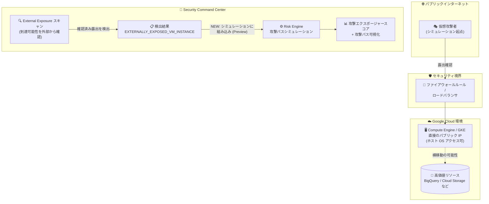

# Security Command Center: Risk Engine 攻撃パスシミュレーションが EXTERNALLY_EXPOSED_VM_INSTANCE 検出カテゴリに対応 (Preview)

**リリース日**: 2026-10-15

**サービス**: Security Command Center

**機能**: Risk Engine 攻撃パスシミュレーションの External Exposure (EXTERNALLY_EXPOSED_VM_INSTANCE) 対応

**ステータス**: Preview

📊 [このアップデートのインフォグラフィックを見る](https://takech9203.github.io/google-cloud-news-summary/20261015-security-command-center-external-exposure-attack-path.html)

## 概要

Security Command Center の Risk Engine による攻撃パスシミュレーションが、External Exposure の検出カテゴリ **EXTERNALLY_EXPOSED_VM_INSTANCE** をサポートしました (Preview)。この検出カテゴリは、ホスト OS へのアクセスを許可する直接のパブリック IP アドレスを持つ Compute Engine または Google Kubernetes Engine (GKE) リソースを特定します。

今回の対応により、攻撃パス分析の精度が向上し、「実際にインターネットから到達可能であることが確認されたエクスポージャー」に基づく攻撃エクスポージャースコア (attack exposure score) が付与されるようになります。これにより、セキュリティ担当者は確認済みのインターネット露出のうち、高価値リソースへの攻撃経路につながるものを優先的に修復できます。

External Exposure は、外部 (インターネット) の視点から Google Cloud 環境をスキャンし、実際に到達可能なリソースを確認する機能です (Preview)。確認済みのエクスポージャーが攻撃パスシミュレーションと統合されることで、理論上の脆弱性ではなく「確認された露出」をベースにしたリスクの優先順位付けが可能になります。対象ユーザーは、Security Command Center Premium または Enterprise ティアを組織レベルで有効化しているセキュリティ運用チームです。

**アップデート前の課題**

- External Exposure の検出結果 (EXTERNALLY_EXPOSED_VM_INSTANCE) は Risk Engine の攻撃パスシミュレーションの対象外であり、確認済みのインターネット露出が攻撃エクスポージャースコアに反映されなかった
- 攻撃パス分析は構成情報やネットワーク関係に基づくモデルが中心で、外部スキャンで実際に到達可能と確認された VM の露出を直接考慮できなかった
- 多数の External Exposure 検出結果の中から、高価値リソースへの攻撃経路につながるものを特定して優先順位付けすることが難しかった

**アップデート後の改善**

- EXTERNALLY_EXPOSED_VM_INSTANCE カテゴリの検出結果が攻撃パスシミュレーションに組み込まれ、攻撃パス分析の精度が向上した
- 確認済みのインターネット露出に対して攻撃エクスポージャースコアが付与され、修復の優先順位付けが容易になった
- 露出した VM から高価値リソース (例: 機密データを持つ BigQuery データセットや Cloud Storage バケット) への横移動 (ラテラルムーブメント) 経路を攻撃パスとして可視化できるようになった

## アーキテクチャ図



External Exposure がインターネット側から到達可能性を確認した VM の検出結果 (EXTERNALLY_EXPOSED_VM_INSTANCE) が、Risk Engine の攻撃パスシミュレーションに組み込まれ、高価値リソースへの攻撃経路とスコアとして可視化される流れを示しています。

## サービスアップデートの詳細

### 主要機能

1. **EXTERNALLY_EXPOSED_VM_INSTANCE カテゴリの攻撃パスシミュレーション対応 (Preview)**
   - ホスト OS アクセスを許可する直接のパブリック IP アドレスを持つ Compute Engine / GKE リソースを特定する検出カテゴリが、Risk Engine のシミュレーション対象に追加された
   - 確認済みの露出が攻撃パスモデルに反映され、攻撃パス分析の精度が向上する

2. **確認済みエクスポージャーへの攻撃エクスポージャースコア付与**
   - 確認済みの露出が横移動経路 (例: 露出したサービスアカウントから機密性の高い BigQuery データベースや Cloud Storage バケットへの到達) につながる場合、検出結果にスコアが付与される
   - スコアにより、高価値リソースに最大のリスクをもたらすエクスポージャーの修復を優先できる

3. **External Exposure による露出の実証ベース検出 (前提機能、Preview)**
   - 外部向け IP アドレス・ホスト名・ドメイン名・URL を継続的にスキャンし、パブリックインターネットから実際に到達可能なリソースを確認する
   - 外部ロードバランサ、Google Cloud Armor ポリシー、ファイアウォールルール、バックエンドサービスから露出リソースまでのネットワークパスをトレースして表示する
   - 露出したサービスやソフトウェアを特定できた場合、それに影響する既知の CVE 脆弱性も検出結果に表示する

## 技術仕様

### EXTERNALLY_EXPOSED_VM_INSTANCE 検出結果の概要

| 項目 | 詳細 |
|------|------|
| 検出クラス (finding_class) | EXTERNAL_EXPOSURE |
| 検出カテゴリ | EXTERNALLY_EXPOSED_VM_INSTANCE |
| 対象リソース | 直接のパブリック IP を持ち、ホスト OS アクセスを許可する Compute Engine インスタンス / GKE リソース |
| ステータス | Preview |
| 必要なティア | Security Command Center Premium または Enterprise |
| 攻撃パスシミュレーションの要件 | 組織レベルでの有効化が必要 (プロジェクトレベルの有効化では利用不可) |
| シミュレーション実行頻度 | 約 6 時間ごと (組織規模により変動、最低 1 日 1 回) |
| スコア対象 | アクティブかつミュートされていない検出結果のみ |

### 検出結果の確認 (gcloud CLI)

```bash
# アクティブな External Exposure クラスの検出結果を一覧表示
gcloud scc findings list projects/PROJECT_ID \
  --location=global \
  --filter="state=\"ACTIVE\" AND finding_class=\"EXTERNAL_EXPOSURE\""
```

## 設定方法

### 前提条件

1. Security Command Center Premium または Enterprise ティアを組織レベルで有効化していること (攻撃パスシミュレーションはプロジェクトレベルの有効化では利用不可)
2. External Exposure 機能 (Preview) を有効化していること
3. 攻撃エクスポージャースコアを自組織の優先度に合わせるため、高価値リソースセット (resource value configuration) を定義していること

### 手順

#### ステップ 1: External Exposure の検出結果を確認する

Google Cloud コンソールで Security Command Center の **[検出結果 (Findings)]** ページを開き、**External Exposure** ビューを選択します。`finding_class` が `EXTERNAL_EXPOSURE` の検出結果のみが表示されます。**[リスクの概要] > [External Exposure]** ダッシュボードからも確認できます (組織・フォルダ・プロジェクトスコープで利用可能)。

#### ステップ 2: 攻撃エクスポージャースコアと攻撃パスを確認する

```text
Google Cloud コンソール → Security Command Center → [アセット] ページ
→ [High value resource set] タブ → 攻撃エクスポージャースコアの降順で表示
→ スコアの数値をクリックして攻撃パスを表示
```

攻撃パス上のノードをクリックすると関連する検出結果へのリンクが表示され、修復方法の詳細を確認できます。EXTERNALLY_EXPOSED_VM_INSTANCE の検出結果にスコアが付与されている場合、確認済みの露出を起点とした経路を優先的に修復します。

## メリット

### ビジネス面

- **リスクベースの優先順位付け**: 理論上の露出ではなく、外部スキャンで到達可能と確認された露出にスコアが付くため、限られたセキュリティリソースを実リスクの高い修復に集中できる
- **攻撃者より先に露出を把握**: 自動スキャナーはインターネット露出アセットを数分で発見しうるため、確認済み露出の優先修復は攻撃の未然防止に直結する

### 技術面

- **攻撃パス分析の精度向上**: 確認済みのインターネット露出がシミュレーションモデルに組み込まれ、攻撃パスとスコアの信頼性が高まる
- **横移動リスクの可視化**: 露出した VM から高価値リソースへの到達経路がグラフとして可視化され、修復ポイント (ファイアウォールルールの制限など) を特定しやすい
- **環境に非侵襲**: シミュレーションは読み取りアクセスのみで構築された仮想モデル上で実行され、本番環境に影響を与えない

## デメリット・制約事項

### 制限事項

- Preview 段階の機能であり、Pre-GA 利用規約が適用される (サポートが限定される場合がある)
- 攻撃パスシミュレーションは Security Command Center Premium / Enterprise の組織レベル有効化が必須で、プロジェクトレベルの有効化では利用できない
- External Exposure をプロジェクトレベルで有効化した場合、ネットワーク露出パスのインサイトは提供されない (組織・フォルダレベルの有効化が必要)
- 検出結果には露出リソースごとに 1 つのネットワークパスのみが報告される。ロードバランサ配下に複数の VM がある場合、検出結果は 1 つの VM インスタンスについてのみ報告される

### 考慮すべき点

- 攻撃エクスポージャースコアはパブリックインターネットを起点とした脅威のみを反映し、内部犯行・ゼロデイ脆弱性・サードパーティインフラ由来の脅威は考慮されない
- スコアが 0 でもリスクがないことを意味しない。また、最新シミュレーション以降に生成された検出結果にはスコアが付かない場合がある
- 正確な優先順位付けには高価値リソースセットの定義が重要。未定義の場合はデフォルト設定が使われ、自組織の優先度を反映しない可能性がある
- Security Command Center Enterprise ティアは 2027 年 5 月 21 日に提供終了が予定されており、該当組織は Premium ティアへ自動移行される

## ユースケース

### ユースケース 1: 確認済み露出 VM の優先修復

**シナリオ**: 多数のプロジェクトを持つ組織で、パブリック IP を持つ VM が散在している。どの露出から修復すべきか判断がつかない。

**実装例**:
```bash
# アクティブな External Exposure 検出結果を確認
gcloud scc findings list organizations/ORGANIZATION_ID \
  --location=global \
  --filter="state=\"ACTIVE\" AND finding_class=\"EXTERNAL_EXPOSURE\""
```

**効果**: EXTERNALLY_EXPOSED_VM_INSTANCE の検出結果に攻撃エクスポージャースコアが付与されるため、高価値リソースへの攻撃経路につながる確認済み露出から順に、ファイアウォールルールの制限やパブリック IP の削除といった修復を実施できる。

### ユースケース 2: 露出 VM から機密データへの横移動リスクの評価

**シナリオ**: ホスト OS アクセスを許可するパブリック IP 付き VM が、機密データを保持する BigQuery データセットや Cloud Storage バケットと同一環境に存在する。

**効果**: 攻撃パスの可視化により、露出 VM を起点として高価値リソースに到達しうる経路 (IAM 権限、ネットワーク関係などの組み合わせ) を特定し、経路上のチョークポイントで対策 (権限の最小化、ネットワーク分離) を講じられる。

## 料金

攻撃エクスポージャースコアと攻撃パスは Security Command Center Premium または Enterprise ティアの機能です。External Exposure も Premium / Enterprise ティアで利用できます。詳細な料金は公式の料金ページを参照してください。

- [Security Command Center の料金](https://cloud.google.com/security-command-center/pricing)

## 関連サービス・機能

- **Compute Engine / Google Kubernetes Engine (GKE)**: 今回の検出カテゴリの対象リソース。直接のパブリック IP によるホスト OS アクセスの露出が検出される
- **External Exposure (SCC)**: 外部視点のスキャンで実際の到達可能性を確認する前提機能。ネットワークパスのトレース、サービスのフィンガープリンティング、CVE 特定を行う
- **Cloud Armor / VPC ファイアウォールルール**: 検出されたネットワークパスに基づき、露出を抑止する予防的な緩和策として利用
- **Event Threat Detection / Container Threat Detection**: 攻撃パスは「可能性」の可視化であり、実際の攻撃の監視には THREAT クラスの検出を行うこれらのサービスを併用する

## 参考リンク

- 📊 [インフォグラフィック](https://takech9203.github.io/google-cloud-news-summary/20261015-security-command-center-external-exposure-attack-path.html)
- [公式リリースノート](https://docs.cloud.google.com/release-notes#October_15_2026)
- [Detect exposed resources (External Exposure)](https://docs.cloud.google.com/security-command-center/docs/detect-external-exposure)
- [Overview of attack exposure scores and attack paths](https://docs.cloud.google.com/security-command-center/docs/attack-exposure-learn)
- [Risk Engine feature support](https://docs.cloud.google.com/security-command-center/docs/attack-exposure-supported-features)
- [料金ページ](https://cloud.google.com/security-command-center/pricing)

## まとめ

Risk Engine の攻撃パスシミュレーションが EXTERNALLY_EXPOSED_VM_INSTANCE カテゴリに対応したことで、外部スキャンにより「確認された」インターネット露出を起点としたリスク評価が可能になり、攻撃パス分析の精度と優先順位付けの実効性が向上しました。Security Command Center Premium / Enterprise を組織レベルで利用している場合は、External Exposure を有効化し、高価値リソースセットを定義したうえで、スコアの高い露出から修復を進めることを推奨します。

---

**タグ**: #SecurityCommandCenter #RiskEngine #ExternalExposure #AttackPath #AttackExposureScore #ComputeEngine #GKE #Preview #セキュリティ
