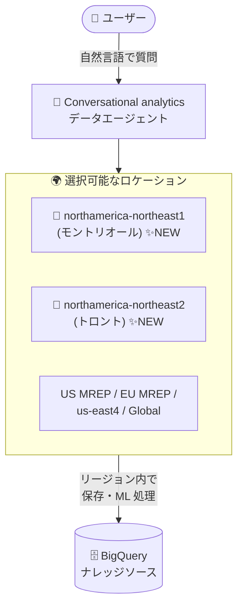

# BigQuery: Conversational analytics (会話型分析) がモントリオール・トロントリージョンで利用可能に

**リリース日**: 2026-10-16

**サービス**: BigQuery

**機能**: Conversational analytics (会話型分析) のロケーション拡大

**ステータス**: Feature (ロケーション拡大)

📊 [このアップデートのインフォグラフィックを見る](https://takech9203.github.io/google-cloud-news-summary/20261016-bigquery-conversational-analytics-locations.html)

## 概要

BigQuery の Conversational analytics (会話型分析) が、新たに **northamerica-northeast1 (モントリオール)** と **northamerica-northeast2 (トロント)** の 2 つのカナダリージョンで利用可能になりました。Conversational analytics は、自然言語でデータに質問できるデータエージェント機能で、テーブルのフィールド名や抽出条件を指定しなくても「売上」「最も人気のある」といった日常的な言葉で複数ステップの質問を行い、テキスト・コード・画像 (マルチモーダル) やグラフを含む回答を得られます。

Conversational analytics におけるロケーションは、エージェントと会話 (conversation) のリソースが保存される場所、および ML 処理が実行される場所を決定します。今回の拡大により、カナダ国内にデータを保持する要件を持つ組織でも、エージェント・会話リソースと ML 処理をカナダリージョン内に収めた形で会話型分析を利用できるようになりました。

**アップデート前の課題**

- Conversational analytics のロケーションとしてカナダリージョンを選択できず、カナダのナレッジソースを使う場合でもエージェント・会話リソースの保存先と ML 処理はグローバルロケーションなどに配置されていた
- データレジデンシー (データ所在地) 要件によりリソースをカナダ国内に収める必要がある組織では、会話型分析の採用が難しかった

**アップデート後の改善**

- northamerica-northeast1 (モントリオール) と northamerica-northeast2 (トロント) をエージェントのロケーションとして利用可能になった
- エージェント・会話リソースの保存と ML 処理をカナダリージョン内で完結でき、データレジデンシー要件を満たしながら会話型分析を利用できるようになった

## アーキテクチャ図

エージェントと会話リソースの保存先および ML 処理の実行場所として、新たに 2 つのカナダリージョンを選択できるようになった構成を示しています。

## サービスアップデートの詳細

### 主要機能

1. **カナダ 2 リージョンへの対応**
   - northamerica-northeast1 (モントリオール) と northamerica-northeast2 (トロント) が Conversational analytics の対応ロケーションに追加
   - ロケーションはエージェント・会話リソースの保存場所と ML 処理の実行場所を決定する

2. **対応ロケーションの一覧 (今回の追加後)**
   - US MREP
   - EU MREP
   - northamerica-northeast1 (モントリオール) ← 今回追加
   - northamerica-northeast2 (トロント) ← 今回追加
   - us-east4 (北バージニア)
   - Global

3. **ロケーションのデフォルト決定ルール**
   - すべてのナレッジソースが同一の対応リージョン (例: us-east4) にある場合はそのリージョンが使用される
   - すべてのナレッジソースが US 内のリージョンにある場合は US MREP、EU 内の場合は EU MREP が使用される
   - それ以外の場合は Global ロケーションが使用される
   - エージェント作成時に別のロケーションを任意に選択できるが、保存後は変更できない

## 技術仕様

### ロケーションに関する仕様

| 項目 | 詳細 |
|------|------|
| ロケーションが決定するもの | エージェント・会話リソースの保存場所、ML 処理の実行場所 |
| ロケーションの指定 | エージェント作成時に選択可能 (保存後は変更不可) |
| 2026 年 6 月 4 日より前に作成されたエージェント | Global ロケーションに配置 |
| ナレッジソース数の上限 | 1 エージェントあたり最大 100 個 |

### セキュリティ関連の仕様

- ユーザーがアクセス権限を持つデータ・リソースのみにアクセス可能
- VPC Service Controls (VPC-SC) に準拠
- 書き込み操作・DML クエリの実行は不可
- 明示的に選択したナレッジソースのみにアクセス
- 会話履歴は本人のみに共有され、他ユーザーとの共有は不可

## メリット

### ビジネス面

- **データレジデンシー要件への対応**: カナダ国内にデータと処理を保持する必要がある組織 (金融、公共、医療など) でも会話型分析を採用しやすくなる
- **データ民主化の推進**: SQL を書けないビジネスユーザーでも自然言語でデータ分析が可能になり、その適用範囲がカナダリージョン利用組織にも広がる

### 技術面

- **リージョン内での処理完結**: エージェント・会話リソースの保存と ML 処理がカナダリージョン内で実行される
- **既存の BigQuery データとの親和性**: カナダリージョンに保存済みの BigQuery データをナレッジソースとして活用できる

## デメリット・制約事項

### 制限事項

- 1 エージェントに追加できるナレッジソースは最大 100 個
- エージェントのロケーションは保存後に変更できない

### 考慮すべき点

- 2026 年 6 月 4 日より前に作成されたエージェントは Global ロケーションに配置されているため、カナダリージョンに配置するには新規にエージェントを作成する必要がある
- クエリ・会話・データ・可視化に関するその他の制限は [Conversational Analytics API known limitations](https://docs.cloud.google.com/gemini/data-agents/conversational-analytics-api/known-limitations) を参照

## ユースケース

### ユースケース 1: カナダのデータレジデンシー要件下での会話型分析

**シナリオ**: カナダの金融機関が、顧客データをカナダ国内 (モントリオール/トロントリージョン) の BigQuery に保持しており、データと処理を国外に出さずにビジネスユーザー向けのセルフサービス分析を提供したい。

**効果**: エージェントのロケーションに northamerica-northeast1 または northamerica-northeast2 を指定することで、エージェント・会話リソースの保存と ML 処理をカナダリージョン内に収めたまま、自然言語でのデータ分析を提供できる。

### ユースケース 2: カナダ 2 リージョンでの可用性を考慮したエージェント配置

**シナリオ**: モントリオールとトロントの両リージョンに BigQuery データセットを配置している組織が、データの所在リージョンに合わせてエージェントを配置したい。

**効果**: 両リージョンがサポートされたことで、ナレッジソースの所在に合わせたエージェント配置が可能になる。

## 料金

Conversational analytics 自体のロケーション追加による追加料金の記載はありません。データエージェントの作成時や、データエージェント・データソースとの会話時に実行されるクエリに対して、BigQuery のコンピューティング料金が課金されます。エージェントの料金詳細は [データエージェントの料金ページ](https://cloud.google.com/products/data-agents/pricing) を参照してください。

なお、プロジェクトレベル・ユーザーレベル・クエリレベルの支出上限を設定してエージェントのコストを管理できます。また、エージェントが実行した BigQuery ジョブには `ca-bq-job`、`data-agent-id`、`conversation-id` などのラベルが付与され、課金レポートのフィルタリングやコスト分析に利用できます。

## 利用可能リージョン

今回の追加後、Conversational analytics は以下のロケーションで利用可能です。

| ロケーション | 備考 |
|--------------|------|
| US MREP | US 内の複数リージョン |
| EU MREP | EU 内の複数リージョン |
| northamerica-northeast1 (モントリオール) | **今回追加** |
| northamerica-northeast2 (トロント) | **今回追加** |
| us-east4 (北バージニア) | |
| Global | 2026 年 6 月 4 日より前に作成されたエージェントのデフォルト |

## 関連サービス・機能

- **Conversational Analytics API**: 会話型分析の基盤となる API。データエージェントや会話の作成・管理を行う
- **BigQuery (データセット/テーブル/ビュー)**: エージェントのナレッジソースとして使用。パーティションや検索インデックスなどの最適化も活用される
- **VPC Service Controls**: 会話型分析は VPC-SC のセキュリティ境界に準拠
- **Cloud Billing (ラベルによるコスト分析)**: エージェントが実行したジョブのラベルを使って課金レポートをフィルタリング可能

## 参考リンク

- 📊 [インフォグラフィック](https://takech9203.github.io/google-cloud-news-summary/20261016-bigquery-conversational-analytics-locations.html)
- [公式リリースノート](https://docs.cloud.google.com/release-notes#October_16_2026)
- [ドキュメント: Conversational analytics in BigQuery](https://docs.cloud.google.com/bigquery/docs/conversational-analytics)
- [Conversational Analytics API の概要](https://docs.cloud.google.com/gemini/docs/conversational-analytics-api/overview)
- [料金ページ (データエージェント)](https://cloud.google.com/products/data-agents/pricing)
- [BigQuery の料金](https://docs.cloud.google.com/bigquery/pricing#analysis_pricing_models)

## まとめ

BigQuery の Conversational analytics がモントリオール・トロントの 2 つのカナダリージョンに対応し、データレジデンシー要件を持つカナダの組織でも自然言語によるデータ分析を利用しやすくなりました。カナダリージョンに BigQuery データを保持している組織は、エージェント作成時にロケーションとしてこれらのリージョンを指定することを検討してください。ロケーションは保存後に変更できない点に注意が必要です。

---

**タグ**: BigQuery, Conversational Analytics, データエージェント, ロケーション拡大, カナダリージョン, データレジデンシー, 生成 AI
