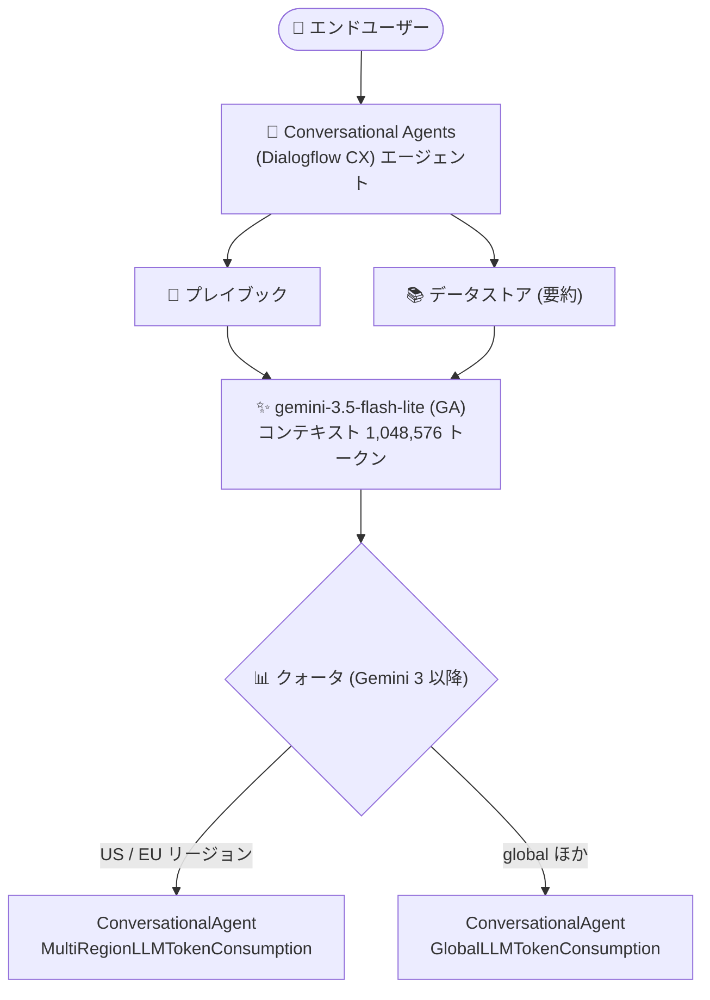

# Dialogflow: gemini-3.5-flash-lite が一般提供 (GA) 開始

**リリース日**: 2026-10-16

**サービス**: Dialogflow (Conversational Agents / Dialogflow CX)

**機能**: gemini-3.5-flash-lite モデルの一般提供 (GA)

**ステータス**: GA (一般提供)

📊 [このアップデートのインフォグラフィックを見る](https://takech9203.github.io/google-cloud-news-summary/20261016-dialogflow-gemini-3-5-flash-lite-ga.html)

## 概要

Dialogflow (Conversational Agents / Dialogflow CX) において、Google の最新コスト効率モデル **gemini-3.5-flash-lite** が一般提供 (GA) になりました。公式ドキュメントのモデルサポート表では、プレイブック (Playbooks) とデータストアの要約モデルの選択肢として gemini-3.5-flash-lite が GA として掲載されています。これにより、本番環境の会話型エージェントで最新の Flash-Lite 系モデルを SLA 対象外の Preview ではなく GA ステータスで利用できます。

Gemini 3.5 Flash-Lite は、Flash-Lite 系列の最新モデルで、シンプルなコーディングタスク、正確なドキュメント理解、低コスト・高速推論が求められる軽量なエージェントワークフロー向けに最適化されています。思考レベル (thinking level) を調整することで、品質・速度・トークン出力のバランスを制御できる点が特徴です。

あわせてリリースノートでは、Gemini 3 以降のモデルで使用される新しいクォータ体系 (Generative quotas) への参照が案内されています。Gemini 3 以降のモデルは、従来のリージョン単位クォータとは異なるマルチリージョン / グローバル単位のクォータを使用するため、クォータ引き上げのリクエスト方法が変わる点に注意が必要です。

**アップデート前の課題**

- Dialogflow の生成系機能で GA ステータスで利用できる最新の Flash-Lite 系モデルは gemini-3.1-flash-lite までで、最新世代の gemini-3.5-flash-lite を本番ワークロードで GA モデルとして選択できなかった
- Gemini 3 以降のモデルのクォータは従来の `ConversationalAgentLlmTokenConsumption` (リージョン単位) とは異なる体系で管理され、Google Cloud コンソールに該当のディメンション付きクォータが表示されない場合はクォータ引き上げの申請方法がわかりにくかった

**アップデート後の改善**

- gemini-3.5-flash-lite がプレイブック、データストア要約などのモデル選択肢として GA になり、本番環境の会話型エージェントで利用可能になった
- 最大 1,048,576 トークンのコンテキストウィンドウと最大 65,536 トークンの出力を持つ最新の Flash-Lite モデルを、低コスト・低レイテンシが求められる会話ワークロードに適用できるようになった
- Gemini 3 以降のモデル向けクォータ (`ConversationalAgentMultiRegionLLMTokenConsumption` / `ConversationalAgentGlobalLLMTokenConsumption`) の引き上げリクエスト手順 (gcloud コマンド) が公式ドキュメントで案内された

## アーキテクチャ図



Dialogflow CX エージェントのプレイブックやデータストア要約で gemini-3.5-flash-lite を選択できるようになり、トークン消費は Gemini 3 以降専用のマルチリージョン / グローバルクォータで管理されます。

## サービスアップデートの詳細

### 主要機能

1. **gemini-3.5-flash-lite の GA 提供**
   - プレイブックのモデルサポート表に GA として掲載 (gemini-2.5-flash、gemini-2.5-flash-lite、gemini-3.1-flash-lite と並ぶ選択肢)
   - データストアの要約モデル (summarization model) の選択肢としても GA として掲載
   - エージェントレベル (Agent settings → Generative AI → Playbook) またはリクエストレベル (`DetectIntentRequest.query_params.llm_model_settings.model`) でモデルを選択可能

2. **コスト効率と速度に最適化されたモデル特性**
   - Gemini 3.5 Flash-Lite は Flash-Lite 系列の最新モデルで、高スループットの分類・ルーティング・抽出タスクや軽量なエージェントワークフロー向け
   - 思考レベル (thinking level) を MINIMAL / LOW / MEDIUM / HIGH から選択でき、デフォルトは MINIMAL (速度・コスト効率を優先)
   - Gemini 2.5 Flash や複雑度の低い Gemini 3 Flash ワークロードの移行先として位置付けられている

3. **Gemini 3 以降のモデル向けクォータ体系**
   - 生成系機能 (Generators、Generative fallback、Playbook、Data store) の LLM トークン消費はデフォルト 600,000 トークン/分
   - Gemini 3 以降のモデルは、米国内リージョンは `multi_region=us`、欧州リージョンは `multi_region=eu` の `ConversationalAgentMultiRegionLLMTokenConsumption` クォータ、その他 (global 含む) は `ConversationalAgentGlobalLLMTokenConsumption` クォータを使用
   - コンソールにディメンション付きクォータが表示されない場合は、`gcloud beta quotas preferences create` コマンドで引き上げをリクエスト可能

## 技術仕様

### gemini-3.5-flash-lite モデル仕様

| 項目 | 詳細 |
|------|------|
| コンテキストウィンドウ | 1,048,576 トークン |
| 最大出力トークン | 65,536 トークン |
| 思考 (Thinking) | サポート (デフォルトは minimal) |
| 構造化出力 / システム指示 | サポート |
| コンテキストキャッシュ | 暗黙的・明示的の両方をサポート |
| Function calling / コード実行 | サポート |
| チューニング | 非サポート |
| モデル提供リージョン | global、us (マルチリージョン)、eu (マルチリージョン)、asia-south1 |
| GA 日 / 廃止予定日 (モデル自体) | 2026 年 7 月 21 日 GA / 2027 年 7 月 21 日以降に廃止予定 |

**注意 (破壊的変更の可能性)**: gemini-3.5-flash-lite では temperature、top-K、top-P のカスタム値はサポートされず無視されます。frequency penalty / presence penalty のカスタム値を設定するとエラーになります。

### Dialogflow 生成系機能のクォータ

| クォータ | 対象 | デフォルト |
|------|------|------|
| `ConversationalAgentLlmTokenConsumption` (リージョン単位) | Gemini 2.5 系モデル | 600,000 トークン/分 |
| `ConversationalAgentMultiRegionLLMTokenConsumption` (multi_region=us / eu) | Gemini 3 以降 (米国・欧州リージョン) | 600,000 トークン/分 |
| `ConversationalAgentGlobalLLMTokenConsumption` | Gemini 3 以降 (global 含むその他リージョン) | 600,000 トークン/分 |

## 設定方法

### 前提条件

1. Dialogflow CX (Conversational Agents) のエージェントが作成済みであること
2. プレイブック、データストア、ジェネレーターなどの生成系機能を使用していること

### 手順

#### ステップ 1: モデルの選択

[Conversational Agents コンソール](https://conversational-agents.cloud.google.com/projects) で、**Agent settings → Generative AI → Playbook** からモデル一覧の表示名で gemini-3.5-flash-lite を選択します。API の場合は `GenerativeSettings.llm_model_settings.model` フィールドにモデル名を指定します。データストアの要約モデルは、データストア設定の要約モデル選択で gemini-3.5-flash-lite を選択します。

#### ステップ 2: クォータの確認・引き上げリクエスト (必要な場合)

Gemini 3 以降のモデル用のディメンション付きクォータがコンソールに表示されない場合は、以下の gcloud コマンドで引き上げをリクエストできます。

```bash
PROJECT_ID=your-project
TARGET_TPM=1000000
MULTI_REGION=us
BASE_MODEL=gemini-3.5-flash-lite
USER_EMAIL=user@example.com
REASON="Reason for requesting higher multi-region token per minute limit"

gcloud beta quotas preferences create \
  --service=dialogflow.googleapis.com \
  --project="${PROJECT_ID}" \
  --billing-project="${PROJECT_ID}" \
  --quota-id=ConversationalAgentMultiRegionLLMTokensPerMinutePerBaseModel \
  --preferred-value=${TARGET_TPM} \
  --dimensions=multi_region=${MULTI_REGION},base_model=${BASE_MODEL} \
  --email="${USER_EMAIL}" \
  --justification="${REASON}"
```

#### ステップ 3: トークン使用量のモニタリング

Cloud Monitoring の Metrics Explorer で「Conversational Agent LLM tokens quota usage」メトリクスを選択し、`location` と `base_model` ディメンションで集計することで、リージョン・モデル別のトークン消費を可視化できます。

## メリット

### ビジネス面

- **運用コストの最適化**: Flash-Lite 系列はコスト効率を重視したモデルラインであり、大量の会話トラフィックを処理するコンタクトセンターやチャットボットの LLM コストを抑えられる
- **本番利用の安心感**: GA ステータスとなったことで、本番ワークロードでの採用判断がしやすくなった

### 技術面

- **低レイテンシ**: デフォルトの minimal thinking により、分類・ルーティング・抽出といった高スループットタスクで高速な応答が期待できる
- **大規模コンテキスト**: 1,048,576 トークンのコンテキストウィンドウにより、長い会話履歴や大量の参照情報を扱える
- **柔軟な品質調整**: 思考レベル (MINIMAL / LOW / MEDIUM / HIGH) により、タスクの複雑さに応じて品質と速度のバランスを調整できる

## デメリット・制約事項

### 制限事項

- temperature、top-K、top-P のカスタム値はサポートされない (設定しても無視される)
- frequency penalty / presence penalty のカスタム値を設定するとエラーになる
- モデルのチューニング (fine-tuning) は非サポート
- 最後の入力ターンのロールが Model であるリクエストはサポートされない

### 考慮すべき点

- Gemini 3 以降のモデルはクォータ体系が Gemini 2.5 系と異なるため、既存のクォータ引き上げ設定がそのまま引き継がれない点に注意が必要
- 複数ステップのツール呼び出しを行うエージェント用途では、minimal thinking のままだとツール実行が途中で終了する可能性があるため、thinking level を medium 以上に設定することが推奨されている
- モデルの既定パラメータ挙動が従来モデルと異なるため、既存エージェントの移行時は十分なテストが必要

## ユースケース

### ユースケース 1: 高トラフィックなカスタマーサポートボットのコスト最適化

**シナリオ**: EC サイトのカスタマーサポートで、FAQ 応答やデータストアに基づく回答の要約を行うエージェントを運用しており、月間数百万ターンの会話を処理している。

**実装例**: データストアの要約モデルを gemini-3.5-flash-lite に変更し、minimal thinking で高速・低コストに要約を生成する。

**効果**: 最新世代モデルの品質を維持しながら、低レイテンシでの応答とコスト効率の向上が期待できる。

### ユースケース 2: 意図分類・ルーティング用プレイブックの高速化

**シナリオ**: 問い合わせ内容を分類して適切なフローやプレイブックへルーティングする前段処理を LLM で行っている。

**効果**: gemini-3.5-flash-lite は高スループットの分類・ルーティングタスクに適しており、minimal thinking により応答速度を優先した処理が可能。

## 料金

Dialogflow CX の生成系機能の利用料金は Dialogflow の料金体系に従います。また、Gemini 3.5 Flash-Lite 自体の料金は生成 AI の料金ページで確認できます。最新の料金は以下の公式ページを参照してください。

- [Dialogflow 料金ページ](https://cloud.google.com/dialogflow/pricing)
- [生成 AI (Gemini) 料金ページ](https://cloud.google.com/gemini-enterprise-agent-platform/generative-ai/pricing)

## 利用可能リージョン

gemini-3.5-flash-lite モデル自体の提供リージョンは以下のとおりです (モデルドキュメントより)。

- global
- us (マルチリージョン)
- eu (マルチリージョン)
- asia-south1

Dialogflow のプレイブックは global、us / eu マルチリージョン、us-central1、europe-west1、asia-northeast1 など多数のリージョンでサポートされています。詳細は [プレイブックのリージョンサポート](https://docs.cloud.google.com/dialogflow/cx/docs/concept/playbook) を参照してください。

## 関連サービス・機能

- **Vertex AI / Gemini Enterprise Agent Platform**: gemini-3.5-flash-lite モデルの提供基盤。モデル仕様・ライフサイクルはこちらで管理される
- **Cloud Monitoring (Metrics Explorer)**: LLM トークン消費量をリージョン・モデル別に可視化し、クォータ管理に活用できる
- **Cloud Quotas (gcloud beta quotas)**: Gemini 3 以降のモデル向けクォータ引き上げリクエストに使用

## 参考リンク

- 📊 [インフォグラフィック](https://takech9203.github.io/google-cloud-news-summary/20261016-dialogflow-gemini-3-5-flash-lite-ga.html)
- [公式リリースノート](https://docs.cloud.google.com/release-notes#October_16_2026)
- [Dialogflow のクォータと上限 (Generative quotas)](https://docs.cloud.google.com/dialogflow/quotas)
- [プレイブックのモデルサポート](https://docs.cloud.google.com/dialogflow/cx/docs/concept/playbook)
- [データストアの要約モデル設定](https://docs.cloud.google.com/dialogflow/cx/docs/concept/data-store/settings)
- [Gemini 3.5 Flash-Lite モデルドキュメント](https://docs.cloud.google.com/gemini-enterprise-agent-platform/models/gemini/3-5-flash-lite)
- [Dialogflow 料金ページ](https://cloud.google.com/dialogflow/pricing)

## まとめ

Dialogflow の生成系機能 (プレイブック、データストア要約など) で最新のコスト効率モデル gemini-3.5-flash-lite が GA となり、本番環境で安心して採用できるようになりました。Gemini 3 以降のモデルはクォータ体系がマルチリージョン / グローバル単位に変わるため、本番導入前にクォータの確認と必要に応じた引き上げリクエストを行い、パラメータ挙動の変更点 (temperature 等のカスタム値非サポート) を踏まえた動作検証を実施することを推奨します。

---

**タグ**: #Dialogflow #ConversationalAgents #Gemini #GenerativeAI #GA #LLM #Chatbot
