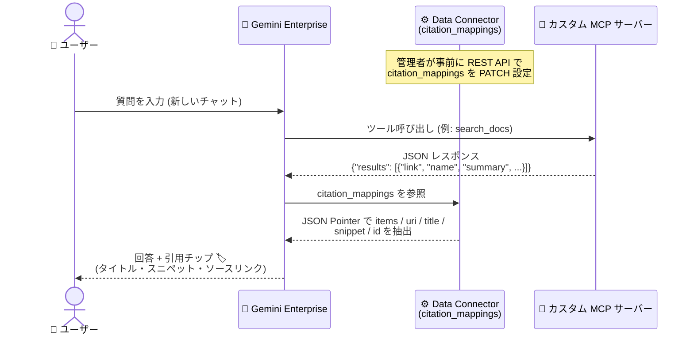

# Gemini Enterprise: カスタム MCP データストア向け引用 (Citation) 設定が GA

**リリース日**: 2026-10-16

**サービス**: Gemini Enterprise

**機能**: カスタム Model Context Protocol (MCP) データストア向け引用マッピング (`citation_mappings`)

**ステータス**: GA (一般提供)

📊 [このアップデートのインフォグラフィックを見る](https://takech9203.github.io/google-cloud-news-summary/20261016-gemini-enterprise-mcp-citation-mappings.html)

## 概要

Gemini Enterprise で、カスタム Model Context Protocol (MCP) データストア向けの引用 (citation) 設定が GA (一般提供) になりました。REST API 経由で `citation_mappings` パラメータをカスタム MCP データストアに設定することで、Gemini Enterprise がカスタム MCP サーバー上のツールを使って質問に回答する際に、ソース引用チップ (citation chips) を表示できるようになります。

引用チップとは、回答内の主張をソースドキュメントにリンクする小さなカードです。各 MCP サーバーは独自の JSON 構造で結果を返すため、`citation_mappings` では RFC 6901 標準の JSON Pointer を使って、各ツールのレスポンスのどこにリンク (`uri`)、タイトル (`title`)、スニペット (`snippet`)、ID (`id`) が格納されているかを指定します。設定は Discovery Engine v1 REST API (`updateDataConnector`) 経由でのみ可能で、Google Cloud コンソールでは利用できません。

社内ナレッジベースや独自システムをカスタム MCP サーバー経由で Gemini Enterprise に接続している企業にとって、AI 回答の根拠 (ソース) をユーザーに明示できるようになる重要なアップデートです。回答の信頼性・検証可能性を高めたい管理者 (Discovery Engine Editor / Gemini Enterprise Admin ロール保持者) が対象です。

**アップデート前の課題**

- カスタム MCP サーバーのツールを使った回答では、各 MCP サーバーが独自の JSON 構造で結果を返すため、Gemini Enterprise がどのフィールドをソース情報として扱うべきか明示的に指定する標準的な方法がなかった
- 回答の根拠となるソースドキュメントへのリンクをユーザーが確認しにくく、AI 回答の検証可能性に課題があった
- モデルが指示に基づいて回答テキスト内に生成するインライン Markdown リンクは、構造化されたソース引用 UI とは別物であり、一貫した引用表示を保証できなかった

**アップデート後の改善**

- `citation_mappings` パラメータにより、ツールごとに JSON Pointer でレスポンス構造を宣言し、引用チップに表示するリンク・タイトル・スニペット・ID を正確にマッピングできるようになった
- カスタム MCP サーバー上のツールを使った回答に、ソースへリンクする引用チップが表示され、回答の根拠をワンクリックで確認できるようになった
- デフォルトエントリ (`""`) により、同じレスポンス形式を持つ複数ツールへの一括マッピングと、ツール単位でのロール別オーバーライドが可能になった

## アーキテクチャ図



管理者が REST API で設定した `citation_mappings` に基づき、Gemini Enterprise がカスタム MCP ツールの JSON レスポンスから引用フィールドを抽出し、回答に引用チップを表示するフローです。

## サービスアップデートの詳細

### 主要機能

1. **ツールごとの引用フィールドマッピング**
   - `citation_mappings` は JSON オブジェクトで、各キーが MCP ツール名 (bare name、例: `search_docs`)、値が「引用ロール → JSON Pointer」のマッピング
   - 各ツールのレスポンス内の結果リスト (`items`) と、各結果アイテム内のリンク (`uri`)、タイトル (`title`)、スニペット (`snippet`)、ID (`id`) の位置を RFC 6901 JSON Pointer で指定

2. **デフォルトエントリとオーバーライド**
   - 空キー (`""`) でコネクタ上の全ツールに適用されるデフォルトマッピングを定義可能
   - 名前付きツールエントリはデフォルトエントリをロール単位でオーバーライド (例: `uri` のみ上書きし、他のロールはデフォルトを継承)
   - 最大 101 エントリ (名前付きツール 100 + デフォルトエントリ 1) をサポート

3. **自動フォールバック**
   - `items` を省略した場合、`results`、`items`、`documents`、`content` などの一般的なフィールド名からリストを自動検出
   - `snippet` を省略した場合、`snippet`、`text`、`description`、`summary` などから自動選択
   - マッピングが機能しない場合 (items が一致しない、uri を持つアイテムがないなど) は、Gemini Enterprise の自動レスポンス処理にフォールバック

## 技術仕様

### 引用ロールの仕様

| ロール | 指す対象 | 評価基準 | 省略時の動作 |
|------|------|------|------|
| `items` | 結果のリスト | ツールレスポンスのルート | 一般的なフィールド名 (`results`、`items`、`documents`、`content` など) から自動検出 |
| `uri` | 引用チップが開くリンク | 各アイテム | **必須**。各対象ツールはツールエントリまたはデフォルトエントリ経由で `uri` を提供する必要あり |
| `title` | 引用チップに表示されるタイトル | 各アイテム | `Untitled` と表示 |
| `snippet` | 引用チップに表示される短いテキスト | 各アイテム | 一般的なフィールド (`snippet`、`text`、`description`、`summary` など) から自動選択 |
| `id` | ソースの安定した ID | 各アイテム | `uri` の値が ID として使用される |

### JSON Pointer の評価ルール

| 項目 | 詳細 |
|------|------|
| 標準 | RFC 6901 準拠。空でないポインタは `/` で開始、最大 512 文字 |
| 空ポインタ (`""`) | JSON ドキュメント全体 (またはアイテム全体) を指す。レスポンス自体がリスト / 単一オブジェクトの場合に使用 |
| 配列インデックス | 非負整数で 0 始まりの位置を指定 (例: `/links/0/href`) |
| エスケープ | フィールド名内の `/` は `~1`、`~` は `~0` でエスケープ (例: `a/b` → `/a~1b`) |
| マッチング | 完全一致・大文字小文字を区別。`snippet` 以外はポインタ不一致時に他フィールドを推測しない |
| 単一オブジェクト | `items` がリストではなくオブジェクトに解決された場合、単一の結果アイテムとして扱う |
| text ブロック内 JSON | `{"content": [{"type": "text", "text": "..."}]}` 形式の場合、デコード後の JSON に対してポインタを記述。非構造化プレーンテキストには適用不可 |
| structuredContent | 構造化コンテンツの場合、トップレベルの MCP result オブジェクトからポインタを記述 (例: `/structuredContent/results`) |

### `citation_mappings` の設定例

ツール `search_docs` が以下の JSON を返す場合:

```json
{
  "results": [
    {
      "doc_id": "kb-1042",
      "name": "Expense policy 2026",
      "link": "https://intranet.cymbal.com/kb/1234",
      "summary": "Meals are reimbursed up to 60 USD per day."
    }
  ]
}
```

次のように設定します:

```json
{
  "search_docs": {
    "items": "/results",
    "uri": "/link",
    "title": "/name",
    "snippet": "/summary",
    "id": "/doc_id"
  }
}
```

複数ツールが同じ形式の場合は、デフォルトエントリ (`""`) とロール単位のオーバーライドが使えます:

```json
{
  "": { "items": "/results", "uri": "/link", "title": "/name" },
  "get_doc": { "items": "" }
}
```

## 設定方法

### 前提条件

1. カスタム MCP サーバーのデータストアを作成し、アクション (ツール) を有効化していること
2. **Discovery Engine Editor** または **Gemini Enterprise Admin** ロールを保有していること
3. カスタム MCP データストアのコレクション ID (`COLLECTION_ID`) を取得していること (データストア ID から `_mcp_data` サフィックスを除いたもの)

### 手順

#### ステップ 1: citation_mappings を設定 (PATCH)

`updateDataConnector` メソッドを `updateMask=action_config.action_params` 付きで呼び出します。

```bash
curl -X PATCH \
  -H "Authorization: Bearer $(gcloud auth print-access-token)" \
  -H "Content-Type: application/json" \
  -H "X-Goog-User-Project: PROJECT_ID" \
  "https://ENDPOINT/v1/projects/PROJECT_NUMBER/locations/LOCATION/collections/COLLECTION_ID/dataConnector?updateMask=action_config.action_params" \
  -d '{
    "actionConfig": {
      "actionParams": {
        "citation_mappings": {
          "search_docs": {
            "items": "/results",
            "uri": "/link",
            "title": "/name"
          }
        }
      }
    }
  }'
```

`ENDPOINT` はデータストアのロケーションに応じて `discoveryengine.googleapis.com` (global)、`us-discoveryengine.googleapis.com` (us)、`eu-discoveryengine.googleapis.com` (eu) を指定します。

#### ステップ 2: 設定を確認 (GET)

`getDataConnector` メソッドで現在のマッピングを確認します。

```bash
curl -X GET \
  -H "Authorization: Bearer $(gcloud auth print-access-token)" \
  -H "X-Goog-User-Project: PROJECT_ID" \
  "https://ENDPOINT/v1/projects/PROJECT_NUMBER/locations/LOCATION/collections/COLLECTION_ID/dataConnector"
```

レスポンスの `actionConfig.actionParams.citation_mappings` に設定が表示されます。

#### ステップ 3: 動作確認

1. Gemini Enterprise で **新しいチャット** を開始する (既存のチャットは開始時のコネクタ設定を保持するため)
2. マッピングしたツールが呼び出される質問をする
3. 「Show thinking」などのツール実行インジケーターでツール呼び出しを確認する
4. 回答に期待どおりのタイトル・スニペット・リンクを持つ引用チップが表示されることを確認する

マッピングをすべて削除する場合は、`"citation_mappings": {}` を PATCH で送信します。

## メリット

### ビジネス面

- **回答の信頼性向上**: AI 回答の根拠となる社内ドキュメントへのリンクが引用チップとして明示され、ユーザーが回答を検証しやすくなる
- **カスタムデータソースの活用促進**: 独自システムを MCP 経由で接続した場合でも、Google 製コネクタと同様の引用体験を提供でき、エンタープライズでの AI 回答への信頼を高められる

### 技術面

- **柔軟なレスポンス対応**: RFC 6901 JSON Pointer により、任意の JSON 構造を持つ MCP ツールレスポンスに対応できる
- **運用負荷の軽減**: デフォルトエントリ (`""`) により、同一形式のツール群を 1 つのマッピングでカバーでき、ツール単位の個別調整も可能
- **安全なフォールバック**: マッピングが機能しない場合は自動レスポンス処理にフォールバックするため、設定ミスが回答生成自体を妨げない

## デメリット・制約事項

### 制限事項

- `citation_mappings` は **v1 REST API のみ** で設定可能。Google Cloud コンソールでは利用できない
- マッピングエントリは最大 101 (名前付きツール 100 + デフォルトエントリ 1)、JSON Pointer は最大 512 文字
- ツールが非構造化プレーンテキスト (生の Markdown や自由形式文字列) を返す場合、JSON Pointer で評価できず引用チップは抽出されない
- モデルが自身の知識から回答しツールを呼び出さなかった場合、引用チップは表示されない
- データストアを削除して再作成した場合、マッピングは引き継がれず再設定が必要

### 考慮すべき点

- **更新はマッピング全体の置換**: `citation_mappings` の送信は既存の全ツールエントリを上書きする。1 ツールだけ変更する場合も、保持したい全エントリを含めて送信する必要がある (GET で既存の `citation_mappings` ブロックのみコピーして編集するのが安全)
- **OAuth コネクタの注意点**: GET レスポンスの `actionParams` 全体を PATCH に流用しない。GET は `client_id` を返さないため、そのまま送信すると `Connector params must contain client_id` エラーで失敗する。`actionParams` には `citation_mappings` のみ含める
- **updateMask は狭く指定**: `updateMask=action_config.action_params` を使用する。`updateMask=action_config` も受理されるが、リクエストに含まれない他の `actionConfig` フィールドを書き換えてしまう
- **変更は新しいチャットから適用**: 既存のチャットは開始時のコネクタ設定を保持するため、テストは必ず新しいチャットで行う
- アイテム用ポインタ (`uri` など) は `items` で選択された **各アイテムからの相対パス** で記述する (`/results/0/link` ではなく `/link`)。ツール名は MCP サーバーが宣言する bare name を使い、サーバー名やコネクタ名のプレフィックスを付けない
- 不正なマッピングは `400 INVALID_ARGUMENT` で拒否される。エラーメッセージが問題のツールとロールを特定するため、トラブルシューティングガイドを参照する

## ユースケース

### ユースケース 1: 社内ナレッジベース検索の回答に引用を表示

**シナリオ**: 社内イントラネットのナレッジベースをカスタム MCP サーバー (`search_docs` ツール) 経由で Gemini Enterprise に接続している。従業員が経費精算ポリシーについて質問した際、回答の根拠となる KB 記事へのリンクを表示したい。

**実装例**:
```json
{
  "search_docs": {
    "items": "/results",
    "uri": "/link",
    "title": "/name",
    "snippet": "/summary",
    "id": "/doc_id"
  }
}
```

**効果**: 回答に「Expense policy 2026」のようなタイトル付き引用チップが表示され、クリックすると KB 記事 (例: `https://intranet.cymbal.com/kb/1234`) に遷移できる。従業員は回答の根拠を即座に確認できる。

### ユースケース 2: 同一形式の複数ツールへの一括マッピング

**シナリオ**: カスタム MCP サーバーが検索系ツールを多数公開しており、ほとんどが `/results` 配下に `/link`・`/name` を持つ共通形式でレスポンスを返す。ただし `get_doc` ツールだけは単一ドキュメントオブジェクトを返す。

**実装例**:
```json
{
  "": { "items": "/results", "uri": "/link", "title": "/name" },
  "get_doc": { "items": "" }
}
```

**効果**: デフォルトエントリで全ツールを一括カバーしつつ、`get_doc` のみ `items` をオーバーライドして単一オブジェクト形式に対応。ツールが増えてもマッピングの保守コストを最小化できる。

## 料金

今回の `citation_mappings` 機能自体に対する追加料金の記載はリリースノート・ドキュメントにありません。Gemini Enterprise はエディションベースのライセンス体系です。詳細は以下を参照してください。

- [Gemini Enterprise エディション比較](https://docs.cloud.google.com/gemini/enterprise/docs/editions)

## 利用可能リージョン

カスタム MCP データストアのロケーションとして **global、us (マルチリージョン)、eu (マルチリージョン)** がサポートされ、それぞれ `discoveryengine.googleapis.com`、`us-discoveryengine.googleapis.com`、`eu-discoveryengine.googleapis.com` のエンドポイントを使用します。

## 関連サービス・機能

- **カスタム MCP サーバーデータストア**: 本機能の前提となるデータストア。独自の MCP サーバーを Gemini Enterprise に接続し、ツール (アクション) を利用可能にする
- **Discovery Engine API (v1)**: `citation_mappings` の設定・取得に使用する `updateDataConnector` / `getDataConnector` メソッドを提供
- **Agent Registry**: MCP サーバーのインポート・ガバナンスに利用できる関連機能
- **組織ポリシー (Custom MCP data stores 制約)**: カスタム MCP データストアの利用を組織ポリシーで制御可能

## 参考リンク

- 📊 [インフォグラフィック](https://takech9203.github.io/google-cloud-news-summary/20261016-gemini-enterprise-mcp-citation-mappings.html)
- [公式リリースノート](https://docs.cloud.google.com/release-notes#October_16_2026)
- [Configure citations for custom MCP data stores](https://docs.cloud.google.com/gemini/enterprise/docs/connectors/custom-mcp-server/configure-citations-for-custom-mcp-data-stores)
- [Set up your custom MCP server data store](https://docs.cloud.google.com/gemini/enterprise/docs/connectors/custom-mcp-server/set-up-custom-mcp-server)
- [updateDataConnector REST リファレンス](https://docs.cloud.google.com/gemini/enterprise/docs/connectors/custom-mcp-server/reference/rest/v1/projects.locations.collections/updateDataConnector)
- [Gemini Enterprise アクセス制御](https://docs.cloud.google.com/gemini/enterprise/docs/access-control)

## まとめ

カスタム MCP データストア向けの `citation_mappings` が GA となり、独自の MCP サーバーを接続した Gemini Enterprise 環境でも、回答の根拠をソース引用チップとしてユーザーに明示できるようになりました。カスタム MCP サーバーを運用中の管理者は、まず主要な検索系ツールのレスポンス形式を確認し、`uri` と `title` のマッピングから設定を始めることを推奨します。更新時はマッピング全体が置換される点と、変更が新しいチャットからのみ適用される点に注意してください。

---

**タグ**: Gemini Enterprise, MCP, Model Context Protocol, Citation, Discovery Engine, REST API, GA, データストア, 引用
