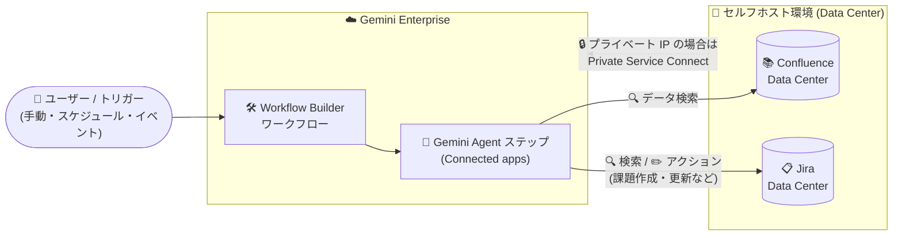

# Gemini Enterprise: Workflow Builder のワークフローが Confluence Data Center / Jira Data Center に接続可能に

**リリース日**: 2026-10-16

**サービス**: Gemini Enterprise

**機能**: Workflow Builder の Confluence Data Center / Jira Data Center 連携

**ステータス**: Feature (新機能)

📊 [このアップデートのインフォグラフィックを見る](https://takech9203.github.io/google-cloud-news-summary/20261016-gemini-enterprise-workflow-builder-confluence-jira.html)

## 概要

Gemini Enterprise の Workflow Builder で作成するワークフローを、**Confluence Data Center** および **Jira Data Center** に接続できるようになりました。これにより、Atlassian のセルフホスト版 (Data Center 版) 製品に対して、ワークフローからデータの検索やアクションの自動化が可能になります。

Workflow Builder は、Gemini Enterprise Web アプリ内でワークフロー型エージェントを構築する機能です。設定したトリガーに基づいて一連のステップやアクションを実行するエージェントを、自然言語やビジュアルエディタで作成できます。これまでワークフローがサポートするコネクタには Gmail、Google Drive、Confluence (Cloud)、Jira (Cloud)、Slack、Salesforce などがありましたが、今回のアップデートで Atlassian 製品のセルフホスト版である Confluence Data Center と Jira Data Center が加わりました。

Atlassian 製品をオンプレミスや自社管理環境 (Data Center 版) で運用している企業にとって、Gemini Enterprise のワークフロー自動化を既存のナレッジベース (Confluence) や課題管理 (Jira) と直接統合できるようになる点が大きな価値です。

**アップデート前の課題**

- Workflow Builder のワークフローから接続できる Atlassian 製品はクラウド版 (Confluence / Jira) が中心であり、セルフホスト版の Confluence Data Center / Jira Data Center をワークフローのステップやツールとして利用できなかった
- Data Center 版を利用する企業は、Gemini Enterprise での検索 (データストア経由) は可能でも、ワークフローによる横断的な自動化に組み込むことができなかった

**アップデート後の改善**

- ワークフローの Gemini Agent ステップから Confluence Data Center / Jira Data Center のデータを検索できるようになった
- Jira Data Center に対する課題の作成・更新・ステータス変更・コメント追加などのアクションをワークフローから自動化できるようになった
- Google Workspace 系コネクタ (Gmail、Google Drive など) と Atlassian Data Center 版を 1 つのワークフロー内で組み合わせた業務自動化が可能になった

## アーキテクチャ図



Workflow Builder で作成したワークフローのトリガー (手動・スケジュール・イベント) により Gemini Agent ステップが実行され、コネクタ経由で Confluence Data Center / Jira Data Center のデータ検索とアクション実行を行う構成です。プライベート IP のインスタンスには Private Service Connect で接続します。

## サービスアップデートの詳細

### 主要機能

1. **ワークフローからの Confluence Data Center / Jira Data Center 接続**
   - Workflow Builder のワークフロー (Gemini Agent ステップの Connected apps) に Confluence Data Center と Jira Data Center をコネクタとして追加可能
   - ワークフローがサポートするコネクタ一覧 (Gmail、Google Calendar、Google Chat、Google Drive、Confluence、Jira、Microsoft Teams、Notion、OneDrive、Outlook、Salesforce、SharePoint、ServiceNow、Slack) に両コネクタが追加された

2. **データ検索 (Federated Search)**
   - ワークフローのエージェントステップから Confluence Data Center のページコンテンツ・添付ファイル・コメント、Jira Data Center のプロジェクト・課題・ユーザー情報を検索可能
   - クエリは Jira / Confluence Data Center の API に直接送信され、他の接続済みデータソースの結果とブレンドして表示される

3. **アクションの自動化**
   - Jira Data Center: 課題の作成 (Create issue)、課題の更新 (Update issue)、ステータス変更 (Change Issue Status)、コメント作成・更新、添付ファイルのアップロード・ダウンロードが可能
   - Confluence Data Center: ページへの添付ファイルのアップロード・ダウンロードが可能
   - Gemini Agent ステップでは、コネクタごとに検索アクションとデータ変更アクションを個別に有効化/無効化でき、「検索のみ許可し、作成・変更は禁止」といった粒度の細かい制御が可能

## 技術仕様

### コネクタの仕様

| 項目 | Confluence Data Center | Jira Data Center |
|------|------------------------|------------------|
| サポートバージョン | 7.19.0 以降 | 9.4.8 以降 |
| 接続モード | Federated search and actions (GA) / Data ingestion (Private Preview) | Federated search and actions (GA) / Data ingestion (Private Preview) |
| 認証 (Federated search) | OAuth 2.0 (クライアント ID / クライアントシークレット) | OAuth 2.0 (クライアント ID / クライアントシークレット) |
| 必要スコープ (検索・アクション) | WRITE | WRITE |
| 添付ファイルサイズ上限 | 200 MB | 200 MB |
| データストアのロケーション | Global、US、EU | Global、US、EU |
| プライベート接続 | Private Service Connect | Private Service Connect |

### ワークフローのトリガー

| トリガー | 説明 |
|------|------|
| 手動トリガー | Gemini Enterprise アプリのチャットから `@` + ワークフロー名で起動。入力フィールドの定義も可能 |
| スケジュールトリガー | 分・時間・日・週・月単位、または cron 式で指定した頻度で実行 |
| イベントトリガー | コネクタ内のデータ変更をきっかけに実行 (フィルタ条件を設定可能) |

## 設定方法

### 前提条件

1. Gemini Enterprise 管理者がアプリの機能管理設定で Workflow Builder の機能トグルを有効化していること
2. 必要なデータストアが接続された Gemini Enterprise Web アプリがあること
3. データストア作成ユーザーに Discovery Engine 編集者ロール (`roles/discoveryengine.editor`) が付与されていること
4. Confluence Data Center / Jira Data Center 側で OAuth アプリを登録し、クライアント ID とクライアントシークレットを取得していること (シークレットは Secret Manager に保存)
5. インスタンスがプライベート IP の場合、Private Service Connect のプロデューサーサービスを公開していること

### 手順

#### ステップ 1: データストアの作成

Google Cloud コンソールの Gemini Enterprise ページで、**Data stores** > **Create data store** から「Confluence Data Center」または「Jira Data Center」を選択し、接続モード (Federated search)、インスタンス URI、OAuth 認証情報、宛先タイプ (Public / Private) を設定してデータストアを作成します。Federated search を選択した場合は、有効化するアクションもこの時点で選択できます。

#### ステップ 2: アプリへの接続と認可

作成したデータストアを Gemini Enterprise アプリに接続し、クエリ実行前にユーザー認可 (OAuth) を完了します。

#### ステップ 3: ワークフローへの組み込み

Workflow Builder のキャンバスで Gemini Agent ノードを開き、**Connected apps** で対象コネクタをオンに切り替えます (必要に応じて OAuth 認可を実施)。公式ドキュメントでは、Jira を検索専用で使う場合の例として、**Search For Data** をオン、**Add Or Update Data** をオフにする構成が示されています。

## メリット

### ビジネス面

- **セルフホスト環境の活用**: コンプライアンスやデータ主権の要件で Atlassian Data Center 版を利用する企業でも、Gemini Enterprise のワークフロー自動化に既存資産をそのまま組み込める
- **業務プロセスの自動化**: ナレッジ検索 (Confluence) と課題管理 (Jira) をまたぐ定型業務を、AI 自動化と人間による承認 (Human-in-the-loop) を組み合わせて自動化できる

### 技術面

- **粒度の細かいアクション制御**: コネクタ単位・アクション単位で検索/データ変更を個別に有効化でき、最小権限での運用が可能
- **プライベート接続のサポート**: Private Service Connect により、プライベート IP で運用されるオンプレミスのインスタンスにも安全に接続できる
- **CMEK 対応**: US / EU ロケーションでは Cloud KMS の顧客管理暗号鍵 (CMEK) を設定可能

## デメリット・制約事項

### 制限事項

- Data ingestion (データ取り込み) モードは Private Preview であり、利用には許可リストへの登録が必要 (GA は Federated search and actions のみ)
- Confluence Data Center / Jira Data Center のデータストアは Global、US、EU ロケーションのみサポート
- 既存のデータストアへの VPC Service Controls 境界の適用は不可 (適用するにはデータストアの再作成が必要)
- 添付ファイルのアップロード・ダウンロードの最大サイズは 200 MB
- アクションを有効にした同一コネクタタイプのデータストアを、同じアプリケーションに複数関連付けることは非推奨

### 考慮すべき点

- Federated search では検索クエリ文字列がサードパーティ (Atlassian Data Center) の API に直接送信され、クエリがユーザーの ID と関連付けられる可能性がある。送信後のデータは当該システムの利用規約・プライバシーポリシーに従う
- 精度向上のため LLM がクエリを書き換えることがあり、セッションのクエリ履歴の一部が送信クエリに含まれる場合がある
- Jira で課題レベルのセキュリティを設定している場合、データ取り込みモードでは Permission Accessor for Jira Data Center プラグインのインストールが必要
- ワークフローの Gemini Agent ステップは Gemini 3.0 以降のモデルのみサポート

## ユースケース

### ユースケース 1: 問い合わせ内容に基づく Jira 課題の自動起票

**シナリオ**: イベントトリガー (例: メール受信などコネクタのデータ変更) でワークフローを起動し、Gemini Agent が Confluence Data Center の社内ナレッジを検索して関連情報を収集したうえで、Jira Data Center に課題を自動作成する。

**実装例**:
```
1. イベントトリガー: コネクタのデータ変更を検知
2. Gemini Agent ステップ A: Confluence Data Center を検索 (Search For Data: オン / Add Or Update Data: オフ)
3. Gemini Agent ステップ B: Jira Data Center で Create issue アクションを実行
4. Human-in-the-loop ステップ: 担当者が承認
```

**効果**: ナレッジ参照と起票作業を自動化し、対応の初動を高速化。読み取り専用設定により意図しないデータ変更を防止できる。

### ユースケース 2: 定期的な課題ステータスの棚卸しと更新

**シナリオ**: スケジュールトリガーで週次実行するワークフローが Jira Data Center の課題を検索し、条件分岐 (Condition ステップ) で滞留課題を抽出してコメント追加やステータス変更を行う。

**効果**: 課題管理の棚卸し作業を自動化し、プロジェクト運営の抜け漏れを削減できる。

## 料金

Gemini Enterprise はエディションベースのライセンス体系です (Business / Standard / Plus / Pay-as-you-go / Frontline)。サードパーティコネクタのフルエコシステムへのアクセスは Standard 以上のエディションで提供されます。データストア作成時には General pricing または Configurable pricing を選択します。

詳細は以下を参照してください。

- [Gemini Enterprise エディション比較](https://docs.cloud.google.com/gemini/enterprise/docs/editions)
- [ライセンス](https://docs.cloud.google.com/gemini/enterprise/docs/licenses)
- [クォータと超過料金](https://docs.cloud.google.com/gemini/enterprise/docs/quotas-and-overages)

## 利用可能リージョン

Confluence Data Center / Jira Data Center のデータストアは **Global、US、EU** のマルチリージョンロケーションでサポートされます。

## 関連サービス・機能

- **Gemini Enterprise コネクタ (Confluence / Jira Cloud 版)**: クラウド版 Atlassian 製品向けのコネクタ。今回のアップデートで Data Center 版も含めワークフローから利用可能なコネクタが拡充された
- **Private Service Connect**: プライベート IP で運用される Data Center インスタンスへの接続に使用。セルフホストデータソース接続の基盤
- **Secret Manager**: OAuth クライアントシークレットの保管に使用
- **Cloud KMS (CMEK)**: US / EU ロケーションのデータストアで顧客管理暗号鍵を利用可能
- **VPC Service Controls**: データストアのセキュリティ境界の適用に利用可能 (新規作成時のみ)

## 参考リンク

- 📊 [インフォグラフィック](https://takech9203.github.io/google-cloud-news-summary/20261016-gemini-enterprise-workflow-builder-confluence-jira.html)
- [公式リリースノート](https://docs.cloud.google.com/release-notes#October_16_2026)
- [Workflows overview (Workflow Builder)](https://docs.cloud.google.com/gemini/enterprise/docs/workflow-builder/workflows)
- [Confluence Data Center コネクタ](https://docs.cloud.google.com/gemini/enterprise/docs/connectors/confluence-dc)
- [Jira Data Center コネクタ](https://docs.cloud.google.com/gemini/enterprise/docs/connectors/jira-dc)
- [Jira Data Center データストアのセットアップ](https://docs.cloud.google.com/gemini/enterprise/docs/connectors/jira-dc/set-up-data-store)
- [Confluence Data Center データストアのセットアップ](https://docs.cloud.google.com/gemini/enterprise/docs/connectors/confluence-dc/set-up-data-store)
- [Gemini Enterprise エディション](https://docs.cloud.google.com/gemini/enterprise/docs/editions)

## まとめ

Atlassian 製品をセルフホスト (Data Center 版) で運用する企業にとって、Gemini Enterprise の Workflow Builder から Confluence / Jira のデータ検索とアクション自動化を直接組み込めるようになる重要なアップデートです。まずは OAuth 認証とデータストアのセットアップを行い、検索専用の読み取り構成からワークフローへの統合を試すことを推奨します。プライベート IP 環境では Private Service Connect の構成も合わせて計画してください。

---

**タグ**: Gemini Enterprise, Workflow Builder, Confluence Data Center, Jira Data Center, コネクタ, ワークフロー自動化, エージェント
