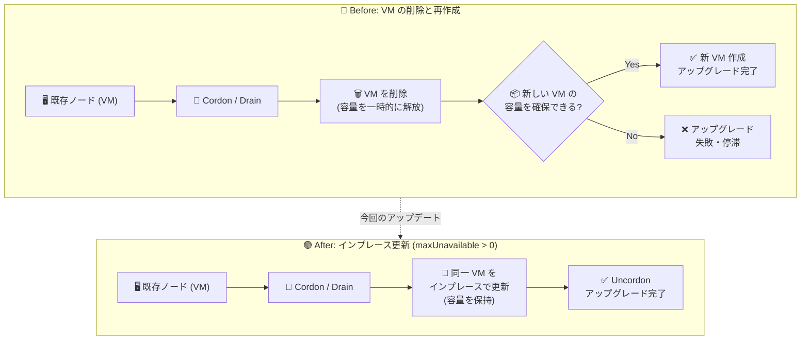

# Google Kubernetes Engine (GKE): Standard CPU ノードプールのインプレースノードアップグレード

**リリース日**: 2026-10-16

**サービス**: Google Kubernetes Engine (GKE)

**機能**: Standard CPU ノードプールにおける Compute Engine VM のインプレース更新によるノードアップグレード

**ステータス**: Change (全 GKE バージョンに適用)

📊 [このアップデートのインフォグラフィックを見る](https://takech9203.github.io/google-cloud-news-summary/20261016-gke-standard-in-place-node-upgrade.html)

## 概要

GKE Standard の CPU ノードプールにおいて、ノードのバージョンアップグレード時に、従来のように Compute Engine VM を削除して新規作成する代わりに、既存の VM をインプレース (in place) で更新できるようになりました。ノードが基盤となる VM をそのまま保持するため、アップグレード中もコンピュート容量が維持されます。

これにより、リソース (容量) 不足が原因でノードアップグレードが失敗したり停滞したりするリスクが低減されます。特に、特定のマシンタイプの在庫が逼迫しているリージョン/ゾーンや、リソース制約の厳しい環境でクラスタを運用しているユーザーにとって重要な改善です。

この動作を有効にするには、surge upgrade (サージアップグレード) で `maxUnavailable` フィールドを 0 より大きい値に設定します。本変更は全 GKE バージョンに適用されます。オプトアウトしたい場合は Cloud Customer Care への連絡が必要です。

**アップデート前の課題**

- 以前は `maxUnavailable` を使った固定容量 (fixed capacity) アップグレードでも、ノードの再作成時に VM が削除・新規作成されるため、予約 (reservation) 由来でない容量は一時的に解放されていた
- 容量が解放された隙に他の利用者がリソースを確保すると、同じマシンタイプの VM を再取得できず、アップグレードが失敗・停滞するリスクがあった
- リソース制約の厳しい環境では、アップグレード中の容量確保のために予約の利用などの追加対策を検討する必要があった

**アップデート後の改善**

- CPU ノードプールのバージョンアップグレードで `maxUnavailable` > 0 を設定している場合、GKE が同一の Compute Engine インスタンスを再利用し、既存の VM をインプレースで更新するようになった
- ノードが基盤の VM を保持するため、アップグレード中もコンピュート容量が維持され、容量不足によるアップグレードの失敗・停滞リスクが低減された
- 追加のサージノード用リソースを確保できない場合でも、既存ノードを 1 台ずつインプレースで更新することでアップグレードを進行できる

## アーキテクチャ図



従来は VM の削除時に容量が解放され再取得に失敗するリスクがありましたが、今回のアップデートにより `maxUnavailable` > 0 の CPU ノードプールでは同一 VM をインプレースで更新するため、容量を保持したままアップグレードが完了します。

## サービスアップデートの詳細

### 主要機能

1. **Compute Engine インスタンスの再利用によるインプレース更新**
   - CPU ノードプールのバージョンアップグレードで `maxUnavailable` フィールドが 0 より大きい場合、GKE は同一の Compute Engine インスタンスを再利用し、ノードの既存容量を保持する
   - VM の削除・再作成が発生しないため、容量の一時解放に伴う再取得失敗のリスクがなくなる

2. **リソース制約環境でのアップグレード信頼性向上**
   - リソース不足が原因でノードアップグレードが失敗・停滞するリスクを低減
   - サージノード (`maxSurge`) 用の追加容量が確保できない場合でも、`maxUnavailable` の予算内で既存ノードを 1 台ずつインプレースで更新してアップグレードを進行できる

3. **全 GKE バージョンへの適用とオプトアウト**
   - この変更は特定バージョンへのアップグレードに限らず、全 GKE バージョンに適用される
   - オプトアウトする場合は Cloud Customer Care に連絡する

### maxUnavailable によるアップグレードの流れ

`maxUnavailable` > 0 の設定でノードをアップグレードする際、GKE は以下の手順を実行します。

1. 既存ノードを Cordon (スケジューリング対象から除外)
2. 既存ノードを Drain (`PodDisruptionBudget` と `GracefulTerminationPeriod` を最大 1 時間尊重。1 時間経過後、残りの Pod は強制退避)
3. 既存ノードを新しい構成で再作成 (CPU ノードプールのバージョンアップグレードでは同一 Compute Engine インスタンスをインプレースで再利用)
4. ノードが Ready になるまで待機
5. アップグレード済みノードを Uncordon

## 技術仕様

### インプレース更新 (インスタンス再利用) の適用条件

| 項目 | 詳細 |
|------|------|
| 対象 | GKE Standard の CPU ノードプールのバージョンアップグレード |
| 有効化条件 | surge upgrade で `maxUnavailable` > 0 を設定 |
| 適用バージョン | 全 GKE バージョン |
| 動作 | 同一 Compute Engine インスタンスを再利用し、ノードの既存容量を保持 |
| オプトアウト | Cloud Customer Care に連絡 |

### インスタンスが再利用されない (削除・再作成される) ケース

以下のシナリオでは、GKE は既存の Compute Engine インスタンスを再利用せず、インスタンスを削除して再作成します。この場合、容量が予約 (reservation) 由来でなければ、ノードの容量は一時的に解放されます。

- バージョンアップグレード以外のノードプール更新 (マシンタイプ、ディスクタイプ、ディスクサイズの変更など)
- GPU または TPU を含むノードプールのバージョンアップグレード
- Spot VM またはプリエンプティブル VM を使用するノードプールのバージョンアップグレード
- 未完了の surge upgrade のロールバック
- ノードの自動修復 (auto-repair)

### surge upgrade の設定プロファイル例

| 説明 | 設定 | 典型的なユースケース |
|------|------|---------------------|
| バランス型 (デフォルト)。低速だが最も中断が少ない | `maxSurge=1` `maxUnavailable=0` | ほとんどのワークロード |
| バランス型。リソース制約環境向け、サージリソース不要 | `maxSurge=0` `maxUnavailable=1` | リソース制約のあるノードプール |
| 高速。サージリソース不要、中断は最大 | `maxSurge=0` `maxUnavailable=100` | ジョブ完了後の大規模ノードプール |
| 高速。サージリソースを最大活用し中断が少ない | `maxSurge=100` `maxUnavailable=0` | 大規模ノードプール |

なお、新規作成されるノードプールのデフォルトは `maxSurge=1`、`maxUnavailable=0` です。インプレース更新の恩恵を受けるには `maxUnavailable` を 0 より大きい値に明示的に設定する必要があります。また、Spot VM を使用するノードでは可用性保証がないため surge upgrade の設定値は無視されます。

## 設定方法

### 前提条件

1. GKE Standard クラスタの CPU ノードプールであること (Autopilot ではノードプール設定をユーザーが管理しないため対象外)
2. ノードプールのアップグレード戦略が surge upgrade (`SURGE`) であること

### 手順

#### ステップ 1: 既存ノードプールの surge upgrade 設定で maxUnavailable を 0 より大きい値に設定

```bash
gcloud container node-pools update NODE_POOL_NAME \
    --cluster=CLUSTER_NAME \
    --max-surge-upgrade=0 --max-unavailable-upgrade=1
```

固定容量でアップグレードする場合の設定例です。`maxSurge=0`、`maxUnavailable=1` とすることで、サージノード用の追加リソースを使わずに 1 台ずつノードをインプレースで更新します。

#### ステップ 2: (新規作成の場合) 固定容量アップグレード設定でクラスタ/ノードプールを作成

```bash
# クラスタ作成時に設定する場合
gcloud container clusters create CLUSTER_NAME \
    --max-surge-upgrade=0 --max-unavailable-upgrade=1

# 既存クラスタにノードプールを作成する場合
gcloud container node-pools create NODE_POOL_NAME \
    --num-nodes=NUMBER_NODES --cluster=CLUSTER_NAME \
    --max-surge-upgrade=SURGE_NODES --max-unavailable-upgrade=UNAVAILABLE_NODES
```

#### ステップ 3: 設定の確認

```bash
gcloud container node-pools describe NODE_POOL_NAME \
    --cluster=CLUSTER_NAME
```

surge upgrade が有効なノードプールでは、`strategy` が `SURGE` と表示されます。`upgradeSettings` の `maxUnavailable` が 0 より大きいことを確認してください。

## メリット

### ビジネス面

- **アップグレードの信頼性向上**: 容量不足によるアップグレードの失敗・停滞リスクが低減され、クラスタのバージョン維持 (セキュリティパッチ適用など) を計画どおり進めやすくなる
- **追加コストなしの容量保持**: サージノード用の追加 VM を作成せずに容量を保持したままアップグレードできるため、リソース制約環境でも追加の予約購入などを減らせる可能性がある

### 技術面

- **コンピュート容量の維持**: ノードが基盤の VM を保持するため、アップグレード中に容量が解放されず、同一マシンタイプの再取得に失敗するリスクがない
- **リソース逼迫環境での進行保証**: サージノード用の容量が確保できない場合でも、`maxUnavailable` の予算で既存ノードを 1 台ずつインプレース更新してアップグレードを進行できる
- **ユーザー側の移行作業が不要**: `maxUnavailable` > 0 を設定済みであれば、全 GKE バージョンで自動的にこの動作が適用される

## デメリット・制約事項

### 制限事項

- 対象は CPU ノードプールの**バージョンアップグレード**のみ。マシンタイプ、ディスクタイプ、ディスクサイズ変更などバージョンアップグレード以外のノードプール更新ではインスタンスは再利用されない
- GPU / TPU を含むノードプール、Spot VM / プリエンプティブル VM を使用するノードプールのバージョンアップグレードは対象外
- 未完了の surge upgrade のロールバックやノード自動修復時もインスタンスは再利用されない
- デフォルト設定 (`maxSurge=1`、`maxUnavailable=0`) ではこの動作は有効にならず、`maxUnavailable` > 0 の明示的な設定が必要

### 考慮すべき点

- `maxUnavailable` > 0 に設定すると、アップグレード中にその台数分のノードが同時に利用不可になる。他のノードに空き容量がない場合、Pod は既存ノードのアップグレード完了まで Pending 状態で待機する可能性がある
- Drain 時には `PodDisruptionBudget` と `GracefulTerminationPeriod` が最大 1 時間尊重されるが、1 時間を超えると残りの Pod は強制退避される
- オプトアウトにはセルフサービスの設定がなく、Cloud Customer Care への連絡が必要
- 中断を最小化したいワークロードでは、従来どおり `maxSurge` ベースの設定 (サージノード方式) との使い分けを検討する

## ユースケース

### ユースケース 1: 容量が逼迫したリージョンでのクラスタアップグレード

**シナリオ**: 特定のマシンタイプの在庫が逼迫しているゾーンで GKE Standard クラスタを運用しており、過去にノードアップグレード時の VM 再作成で容量を確保できず、アップグレードが停滞したことがある。

**実装例**:
```bash
gcloud container node-pools update prod-pool \
    --cluster=prod-cluster \
    --max-surge-upgrade=0 --max-unavailable-upgrade=1
```

**効果**: バージョンアップグレード時に既存 VM がインプレースで更新されるため、容量が解放されず、在庫逼迫による再取得失敗が発生しない。アップグレードが確実に進行する。

### ユースケース 2: 予約を使わないコスト重視環境での定期アップグレード

**シナリオ**: Compute Engine の予約 (reservation) を購入せずにコストを抑えて運用しており、毎月の GKE マイナーバージョン/パッチアップグレードを自動アップグレードに任せたいが、容量リスクが懸念だった。

**効果**: `maxUnavailable` > 0 を設定しておけば、予約なしでもアップグレード中の容量が VM ごと保持されるため、追加の予約コストをかけずにアップグレードの信頼性を確保できる。

## 関連サービス・機能

- **Compute Engine**: GKE Standard のノードは Compute Engine VM 上で動作する。本アップデートはこの VM をインプレースで更新する仕組みであり、Compute Engine の容量 (在庫) や予約 (reservation) の考え方と密接に関連する
- **GKE ノードアップグレード戦略 (surge upgrade / blue-green upgrade)**: 本機能は surge upgrade の `maxUnavailable` 設定に基づく。中断を最小化したい場合はサージノード方式 (`maxSurge`) や blue-green upgrade との使い分けが必要
- **PodDisruptionBudget (PDB)**: ノード Drain 時に最大 1 時間尊重されるため、ワークロードの可用性要件に合わせた PDB の設定が重要
- **クラスタオートスケーラー**: surge upgrade はクラスタオートスケーラーと連携し、アップグレード中のノードへの変更を防止する

## 参考リンク

- 📊 [インフォグラフィック](https://takech9203.github.io/google-cloud-news-summary/20261016-gke-standard-in-place-node-upgrade.html)
- [公式リリースノート](https://docs.cloud.google.com/release-notes#October_16_2026)
- [ドキュメント: ノードプールのアップグレード戦略 (maxUnavailable: GKE makes an existing node unavailable to recreate it)](https://docs.cloud.google.com/kubernetes-engine/docs/concepts/node-pool-upgrade-strategies#max-unavailable)
- [ドキュメント: surge upgrade の設定方法](https://docs.cloud.google.com/kubernetes-engine/docs/how-to/node-pool-upgrade-strategies)
- [ドキュメント: リソース制約環境でのアップグレード](https://docs.cloud.google.com/kubernetes-engine/docs/how-to/node-upgrades-quota)

## まとめ

GKE Standard の CPU ノードプールで、`maxUnavailable` > 0 の surge upgrade 設定時に既存 VM をインプレース更新する動作が全バージョンで有効になり、容量不足によるアップグレードの失敗・停滞リスクが大幅に低減されました。リソース逼迫環境や予約なしで運用しているクラスタでは、ノードプールの `maxUnavailable` 設定を見直し、GPU/TPU・Spot VM ノードプールなど対象外のケースを確認した上で、固定容量アップグレードの活用を検討することを推奨します。

---

**タグ**: #GKE #Kubernetes #NodeUpgrade #SurgeUpgrade #maxUnavailable #ComputeEngine #Infrastructure
