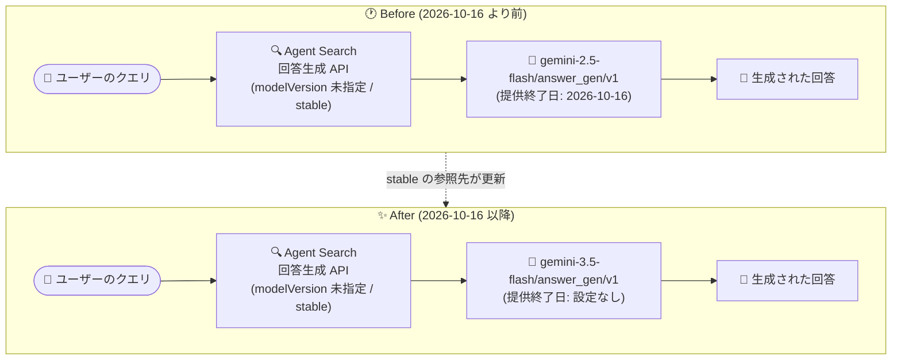

# Vertex AI Search: Agent Search の回答生成 stable モデルが gemini-3.5-flash に更新

**リリース日**: 2026-10-16

**サービス**: Vertex AI Search

**機能**: Agent Search 回答生成の stable モデル更新 (gemini-2.5-flash → gemini-3.5-flash)

**ステータス**: Change (変更)

📊 [このアップデートのインフォグラフィックを見る](https://takech9203.github.io/google-cloud-news-summary/20261016-vertex-ai-search-agent-search-stable-model-update.html)

## 概要

Vertex AI Search (Agent Search) において、回答生成 (answer generation) に使用される **stable モデルが `gemini-2.5-flash/answer_gen/v1` から `gemini-3.5-flash/answer_gen/v1` に更新** されました。`stable` はモデルバージョンを明示的に指定しなかった場合に使用されるデフォルトのモデル指定であり、今回の更新により、デフォルト設定で回答生成を利用しているすべてのアプリケーションが新しい Gemini 3.5 Flash ベースのモデルで回答を生成するようになります。

Agent Search の回答生成モデルは、検索サマリー (search summaries) と回答・フォローアップ (answers and follow-ups) の両方の機能で使用されます。公式ドキュメントによると、`stable` が指すモデルは新しいモデルやバージョンが利用可能になるのに合わせて定期的に変更される仕様であり、今回の変更はそのライフサイクルポリシーに沿ったものです。

また、公式ドキュメントのモデル一覧では、旧 stable モデルである `gemini-2.5-flash/answer_gen/v1` の提供終了日 (discontinuation date) が **2026 年 10 月 16 日** と記載されています。`gemini-2.5-flash/answer_gen/v1` をモデル名で明示的に指定しているユーザーは、新しいモデルまたは `stable` への移行を検討する必要があります。

**アップデート前の課題**

- `stable` 指定 (およびデフォルト) での回答生成は `gemini-2.5-flash/answer_gen/v1` を使用しており、より新しい世代の Gemini モデルを利用するにはモデルバージョンの明示的な指定が必要だった
- `gemini-2.5-flash/answer_gen/v1` はリリース後に凍結 (frozen) されたモデルであり、提供終了日 (2026 年 10 月 16 日) が設定されていた

**アップデート後の改善**

- `stable` 指定 (およびモデル未指定のデフォルト) の回答生成が、新世代の `gemini-3.5-flash/answer_gen/v1` を使用するようになった
- モデルバージョンを指定していないアプリケーションは、設定変更なしで新しいモデルによる回答生成に移行される

## アーキテクチャ図



`stable` モデル指定の参照先が `gemini-2.5-flash/answer_gen/v1` から `gemini-3.5-flash/answer_gen/v1` に切り替わり、モデル未指定のアプリケーションも自動的に新モデルで回答を生成するようになります。

## サービスアップデートの詳細

### 主要機能

1. **stable モデルの参照先の更新**
   - 回答生成用の stable モデルが `gemini-2.5-flash/answer_gen/v1` から `gemini-3.5-flash/answer_gen/v1` に更新された
   - `stable` はモデルバージョンを指定しない場合のデフォルトのモデル指定
   - `stable` が指すモデルは、新しいモデルやバージョンの提供開始に合わせて定期的に変更される

2. **回答生成モデルの適用範囲**
   - 回答生成モデルは検索サマリー (search summaries) と回答・フォローアップ (answers and follow-ups) で使用される
   - Agent Search のモデルには、質問応答タスクでテストされた Agent Platform LLM モデルと、それをベースに質問応答向けに追加学習された Agent Search モデルの 2 種類がある

3. **モデルライフサイクル**
   - Agent Search モデルは、ベースとなる Agent Platform LLM モデルと同じ提供終了日を共有する
   - ベース LLM モデルは、次バージョンのモデルのリリース日から 6 か月間利用可能
   - 公式ドキュメントのモデル一覧では、`gemini-2.5-flash/answer_gen/v1` の提供終了日は 2026 年 10 月 16 日と記載されている

## 技術仕様

### 回答生成モデルバージョン (公式ドキュメントのモデル一覧より)

| モデルバージョン | 説明 | コンテキストウィンドウ | 提供終了日 |
|------|------|------|------|
| `stable` | モデルバージョン未指定時のデフォルト。今回の更新で `gemini-3.5-flash/answer_gen/v1` を参照 | 128K | - |
| `gemini-3.5-flash/answer_gen/v1` | gemini-3.5-flash ベースのモデル (新 stable) | 128K | N/A (未設定) |
| `gemini-3.1-pro-preview/answer_gen/v1` | gemini-3.1-pro-preview ベースのモデル | 128K | N/A (未設定) |
| `gemini-3-flash-preview/answer_gen/v1` | gemini-3-flash-preview ベースのモデル | 128K | N/A (未設定) |
| `gemini-2.5-flash/answer_gen/v1` | gemini-2.5-flash ベースのモデル。リリース後に凍結 (frozen) | 128K | 2026-10-16 |

注: ドキュメントによると、品質とレイテンシの観点から、このコンテキストウィンドウは同モデルが他の用途で許可されるサイズより小さく設定されています。また、最新の Gemini モデルがこの API で利用できるとは限りません。

### モデルバージョンの指定例 (Answer API)

```json
{
  "query": { "text": "..." },
  "answerGenerationSpec": {
    "modelSpec": {
      "modelVersion": "gemini-3.5-flash/answer_gen/v1"
    }
  }
}
```

`modelVersion` を省略した場合は `stable` が使用され、今回の更新後は `gemini-3.5-flash/answer_gen/v1` で回答が生成されます。

## メリット

### ビジネス面

- **運用負荷なしでの最新化**: モデル未指定 (または `stable` 指定) のアプリケーションは、コード変更なしで新世代モデルによる回答生成へ移行できる
- **ライフサイクルリスクの低減**: 提供終了日が設定された旧モデルから、提供終了日未設定の新モデルへ早期に移行できる

### 技術面

- **新世代 Gemini モデルの利用**: 回答生成のベースモデルが gemini-2.5-flash から gemini-3.5-flash に世代更新される
- **コンテキストウィンドウは 128K を維持**: モデル更新後もドキュメント記載のコンテキストウィンドウは 128K で変わらない

## デメリット・制約事項

### 制限事項

- 回答生成用のコンテキストウィンドウ (128K) は、品質とレイテンシの観点から同モデルの他用途での上限より小さい
- 最新の Gemini モデルがこの API で常に利用できるとは限らない

### 考慮すべき点

- `stable` を使用している場合、参照先モデルの変更に伴い回答の内容や傾向が変化する可能性がある。応答の一貫性を重視する場合は、特定のモデルバージョンを明示的に指定することがドキュメントで推奨されている
- `gemini-2.5-flash/answer_gen/v1` をモデル名で明示指定している場合、ドキュメント上の提供終了日 (2026 年 10 月 16 日) を踏まえ、`gemini-3.5-flash/answer_gen/v1` または `stable` への移行を検討する
- `preview` 指定は予告なく変更される可能性があるため、本番環境では特定バージョンの指定を検討する

## ユースケース

### ユースケース 1: デフォルト設定で回答生成を利用している検索アプリ

**シナリオ**: 社内ドキュメント検索アプリで、`modelVersion` を指定せずに Answer API を利用している。

**効果**: 設定変更なしで新しい gemini-3.5-flash ベースのモデルによる回答生成に自動的に移行される。回答の傾向が変わる可能性があるため、更新後の回答品質を確認するとよい。

### ユースケース 2: 旧モデルを明示指定しているアプリの移行

**シナリオ**: 回答の一貫性のために `gemini-2.5-flash/answer_gen/v1` を明示指定しているが、ドキュメント上の提供終了日が 2026 年 10 月 16 日と記載されている。

**実装例**:
```json
{
  "answerGenerationSpec": {
    "modelSpec": {
      "modelVersion": "gemini-3.5-flash/answer_gen/v1"
    }
  }
}
```

**効果**: 提供終了予定のモデルから新 stable モデルへ計画的に移行し、サービス継続性を確保できる。

## 料金

今回のアップデートに伴う料金変更は Release Notes には記載されていません。Vertex AI Search の料金の詳細は料金ページを参照してください。

- [Vertex AI Search の料金](https://cloud.google.com/generative-ai-app-builder/pricing)

## 関連サービス・機能

- **検索サマリー (Search summaries)**: 回答生成モデルを使用して検索結果のサマリーを生成する機能。今回のモデル更新の影響を受ける
- **回答とフォローアップ (Answers and follow-ups)**: 回答生成モデルを使用して質問への回答とフォローアップを生成する機能。今回のモデル更新の影響を受ける
- **Gemini Enterprise Agent Platform**: 回答生成モデルのベースとなる LLM モデルを提供するプラットフォーム。モデルのバージョンとライフサイクルはこのプラットフォームのポリシーに従う

## 参考リンク

- 📊 [インフォグラフィック](https://takech9203.github.io/google-cloud-news-summary/20261016-vertex-ai-search-agent-search-stable-model-update.html)
- [公式リリースノート](https://docs.cloud.google.com/release-notes#October_16_2026)
- [Answer generation model versions and lifecycle](https://docs.cloud.google.com/generative-ai-app-builder/docs/answer-generation-models)
- [Model versions and lifecycle (Agent Platform)](https://docs.cloud.google.com/gemini-enterprise-agent-platform/models/model-versions)
- [料金ページ](https://cloud.google.com/generative-ai-app-builder/pricing)

## まとめ

Agent Search の回答生成における stable モデルが gemini-3.5-flash ベースに更新され、デフォルト設定のアプリケーションは自動的に新世代モデルへ移行します。`stable` 利用者は更新後の回答品質・傾向の変化を確認し、`gemini-2.5-flash/answer_gen/v1` を明示指定している場合はドキュメント記載の提供終了日 (2026 年 10 月 16 日) を踏まえて新モデルへの移行を計画することを推奨します。

---

**タグ**: Vertex AI Search, Agent Search, 回答生成, Gemini 3.5 Flash, stable モデル, モデルライフサイクル
