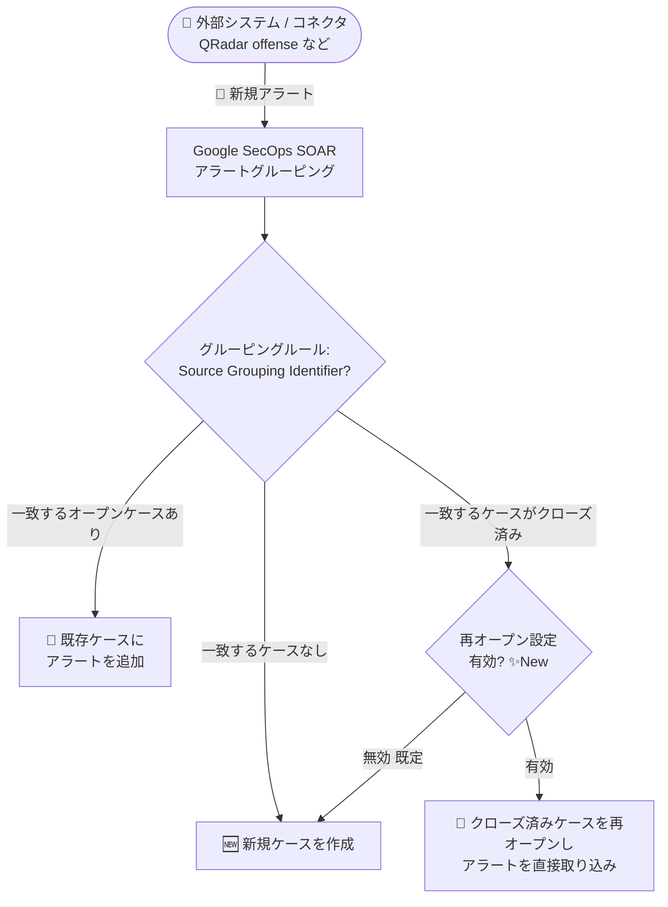

# Google SecOps / Google SecOps SOAR: クローズ済みケースの再オープン設定・SOAR Release 6.3.103・ListCaseEvents API 非推奨化

**リリース日**: 2026-10-18

**サービス**: Google SecOps / Google SecOps SOAR

**機能**: Source Grouping Identifier によるアラートグルーピング時のクローズ済みケース再オープン設定、SOAR Release 6.3.103 ロールアウト、ListCaseEvents API エンドポイントの非推奨化

**ステータス**: Feature (GA) / Announcement / Deprecated

📊 [このアップデートのインフォグラフィックを見る](https://takech9203.github.io/google-cloud-news-summary/20261018-google-secops-soar-updates.html)

## 概要

Google SecOps および Google SecOps SOAR に関する 3 件のアップデートが発表されました。中心となるのは、**Source Grouping Identifier (ソースグルーピング識別子) によるアラートグルーピング時に、クローズ済みケースを再オープンするかどうかを設定できる新機能**です。この設定を有効にすると、過去にクローズされたケースと同じソースグルーピング識別子を持つ新しいアラートを受信した際に、Google SecOps がそのケースを自動的に再オープンし、新しいアラートを直接そのケースに取り込みます。QRadar の offense ID のように、外部システム側でグループ ID が付与されたアラートを扱う SOC チームにとって、外部システムとのケース状態の整合性 (パリティ) を保ちやすくなる重要な改善です。

あわせて、**SOAR Release 6.3.103 が第 1 フェーズのリージョンへロールアウト開始**されたことが発表されました (Release 6.3.102 は前日 2026-10-17 に全リージョンで利用可能になっています)。また、**2026 年 10 月 12 日付で ListCaseEvents API エンドポイントが非推奨**となり、代替として ListCaseEvidenceData API エンドポイントの使用が推奨されています。SOAR API を利用した自動化・外部連携を構築しているチームは移行対応が必要です。

**アップデート前の課題**

- アラートグルーピングはオープン状態のアラートとケースに対してのみ行われ、クローズ済みケースは再オープンされなかった。そのため、同じソースグルーピング識別子のアラートがクローズ後に再び発生した場合、常に新規ケースが作成されていた
- 同一インシデントの再燃 (例: QRadar の同一 offense に属するアラートの再発) でも新規ケースが乱立し、調査コンテキストが分断され、重複ケースの管理負荷が発生していた
- QRadar など第三者システム側ではひとつのグループ (offense) として扱われているのに、Google SecOps 側では複数ケースに分かれ、外部システムとのケース状態の整合性が取りにくかった
- ケースイベントの取得には ListCaseEvents API を使用していたが、レガシー SOAR API は Chronicle API への移行対象であり、パフォーマンス面の課題が指摘されていた

**アップデート後の改善**

- SOAR 設定でクローズ済みケースの再オープンを有効化すると、クローズ済みケースと同じソースグルーピング識別子の新規アラート受信時に、ケースが自動的に再オープンされアラートが直接取り込まれるようになった
- 重複する新規ケースの作成が削減され、第三者システムとのパリティが確保しやすくなった (Google はベストプラクティスとして本設定の有効化を推奨)
- 設定はオプトイン方式のため、従来どおり新規ケースを作成する運用 (デフォルト動作) も選択できる
- ケース証跡データの取得は、リソース指向の新しい ListCaseEvidenceData API (Chronicle API) に一本化され、移行先が明確になった

## アーキテクチャ図



新規アラート受信時のグルーピング判定フローです。今回のアップデートにより、ソースグルーピング識別子が一致するケースがクローズ済みの場合の挙動 (再オープン or 新規ケース作成) を設定で選択できるようになりました。

## サービスアップデートの詳細

### 主要機能

1. **クローズ済みケースの再オープン設定 (Feature)**
   - 「SOAR Settings > Advanced > Alerts Grouping」の「Allow reopening closed cases when grouping by source grouping identifier」オプションで制御する
   - 有効時: クローズ済みケースと同じソースグルーピング識別子の新規アラートを受信すると、Google SecOps がケースを自動的に再オープンし、アラートをそのケースに直接取り込む
   - 無効時 (デフォルト動作): 従来どおり新規ケースを作成する
   - Google は、重複する新規ケースの削減と第三者システムとのパリティ確保のため、本設定の有効化をベストプラクティスとして推奨している

2. **SOAR Release 6.3.103 のロールアウト開始 (Announcement)**
   - Release 6.3.103 が第 1 フェーズのリージョンにロールアウト中
   - ロールアウト対象リージョンは [SOAR gradual release](https://docs.cloud.google.com/chronicle/docs/soar/overview-and-introduction/soar-gradual-release) ページで確認できる
   - なお、Release 6.3.102 は 2026-10-17 に全リージョンで利用可能になった

3. **ListCaseEvents API エンドポイントの非推奨化 (Deprecated)**
   - 2026 年 10 月 12 日付で ListCaseEvents API エンドポイントが非推奨となった
   - 代替として [ListCaseEvidenceData](https://docs.cloud.google.com/chronicle/docs/reference/rest/v1alpha/projects.locations.instances.cases.caseEvidenceDatas/list) API エンドポイント (`projects.locations.instances.cases.caseEvidenceDatas/list`) を使用する
   - 背景として、レガシー SOAR API 全体が Chronicle API へ移行中であり、移行期限は 2026 年 11 月 30 日から **2027 年 3 月 31 日に延長**されている (2026-10-12 発表)

## 技術仕様

### アラートグルーピングの主な設定 (SOAR Settings > Advanced > Alerts Grouping)

| 設定項目 | 詳細 |
|------|------|
| Max. alerts grouped into a case | 1 ケースにグルーピングする最大アラート数 (30)。上限到達後は新規ケースを開始 |
| Timeframe for grouping alerts | グルーピングの対象時間 (0.5〜24 時間、30 分刻み)。Source Grouping Identifier によるグルーピングには適用されない |
| Group entities and source grouping identifiers in the same case | 有効時、まず同一ソースグルーピング識別子のアラートを探し、見つからない場合は共通エンティティを持つケースを探してグルーピングする |
| Allow reopening closed cases when grouping by source grouping identifier | **今回追加**。有効時、クローズ済みケースと同一識別子のアラート受信でケースを再オープン。無効時 (デフォルト) は新規ケースを作成 |

- Source Grouping Identifier によるグルーピングは `sourceGroupIdentifier` と `maxAlertsInCase` のみに基づいて行われ、タイムフレームは使用されない
- グルーピングルールは Alert Type → Product → Data Source → Fallback Rule の階層順でマッチングされる

### ListCaseEvents API の移行

| 項目 | 詳細 |
|------|------|
| 非推奨エンドポイント | ListCaseEvents |
| 非推奨日 | 2026 年 10 月 12 日 |
| 移行先 | ListCaseEvidenceData (`GET .../projects/{project}/locations/{location}/instances/{instance}/cases/{case}/caseEvidenceDatas`) |
| 関連 | レガシー SOAR API 全体の Chronicle API への移行期限は 2027 年 3 月 31 日に延長済み |

## 設定方法

### 前提条件

1. Google SecOps SOAR の管理者権限 (SOAR Settings へのアクセス権) を持っていること
2. Source Grouping Identifier を使用するグルーピングルールが構成されていること (例: QRadar などグループ ID 付きアラートを送るコネクタ)

### 手順

#### ステップ 1: アラートグルーピング設定を開く

Google SecOps コンソールで「**SOAR Settings > Advanced > Alerts Grouping**」に移動します。

#### ステップ 2: 再オープン設定を有効化する

General セクションの「**Allow reopening closed cases when grouping by source grouping identifier**」を有効にします。有効化後、クローズ済みケースと同じソースグルーピング識別子を持つ新規アラートを受信すると、ケースが自動的に再オープンされます。

#### ステップ 3: (API 利用者) ListCaseEvents の呼び出しを移行する

ListCaseEvents を使用しているスクリプトや連携を特定し、ListCaseEvidenceData API エンドポイントへ置き換えます。

```bash
# 移行後の呼び出し例 (Chronicle API / v1alpha)
curl -s \
  -H "Authorization: Bearer $(gcloud auth print-access-token)" \
  "https://chronicle.googleapis.com/v1alpha/projects/PROJECT_ID/locations/LOCATION/instances/INSTANCE_ID/cases/CASE_ID/caseEvidenceDatas"
```

## メリット

### ビジネス面

- **重複ケースの削減**: 同一インシデントの再燃で新規ケースが乱立しなくなり、ケース管理のオーバーヘッドと SOC アナリストの調査工数を削減できる
- **外部システムとのパリティ**: QRadar の offense など、第三者システム側のグループ単位と Google SecOps のケースが一対一で対応しやすくなり、運用の一貫性が向上する

### 技術面

- **調査コンテキストの維持**: 再オープンされたケースに過去の調査履歴と新しいアラートが集約されるため、インシデントの全体像を把握しやすい
- **オプトイン方式**: デフォルトは従来動作 (新規ケース作成) のままであり、既存の運用フローへの影響なしに段階的に導入できる
- **API の近代化**: ListCaseEvidenceData はリソース指向の Chronicle API であり、レガシー API のパフォーマンス問題を回避できる

## デメリット・制約事項

### 制限事項

- 再オープン機能は **Source Grouping Identifier によるグルーピングのみ**が対象。エンティティベースのグルーピングではクローズ済みケースは再オープンされない
- Source Grouping Identifier によるグルーピングにはタイムフレーム設定が適用されないため、時間的に大きく離れたアラートでも同一識別子であれば同じケースに集約される
- 1 ケースあたりの最大アラート数 (30) の制限は引き続き適用される

### 考慮すべき点

- クローズ済みケースが自動で再オープンされるため、ケースのクローズを完了指標 (SLA・メトリクス) に使っている場合は、再オープンによる統計への影響を確認する必要がある
- 再オープン時に実行されるプレイブックやワークフローの挙動を事前にテストすることを推奨
- ListCaseEvents を使用する既存の自動化・連携は、レガシー SOAR API の移行期限 (2027 年 3 月 31 日) を待たず早期に ListCaseEvidenceData へ移行すべき

## ユースケース

### ユースケース 1: QRadar offense と連動したケースライフサイクル管理

**シナリオ**: MSSP が QRadar コネクタで取り込んだアラートを offense ID (Source Grouping Identifier) でグルーピングしている。いったん収束してケースをクローズした後、同じ offense で新たなアラートが発生した。

**実装例**:
```
グルーピングルール:
  Category = Data Source
  Value = QRadar
  Group by = Source Grouping Identifier

SOAR Settings > Advanced > Alerts Grouping:
  Allow reopening closed cases when grouping by source grouping identifier = 有効
```

**効果**: QRadar 側の offense 単位と Google SecOps のケースが一致し続け、再発アラートは過去の調査履歴を持つケースに自動集約される。新規重複ケースの作成が防止され、トリアージ時間が短縮される。

### ユースケース 2: ListCaseEvents からの API 移行

**シナリオ**: ケースのイベント情報を外部のチケットシステムに同期するスクリプトが ListCaseEvents を使用している。

**効果**: ListCaseEvidenceData へ移行することで、非推奨 API の停止リスクを回避し、Chronicle API ベースの安定した連携を維持できる。移行は SOAR API 全体の Chronicle API 移行 (期限: 2027 年 3 月 31 日) の一環として計画的に実施できる。

## 料金

本アップデートによる追加料金はありません。Google SecOps はサブスクリプションベースの課金体系です。詳細は [Google SecOps の料金ページ](https://cloud.google.com/security/products/security-operations#pricing) を参照してください。

## 利用可能リージョン

- クローズ済みケースの再オープン設定: Google SecOps / SOAR の提供リージョンで利用可能
- SOAR Release 6.3.103: 第 1 フェーズのリージョンからロールアウト中。対象リージョンは [SOAR gradual release](https://docs.cloud.google.com/chronicle/docs/soar/overview-and-introduction/soar-gradual-release) を参照

## 関連サービス・機能

- **Google SecOps SIEM**: 検出ルール (YARA-L) が生成したアラートも SOAR のケースグルーピングの対象となり、ケース管理と連携する
- **Chronicle API**: レガシー SOAR API の移行先。ListCaseEvidenceData を含むリソース指向のエンドポイントを提供する
- **サードパーティ SIEM コネクタ (QRadar、ArcSight など)**: Source Grouping Identifier の供給元。外部システムのグループ ID をケースグルーピングに利用できる
- **SOAR プレイブック**: ケース再オープン時のアラート取り込みを起点に、対応ワークフローを自動実行できる

## 参考リンク

- 📊 [インフォグラフィック](https://takech9203.github.io/google-cloud-news-summary/20261018-google-secops-soar-updates.html)
- [公式リリースノート](https://docs.cloud.google.com/release-notes#October_18_2026)
- [Configure alert grouping (アラートグルーピングの構成)](https://docs.cloud.google.com/chronicle/docs/soar/investigate/working-with-alerts/alert-grouping-mechanism-admin)
- [SOAR gradual release (段階的リリース)](https://docs.cloud.google.com/chronicle/docs/soar/overview-and-introduction/soar-gradual-release)
- [ListCaseEvidenceData API リファレンス](https://docs.cloud.google.com/chronicle/docs/reference/rest/v1alpha/projects.locations.instances.cases.caseEvidenceDatas/list)
- [SOAR Migration overview (API 移行ガイド)](https://docs.cloud.google.com/chronicle/docs/soar/admin-tasks/advanced/migrate-to-gcp)
- [Google SecOps 料金ページ](https://cloud.google.com/security/products/security-operations#pricing)

## まとめ

クローズ済みケースの再オープン設定は、Source Grouping Identifier を利用する SOC チームにとって重複ケース削減と外部システムとのパリティ確保を実現する実用的な改善であり、Google もベストプラクティスとして有効化を推奨しています。SLA 指標やプレイブックへの影響を確認したうえで有効化を検討してください。あわせて、ListCaseEvents API を使用している場合は ListCaseEvidenceData への移行を早期に計画することを推奨します。

---

**タグ**: Google SecOps, Google SecOps SOAR, アラートグルーピング, Source Grouping Identifier, ケース管理, Chronicle API, API 非推奨, セキュリティ運用, SOC
