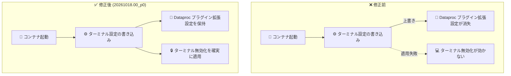

# Agent Platform Workbench: 20261018.00_p0 リリース (パッケージ更新と Jupyter Server 設定競合の修正)

**リリース日**: 2026-10-19

**サービス**: Agent Platform Workbench (Gemini Enterprise Agent Platform)

**機能**: 20261018.00_p0 イメージリリース

**ステータス**: リリース済み (Change / Fixed)

📊 [このアップデートのインフォグラフィックを見る](https://takech9203.github.io/google-cloud-news-summary/20261019-agent-platform-workbench-20261018-release.html)

## 概要

Gemini Enterprise Agent Platform の Jupyter ノートブック開発環境である Agent Platform Workbench (旧 Vertex AI Workbench) に、メンテナンスリリース 20261018.00_p0 が公開されました。本リリースは、(1) 上流依存関係の最新パッケージへの更新、(2) Jupyter Server のターミナル設定に起因する設定競合の修正、の 2 点を含むパッチリリースです。

修正されたのは、コンテナ起動時に Jupyter Server のターミナル設定が Dataproc プラグイン (Managed Service for Apache Spark 連携) のサーバー拡張設定を上書きしてしまう、あるいはターミナル無効化設定 (`notebook-disable-terminal`) が適用されないことがある、という問題です。セキュリティ要件でターミナルアクセスを無効化しつつ、Dataproc / Spark カーネル連携を利用しているユーザーに影響する不具合が解消されます。

**アップデート前の課題**

- コンテナ起動時に Jupyter Server のターミナル設定が書き込まれる際、Dataproc プラグインのサーバー拡張設定を上書きしてしまい、プラグインが正しく動作しないことがあった
- ターミナル無効化設定 (`notebook-disable-terminal: true`) がコンテナ起動時に適用されず、無効化したはずのターミナルが利用可能なままになるケースがあった
- 依存パッケージが前回リリース時点のバージョンに留まっていた

**アップデート後の改善**

- ターミナル設定の適用処理が修正され、Dataproc プラグインのサーバー拡張設定と共存できるようになった
- `notebook-disable-terminal` によるターミナル無効化がコンテナ起動時に確実に適用されるようになった
- 上流依存関係の最新パッケージが取り込まれ、セキュリティ・安定性が向上した

## アーキテクチャ図



コンテナ起動時の Jupyter Server 設定適用フローの修正前後の比較です。修正後はターミナル設定と Dataproc プラグインのサーバー拡張設定が競合せず、両方が正しく反映されます。

## サービスアップデートの詳細

### 主要な変更点

1. **上流依存パッケージの更新 (Change)**
   - イメージに含まれる上流依存関係のパッケージを最新版に更新
   - Workbench の週次メンテナンスリリースにおける定常的なセキュリティ・安定性向上

2. **Jupyter Server ターミナル設定の競合修正 (Fixed)**
   - コンテナ起動時に、Jupyter Server のターミナル設定が Dataproc プラグインのサーバー拡張設定を上書きする問題を修正
   - ターミナル無効化設定が起動時に適用されないことがある問題を修正
   - ターミナルアクセス制御と Spark カーネル連携 (Dataproc プラグイン) を併用する環境での設定の信頼性が向上

## 技術仕様

### 関連するインスタンスメタデータキー

今回の修正に関連する Workbench インスタンスのメタデータキーは以下のとおりです。

| メタデータキー | 機能 | 値 |
|------|------|------|
| `notebook-disable-terminal` | JupyterLab のターミナルアクセスの無効化 | `true`: 無効化 / `false` (デフォルト): 有効 |
| `disable-mixer` | Dataproc プラグイン (Managed Service for Apache Spark カーネル) の無効化 | `true`: 無効化 / `false` (デフォルト): 有効 |

```bash
# 例: ターミナルを無効化しつつ Dataproc プラグインを有効のまま利用する
gcloud workbench instances update INSTANCE_NAME \
  --metadata=notebook-disable-terminal=true
```

## 設定方法

### 前提条件

1. Agent Platform Workbench インスタンスを利用していること
2. インスタンスのイメージを更新する権限があること

### 手順

本リリースを適用するには、インスタンスを最新イメージにアップグレードします。詳細は [イメージバージョンの管理](https://docs.cloud.google.com/gemini-enterprise-agent-platform/notebooks/workbench/instances/manage-image-versions) を参照してください。`notebook-upgrade-schedule` メタデータキーで自動アップグレードをスケジュールすることも可能です。

## メリット

### ビジネス面

- **セキュリティポリシーの確実な適用**: ターミナル無効化が起動時に確実に反映されるため、コンプライアンス要件 (シェルアクセス制限) を満たす環境の信頼性が向上する
- **運用負荷の軽減**: 設定が意図通り適用されない問題の調査・回避策が不要になる

### 技術面

- **設定の共存**: ターミナル設定と Dataproc プラグインのサーバー拡張設定が競合せず、Spark カーネル連携を維持したままターミナル制御が可能
- **最新パッケージ**: 上流依存関係の更新により既知の脆弱性・不具合への対応が取り込まれる

## デメリット・制約事項

### 考慮すべき点

- 修正を反映するには、インスタンスを本リリース以降のイメージにアップグレードする必要がある
- ターミナル無効化に依存したセキュリティ統制を行っている場合は、アップグレード後に `notebook-disable-terminal` の設定が意図通り動作していることを確認することを推奨

## ユースケース

### ユースケース 1: ターミナル無効化と Spark カーネルの併用環境

**シナリオ**: 規制業種のデータサイエンスチームが、シェルアクセスを禁止 (`notebook-disable-terminal: true`) した Workbench インスタンスで、Dataproc プラグイン経由の Managed Service for Apache Spark カーネルを使ってデータ処理を行っている。

**効果**: 本リリース適用後は、起動時にターミナル無効化が確実に適用され、かつ Dataproc プラグインの拡張設定が上書きされないため、セキュリティ統制と Spark 連携を両立できる。

## 料金

本リリースは料金に影響しません。Agent Platform Workbench インスタンスの料金は、基盤となる Compute Engine リソース等に基づきます。詳細は [Vertex AI の料金ページ](https://cloud.google.com/vertex-ai/pricing) を参照してください。

## 関連サービス・機能

- **Dataproc / Managed Service for Apache Spark**: 今回修正されたサーバー拡張設定の対象。JupyterLab から Spark クラスタ上でノートブックを実行できる
- **BigQuery JupyterLab プラグイン**: Workbench に統合されたデータ探索・クエリ機能。2026 年 10 月初旬のリリースで Dataproc プラグインから独立して有効化されるようになった
- **Compute Engine**: Workbench インスタンスの基盤 VM。メタデータキーによる機能制御の仕組みを提供

## 参考リンク

- 📊 [インフォグラフィック](https://takech9203.github.io/google-cloud-news-summary/20261019-agent-platform-workbench-20261018-release.html)
- [公式リリースノート](https://docs.cloud.google.com/release-notes#October_19_2026)
- [Agent Platform Workbench の概要](https://docs.cloud.google.com/gemini-enterprise-agent-platform/notebooks/workbench/introduction)
- [メタデータによる機能管理](https://docs.cloud.google.com/gemini-enterprise-agent-platform/notebooks/workbench/instances/manage-metadata)
- [イメージバージョンの管理](https://docs.cloud.google.com/gemini-enterprise-agent-platform/notebooks/workbench/instances/manage-image-versions)
- [料金ページ](https://cloud.google.com/vertex-ai/pricing)

## まとめ

Agent Platform Workbench の 20261018.00_p0 は、依存パッケージ更新と Jupyter Server 設定競合の修正を含むメンテナンスリリースです。ターミナル無効化によるアクセス統制と Dataproc プラグイン (Spark カーネル連携) を併用している環境では、設定の信頼性が向上するため、早めのイメージアップグレードを推奨します。

---

**タグ**: #AgentPlatformWorkbench #GeminiEnterprise #JupyterLab #Dataproc #メンテナンスリリース
