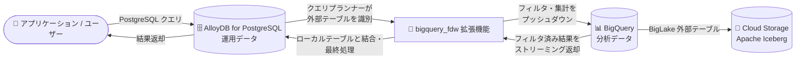

# AlloyDB for PostgreSQL: Lakehouse Federation (BigQuery リアルタイムアクセス) が GA

**リリース日**: 2026-10-19

**サービス**: AlloyDB for PostgreSQL

**機能**: Lakehouse Federation (bigquery_fdw による BigQuery リアルタイムデータアクセス)

**ステータス**: GA (一般提供)

📊 [このアップデートのインフォグラフィックを見る](https://takech9203.github.io/google-cloud-news-summary/20261019-alloydb-lakehouse-federation-ga.html)

## 概要

AlloyDB for PostgreSQL の Lakehouse Federation が一般提供 (GA) になりました。この機能は `bigquery_fdw` (Foreign Data Wrapper) 拡張機能を利用して、AlloyDB から BigQuery 上のライブデータを直接クエリできるようにするものです。データを移動・複製することなく、標準の PostgreSQL 構文で BigQuery のデータセットや、BigLake 外部テーブル経由で Apache Iceberg などのオープンフォーマットにアクセスできます。

従来、運用系データベース (AlloyDB) と分析系データウェアハウス (BigQuery) のデータを組み合わせるには、ETL パイプラインの構築・運用が必要でした。Lakehouse Federation により、パイプラインを介さずに最新の分析データへリアルタイムにアクセスでき、HTAP (ハイブリッドトランザクション/分析処理) ワークロードや AI エージェント向けのデータ活用が容易になります。

対象ユーザーは、AlloyDB 上の運用データと BigQuery 上の分析データ・履歴データを組み合わせて利用したいアプリケーション開発者、データエンジニア、Solutions Architect です。

**アップデート前の課題**

- AlloyDB から BigQuery のデータを利用するには、ETL パイプラインの構築・保守が必要で、データの鮮度がバッチ処理の間隔やパイプラインの障害に左右されていた
- 分析データを AlloyDB 側に複製すると、ストレージコストの増加とデータガバナンス管理の負担が発生していた
- 運用データ (AlloyDB) と分析データ (BigQuery) を結合した即時のアドホック分析が困難だった

**アップデート後の改善**

- `bigquery_fdw` 拡張機能により、AlloyDB から BigQuery のライブデータを PostgreSQL 構文で直接クエリ可能になった (Zero ETL)
- フィルタや集計を BigQuery 側にプッシュダウンして実行し、必要な行や事前集計済みの結果のみをネットワーク転送するため、効率的なクエリ実行が可能になった
- データを 1 か所 (BigQuery) に保持したままアクセスできる Zero-copy アーキテクチャにより、複製に伴うコストとガバナンスの負担が不要になった
- GA となったことで、本番環境での利用が正式にサポートされるようになった

## アーキテクチャ図



AlloyDB に発行された PostgreSQL クエリのうち、外部テーブルに対する部分が `bigquery_fdw` を通じて BigQuery にプッシュダウンされ、BigQuery (および Cloud Storage 上の Iceberg テーブル) で実行された結果のみが AlloyDB にストリーミング返却されます。AlloyDB はローカルの運用テーブルと結合して最終結果を返します。

## サービスアップデートの詳細

### 主要機能

1. **Zero ETL でのリアルタイムデータアクセス**
   - ETL パイプラインを構築・保守することなく、BigQuery のライブデータを直接クエリ
   - 同期間隔やパイプラインのレイテンシを排除し、常に最新データにアクセス可能

2. **PostgreSQL 標準構文でのクエリと JOIN**
   - `CREATE FOREIGN TABLE` で定義した外部テーブルを、通常の AlloyDB テーブルと同様にクエリ可能
   - AlloyDB のローカルテーブルと BigQuery の外部テーブルを JOIN して HTAP ワークロードを実現

3. **プッシュダウン最適化**
   - 標準的なフィルタ、LIMIT、集計を BigQuery 側にプッシュダウン
   - BigQuery の分散エンジンに重い処理をオフロードし、関連する行・事前集計済みサマリーのみをネットワーク転送

4. **オープンフォーマット対応**
   - BigQuery ネイティブストレージに加え、BigLake 外部テーブル経由で Cloud Storage 上の Apache Iceberg テーブルにもアクセス可能

5. **IAM による一元的なアクセス制御**
   - AlloyDB クラスタのサービスアカウントに付与した IAM ロールに基づいてアクセスを制御
   - 組織の集中的なデータガバナンスポリシーに準拠した連携が可能

## 技術仕様

### クエリ実行フロー

| ステップ | 処理内容 |
|------|------|
| 1. クエリ送信 | 標準の PostgreSQL クエリを AlloyDB インスタンスに送信 |
| 2. クエリプランニング | AlloyDB のクエリプランナーが BigQuery にマッピングされた外部テーブルを識別 |
| 3. プッシュダウン最適化 | フィルタ・集計を BigQuery に直接プッシュダウン |
| 4. 実行とデータ取得 | BigQuery がクエリを実行 (ネイティブストレージまたは Iceberg テーブルをスキャン) し、結果を AlloyDB にストリーミング |
| 5. 最終処理 | AlloyDB がローカルテーブルと結合し、残りの処理を行って結果を返却 |

### 主なデータ型マッピング

| BigQuery データ型 | 推奨する PostgreSQL 外部テーブルのデータ型 |
|------|------|
| BOOLEAN | BOOLEAN |
| INTEGER (INT64) | BIGINT |
| FLOAT (FLOAT64) | DOUBLE PRECISION |
| STRING | VARCHAR |
| NUMERIC / NUMERIC(P[, S]) | NUMERIC(38, 9) / NUMERIC(P, S) |
| BIGNUMERIC | NUMERIC(77, 38) |
| DATE / TIME / DATETIME | DATE / TIME / TIMESTAMP |
| TIMESTAMP | TIMESTAMPTZ |
| JSON | JSONB |
| BYTES | BYTEA |
| GEOGRAPHY | GEOGRAPHY(POINT) など (PostGIS) |
| ARRAY | VECTOR(N) (`bigquery_fdw.enable_vector_downcasting` フラグが必要、float4 への変換で精度低下の可能性あり) |

直接マッピングできない型は、クエリ内で明示的に `CAST` するか、互換性のある型で表現する BigQuery ビューを作成して対応します。

### 必要な IAM ロール (AlloyDB クラスタのサービスアカウントに付与)

| ロール | 用途 |
|------|------|
| BigQuery Data Viewer (`roles/bigquery.dataViewer`) | テーブル/ビューのデータとメタデータの読み取り |
| BigQuery Read Session User (`roles/bigquery.readSessionUser`) | 読み取りセッションの作成・使用 |
| BigQuery Job User (`roles/bigquery.jobUser`) | クエリジョブの実行 (ランタイムプロジェクトを分ける場合はそのプロジェクトに付与) |
| Storage Object Viewer (`roles/storage.objectViewer`) | BigQuery 外部テーブル (Cloud Storage 上のデータ) へのアクセス |

## 設定方法

### 前提条件

1. AlloyDB クラスタとプライマリインスタンスが作成済みであること
2. BigQuery データセットとテーブルが作成済みであること
3. AlloyDB インスタンスで `bigquery_fdw.enabled` データベースフラグを有効化すること
4. 必要な API (AlloyDB API、BigQuery API、BigQuery Storage API など) を有効化すること
5. AlloyDB クラスタのサービスアカウントに前述の IAM ロールを付与すること (Google Cloud コンソール / AlloyDB Studio から接続する場合は自動で付与される)

### 手順

#### ステップ 1: クラスタのサービスアカウントを確認し、BigQuery へのアクセス権を付与

```bash
gcloud beta alloydb clusters describe CLUSTER --region=REGION
```

出力に含まれる `serviceAccountEmail` に対して、BigQuery Data Viewer、Read Session User、Job User などの必要なロールを付与します。

#### ステップ 2: 拡張機能の作成

```sql
CREATE EXTENSION bigquery_fdw;
```

BigQuery データセットにアクセスするすべてのデータベースで作成が必要です。

#### ステップ 3: 外部サーバーとユーザーマッピングの作成

```sql
CREATE SERVER BIGQUERY_SERVER_NAME
  FOREIGN DATA WRAPPER bigquery_fdw
  OPTIONS (runtime_project 'RUNTIME_PROJECT_ID');  -- runtime_project は省略可

CREATE USER MAPPING FOR USERNAME SERVER BIGQUERY_SERVER_NAME;
```

`runtime_project` を指定すると、クエリ実行 (コンピュート課金) を行うプロジェクトをデータ格納プロジェクトと分離できます。省略した場合はデータを所有するプロジェクトに課金されます。

#### ステップ 4: 外部テーブルの定義とクエリ

```sql
CREATE FOREIGN TABLE sales_history (
  order_id   BIGINT,
  order_date DATE,
  amount     NUMERIC(38, 9)
)
SERVER BIGQUERY_SERVER_NAME
OPTIONS (
  project 'BIGQUERY_PROJECT_ID',
  dataset 'BIGQUERY_DATASET_NAME',
  table   'BIGQUERY_TABLE_NAME'
);

-- ローカルテーブルと JOIN してクエリ
SELECT c.customer_name, SUM(s.amount)
FROM customers c
JOIN sales_history s ON c.order_id = s.order_id
GROUP BY c.customer_name;
```

列名は BigQuery 側の列名と大文字・小文字を含めて完全に一致させる必要があります (大文字を含む場合は二重引用符で囲む)。

## メリット

### ビジネス面

- **意思決定の迅速化**: バッチ処理を待たずに最新の分析データへアクセスでき、リアルタイムの業務判断が可能
- **運用コストの削減**: ETL パイプラインの構築・保守が不要になり、障害対応やデータ鮮度管理の負担を軽減
- **コスト管理の柔軟性**: ランタイムプロジェクトの指定により、コンピュートコストをコストセンターごとに分離可能

### 技術面

- **Zero-copy アーキテクチャ**: データを BigQuery に保持したままアクセスし、ストレージコストとガバナンスの重複を回避
- **プッシュダウン最適化**: 重い集計処理を BigQuery の分散エンジンにオフロードし、ネットワーク転送量を最小化
- **AlloyDB AI との組み合わせ**: 外部の分析データを AlloyDB にマテリアライズすれば、カラムナエンジンや AlloyDB AI によるベクトル検索・エージェント型ワークフローにも活用可能

## デメリット・制約事項

### 制限事項

- AlloyDB と BigQuery でデフォルトの照合順序 (collation) が異なるため、ソートや文字列比較の結果が異なる場合がある (AlloyDB 側で C.UTF-8、BigQuery 側でデフォルトの照合順序の利用が推奨)
- プッシュダウン後も大量のデータを返すクエリは最適化されず、BigQuery API のレスポンスサイズ上限によりクエリが失敗する可能性がある
- 外部テーブル作成時に、リモートの BigQuery テーブルの存在やスキーマは検証されない
- PostgreSQL と BigQuery で小数精度や演算の扱いが異なるため、複雑な計算で丸め誤差・精度低下・オーバーフローが発生する可能性がある
- Database Migration Service は `bigquery_fdw` で作成した外部テーブルの移行をサポートしない (移行ジョブから除外するか、移行前に削除して移行後に再作成する)

### 考慮すべき点

- BigQuery へのアクセス権限は AlloyDB クラスタのサービスアカウント単位で評価される。IAM データベース認証でログインしたユーザー個人の IAM 権限は BigQuery テーブルに対してチェックされない
- 外部テーブルへのクエリは BigQuery のコンピュート料金と BigQuery Storage API 料金が発生するため、クエリパターンに応じたコスト見積もりが必要
- データ型マッピングを事前に確認し、必要に応じて CAST や BigQuery ビューで型を調整する

## ユースケース

### ユースケース 1: HTAP (ハイブリッドトランザクション/分析処理)

**シナリオ**: EC サイトの注文処理を AlloyDB で行いつつ、BigQuery に蓄積された過去数年分の購買履歴と組み合わせて、注文時にリアルタイムのレコメンデーションや与信判断を行いたい。

**実装例**:
```sql
SELECT o.order_id, o.customer_id, h.lifetime_value
FROM orders o                      -- AlloyDB のライブ注文データ
JOIN customer_history h            -- BigQuery の履歴データ (外部テーブル)
  ON o.customer_id = h.customer_id
WHERE o.created_at > now() - interval '1 hour';
```

**効果**: トランザクション性能に影響を与えずに、"ホット" な運用データと "コールド" な履歴データを 1 つのクエリで結合できる。

### ユースケース 2: パイプラインレスなリアルタイム分析

**シナリオ**: データ分析チームが BigQuery で管理する集計データを、業務アプリケーション (AlloyDB) から参照したいが、ETL パイプラインの構築・運用コストは避けたい。

**効果**: バッチ同期の待ち時間やパイプライン障害のリスクなしに、常に最新の分析データへ PostgreSQL 構文でアクセスできる。

### ユースケース 3: エージェント型ワークフロー向けのデータマテリアライズ

**シナリオ**: BigQuery 上の分析データを AlloyDB に取り込み、AlloyDB のカラムナエンジンと AlloyDB AI を使った高速なベクトル検索や ML エンベディングを活用したい。

**効果**: 外部の分析データを AlloyDB のパフォーマンスと AI 機能で活用し、高度な AI エージェントワークフローを実現できる。

## 料金

Lakehouse Federation (bigquery_fdw) の利用には、以下の BigQuery 側の料金が発生します。

- **BigQuery コンピュート料金**: プッシュダウンされたクエリの実行に対する課金
- **BigQuery Storage API 料金**: 結果データの読み取り (ストリーミング) に対する課金

ランタイムプロジェクトを指定することで、クエリ実行のコンピュート課金先をデータ格納プロジェクトから分離できます。指定しない場合は、データを所有するプロジェクトに課金されます。

詳細は以下を参照してください。

- [BigQuery の料金](https://cloud.google.com/bigquery/pricing)
- [AlloyDB の料金](https://cloud.google.com/alloydb/pricing)

## 利用可能リージョン

公式ドキュメントにリージョン固有の制限は記載されていません。AlloyDB が利用可能なリージョンについては [AlloyDB locations](https://docs.cloud.google.com/alloydb/docs/locations) を参照してください。

## 関連サービス・機能

- **BigQuery**: 連携先のデータウェアハウス。外部テーブルを通じてライブデータをクエリする
- **BigLake / Apache Iceberg**: BigLake 外部テーブル経由で Cloud Storage 上のオープンフォーマットデータにアクセス可能
- **alloydb_sync 拡張機能**: bigquery_fdw と組み合わせて、一回限りのデータ操作や定期的な同期 (マテリアライズ) を提供
- **Cloud IAM**: AlloyDB クラスタのサービスアカウントへのロール付与による一元的なアクセス制御
- **AlloyDB AI / カラムナエンジン**: マテリアライズした分析データに対するベクトル検索や高速分析に活用
- **BigQuery の Cloud SQL / AlloyDB 連携 (EXTERNAL_QUERY)**: 逆方向 (BigQuery から運用 DB をクエリする) のフェデレーション機能

## 参考リンク

- 📊 [インフォグラフィック](https://takech9203.github.io/google-cloud-news-summary/20261019-alloydb-lakehouse-federation-ga.html)
- [公式リリースノート](https://docs.cloud.google.com/release-notes#October_19_2026)
- [Access to real-time data in BigQuery overview](https://docs.cloud.google.com/alloydb/docs/access-real-time-data-overview)
- [Configure access to real-time data in BigQuery](https://docs.cloud.google.com/alloydb/docs/configure-access-real-time-data)
- [Choose how to access BigQuery data from AlloyDB](https://docs.cloud.google.com/alloydb/docs/choose-access-bigquery-data-from-alloydb)
- [BigQuery の料金](https://cloud.google.com/bigquery/pricing)

## まとめ

AlloyDB の Lakehouse Federation が GA となり、ETL パイプラインなしで BigQuery のライブデータを PostgreSQL 構文で直接クエリできる構成が本番環境で正式に利用可能になりました。運用データと分析データの統合 (HTAP) や AI エージェント向けのデータ活用を検討しているチームは、`bigquery_fdw.enabled` フラグの有効化とクラスタサービスアカウントへの IAM ロール付与から評価を始めることを推奨します。コスト面では BigQuery のコンピュート/Storage API 課金とランタイムプロジェクトの設計を事前に確認してください。

---

**タグ**: AlloyDB, PostgreSQL, BigQuery, Lakehouse Federation, bigquery_fdw, HTAP, Zero ETL, GA, データ分析, フェデレーション
