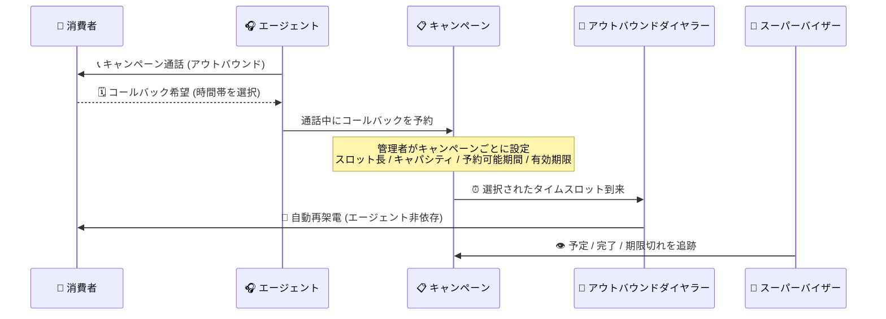

# Google Cloud Contact Center as a Service: バージョン 6.22 正式リリース

**リリース日**: 2026-10-19

**サービス**: Google Cloud Contact Center as a Service (CCaaS)

**機能**: バージョン 6.22 正式リリース (チャットトランスクリプト分割、キャンペーンベースのスケジュールコールバック、45 件のバグ修正)

**ステータス**: 一般提供 (リリース済み。各インスタンスへの適用時期はデプロイスケジュールに依存)

📊 [このアップデートのインフォグラフィックを見る](https://takech9203.github.io/google-cloud-news-summary/20261019-ccaas-6-22-release.html)

## 概要

Google Cloud CCaaS のバージョン 6.22 が正式にリリースされました。10 月 13 日に公開されたプレリリースノート ([レポート](2026-10-13-ccaas-6-22-prerelease-notes.md)) で予告されていた内容が、予定どおり 2 つの新機能と多数のバグ修正を含む形で提供開始されています。各インスタンスへの適用タイミングは、契約時に選択したデプロイスケジュールに依存するため、自社インスタンスの更新時期は管理者が確認する必要があります。

新機能の 1 つ目は「チャットのトランスクリプト分割 (Transcript Separation)」です。従来の 1 セッション = 1 統合トランスクリプトに代えて、チャットに参加したエージェント・仮想エージェント・スーパーバイザーの参加者セグメントごとに個別のトランスクリプトファイルを配信できます。2 つ目は「キャンペーンベースのスケジュールコールバック」で、アウトバウンドキャンペーン通話中にエージェントがコールバックを予約でき、コールバックは個々のエージェントではなくキャンペーンに帰属し、ダイヤラーが消費者の選択した時間帯に自動で再架電します。

また、本リリースには 45 件のバグ修正が含まれます。重複コールレコードによる待ち時間の誤表示、データベース高レイテンシ時の SIP 603 エラーによる着信拒否、複数回の保留で通話録音が歪む問題、ノルウェー・デンマークなどの IVR コールバック番号への誤った +1 プレフィックス付与、Kubernetes / Google Cloud サービスアカウントの過剰権限 (権限昇格リスク) の是正など、音声・チャット・レポーティング・CRM 連携・セキュリティにわたる広範な修正が行われています。コンタクトセンターの管理者・スーパーバイザー・運用チームは、自社インスタンスの更新時期を確認し、新機能の活用とバグ修正の恩恵を計画的に取り込むことが推奨されます。

**アップデート前の課題**

- 従来のスケジュールコール機能はインバウンド向け (営業時間外やキュー超過時に消費者がコールバックを予約) であり、アウトバウンドキャンペーン通話中にコールバックをキャンペーン単位で予約・管理する仕組みがなかった
- チャットのトランスクリプトはセッションごとに 1 つの統合ファイルとして出力され、転送やエスカレーションが発生した会話でどの参加者がどの部分を担当したかを切り分けにくかった
- 重複コールレコード、SIP 603 エラーによる着信拒否、録音の歪み、国際地域での IVR コールバック番号の誤りなど、多数の既知の不具合が存在していた

**アップデート後の改善**

- エージェントがキャンペーン通話中にコールバックを予約でき、ダイヤラーが消費者の選択したタイムスロットに自動で再架電する。管理者はキャンペーンごとにスロット長・キャパシティ・予約可能期間・有効期限を設定でき、スーパーバイザーはキャンペーンリストから予定・完了・期限切れのコールバックを追跡できる
- Settings > Chat > Chat Transcript の Transcript Separation で Per Segment を選択すると、参加者セグメントごとに個別のトランスクリプトファイルが配信される (消費者には従来どおり全チャットの統合トランスクリプトが提供される)
- 音声・録音品質、チャット・仮想エージェント、レポーティング、CRM 連携、国際化、セキュリティにわたる 45 件の不具合が修正された

## アーキテクチャ図

キャンペーンベースのスケジュールコールバックのフロー。コールバックは予約したエージェント個人ではなくキャンペーンに帰属するため、当該エージェントの在席状況に関係なくダイヤラーが指定スロットで自動的に再架電します。

## サービスアップデートの詳細

### 主要機能

1. **チャットのトランスクリプト分割 (Transcript Separation)**
   - 1 セッションにつき 1 つの統合トランスクリプトではなく、参加者セグメントごとに個別のトランスクリプトファイルを配信するよう構成できる
   - 設定場所は Settings > Chat > Chat Transcript > Transcript Separation で、Per Segment を選択する
   - チャットに参加した各エージェント、仮想エージェント、スーパーバイザーごとに個別ファイルが生成され、転送・エスカレーションされた会話でどの参加者がどの部分を担当したかを特定しやすくなる
   - この設定にかかわらず、消費者には常に全チャットの統合トランスクリプトが提供される
   - デフォルトでは無効。インスタンスで有効化するには Google Cloud サポートへの連絡が必要

2. **キャンペーンベースのスケジュールコールバック**
   - エージェントがアウトバウンドキャンペーン通話中にコールバックを予約できる
   - コールバックは個々のエージェントではなくキャンペーンに帰属し、ダイヤラーが消費者の選択したタイムスロットに自動で再架電する
   - 管理者はキャンペーンごとにスロット長、キャパシティ、予約可能期間 (booking window)、有効期限 (expiry) を設定できる
   - スーパーバイザーはキャンペーンリストから「予定 (upcoming)」「完了 (completed)」「期限切れ (expired)」のコールバックを追跡できる

3. **45 件のバグ修正**
   - 主なテーマ別の修正内容は以下のとおり (詳細はリリースノート参照):

   | テーマ | 主な修正内容 |
   |--------|--------------|
   | 通話ルーティング・安定性 | 1 件のインバウンド通話に対する重複コールレコードの作成 (リアルタイムキューの待ち時間誤表示の原因)、データベース高レイテンシ時に着信が SIP 603 エラーで拒否される問題、ピックアップとカスケードタイマー満了が重なった際の 1 通話の 2 エージェント同時割り当て、クローズ済みキューへの転送が可能だった問題、管理画面で非表示にした転送制限が有効なまま残りキューが転送先として到達不能になる問題 |
   | 録音・音声品質 | 通話中に複数回保留すると録音が歪む・不明瞭になる問題、ウォーム転送完了後も録音に保留音が流れ続ける問題、音声アップロードが拡張子のみで検証され非互換フォーマット再生時に通話が切断される問題、アウトバウンド仮想エージェント音声の途中切断 |
   | チャット・仮想エージェント | 仮想エージェントから人間へのエスカレーションで最大 300 秒の割り当て遅延、チャットイベントからの会話 ID 欠落、応答がなくなったエンドユーザーへのチャット割り当て、モニター後バージイン時にスーパーバイザー名が表示されない問題 |
   | レポーティング・モニタリング | スキルベースキューで対応可能エージェント数が 0 と誤表示される問題、通話・ラップアップ時間の重複レポート行、レポートエクスポートが処理中のまま完了しない問題、デフレクションされた通話メタデータが Cloud Storage へエクスポートされない問題 |
   | CRM・エージェント体験 | Salesforce ルックアップ失敗時の重複レコード作成、キャンペーン通話中の CRM レコード自動表示の不具合、必須ディスポジションが音声切断時に破棄される問題、削除済みステータスに紐づくエージェントがサインインできない問題 |
   | 国際化・地域対応 | ノルウェー・デンマークなど一部地域の IVR カスタムコールバック番号に誤って +1 プレフィックスが付与される問題、セッションメタデータがユーザー設定言語ではなく英語で表示される問題 |
   | セキュリティ | 複数の Kubernetes および Google Cloud サービスアカウントに過剰に広い権限が付与され、不正な権限昇格を許す可能性があった問題 (権限スコープの是正) |
   | アクセシビリティ・UI | ブラウザ 400% ズーム時にチャットウィジェットのテキストサイズメニューがスクロールできない問題、エージェントアダプターの iframe 幅が狭い場合の表示崩れ |
   | ドキュメント | Apps API / コールセッションメタデータスキーマの `parentId`・`finishReason` フィールド未定義、Manager API のエージェントアクティビティログで 17 個のチャットルーティング・アクティビティ値が未記載だった問題 |

## 技術仕様

### チャットトランスクリプト分割の設定

| 項目 | 詳細 |
|------|------|
| 設定場所 | Settings > Chat > Chat Transcript > Transcript Separation |
| 設定値 | Per Segment (参加者セグメントごとに個別ファイル配信) |
| 対象参加者 | エージェント、仮想エージェント、スーパーバイザー |
| 消費者向けトランスクリプト | 設定にかかわらず常に全チャットの統合版を受領 |
| デフォルト | 無効 (有効化には Google Cloud サポートへの連絡が必要) |

### キャンペーンベースのスケジュールコールバックの設定項目

| 項目 | 詳細 |
|------|------|
| スロット長 (slot length) | コールバック時間枠の長さをキャンペーンごとに設定 |
| キャパシティ (capacity) | 各スロットで受け付けるコールバック数の上限 |
| 予約可能期間 (booking window) | コールバックを予約できる期間 |
| 有効期限 (expiry) | コールバックの有効期限 |
| 帰属先 | 個々のエージェントではなくキャンペーンに帰属 |
| 追跡 | スーパーバイザーがキャンペーンリストから予定・完了・期限切れを確認 |

### 適用タイミング

| 項目 | 詳細 |
|------|------|
| リリース日 | 2026 年 10 月 19 日 |
| インスタンスへの適用 | 選択済みのデプロイスケジュールに依存 (全インスタンスに即時適用されるわけではない) |

## 設定方法

### 前提条件

1. Google Cloud CCaaS (CCAI Platform) のインスタンスがバージョン 6.22 に更新されていること (デプロイスケジュールを確認)
2. トランスクリプト分割の利用には Google Cloud サポートによるインスタンスでの有効化が必要
3. キャンペーンコールバックの利用にはアウトバウンドキャンペーン (キャンペーンマネージャー) の運用が前提

### 手順

#### ステップ 1: トランスクリプト分割の有効化

1. Google Cloud サポートに連絡し、インスタンスでの Transcript Separation 機能の有効化を依頼する
2. CCAI Platform ポータルで **Settings > Chat > Chat Transcript** に移動する
3. **Transcript Separation** で **Per Segment** を選択して保存する

#### ステップ 2: キャンペーンコールバックの設定

1. CCAI Platform ポータルでキャンペーン設定を開く
2. キャンペーンごとにスロット長、キャパシティ、予約可能期間、有効期限を設定する
3. エージェントはキャンペーン通話中に消費者の希望時間帯でコールバックを予約する
4. スーパーバイザーはキャンペーンリストから予定・完了・期限切れのコールバックを追跡する

## メリット

### ビジネス面

- **再架電の確実性と接続率の向上**: コールバックがキャンペーンに帰属するため、予約したエージェントのシフトや離席に左右されず、消費者が選んだ時間帯に確実に再架電できる。商談機会の喪失防止と顧客体験の向上が期待できる
- **キャンペーン運用の可視性向上**: スーパーバイザーが予定・完了・期限切れのコールバックを一覧で追跡でき、未消化コールバックの検知や改善サイクルの運用が容易になる
- **品質管理・監査の効率化**: 参加者別トランスクリプトにより、QA やコンプライアンス監査で各参加者の対応内容を正確に切り分けて評価できる

### 技術面

- **安定性の大幅な改善**: 重複コールレコード、SIP 603 エラー、イベントプロセッサのクラッシュ、レポートエクスポートの停止など、運用に影響する 45 件の不具合が一括で修正された
- **セキュリティ姿勢の強化**: Kubernetes / Google Cloud サービスアカウントの過剰権限が是正され、権限昇格リスクが低減された
- **グローバル展開時の信頼性向上**: ノルウェー・デンマークなどでの IVR コールバック番号の +1 プレフィックス誤付与が修正され、国際地域でのコールバック運用が正常化された

## デメリット・制約事項

### 制限事項

- トランスクリプト分割はデフォルトで無効であり、有効化には Google Cloud サポートへの連絡が必要 (セルフサービスで有効化できない)
- バージョン 6.22 の適用時期はデプロイスケジュールに依存するため、リリース日時点で全インスタンスに反映されているわけではない

### 考慮すべき点

- トランスクリプト分割を有効にすると、CRM や外部ストレージに配信されるトランスクリプトファイル数が増加するため、後続のファイル処理・保管・分析フローへの影響を事前に確認する必要がある
- キャンペーンコールバックのスロット長・キャパシティ・予約可能期間・有効期限はキャンペーンごとの設計が必要であり、既存のキャンペーン運用設計 (エージェント配置やダイヤリングモード) との整合を取る必要がある
- プレリリースノート (10 月 13 日公開) の内容を前提に準備していた場合も、正式リリースノートで修正一覧 (45 件) を改めて確認することを推奨

## ユースケース

### ユースケース 1: アウトバウンドセールスキャンペーンでの再架電予約

**シナリオ**: 保険商品のアウトバウンドキャンペーンで、消費者が「明日の午後にかけ直してほしい」と希望した場合、エージェントが通話中にその時間帯のコールバックを予約する。

**効果**: コールバックはキャンペーンに帰属するため、翌日に当該エージェントが不在でもダイヤラーが指定スロットで自動的に再架電する。スーパーバイザーは期限切れコールバックを監視し、未消化の再架電を検知してフォローできる。

### ユースケース 2: エスカレーションを含むチャットの品質監査

**シナリオ**: 仮想エージェントで開始されたチャットが人間のエージェントにエスカレーションされ、さらにスーパーバイザーがバージインした会話について、各参加者の対応品質を監査する。

**効果**: Per Segment 設定により、仮想エージェント・エージェント・スーパーバイザーそれぞれのトランスクリプトファイルが個別に生成され、担当範囲を明確に切り分けて評価できる。消費者には従来どおり統合トランスクリプトが提供されるため、顧客体験は変わらない。

### ユースケース 3: 既知の不具合に起因する運用課題の解消

**シナリオ**: リアルタイムキュービューの待ち時間が実態と乖離している、国際地域の IVR コールバックが失敗するなどの不具合に悩まされていたコンタクトセンターが、6.22 への更新で解消を図る。

**効果**: 重複コールレコードや IVR コールバック番号プレフィックスの修正などにより、回避策 (手動補正や個別サポート問い合わせ) が不要になり、運用負荷が低減する。

## 料金

本リリースノートに料金に関する記載はありません。CCaaS の料金については公式ドキュメントを参照してください。

- [CCAI Platform ドキュメント](https://docs.cloud.google.com/contact-center/ccai-platform/docs)

## 関連サービス・機能

- **スケジュールコール (インバウンド)**: 営業時間外やキュー超過時に消費者がコールバックを予約できる既存機能。今回のキャンペーンベースのコールバックは、これをアウトバウンドキャンペーンの文脈に拡張するもの
- **アウトバウンドダイヤラー / キャンペーンマネージャー**: Preview / Predictive / Progressive の各ダイヤリングモードを提供するキャンペーン管理基盤。スケジュールコールバックはこの基盤上で動作する
- **チャットトランスクリプト / CRM 連携**: チャット終了後にトランスクリプトを Salesforce、Zendesk などの CRM や外部ストレージへ配信する既存機能。トランスクリプト分割はこの配信単位を参加者セグメントごとに変更する
- **Cloud Storage**: 通話メタデータやトランスクリプトのエクスポート先。本リリースではデフレクションされた通話のメタデータがエクスポートされない不具合も修正された

## 参考リンク

- 📊 [インフォグラフィック](https://takech9203.github.io/google-cloud-news-summary/20261019-ccaas-6-22-release.html)
- [公式リリースノート (Google Cloud)](https://docs.cloud.google.com/release-notes#October_19_2026)
- [CCaaS リリースノート](https://docs.cloud.google.com/contact-center/ccai-platform/docs/release-notes)
- [チャットトランスクリプトとチャット履歴のドキュメント](https://docs.cloud.google.com/contact-center/ccai-platform/docs/chat-transcripts-and-chat-history)
- [キャンペーン管理のドキュメント](https://docs.cloud.google.com/contact-center/ccai-platform/docs/campaign-management)
- [プレリリースノートのレポート (2026-10-13)](2026-10-13-ccaas-6-22-prerelease-notes.md)

## まとめ

CCaaS 6.22 が正式リリースされ、プレリリースノートで予告されていたチャットトランスクリプトの参加者別分割とキャンペーンベースのスケジュールコールバックが利用可能になり、音声・チャット・レポーティング・セキュリティにわたる 45 件のバグ修正が適用されました。インスタンスへの適用時期はデプロイスケジュールに依存するため、管理者はまず自社の更新タイミングを確認し、トランスクリプト分割を利用する場合は Google Cloud サポートへの有効化依頼、キャンペーンコールバックを利用する場合はスロット設計を進めることを推奨します。

---

**タグ**: #CCaaS #ContactCenter #CCAIPlatform #リリース #OutboundCampaign #ChatTranscript #BugFix
