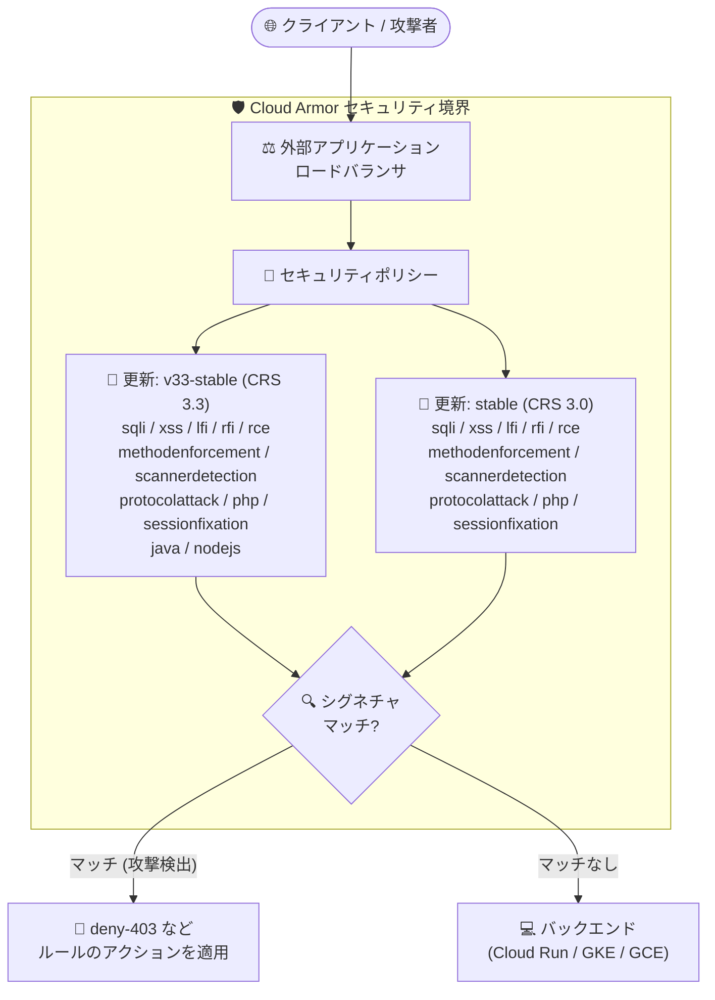

# Google Cloud Armor: 事前構成 WAF ルールセット (CRS 3.3 / 3.0 stable) のセキュリティ修正と機能強化

**リリース日**: 2026-10-19

**サービス**: Google Cloud Armor

**機能**: 事前構成 WAF ルールセットの更新 (v33-stable / v3.0 stable)

**ステータス**: Security (セキュリティ修正・機能強化)

📊 [このアップデートのインフォグラフィックを見る](https://takech9203.github.io/google-cloud-news-summary/20261019-cloud-armor-waf-ruleset-updates.html)

## 概要

Google Cloud Armor の事前構成 WAF ルールセット (preconfigured WAF rules) に対して、セキュリティ修正と機能強化が適用されました。今回の更新は OWASP ModSecurity Core Rule Set (CRS) 3.3 ベースの **v33-stable** 系 12 ルールセットと、CRS 3.0 ベースの **stable** 系 10 ルールセットが対象です。

Cloud Armor の事前構成 WAF ルールは、SQL インジェクション (SQLi)、クロスサイトスクリプティング (XSS)、リモートコード実行 (RCE) など OWASP Top 10 に代表される Web 攻撃を検出する多数のシグネチャで構成されています。更新は canary 版で先行リリースされたのち stable 版に昇格 (プロモート) される運用であり、今回 stable 版に更新が反映されたことで、これらのルールセットを利用するすべてのセキュリティポリシーに最新の検出ロジックが適用されます。

外部アプリケーション ロードバランサなどの前段で Cloud Armor セキュリティポリシーを運用しているユーザーは、追加の設定作業なしに更新後のシグネチャで評価が行われます。ただし、シグネチャの挙動が変わる可能性があるため、opt-out している署名 ID や感度レベル (sensitivity) のチューニング内容を確認することが推奨されます。

**アップデート前の課題**

- 旧バージョンの stable ルールセットには、最新の攻撃手法や回避テクニックに対する検出の抜けや、誤検知 (false positive) につながる既知の問題が残っていた
- canary 版に先行適用されていた修正が stable 版には未反映で、stable 版のみを利用する環境では最新の検出改善を享受できていなかった

**アップデート後の改善**

- CRS 3.3 系 (v33-stable) の 12 ルールセットと CRS 3.0 系 (stable) の 10 ルールセットにセキュリティ修正と機能強化が反映された
- stable ルールセットを参照しているセキュリティポリシーは、設定変更なしで自動的に更新後のシグネチャで評価されるようになった
- SQLi / XSS / LFI / RFI / RCE / メソッド強制 / スキャナ検出 / プロトコル攻撃 / PHP / セッション固定 (CRS 3.3 では加えて Java / Node.js) の各攻撃カテゴリで検出品質が向上した

## アーキテクチャ図



外部アプリケーション ロードバランサに到達したリクエストは、Cloud Armor セキュリティポリシー内の事前構成 WAF ルールで評価されます。今回更新された v33-stable / stable ルールセットのシグネチャにマッチした攻撃リクエストは、バックエンドに到達する前にブロックされます。

## サービスアップデートの詳細

### 主要機能

1. **CRS 3.3 ベース (v33-stable) の 12 ルールセット更新**
   - 対象: `sqli-v33-stable`, `xss-v33-stable`, `lfi-v33-stable`, `rfi-v33-stable`, `rce-v33-stable`, `methodenforcement-v33-stable`, `scannerdetection-v33-stable`, `protocolattack-v33-stable`, `php-v33-stable`, `sessionfixation-v33-stable`, `java-v33-stable`, `nodejs-v33-stable`
   - セキュリティ修正と検出ロジックの機能強化が適用された

2. **CRS 3.0 ベース (stable) の 10 ルールセット更新**
   - 対象: `sqli-stable`, `xss-stable`, `lfi-stable`, `rfi-stable`, `rce-stable`, `methodenforcement-stable`, `scannerdetection-stable`, `protocolattack-stable`, `php-stable`, `sessionfixation-stable`
   - CRS 3.0 には Java / Node.js ルールセットが含まれないため、対象は 10 種類

3. **stable 版への自動反映**
   - 事前構成 WAF ルールの更新は canary 版に先行リリースされた後、stable 版へ昇格される
   - stable ルールセットを参照する既存のセキュリティポリシーには、ユーザー操作なしで更新が反映される

## 技術仕様

### 更新対象ルールセットと攻撃カテゴリ

| 攻撃カテゴリ | CRS 3.3 (v33-stable) | CRS 3.0 (stable) |
|------|------|------|
| SQL インジェクション | sqli-v33-stable | sqli-stable |
| クロスサイトスクリプティング (XSS) | xss-v33-stable | xss-stable |
| ローカルファイル インクルージョン (LFI) | lfi-v33-stable | lfi-stable |
| リモートファイル インクルージョン (RFI) | rfi-v33-stable | rfi-stable |
| リモートコード実行 (RCE) | rce-v33-stable | rce-stable |
| メソッド強制 | methodenforcement-v33-stable | methodenforcement-stable |
| スキャナ検出 | scannerdetection-v33-stable | scannerdetection-stable |
| プロトコル攻撃 | protocolattack-v33-stable | protocolattack-stable |
| PHP インジェクション攻撃 | php-v33-stable | php-stable |
| セッション固定攻撃 | sessionfixation-v33-stable | sessionfixation-stable |
| Java 攻撃 | java-v33-stable | (対象外) |
| Node.js 攻撃 | nodejs-v33-stable | (対象外) |

### 事前構成 WAF ルールの基本仕様

| 項目 | 詳細 |
|------|------|
| ベース | OWASP ModSecurity Core Rule Set (CRS)。最新の脅威への保護には CRS 4.22 (`*-v422-stable`) の利用が推奨されており、CRS 3.3 / 3.0 もサポート継続中 |
| 感度レベル (sensitivity) | 0〜4。デフォルトは 4 (全シグネチャを評価)。低い感度ほど誤検知の少ない高信頼シグネチャのみを評価 |
| チューニング | `opt_out_rule_ids` で特定シグネチャの除外、`opt_in_rule_ids` (sensitivity 0 時) で特定シグネチャのみ有効化が可能 |
| シグネチャ ID 形式 | CRS 3.3: `owasp-crs-v030301-id<ルール番号>-<カテゴリ>` / CRS 3.0: `owasp-crs-v030001-id<ルール番号>-<カテゴリ>` |
| canary / stable | 更新は canary 版に先行リリース後、stable 版へ昇格。canary をプレビューモードで高優先度に置き、stable を適用モードで運用する構成が推奨 |

### ルール式の例 (CRS 3.3)

```
evaluatePreconfiguredWaf('sqli-v33-stable', {'sensitivity': 1})
```

## 設定方法

今回の更新は stable ルールセットに自動反映されるため、新規の設定作業は不要です。以下は更新内容が自身のトラフィックに与える影響を確認するための手順です。

### 前提条件

1. Cloud Armor セキュリティポリシーで `*-v33-stable` または `*-stable` (CRS 3.0) の事前構成 WAF ルールを使用していること
2. セキュリティポリシーのログ (Cloud Logging) を確認できる権限があること

### 手順

#### ステップ 1: 使用中の事前構成 WAF ルールを確認

```bash
gcloud compute security-policies describe POLICY_NAME \
    --format="value(rules.match.expr.expression)"
```

セキュリティポリシー内で `evaluatePreconfiguredWaf('sqli-v33-stable', ...)` のように v33-stable / stable 系ルールセットを参照しているルールを特定します。

#### ステップ 2: ログで誤検知の有無を確認

```bash
gcloud logging read \
  'resource.type="http_load_balancer" AND jsonPayload.enforcedSecurityPolicy.name="POLICY_NAME"' \
  --limit 50 --format json
```

更新後のシグネチャで正当なトラフィックがブロックされていないかを確認します。詳細なマッチ情報が必要な場合は verbose logging の有効化が有用です (本番環境での長期間の有効化は非推奨)。

#### ステップ 3: 必要に応じてチューニング

```bash
gcloud compute security-policies rules update PRIORITY \
    --security-policy POLICY_NAME \
    --expression "evaluatePreconfiguredWaf('sqli-v33-stable', {'sensitivity': 1, 'opt_out_rule_ids': ['owasp-crs-v030301-id942350-sqli']})"
```

誤検知が確認された場合は、感度レベルの調整や `opt_out_rule_ids` による特定シグネチャの除外でチューニングします。opt-out するシグネチャ ID はルールセットのバージョン (CRS 3.0 / 3.3) と一致させる必要があります。

## メリット

### ビジネス面

- **運用負荷ゼロでのセキュリティ向上**: stable ルールセットを利用中の環境には更新が自動反映され、パッチ適用作業なしで最新の攻撃検出が有効になる
- **コンプライアンス維持**: OWASP Top 10 への対策として事前構成 WAF ルールを採用している場合、検出品質の継続的な改善により防御水準を維持できる

### 技術面

- **広範な攻撃カテゴリのカバー**: SQLi / XSS / LFI / RFI / RCE / プロトコル攻撃など主要な Web 攻撃カテゴリ全体で修正・強化が適用される
- **旧バージョン利用環境もカバー**: 最新の CRS 4.22 だけでなく、CRS 3.3 / 3.0 の stable 系を使い続けている環境にも修正が提供される

## デメリット・制約事項

### 制限事項

- 更新内容の個別シグネチャ単位の変更詳細はリリースノートには記載されておらず、挙動の変化はログでの観測により確認する必要がある
- CRS 3.0 系には Java / Node.js ルールセットが存在しないため、これらの攻撃カテゴリの保護には CRS 3.3 以降への移行が必要

### 考慮すべき点

- シグネチャの更新により、これまで通過していたリクエストが新たにマッチする (またはその逆の) 可能性があるため、更新後はログで誤検知・検知漏れを確認することが推奨される
- Google は最新の脅威への保護として CRS 4.22 (`*-v422-stable`) の利用を推奨しており、特に CRS 3.0 からの移行を検討すべきタイミングといえる
- canary 版をプレビューモード (高優先度) で併用していれば、今後の更新も本番影響前にログで検証できる

## ユースケース

### ユースケース 1: stable ルールセット利用環境での更新影響確認

**シナリオ**: EC サイトの外部アプリケーション ロードバランサに `sqli-v33-stable` と `xss-v33-stable` を sensitivity 1 で適用している。今回の更新で正当なトラフィックへの影響がないか確認したい。

**実装例**:
```
# canary 版をプレビューモードで stable より高い優先度に配置し、今後の更新を事前検証する
gcloud compute security-policies rules create 900 \
    --security-policy prod-policy \
    --expression "evaluatePreconfiguredWaf('sqli-v33-canary', {'sensitivity': 1})" \
    --action deny-403 \
    --preview
```

**効果**: stable 版への更新が本番トラフィックに与える影響を、canary 版のプレビューログで事前に把握でき、誤検知時のチューニングを先回りで実施できる。

### ユースケース 2: CRS 3.0 から新バージョンへの移行計画

**シナリオ**: 長期間 `sqli-stable` (CRS 3.0) を利用しているレガシーシステムで、今回の更新を機にルールセットのバージョン棚卸しを行う。

**効果**: CRS 3.0 も引き続き修正が提供されていることを確認しつつ、Java / Node.js 攻撃カテゴリや最新シグネチャを含む CRS 3.3 / 4.22 への段階的な移行計画を立てられる。移行時はプレビューモードでの検証により安全に切り替えられる。

## 料金

今回のルールセット更新自体に追加料金は発生しません。事前構成 WAF ルールの利用料金は従来どおり Cloud Armor の料金体系に従います。

- **Cloud Armor Standard**: ポリシー数・ルール数・リクエスト数に基づく従量課金で WAF を利用
- **Cloud Armor Enterprise (Paygo / Annual)**: WAF の利用 (ルール・ポリシー・リクエスト) がサブスクリプションに含まれる

詳細は [Cloud Armor 料金ページ](https://cloud.google.com/armor/pricing) を参照してください。

## 利用可能リージョン

事前構成 WAF ルールは Cloud Armor セキュリティポリシーの機能としてグローバルに提供されます。詳細は [Cloud Armor ドキュメント](https://docs.cloud.google.com/armor/docs/waf-rules) を参照してください。

## 関連サービス・機能

- **外部アプリケーション ロードバランサ / 外部プロキシ ネットワーク ロードバランサ**: Cloud Armor セキュリティポリシーの適用対象。WAF ルールはこれらの前段でリクエストを評価する
- **Cloud Logging**: WAF ルールのマッチ結果を記録。verbose logging により、どのリクエスト属性がシグネチャにマッチしたかの詳細を確認できる
- **Cloud Armor マネージドルール**: 自動更新される脅威検出シグネチャを提供するオプションのアドオン。事前構成 WAF ルールと同様に canary / stable 版が提供される
- **Cloud Armor Adaptive Protection**: L7 DDoS 攻撃を機械学習で検出する Enterprise 機能。WAF ルールと組み合わせて多層防御を構成する
- **Cloud CDN / Media CDN**: Cloud Armor と統合され、キャッシュ配信にもセキュリティポリシーを適用可能

## 参考リンク

- 📊 [インフォグラフィック](https://takech9203.github.io/google-cloud-news-summary/20261019-cloud-armor-waf-ruleset-updates.html)
- [公式リリースノート](https://docs.cloud.google.com/release-notes#October_19_2026)
- [Cloud Armor 事前構成 WAF ルールのチューニング](https://docs.cloud.google.com/armor/docs/rule-tuning)
- [Cloud Armor 事前構成 WAF ルールの概要](https://docs.cloud.google.com/armor/docs/waf-rules)
- [事前構成 WAF ルールの設定](https://docs.cloud.google.com/armor/docs/configure-waf)
- [Cloud Armor ベストプラクティス](https://docs.cloud.google.com/armor/docs/best-practices)
- [料金ページ](https://cloud.google.com/armor/pricing)

## まとめ

Cloud Armor の CRS 3.3 / 3.0 ベースの stable 系 WAF ルールセット計 22 種にセキュリティ修正と機能強化が自動適用されました。該当ルールセットを利用中の環境では、更新後のログを確認して誤検知の有無を点検し、必要に応じて感度レベルや opt-out 設定をチューニングすることを推奨します。あわせて、より新しい CRS 4.22 への移行や、canary 版をプレビューモードで併用する運用の導入を検討するよい機会です。

---

**タグ**: #CloudArmor #WAF #セキュリティ #OWASP #CRS #SQLi #XSS #DDoS
