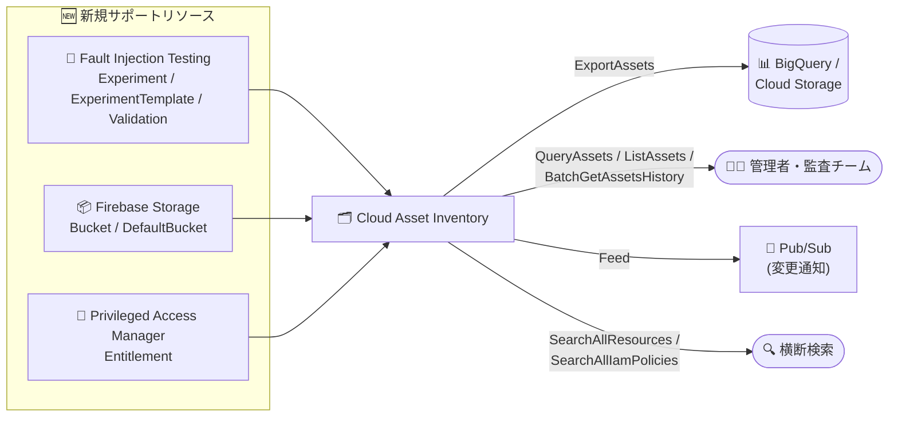

# Cloud Asset Inventory: 新規リソースタイプのサポート追加 (Fault Injection Testing / Firebase Storage / Privileged Access Manager)

**リリース日**: 2026-10-19

**サービス**: Cloud Asset Inventory

**機能**: 新規リソースタイプのサポート追加

**ステータス**: 一般提供 (Publicly Available)

📊 [このアップデートのインフォグラフィックを見る](https://takech9203.github.io/google-cloud-news-summary/20261019-cloud-asset-inventory-new-resource-types.html)

## 概要

Cloud Asset Inventory で新たに 6 つのリソースタイプが一般公開され、`ExportAssets`、`ListAssets`、`BatchGetAssetsHistory`、`QueryAssets`、`Feed`、および Search (`SearchAllResources`、`SearchAllIamPolicies`) の各 API から利用できるようになりました。対象は Fault Injection Testing、Firebase Storage、Privileged Access Manager (PAM) の 3 サービスに属するリソースです。

今回追加されたリソースタイプは以下のとおりです。

- **Fault Injection Testing**: `faulttesting.googleapis.com/Experiment`、`faulttesting.googleapis.com/ExperimentTemplate`、`faulttesting.googleapis.com/Validation`
- **Firebase Storage**: `firebasestorage.googleapis.com/Bucket`、`firebasestorage.googleapis.com/DefaultBucket`
- **Privileged Access Manager**: `privilegedaccessmanager.googleapis.com/Entitlement`

このアップデートにより、組織・フォルダ・プロジェクト横断でのアセット棚卸し、変更履歴の追跡、SQL によるクエリ、リアルタイムの変更監視 (Feed + Pub/Sub) が、これらのリソースに対しても可能になります。カオスエンジニアリングの実験設定、Firebase アプリのストレージバケット、特権アクセスのエンタイトルメント定義といった、ガバナンス上重要な構成情報を一元的に可視化したい組織管理者やセキュリティチームにとって有用なアップデートです。

**アップデート前の課題**

- Fault Injection Testing の実験・テンプレート・検証リソースは Cloud Asset Inventory の対象外であり、組織内でどのような障害注入実験が定義されているかを横断的に棚卸しする手段がなかった
- Firebase Storage のバケットは各プロジェクトの Firebase コンソールや API を個別に確認する必要があり、組織全体のストレージ資産の全体像を把握しにくかった
- PAM のエンタイトルメント (一時的な特権付与の定義) を組織横断で検索・エクスポートできず、特権アクセス設定の監査には各リソースレベルでの個別確認が必要だった

**アップデート後の改善**

- 6 つのリソースタイプを Cloud Asset Inventory の主要 API (エクスポート、一覧、履歴、SQL クエリ、フィード、検索) で統一的に扱えるようになった
- BigQuery / Cloud Storage へのエクスポートや `QueryAssets` による SQL 分析を通じて、これらのリソースの構成をガバナンスレポートやコンプライアンス監査に組み込めるようになった
- Feed と Pub/Sub の連携により、PAM エンタイトルメントの作成・変更などをほぼリアルタイムに検知する監視パイプラインを構築できるようになった

## アーキテクチャ図



3 サービスの新規リソースタイプが Cloud Asset Inventory に取り込まれ、エクスポート・クエリ・検索・変更監視の各 API から統一的に利用できるようになる流れを示しています。

## サービスアップデートの詳細

### 主要機能

1. **Fault Injection Testing リソースのインベントリ対応**
   - `Experiment` (実行された障害注入実験)、`ExperimentTemplate` (注入する障害とターゲットリソースを定義するテンプレート)、`Validation` の 3 タイプが対象
   - Fault Injection Testing は Google Cloud 環境に意図的に障害を注入し、アプリケーションのレジリエンスを検証するサービス (Preview)
   - 組織内でどのような実験テンプレートが存在し、いつ実験が実行されたかを横断的に把握できる

2. **Firebase Storage バケットのインベントリ対応**
   - `Bucket` および `DefaultBucket` (Firebase プロジェクトのデフォルトバケット) が対象
   - Firebase アプリが利用するストレージ資産を、Cloud Storage バケットと同様に組織横断で棚卸し・検索できる

3. **Privileged Access Manager エンタイトルメントのインベントリ対応**
   - `Entitlement` (どのプリンシパルが、どのロールを、どの条件・承認フローで一時取得できるかの定義) が対象
   - PAM は Just-in-Time の一時的な特権昇格を管理するサービスで、エンタイトルメントはその中核リソース
   - なお、PAM のグラント (`privilegedaccessmanager.googleapis.com/Grant`) は従来から Cloud Asset Inventory の Feed で変更通知を受け取れており、今回のエンタイトルメント対応で定義と付与の両面を追跡できるようになる

### 対応 API

| API | 用途 |
|------|------|
| `ExportAssets` | BigQuery / Cloud Storage へのアセット一括エクスポート |
| `ListAssets` | プロジェクト・フォルダ・組織配下のアセット一覧取得 |
| `BatchGetAssetsHistory` | アセットの変更履歴の取得 |
| `QueryAssets` | SQL によるアセットのクエリ |
| `Feed` | Pub/Sub 経由でのアセット変更のリアルタイム通知 |
| `SearchAllResources` / `SearchAllIamPolicies` | 組織横断のリソース・IAM ポリシー検索 |

## 技術仕様

### 追加されたアセットタイプ

| サービス | アセットタイプ |
|------|------|
| Fault Injection Testing | `faulttesting.googleapis.com/Experiment` |
| Fault Injection Testing | `faulttesting.googleapis.com/ExperimentTemplate` |
| Fault Injection Testing | `faulttesting.googleapis.com/Validation` |
| Firebase Storage | `firebasestorage.googleapis.com/Bucket` |
| Firebase Storage | `firebasestorage.googleapis.com/DefaultBucket` |
| Privileged Access Manager | `privilegedaccessmanager.googleapis.com/Entitlement` |

Cloud Asset Inventory のデータは結果整合性で提供され、通常は数時間ごとに同期されます。各アセットタイプの詳細な提供状況 (分析 API での利用可否など) は [サポートされているアセットタイプ](https://docs.cloud.google.com/asset-inventory/docs/asset-types) を参照してください。

## 設定方法

### 前提条件

1. 対象プロジェクトまたは組織で Cloud Asset API (`cloudasset.googleapis.com`) が有効化されていること
2. 呼び出し元に `roles/cloudasset.viewer` などの適切な IAM ロールが付与されていること

### 手順

#### ステップ 1: 新規リソースタイプを検索する

```bash
# 組織内の PAM エンタイトルメントを横断検索
gcloud asset search-all-resources \
  --scope=organizations/ORGANIZATION_ID \
  --asset-types="privilegedaccessmanager.googleapis.com/Entitlement"
```

`--asset-types` に今回追加されたアセットタイプを指定することで、組織・フォルダ・プロジェクトを横断して検索できます。

#### ステップ 2: BigQuery にエクスポートして分析する

```bash
# Fault Injection Testing のリソースを BigQuery にエクスポート
gcloud asset export \
  --organization=ORGANIZATION_ID \
  --content-type=resource \
  --asset-types="faulttesting.googleapis.com/Experiment,faulttesting.googleapis.com/ExperimentTemplate" \
  --bigquery-table="projects/PROJECT_ID/datasets/DATASET_ID/tables/TABLE_ID" \
  --output-bigquery-force
```

エクスポート後は BigQuery 上で SQL を使った分析やダッシュボード化が可能です。

#### ステップ 3: Feed で変更をリアルタイム監視する

```bash
# PAM エンタイトルメントの変更を Pub/Sub に通知するフィードを作成
gcloud asset feeds create pam-entitlement-feed \
  --organization=ORGANIZATION_ID \
  --asset-types="privilegedaccessmanager.googleapis.com/Entitlement" \
  --content-type=resource \
  --pubsub-topic="projects/PROJECT_ID/topics/TOPIC_ID"
```

エンタイトルメントの作成・変更・削除を Pub/Sub 経由で検知し、セキュリティ監視パイプラインに組み込めます。

## メリット

### ビジネス面

- **ガバナンスの強化**: 特権アクセス設定 (PAM エンタイトルメント) や障害注入実験の定義を組織横断で可視化でき、コンプライアンス監査の証跡収集が容易になる
- **運用コストの削減**: 各サービスの API やコンソールを個別に巡回する必要がなくなり、Cloud Asset Inventory の統一インターフェースで棚卸しが完結する

### 技術面

- **統一された API 体験**: 既存の Cloud Asset Inventory のエクスポート・クエリ・検索・フィードの仕組みをそのまま新規リソースタイプに適用できる
- **変更履歴の追跡**: `BatchGetAssetsHistory` により、いつ・どのように構成が変更されたかを遡って確認できる
- **イベント駆動の監視**: Feed + Pub/Sub により、特権アクセス定義の変更などセキュリティ上重要なイベントを即座に検知できる

## デメリット・制約事項

### 制限事項

- Cloud Asset Inventory のデータは結果整合性であり、同期は通常数時間ごとに行われるため、リアルタイム性が厳密に求められる用途には注意が必要
- Fault Injection Testing 自体は Preview 段階のサービスであり、Pre-GA Offerings Terms が適用される
- アセットタイプごとに分析 API (`AnalyzeIamPolicy` など) や Effective Tags の対応状況が異なる場合があるため、[アセットタイプ一覧](https://docs.cloud.google.com/asset-inventory/docs/asset-types) で個別に確認が必要

### 考慮すべき点

- エンタイトルメント情報には特権アクセスの設計が含まれるため、Cloud Asset Inventory の閲覧権限 (`roles/cloudasset.viewer` など) 自体のアクセス管理も適切に行う必要がある
- BigQuery へのエクスポートを定期実行する場合、BigQuery 側のストレージ・クエリ料金が発生する

## ユースケース

### ユースケース 1: 特権アクセス設定の定期監査

**シナリオ**: セキュリティチームが、組織内のすべての PAM エンタイトルメントを月次で棚卸しし、過剰なロールを含むエンタイトルメントがないかを監査したい。

**実装例**:
```bash
gcloud asset export \
  --organization=ORGANIZATION_ID \
  --content-type=resource \
  --asset-types="privilegedaccessmanager.googleapis.com/Entitlement" \
  --bigquery-table="projects/sec-audit/datasets/pam_audit/tables/entitlements" \
  --output-bigquery-force
```

**効果**: BigQuery 上で全エンタイトルメントを SQL で分析でき、承認フローの有無や付与可能ロールの妥当性を体系的にレビューできる。

### ユースケース 2: カオスエンジニアリング実験のガバナンス

**シナリオ**: プラットフォームチームが、組織内の各プロジェクトで定義されている Fault Injection Testing の実験テンプレートと実行履歴を一元管理し、本番環境への意図しない実験を防ぎたい。

**効果**: `SearchAllResources` や Feed を使って実験テンプレートの作成を検知し、ガイドラインに沿わない実験設定を早期に発見できる。

### ユースケース 3: Firebase ストレージ資産の棚卸し

**シナリオ**: 複数の Firebase プロジェクトを運用する組織で、どのプロジェクトにどのストレージバケットが存在するかを横断的に把握したい。

**効果**: `firebasestorage.googleapis.com/Bucket` / `DefaultBucket` を対象にした検索・エクスポートで、Firebase アプリのストレージ資産を他の Google Cloud リソースと同じ枠組みで管理できる。

## 料金

Cloud Asset Inventory 自体は追加料金なしで利用できます。ただし、BigQuery へのエクスポート結果の保存・クエリや、Pub/Sub でのフィード通知には、それぞれのサービスの料金が適用されます。

詳細は [Cloud Asset Inventory の料金ページ](https://cloud.google.com/asset-inventory/pricing) を参照してください。

## 関連サービス・機能

- **Privileged Access Manager (PAM)**: 今回対応したエンタイトルメントの提供元。グラント (`privilegedaccessmanager.googleapis.com/Grant`) の変更通知は従来から Cloud Asset Inventory Feed でサポートされている
- **Fault Injection Testing**: Google Cloud ネイティブのカオスエンジニアリングサービス (Preview)。ゾーン・リージョン障害を模した実験が可能
- **Firebase Storage**: Firebase アプリ向けのオブジェクトストレージ。Cloud Storage を基盤とする
- **BigQuery**: `ExportAssets` のエクスポート先として、アセットデータの SQL 分析・可視化に利用
- **Pub/Sub**: Feed によるアセット変更通知の配信先
- **Security Command Center**: Cloud Asset Inventory のデータを活用した組織全体のセキュリティポスチャ管理を補完

## 参考リンク

- 📊 [インフォグラフィック](https://takech9203.github.io/google-cloud-news-summary/20261019-cloud-asset-inventory-new-resource-types.html)
- [公式リリースノート](https://docs.cloud.google.com/release-notes#October_19_2026)
- [Cloud Asset Inventory でサポートされているアセットタイプ](https://docs.cloud.google.com/asset-inventory/docs/asset-types)
- [Cloud Asset Inventory 概要](https://docs.cloud.google.com/asset-inventory/docs/overview)
- [Fault Injection Testing 概要](https://docs.cloud.google.com/fault-injection-testing/overview)
- [Privileged Access Manager 概要](https://docs.cloud.google.com/iam/docs/pam-overview)
- [料金ページ](https://cloud.google.com/asset-inventory/pricing)

## まとめ

Cloud Asset Inventory のカバレッジが拡大し、特権アクセス管理 (PAM エンタイトルメント)、カオスエンジニアリング (Fault Injection Testing)、Firebase Storage のリソースを統一的に棚卸し・監査・監視できるようになりました。特にセキュリティガバナンスの観点では、PAM エンタイトルメントの横断検索と Feed による変更検知は監査体制の強化に直結します。組織でこれらのサービスを利用している場合は、既存のアセットエクスポートやフィードの対象アセットタイプに今回の 6 タイプを追加することを推奨します。

---

**タグ**: Cloud Asset Inventory, Privileged Access Manager, Fault Injection Testing, Firebase Storage, セキュリティ, ガバナンス, 監査
