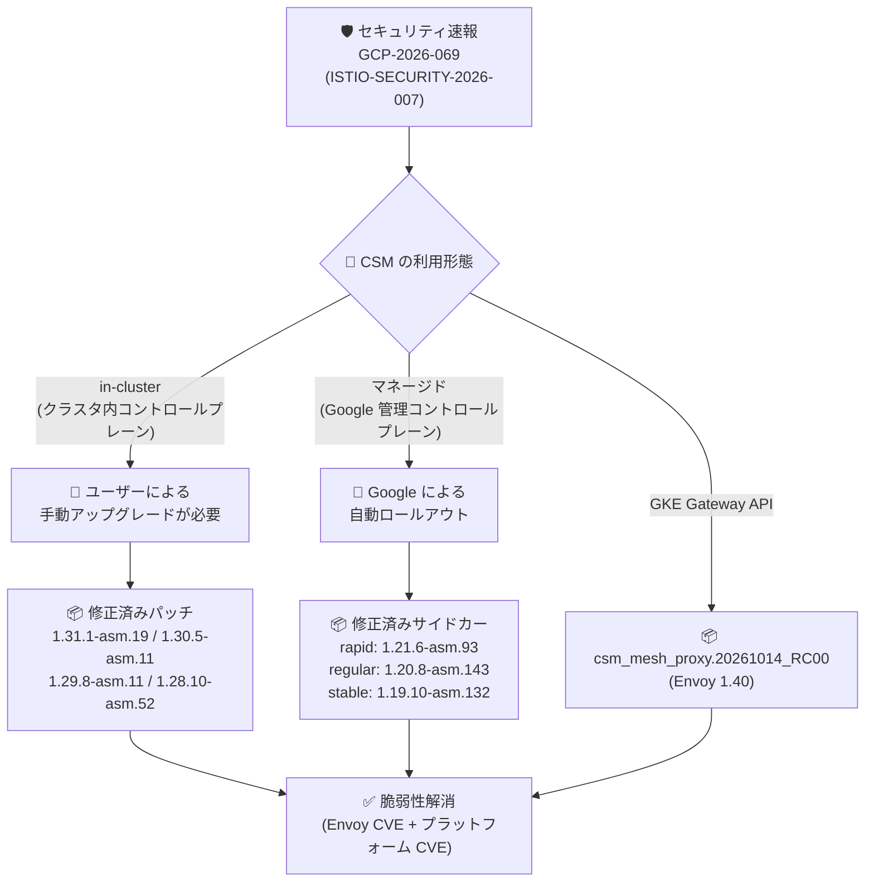

# Cloud Service Mesh: セキュリティ速報 GCP-2026-069 に対応するパッチリリース

**リリース日**: 2026-10-19

**サービス**: Cloud Service Mesh

**機能**: セキュリティパッチリリース (GCP-2026-069 / ISTIO-SECURITY-2026-007)

**ステータス**: Security / Announcement

📊 [このアップデートのインフォグラフィックを見る](https://takech9203.github.io/google-cloud-news-summary/20261019-cloud-service-mesh-security-patches-gcp-2026-069.html)

## 概要

Cloud Service Mesh (CSM) の in-cluster (クラスタ内コントロールプレーン) 向けに、セキュリティ速報 **GCP-2026-069** (Istio のセキュリティアドバイザリ **ISTIO-SECURITY-2026-007** に対応) で公表された脆弱性を解消する新しいパッチバージョンがリリースされました。対象は 1.28 系から 1.31 系までの 4 つのサポートブランチで、それぞれ修正済みの Envoy バージョンを同梱しています。最新の 1.31.1-asm.19 では、GitHub Security Advisory **GHSA-gcjh-h69q-9w9g** の修正も含まれています。

マネージド Cloud Service Mesh を利用している場合は、各リリースチャンネル (rapid / regular / stable) 向けの修正済みサイドカープロキシが順次ロールアウトされます。また、GKE 上の Gateway API 利用時のプロキシは `csm_mesh_proxy.20261014_RC00` (Envoy 1.40 相当) に更新されます。今回のリリースには Envoy / Istio の脆弱性に加えて、CVSS スコア 9.8 のクリティカルな CVE を複数含む多数のプラットフォーム CVE の修正が含まれており、in-cluster CSM を運用しているすべてのチームにとって早急な対応が推奨されるアップデートです。

**アップデート前の課題**

- in-cluster Cloud Service Mesh の既存パッチバージョンには、ISTIO-SECURITY-2026-007 で公表された Envoy / Istio の脆弱性が未修正のまま残っていた
- プロキシのベースイメージに CVSS 9.8 (クリティカル) を含む多数のプラットフォーム CVE が存在し、コンテナイメージスキャンで検出される状態だった
- 修正版が存在しないため、ユーザー側で脆弱性を緩和する恒久的な手段がなかった

**アップデート後の改善**

- 1.28 / 1.29 / 1.30 / 1.31 の各サポートブランチに修正済みパッチバージョンが提供され、アップグレードにより脆弱性を解消できるようになった
- マネージド CSM では修正済みサイドカープロキシ (1.21.6-asm.93 / 1.20.8-asm.143 / 1.19.10-asm.132) が自動ロールアウトされ、ユーザーの操作なしで保護される
- GKE の Gateway API で使用されるプロキシも Envoy 1.40 ベースの修正版に更新される

## アーキテクチャ図



利用形態によって対応が異なります。in-cluster CSM はユーザー自身によるアップグレードが必要ですが、マネージド CSM と Gateway API のプロキシは Google が自動的に更新します。

## サービスアップデートの詳細

### 主要機能

1. **in-cluster Cloud Service Mesh の修正済みパッチバージョン**
   - 各サポートブランチに対して以下の修正版が提供される

   | パッチバージョン | 同梱 Envoy バージョン | 補足 |
   |------------------|----------------------|------|
   | 1.31.1-asm.19 | Envoy v1.39.3 | GHSA-gcjh-h69q-9w9g の修正も含む |
   | 1.30.5-asm.11 | Envoy v1.38.7-dev | |
   | 1.29.8-asm.11 | Envoy v1.37.9-dev | |
   | 1.28.10-asm.52 | Envoy v1.36.10-dev | |

2. **マネージド Cloud Service Mesh のサイドカープロキシ更新**
   - 各リリースチャンネルに修正済みサイドカーが順次ロールアウトされる

   | リリースチャンネル | サイドカーバージョン |
   |--------------------|----------------------|
   | rapid | 1.21.6-asm.93 |
   | regular | 1.20.8-asm.143 |
   | stable | 1.19.10-asm.132 |

3. **GKE 上の Gateway API 向けプロキシ更新**
   - Gateway API を使用するメッシュのプロキシバージョンが `csm_mesh_proxy.20261014_RC00` になる
   - このバージョンは Envoy 1.40 に対応する

## 技術仕様

### 修正される主な高深刻度 CVE

今回のリリースでは Envoy / Istio の脆弱性 (ISTIO-SECURITY-2026-007) に加えて、多数のプラットフォーム CVE が修正されています。以下は CVSS スコアが特に高いものの抜粋です (このほかにも多数の CVE が修正されています)。

| CVE | CVSS スコア | 深刻度 |
|-----|-------------|--------|
| CVE-2026-19931 | 9.8 | Critical |
| CVE-2026-57433 | 9.8 | Critical |
| CVE-2026-11856 | 9.8 | Critical |
| CVE-2026-12087 | 9.1 | Critical |
| CVE-2026-13221 | 9.1 | Critical |
| CVE-2026-18924 | 9.1 | Critical |
| CVE-2026-75803 | 9.1 | Critical |
| CVE-2026-84304 | 8.7 | High |
| CVE-2026-84445 | 8.7 | High |

各 CVE の詳細と影響範囲はセキュリティ速報 (GCP-2026-069) および [Cloud Service Mesh セキュリティ速報ページ](https://docs.cloud.google.com/service-mesh/docs/security-bulletins) を参照してください。

### マネージドデータプレーンの CVE ロールアウト挙動

| 項目 | 詳細 |
|------|------|
| ロールアウト方式 | 既存 Pod を段階的に退避 (evict) して新しいプロキシを再注入 |
| PodDisruptionBudget | 遵守される (段階的に更新) |
| GKE メンテナンスウィンドウ | **CVE 関連のロールアウトでは考慮されない** (高優先度更新として即時適用されうる) |
| 管理対象外 | 手動注入 Pod、Job、StatefulSet、DaemonSet など |

## 設定方法

### 前提条件

1. in-cluster Cloud Service Mesh を使用している場合、現在のバージョンが 1.28〜1.31 のサポート対象ブランチであること
2. サポート終了 (EOL) バージョンを使用している場合、修正はバックポートされないため、まずサポート対象バージョンへのアップグレードが必要

### 手順

#### ステップ 1: 現在の CSM / プロキシバージョンを確認

```bash
# コントロールプレーン (istiod) のバージョン確認
kubectl get pods -n istio-system -l app=istiod \
  -o jsonpath='{.items[*].spec.containers[*].image}'

# サイドカープロキシのバージョン確認
kubectl get pods --all-namespaces \
  -o jsonpath='{range .items[*]}{.metadata.namespace}{"\t"}{.metadata.name}{"\t"}{.spec.containers[?(@.name=="istio-proxy")].image}{"\n"}{end}' | grep -v '^\s*$'
```

自クラスタが修正済みバージョンより古いパッチバージョンを使用していないかを確認します。

#### ステップ 2: in-cluster CSM を修正済みバージョンへアップグレード

```bash
# 例: asmcli を使用して 1.31.1-asm.19 へアップグレード
./asmcli install \
  --project_id PROJECT_ID \
  --cluster_name CLUSTER_NAME \
  --cluster_location CLUSTER_LOCATION \
  --fleet_id FLEET_ID \
  --enable_all
```

アップグレード手順の詳細は [Cloud Service Mesh のアップグレードガイド](https://docs.cloud.google.com/service-mesh/docs/upgrade/upgrade) を参照してください。コントロールプレーンの更新後、ワークロードの再起動によりサイドカーを新バージョンへ入れ替えます。

#### ステップ 3: マネージド CSM の場合はロールアウト状況を確認

マネージド Cloud Service Mesh では修正済みサイドカーが自動的にロールアウトされるため、基本的にユーザー操作は不要です。CVE 関連の高優先度更新は GKE メンテナンスウィンドウを待たずに適用される点に留意してください。

## メリット

### ビジネス面

- **セキュリティリスクの低減**: CVSS 9.8 のクリティカル CVE を含む多数の脆弱性が解消され、サービスメッシュ経由の攻撃リスクを低減できる
- **コンプライアンス対応**: イメージスキャンで検出される既知 CVE が減少し、脆弱性管理ポリシーやセキュリティ監査への対応が容易になる

### 技術面

- **全サポートブランチへの提供**: 1.28〜1.31 の各ブランチに修正版が提供され、メジャーアップグレードなしでパッチ適用だけで対応できる
- **マネージド CSM の自動適用**: マネージド構成ではコントロールプレーン・データプレーンともに Google が自動更新するため、運用負荷なく保護される

## デメリット・制約事項

### 制限事項

- EOL となったブランチには修正がバックポートされないため、古いバージョンの利用者はサポート対象バージョンへのアップグレードが必要
- マネージドデータプレーンは手動注入 Pod、Job、StatefulSet、DaemonSet を自動更新しないため、該当ワークロードは手動での再起動が必要

### 考慮すべき点

- in-cluster CSM はユーザー自身でアップグレードしない限り脆弱なままとなるため、計画的かつ速やかな適用が必要
- CVE 関連のマネージドロールアウトは GKE メンテナンスウィンドウを考慮せず実施されるため、Pod の再起動 (eviction) がメンテナンスウィンドウ外に発生しうる。PodDisruptionBudget を適切に設定しておくことが重要
- サイドカーの入れ替えは Pod の再作成を伴うため、再起動に敏感なワークロードは事前に影響を確認する

## ユースケース

### ユースケース 1: in-cluster CSM クラスタの緊急パッチ適用

**シナリオ**: 本番 GKE クラスタで in-cluster Cloud Service Mesh 1.31 系を運用しており、セキュリティチームからクリティカル CVE (CVSS 9.8) への対応期限が設定されている。

**実装例**:
```bash
# 1. 現行バージョンの確認
kubectl get pods -n istio-system -l app=istiod -o jsonpath='{.items[0].spec.containers[0].image}'

# 2. 1.31.1-asm.19 へアップグレード後、ネームスペース単位でロールアウト再起動
kubectl rollout restart deployment -n production
```

**効果**: パッチバージョンの適用のみで ISTIO-SECURITY-2026-007 と GHSA-gcjh-h69q-9w9g、および多数のプラットフォーム CVE に対応でき、対応期限内に脆弱性を解消できる。

### ユースケース 2: マネージド CSM 環境でのロールアウト影響確認

**シナリオ**: マネージド Cloud Service Mesh (regular チャンネル) を利用しており、自動ロールアウトによる Pod 再起動がサービスに影響しないか確認したい。

**効果**: PodDisruptionBudget を事前に整備しておくことで、サイドカー 1.20.8-asm.143 への自動更新時も可用性を維持したまま段階的に更新が完了する。ユーザーによるパッチ作業は不要。

## 料金

このセキュリティパッチ自体に追加料金は発生しません。Cloud Service Mesh の料金体系 (GKE Enterprise への含有、またはスタンドアロンの従量課金) は従来どおりです。詳細は [Cloud Service Mesh の料金ページ](https://cloud.google.com/service-mesh/pricing) を参照してください。

## 利用可能リージョン

in-cluster パッチバージョンはすべての環境で利用可能です。マネージド Cloud Service Mesh のサイドカー更新は各リリースチャンネルに対して順次ロールアウトされます (ロールアウト完了まで時間差があります)。

## 関連サービス・機能

- **GKE (Google Kubernetes Engine)**: CSM のホスト環境。マネージドデータプレーンの更新は GKE リリースチャンネル・メンテナンスウィンドウと連動する (ただし CVE ロールアウトはウィンドウを考慮しない)
- **GKE Gateway API**: GKE 上の Gateway API 利用時のプロキシも今回 `csm_mesh_proxy.20261014_RC00` (Envoy 1.40) へ更新される
- **Security Command Center / Artifact Analysis**: コンテナイメージの脆弱性スキャンと組み合わせることで、修正対象 CVE の検出・適用状況の追跡が可能
- **Istio / Envoy**: CSM のベースとなる OSS。今回の修正は ISTIO-SECURITY-2026-007 に対応する

## 参考リンク

- 📊 [インフォグラフィック](https://takech9203.github.io/google-cloud-news-summary/20261019-cloud-service-mesh-security-patches-gcp-2026-069.html)
- [公式リリースノート](https://docs.cloud.google.com/release-notes#October_19_2026)
- [Cloud Service Mesh セキュリティ速報](https://docs.cloud.google.com/service-mesh/docs/security-bulletins)
- [Cloud Service Mesh のアップグレード](https://docs.cloud.google.com/service-mesh/docs/upgrade/upgrade)
- [マネージドデータプレーン](https://docs.cloud.google.com/service-mesh/docs/operate-and-maintain/managed-data-plane)
- [料金ページ](https://cloud.google.com/service-mesh/pricing)

## まとめ

CVSS 9.8 のクリティカル CVE を複数含むセキュリティ速報 GCP-2026-069 への対応パッチであり、in-cluster Cloud Service Mesh を運用しているチームは速やかに修正済みバージョン (1.31.1-asm.19 / 1.30.5-asm.11 / 1.29.8-asm.11 / 1.28.10-asm.52) へのアップグレードを計画すべきです。マネージド CSM は自動ロールアウトで保護されますが、CVE ロールアウトはメンテナンスウィンドウを考慮しないため、PodDisruptionBudget の整備を確認しておくことを推奨します。

---

**タグ**: Cloud Service Mesh, セキュリティ, CVE, Istio, Envoy, GKE, セキュリティ速報, GCP-2026-069
