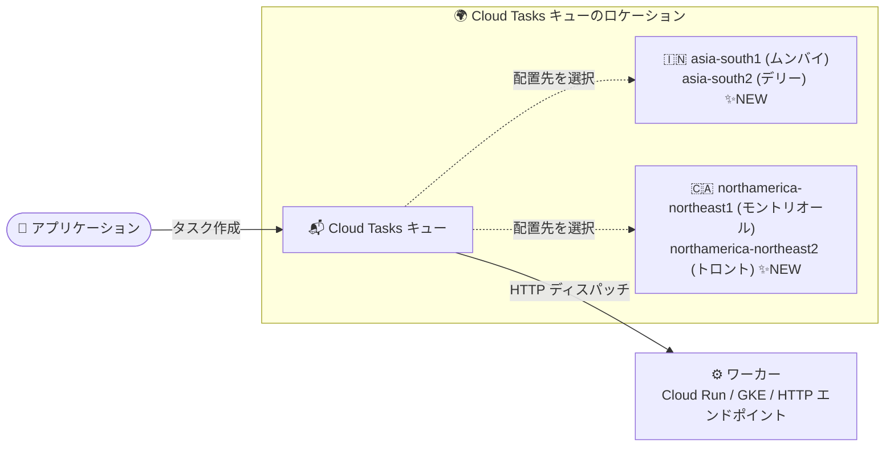

# Cloud Tasks: デリー・トロントリージョンで利用可能に

**リリース日**: 2026-10-19

**サービス**: Cloud Tasks

**機能**: 利用可能リージョンの拡大 (asia-south2 / northamerica-northeast2)

**ステータス**: Changed (リージョン拡大)

📊 [このアップデートのインフォグラフィックを見る](https://takech9203.github.io/google-cloud-news-summary/20261019-cloud-tasks-new-regions.html)

## 概要

フルマネージドのタスクキューサービスである Cloud Tasks が、新たに **asia-south2 (インド・デリー)** と **northamerica-northeast2 (カナダ・トロント)** の 2 リージョンで利用可能になりました。Cloud Tasks は、アプリケーションのメイン処理から独立して実行できる処理 (非同期タスク) をキューに登録し、HTTP エンドポイントや App Engine アプリケーションに対して信頼性の高いレートでディスパッチするサービスです。

Cloud Tasks のキューはリージョンリソースであり、キューを作成するロケーションがタスクデータの保存場所を決定します。今回の拡大により、インドでは Mumbai (asia-south1) に続く 2 つ目、カナダでは Montréal (northamerica-northeast1) に続く 2 つ目のリージョンが追加され、両国内でデータレジデンシー要件を満たしながら、ワークロードに近いロケーションにキューを配置できる選択肢が広がりました。

**アップデート前の課題**

- インドで Cloud Tasks を利用する場合、キューのロケーションは asia-south1 (ムンバイ) のみで、デリー周辺のワークロードやデータと同一リージョンにキューを配置できなかった
- カナダで Cloud Tasks を利用する場合、キューのロケーションは northamerica-northeast1 (モントリオール) のみで、国内でリージョンを分けた構成が組めなかった
- asia-south2 / northamerica-northeast2 で稼働する Cloud Run などのワーカーに対して、キューだけ別リージョンに置く必要があり、リージョンをまたぐ構成になっていた

**アップデート後の改善**

- asia-south2 (デリー)、northamerica-northeast2 (トロント) にキューを作成できるようになった
- インド・カナダそれぞれで国内 2 リージョン体制となり、国内にデータを保持したままリージョンを分散した構成を検討できるようになった
- 同リージョンで稼働するワーカー (Cloud Run、GKE、Compute Engine など) とキューを同一リージョンに揃えた構成が可能になった

## アーキテクチャ図



Cloud Tasks のキュー配置先としてデリーとトロントが追加され、インド・カナダともに国内 2 リージョンからロケーションを選択できるようになった構成を示しています。

## サービスアップデートの詳細

### 主要機能

1. **asia-south2 (デリー、インド) への対応**
   - インド国内では asia-south1 (ムンバイ) に続く 2 つ目の Cloud Tasks 対応リージョン
   - デリー (北インド) 周辺のユーザー・ワークロードに近いロケーションでキューを運用可能

2. **northamerica-northeast2 (トロント、カナダ) への対応**
   - カナダ国内では northamerica-northeast1 (モントリオール) に続く 2 つ目の Cloud Tasks 対応リージョン
   - カナダ国内でリージョンを分けたキュー配置が可能に

3. **キューのロケーションとしての利用**
   - Cloud Tasks のキューはリージョンリソースで、作成時にロケーションを指定する
   - HTTP/S エンドポイントをターゲットとする場合、Cloud Tasks がサポートするすべてのリージョンでキューを作成できる
   - App Engine をターゲットとする場合は、プロジェクトの App Engine リージョンでのみタスクを作成できる (この制約は従来どおり)

## 技術仕様

### リージョン拡大に関する仕様

| 項目 | 詳細 |
|------|------|
| 追加リージョン | asia-south2 (デリー、インド)、northamerica-northeast2 (トロント、カナダ) |
| リソースの単位 | キューはリージョンリソース (ロケーションはキュー作成時に指定) |
| ターゲット | HTTP/S エンドポイント (全対応リージョンで利用可)、App Engine (App Engine リージョンに依存) |
| 組織ポリシー (リソースロケーション) | キュー作成時に適用される (ポリシー設定前に作成済みのキューには適用されない) |

## 設定方法

### 前提条件

1. Cloud Tasks API が有効化されていること
2. キューを作成する権限 (例: `roles/cloudtasks.admin`) を持っていること

### 手順

#### ステップ 1: 新リージョンにキューを作成

```bash
# デリーリージョンにキューを作成
gcloud tasks queues create my-queue \
    --location=asia-south2

# トロントリージョンにキューを作成
gcloud tasks queues create my-queue \
    --location=northamerica-northeast2
```

キューのロケーションは作成時に指定します。既存キューのロケーションは変更できないため、新リージョンを利用する場合は新しいキューを作成します。

#### ステップ 2: 新リージョンのキューにタスクを作成

```bash
gcloud tasks create-http-task \
    --queue=my-queue \
    --location=asia-south2 \
    --url=https://example.com/handler \
    --method=POST
```

タスク作成時にもキューと同じロケーションを指定します。

## メリット

### ビジネス面

- **データレジデンシー要件への対応**: インド・カナダ国内にタスクデータを保持する要件を持つ組織 (金融、公共など) が、ワークロードの所在に合わせてキューのロケーションを選択しやすくなる
- **国内 2 リージョン体制**: インド (ムンバイ/デリー)、カナダ (モントリオール/トロント) それぞれで国内 2 リージョンから選択でき、国内でのリージョン分散構成を検討できる

### 技術面

- **ワーカーとの同一リージョン配置**: asia-south2 / northamerica-northeast2 で稼働する Cloud Run や GKE などのワーカーとキューを同一リージョンに揃えられ、リージョン間のディスパッチを避けられる
- **レイテンシの最適化**: タスクを作成するアプリケーションおよびディスパッチ先のワーカーに近いロケーションにキューを配置できる

## デメリット・制約事項

### 制限事項

- 既存キューのロケーションは変更できないため、新リージョンへ移行する場合は新規キューの作成とアプリケーション側の切り替えが必要
- App Engine をターゲットとするタスクは、引き続きプロジェクトの App Engine リージョンでのみ作成可能

### 考慮すべき点

- リソースロケーションの組織ポリシーを利用している場合、新リージョンでキューを作成するには許可リストへの追加が必要になることがある
- 組織ポリシーはキュー作成時に適用され、ポリシー設定前に作成されたキューには遡及適用されない

## ユースケース

### ユースケース 1: 北インドのワークロード向け非同期処理基盤

**シナリオ**: デリー (asia-south2) の Cloud Run でアプリケーションを運用している企業が、注文処理やメール送信などの非同期タスクを Cloud Tasks で処理したい。従来はキューをムンバイ (asia-south1) に置く必要があった。

**実装例**:
```bash
gcloud tasks queues create order-queue --location=asia-south2
```

**効果**: アプリケーション・キュー・ワーカーを asia-south2 に揃えた構成が可能になり、リージョンをまたがないシンプルな非同期処理基盤を構築できる。

### ユースケース 2: カナダ国内でのデータレジデンシーを満たすタスク処理

**シナリオ**: カナダの組織が、タスクデータを国内に保持する要件のもとで、トロントリージョンの既存ワークロードに非同期処理を追加したい。

**効果**: northamerica-northeast2 にキューを作成することで、タスクデータをカナダ国内のトロントリージョンに保持したまま、既存ワークロードと同一リージョンで Cloud Tasks を利用できる。

## 料金

リージョン追加自体による料金体系の変更はありません。Cloud Tasks はタスクの作成・削除などの操作 (オペレーション) 単位で課金され、App Engine ターゲットへのリクエスト送信自体は無料です。最新の料金は [Cloud Tasks の料金ページ](https://cloud.google.com/tasks/pricing) を参照してください。

## 利用可能リージョン

今回の追加により、Cloud Tasks は以下を含むリージョンで利用可能になりました (抜粋)。

| エリア | リージョン | 備考 |
|--------|-----------|------|
| アジア太平洋 | asia-south1 (ムンバイ) | |
| アジア太平洋 | **asia-south2 (デリー)** | **今回追加** |
| アジア太平洋 | asia-northeast1 (東京)、asia-northeast2 (大阪) ほか | |
| アメリカ | northamerica-northeast1 (モントリオール) | |
| アメリカ | **northamerica-northeast2 (トロント)** | **今回追加** |

対応リージョンの全一覧は [Cloud Tasks のロケーション](https://docs.cloud.google.com/tasks/docs/locations) を参照してください。

## 関連サービス・機能

- **Cloud Scheduler**: cron 形式のスケジュールでジョブを実行するサービス。asia-south2 / northamerica-northeast2 を含むリージョンに対応しており、Cloud Tasks と組み合わせた定期的なタスク投入に利用できる
- **Cloud Run**: Cloud Tasks の HTTP ターゲットとして一般的なワーカー実行環境。asia-south2 / northamerica-northeast2 の両リージョンで利用可能
- **App Engine**: Cloud Tasks のもう一つのターゲット。App Engine ターゲットのタスクはプロジェクトの App Engine リージョンでのみ作成可能
- **組織ポリシー (リソースロケーション制約)**: キュー作成時にロケーションを制御。新リージョン利用時はポリシーの許可リストを確認

## 参考リンク

- 📊 [インフォグラフィック](https://takech9203.github.io/google-cloud-news-summary/20261019-cloud-tasks-new-regions.html)
- [公式リリースノート](https://docs.cloud.google.com/release-notes#October_19_2026)
- [ドキュメント: Cloud Tasks のロケーション](https://docs.cloud.google.com/tasks/docs/locations)
- [ドキュメント: Cloud Tasks の概要](https://docs.cloud.google.com/tasks/docs/dual-overview)
- [料金ページ](https://cloud.google.com/tasks/pricing)

## まとめ

Cloud Tasks がデリー (asia-south2) とトロント (northamerica-northeast2) に対応し、インド・カナダともに国内 2 リージョンでキューを配置できるようになりました。これらのリージョンでワークロードを運用している、またはデータレジデンシー要件を持つ組織は、ワーカーと同一リージョンへのキュー配置を検討してください。既存キューのロケーションは変更できないため、移行する場合は新規キューの作成が必要です。

---

**タグ**: Cloud Tasks, リージョン拡大, asia-south2, northamerica-northeast2, デリー, トロント, 非同期処理, タスクキュー, データレジデンシー
