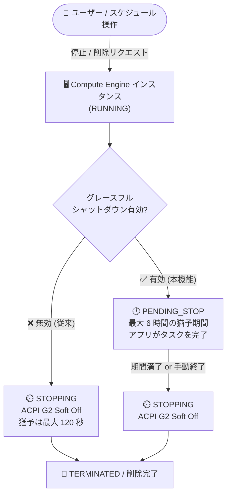

# Compute Engine: グレースフルシャットダウンが GA (一般提供開始)

**リリース日**: 2026-10-19

**サービス**: Compute Engine

**機能**: グレースフルシャットダウン (Graceful Shutdown)

**ステータス**: GA (Generally Available)

📊 [このアップデートのインフォグラフィックを見る](https://takech9203.github.io/google-cloud-news-summary/20261019-compute-engine-graceful-shutdown-ga.html)

## 概要

Compute Engine のグレースフルシャットダウン機能が一般提供 (GA) になりました。インスタンスの停止・削除時に発生しうるデータ損失やファイルシステム破損を防ぐための機能で、有効化するとゲスト OS に対して **最大 6 時間** の猶予期間を与え、実行中のタスクを完了させてからシャットダウンできます。

通常、Compute Engine はインスタンスの停止・削除時にゲスト OS へ ACPI シャットダウンシグナルを送信し、ゲスト OS のクリーンシャットダウンに許容される時間は短時間 (Spot VM は最大 30 秒、その他のインスタンスタイプは最大 120 秒) に限られます。この時間内にタスクが完了しない場合は強制シャットダウンとなり、データ損失やファイルシステム破損につながる可能性がありました。グレースフルシャットダウンを有効にすると、停止・削除操作の開始時にインスタンスが `PENDING_STOP` 状態に遷移し、指定した期間 (1 秒〜6 時間) 内でアプリケーションがタスクを完了できます。

HPC ジョブの完了待ち、データベースのトランザクション確定、メールサーバーの処理完了、マルチプレイヤーゲームセッションの終了など、「途中で打ち切られると困る」ワークロードを Compute Engine 上で運用するすべてのユーザーにとって重要なアップデートです。GA となったことで、本番環境での利用が正式にサポートされます。

**アップデート前の課題**

これまで (Preview 段階、およびグレースフルシャットダウンを使わない場合) は以下の課題がありました。

- 本機能は Preview として提供されており、本番ワークロードでの利用が推奨されなかった
- 標準の停止・削除処理では、ゲスト OS のクリーンシャットダウンに与えられる時間が最大 120 秒 (Spot VM は 30 秒) に限られ、長時間タスクは強制終了されていた
- 強制シャットダウンによりデータ損失やファイルシステム破損のリスクがあり、回避するにはゲスト OS 内からの手動シャットダウンなどの運用上の工夫が必要だった

**アップデート後の改善**

- グレースフルシャットダウンが GA となり、本番環境で正式に利用可能になった
- インスタンスの停止・削除時に、ゲスト OS に最大 6 時間 (1 秒〜6 時間で指定可能) の猶予期間を与えられるようになった
- タスクが早く終わった場合はゲスト OS 内の `shutdown` コマンドや `--no-graceful-shutdown` フラグで猶予期間を途中終了でき、コストを節約できる
- 単一インスタンスだけでなく、一括作成 (bulk create) やインスタンステンプレート経由の作成でも有効化できる

## アーキテクチャ図



グレースフルシャットダウンを有効にすると、停止・削除操作の開始時にインスタンスが `PENDING_STOP` 状態に入り、最大 6 時間タスクを実行し続けられます。期間満了または手動終了後に ACPI G2 Soft Off シグナルが送信され、通常のシャットダウン処理に進みます。

## サービスアップデートの詳細

### 主要機能

1. **最大 6 時間の猶予期間 (PENDING_STOP 状態)**
   - 猶予期間は 1 秒〜6 時間 (21,600 秒) の範囲で指定可能
   - 停止・削除操作 (ユーザー操作およびスケジュールされた停止・削除) の開始時に `PENDING_STOP` 状態へ遷移し、ゲスト OS 内のタスクが実行を継続できる
   - アプリケーションの所要時間より余裕を持った期間設定が推奨 (例: 10 分かかる処理なら 15 分を指定)

2. **猶予期間の手動終了 (コスト節約)**
   - ゲスト OS 内から: `sudo shutdown -h now` などの OS シャットダウンコマンドで即座に終了
   - Google Cloud から: コンソールの「Skip graceful shutdown」チェックボックス、gcloud CLI の `--no-graceful-shutdown` フラグ、REST API の `noGracefulShutdown=true` クエリパラメータで猶予期間をスキップして停止・削除
   - タスク完了後に手動終了すれば、猶予期間中の CPU・メモリ課金を抑えられる

3. **柔軟な有効化方法**
   - 新規インスタンス作成時、既存インスタンスの更新時 (再起動が必要)、一括作成 (bulk create) 時、インスタンステンプレート (リージョン / グローバル) で有効化可能
   - デフォルトでは無効のため、明示的な有効化が必要

## 技術仕様

### 状態遷移と猶予時間

| 項目 | 詳細 |
|------|------|
| デフォルト設定 | 無効 |
| 猶予期間の範囲 | 1 秒〜6 時間 (21,600 秒) |
| 猶予期間中の状態 | `PENDING_STOP` |
| 猶予終了後の処理 | ACPI G2 Soft Off シグナル送信 → `STOPPING` → `TERMINATED` (停止) または削除完了 |
| 従来のシャットダウン猶予 | Spot VM / プリエンプティブル: 最大 30 秒、その他: 最大 120 秒 |
| 対象操作 | ユーザーによる停止・削除、スケジュールされた停止・削除 |
| シャットダウンスクリプト | グレースフルシャットダウン終了後に実行される (猶予期間中にスクリプトを実行する構成が推奨) |

### API 設定 (scheduling.gracefulShutdown)

```json
{
  "scheduling": {
    "gracefulShutdown": {
      "enabled": true,
      "maxDuration": {
        "seconds": "3600"
      }
    }
  }
}
```

## 設定方法

### 前提条件

1. Compute Engine インスタンスの作成・更新権限があること
2. 既存インスタンスで有効化する場合は、設定反映のためにインスタンスの再起動が必要

### 手順

#### ステップ 1: 新規インスタンス作成時に有効化

```bash
gcloud compute instances create INSTANCE_NAME \
    --graceful-shutdown \
    --graceful-shutdown-max-duration=1h \
    --machine-type=MACHINE_TYPE \
    --zone=ZONE
```

`--graceful-shutdown-max-duration` は `1h`、`20m10s` のように時間 (h)・分 (m)・秒 (s) で指定します (1 秒〜6 時間)。

#### ステップ 2: 既存インスタンスで有効化

```bash
gcloud compute instances update INSTANCE_NAME \
    --graceful-shutdown \
    --graceful-shutdown-max-duration=30m \
    --zone=ZONE
```

既存インスタンスで有効化した場合は、設定を反映するためにインスタンスを再起動します。

#### ステップ 3: 停止時にグレースフルシャットダウンをスキップする (必要な場合)

```bash
gcloud compute instances stop INSTANCE_NAME \
    --no-graceful-shutdown \
    --zone=ZONE
```

タスクがすでに完了している場合などは、`--no-graceful-shutdown` フラグで猶予期間をスキップしてコストを節約できます。

## メリット

### ビジネス面

- **データ保全リスクの低減**: 強制シャットダウンによるデータ損失・ファイルシステム破損を防ぎ、復旧コストや業務影響を回避できる
- **本番利用の正式サポート**: GA となったことで、エンタープライズの本番ワークロードに安心して導入できる

### 技術面

- **長時間タスクの安全な完了**: HPC ジョブ、DB トランザクション、バッチ処理などを最大 6 時間かけて完了させてからシャットダウンできる
- **運用の柔軟性**: 猶予期間の手動終了・スキップにより、状況に応じてシャットダウン時間とコストを制御できる
- **テンプレート・一括作成対応**: インスタンステンプレートや bulk create で有効化でき、MIG やフリート全体への展開が容易

## デメリット・制約事項

### 制限事項

- グレースフルシャットダウン有効化後は、TPU VM でホストメンテナンスイベントのシミュレーションができない
- `PENDING_STOP` 中はインスタンスのリセット・再起動・サスペンド、プロパティ更新、削除保護の変更、コアダンプの収集ができない
- 以下のイベント時はグレースフルシャットダウンが開始されない、または進行中でも中断される:
  - Spot VM / プリエンプティブルインスタンスのプリエンプション
  - ホストメンテナンスポリシーが `TERMINATE` のインスタンスのメンテナンスイベント
  - ホストエラーによる停止
- グレースフルシャットダウンでの停止・削除は、プロジェクト・リージョンあたり同時に最大 8,000 インスタンスまで
- 一括作成したインスタンスは、全インスタンスの作成完了後でないとグレースフルシャットダウンの実行・設定変更ができない
- MIG のオートスケーリングによる削除や構成更新 (ローリングアップデート) の際は、猶予期間のスキップ・手動終了ができない

### 考慮すべき点

- 猶予期間中 (`PENDING_STOP`) も CPU とメモリの課金が継続するため、必要以上に長い期間を設定するとコストが増える
- シャットダウンスクリプトは猶予期間の終了後に実行される。スクリプトに十分な実行時間を与えるには、猶予期間中にスクリプトを実行する構成が推奨される
- 猶予期間の満了時や手動終了時にタスクが残っていると強制終了されるため、タスク完了の確認が必要

## ユースケース

### ユースケース 1: HPC / バッチジョブの安全な完了

**シナリオ**: 数時間かかる HPC ジョブやバッチ処理を実行するインスタンスを、スケジュールで夜間に停止している。従来は 120 秒の猶予しかなく、実行中のジョブが強制終了されて再実行が必要になることがあった。

**実装例**:
```bash
gcloud compute instances create hpc-worker-1 \
    --graceful-shutdown \
    --graceful-shutdown-max-duration=6h \
    --machine-type=c3-standard-88 \
    --zone=us-central1-a
```

**効果**: スケジュール停止がトリガーされてもジョブは最大 6 時間実行を継続でき、完了後に手動終了すれば余分な課金も防げる。

### ユースケース 2: セルフマネージドデータベースのトランザクション保護

**シナリオ**: Compute Engine 上でセルフマネージドのデータベースを運用しており、インスタンス停止時にアクティブなトランザクションの確定とクリーンなフラッシュを保証したい。

**効果**: 猶予期間中にトランザクションの確定とチェックポイント処理が完了し、ファイルシステム破損やデータ不整合のリスクを排除できる。ゲスト OS 内から `sudo shutdown -h now` を実行すれば、処理完了後すぐにシャットダウンして課金を止められる。

## 料金

グレースフルシャットダウンの有効化・無効化自体に追加料金はありません。

ただし、グレースフルシャットダウンが有効なインスタンスを停止・削除すると、猶予期間 (`PENDING_STOP`) 中は CPU とメモリの課金が継続します。課金は猶予期間が終了してインスタンスが `STOPPING` 状態に変わった時点で停止します。詳細は [VM インスタンス料金](https://cloud.google.com/compute/vm-instance-pricing) を参照してください。

## 利用可能リージョン

リージョン固有の制限は Release Notes およびドキュメントに記載されていません。詳細は[公式ドキュメント](https://docs.cloud.google.com/compute/docs/instances/graceful-shutdown-overview)を参照してください。

## 関連サービス・機能

- **Spot VM / プリエンプティブルインスタンス**: プリエンプション時はグレースフルシャットダウンが適用されず、従来どおり最大 30 秒の猶予のみとなる点に注意
- **マネージドインスタンスグループ (MIG)**: インスタンステンプレートで有効化すれば MIG のインスタンスにも適用可能。ただしオートスケーリングによる削除時は猶予期間のスキップ・手動終了ができない
- **シャットダウンスクリプト**: グレースフルシャットダウンと併用する場合、スクリプトは猶予期間終了後に実行されるため、猶予期間中に実行する構成が推奨される
- **インスタンスライフサイクル**: 新しい `PENDING_STOP` 状態がライフサイクルに追加され、Cloud Monitoring 等での状態監視時に考慮が必要

## 参考リンク

- 📊 [インフォグラフィック](https://takech9203.github.io/google-cloud-news-summary/20261019-compute-engine-graceful-shutdown-ga.html)
- [公式リリースノート](https://docs.cloud.google.com/release-notes#October_19_2026)
- [ドキュメント: About graceful shutdown](https://docs.cloud.google.com/compute/docs/instances/graceful-shutdown-overview)
- [ドキュメント: Enable graceful shutdown](https://docs.cloud.google.com/compute/docs/instances/enable-graceful-shutdown)
- [ドキュメント: Instance lifecycle](https://docs.cloud.google.com/compute/docs/instances/instance-lifecycle)
- [料金ページ](https://cloud.google.com/compute/vm-instance-pricing)

## まとめ

Compute Engine のグレースフルシャットダウンが GA となり、インスタンスの停止・削除時にゲスト OS へ最大 6 時間の猶予を与えてデータ損失やファイルシステム破損を防げるようになりました。HPC、データベース、バッチ処理など中断に弱いワークロードを運用している場合は、対象インスタンスやインスタンステンプレートでの有効化を検討してください。猶予期間中は CPU・メモリ課金が継続するため、ワークロードの所要時間に合わせた期間設定とタスク完了後の手動終了の運用をあわせて設計することを推奨します。

---

**タグ**: #ComputeEngine #GracefulShutdown #GA #VM #可用性 #データ保護
