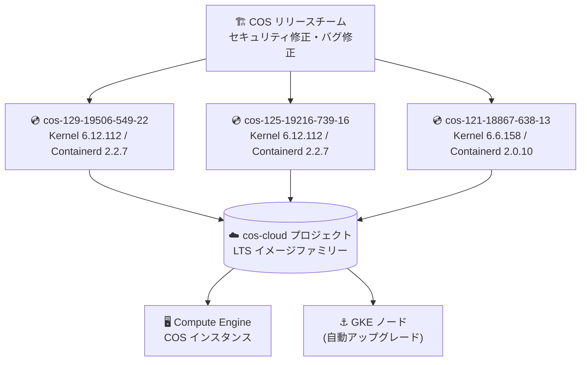

# Container-Optimized OS: 新規 LTS イメージリリース (cos-129 / cos-125 / cos-121)

**リリース日**: 2026-10-19

**サービス**: Container-Optimized OS

**機能**: LTS イメージ更新 (セキュリティ修正・バグ修正)

**ステータス**: 変更 (Changed) / セキュリティ (Security)

📊 [このアップデートのインフォグラフィックを見る](https://takech9203.github.io/google-cloud-news-summary/20261019-container-optimized-os-image-updates.html)

## 概要

Google Cloud のコンテナ実行用 OS である Container-Optimized OS (COS) の 3 つの LTS マイルストーン (M129 / M125 / M121) で、新しいイメージがリリースされました。今回のリリースには、`pci-pf-stub` カーネルモジュールのサポート追加、ネストされたバインドマウントに対する `docker cp` の不具合修正、および Linux カーネル・glibc・sudo・Python に対する複数の CVE 修正が含まれています。

COS は Compute Engine 上でのコンテナ実行や GKE のノードイメージとして広く利用されており、LTS ファミリーのイメージは 26 か月のサポート期間中、セキュリティ脆弱性のスキャンと修正が継続的に提供されます。今回のリリースはその定常的なセキュリティメンテナンスの一環であり、特に Linux カーネル (CVE-2026-99999)、glibc (CVE-2026-5435)、sudo (CVE-2026-82474)、Python (CVE-2026-19445、CVE-2026-6100) の修正が含まれるため、COS を直接利用しているユーザーは早めの適用が推奨されます。

**アップデート前の課題**

- 旧イメージには Linux カーネル、glibc、sudo、Python に未修正の脆弱性 (CVE) が存在していた
- ネストされたバインドマウントを含むコンテナに対して `docker cp` が正しく動作しない不具合があった
- `pci-pf-stub` カーネルモジュールが利用できず、PCI 物理機能 (PF) をスタブドライバに割り当てる構成 (SR-IOV 関連のパススルー構成など) に対応できなかった (M129 / M125)

**アップデート後の改善**

- 各 LTS マイルストーンで上記 CVE が修正され、セキュリティリスクが低減された
- `docker cp` のネストされたバインドマウントに関する不具合が全マイルストーンで修正された
- M129 / M125 で `pci-pf-stub` モジュールがサポートされ、PCI PF をゲストに割り当てる構成が可能になった
- M129 では vim が 9.2.1152 にアップグレードされた

## アーキテクチャ図



新しい COS イメージは `cos-cloud` プロジェクトの各 LTS イメージファミリーを通じて配布され、Compute Engine インスタンスや GKE ノードに適用されます。

## サービスアップデートの詳細

### リリースされたイメージ

| イメージ | マイルストーン | カーネル | Docker | Containerd | サポート終了 |
|----------|---------------|----------|--------|------------|--------------|
| cos-129-19506-549-22 | M129 LTS | COS-6.12.112 | v27.5.1 | v2.2.7 | 2028 年 7 月 |
| cos-125-19216-739-16 | M125 LTS | COS-6.12.112 | v27.5.1 | v2.2.7 | 2028 年 2 月 |
| cos-121-18867-638-13 | M121 LTS | COS-6.6.158 | v27.5.1 | v2.0.10 | 2027 年 3 月 |

### 主要な変更点

1. **pci-pf-stub カーネルモジュールのサポート追加 (M129 / M125)**
   - PCI 物理機能 (PF) をスタブドライバにバインドするためのモジュールが利用可能に
   - デバイスパススルーや SR-IOV 構成の柔軟性が向上

2. **docker cp の不具合修正 (全マイルストーン)**
   - ネストされたバインドマウントを含むコンテナに対する `docker cp` の動作不良を修正

3. **セキュリティ修正 (CVE 対応)**
   - Linux カーネル、glibc、sudo、Python の脆弱性を修正 (詳細は下表)

4. **パッケージ更新 (M129)**
   - vim を 9.2.1152 にアップグレード

### CVE 修正一覧

| CVE | 対象コンポーネント | cos-129 | cos-125 | cos-121 |
|-----|-------------------|:-------:|:-------:|:-------:|
| CVE-2026-99999 | Linux カーネル | ✅ | ✅ | ✅ |
| CVE-2026-5435 | glibc | ✅ | ✅ | ✅ |
| CVE-2026-82474 | sudo | ✅ | - | ✅ |
| CVE-2026-19445 | Python (3.11.17 へ更新) | ✅ | ✅ | ✅ |
| CVE-2026-6100 | Python (3.11.16 での修正) | ✅ | - | - |

## 技術仕様

### COS LTS マイルストーンのサポートポリシー

| 項目 | 詳細 |
|------|------|
| サポート期間 | LTS マイルストーンごとに 26 か月 |
| セキュリティ修正 | 継続的な脆弱性スキャンと定期的な修正適用 |
| 高優先度の修正 | オンデマンドでリリース |
| 中・低優先度の修正 | 3 か月ごとの LTS Refresh リリースに含まれる |
| 配布 | `cos-cloud` プロジェクトの `cos-[MILESTONE]-lts` / `cos-arm64-[MILESTONE]-lts` ファミリー |

### 自動更新の挙動

- COS はアクティブ/パッシブのルートパーティション方式を採用し、OS イメージ全体 (カーネル含む) を更新する
- マイルストーン 117 以降、スタンドアロン COS では自動更新はデフォルトで無効 (メタデータ `cos-update-strategy=update_enabled` で有効化)
- GKE や Cloud SQL などのマネージドサービスで利用される場合は、サービス側が更新を管理する
- 更新はインスタンスの再起動後に反映される

## 設定方法

### 前提条件

1. Compute Engine で COS インスタンスを利用している、または GKE ノードイメージに COS を使用している
2. 本番環境ではイメージファミリー API ではなく、検証済みの特定イメージ名を指定することが推奨される

### 手順

#### ステップ 1: 新イメージで Compute Engine インスタンスを作成

```bash
gcloud compute instances create my-cos-instance \
  --image=cos-129-19506-549-22 \
  --image-project=cos-cloud \
  --zone=asia-northeast1-a
```

検証環境で新イメージを指定してインスタンスを作成し、ワークロードの動作を確認します。

#### ステップ 2: 既存インスタンスの自動更新を有効化 (任意)

```bash
gcloud compute instances add-metadata my-cos-instance \
  --metadata cos-update-strategy=update_enabled
```

スタンドアロンで COS を運用している場合、自動更新を有効にすると同一マイルストーン内の最新バージョンが自動的にダウンロードされます (反映には再起動が必要)。

#### ステップ 3: GKE ノードの場合

GKE では、ノードの自動アップグレードが有効であれば、本イメージを含む GKE バージョンのロールアウトに合わせてノードが順次更新されます。手動で更新する場合はノードプールのアップグレードを実行します。

```bash
gcloud container clusters upgrade my-cluster \
  --node-pool=my-node-pool \
  --zone=asia-northeast1-a
```

## メリット

### ビジネス面

- **セキュリティコンプライアンスの維持**: カーネル・glibc・sudo・Python の CVE 修正により、脆弱性管理基準 (CIS、PCI DSS など) への準拠を維持しやすくなる
- **運用負荷の軽減**: Google がイメージ全体のパッチ適用とテストを実施済みのため、個別パッケージのパッチ管理が不要

### 技術面

- **イメージ全体での一貫した更新**: パッケージ単位ではなく OS イメージ全体が更新されるため、構成ドリフトが発生しない
- **docker cp 不具合の解消**: ネストされたバインドマウント構成でのファイルコピーが正常に動作する
- **pci-pf-stub 対応**: PCI PF のスタブバインドが必要なデバイスパススルー構成に対応 (M129 / M125)

## デメリット・制約事項

### 制限事項

- 更新の反映にはインスタンスの再起動が必要 (自動更新はダウンロード・インストールのみでリブートは強制しない)
- UEFI Secure Boot 有効時および Arm ベースイメージでは、インプレース自動更新はサポートされない
- CVE-2026-82474 (sudo) と CVE-2026-6100 (Python) の修正は一部マイルストーンのみに含まれる (CVE 修正一覧を参照)

### 考慮すべき点

- カーネル更新に敏感な本番ワークロードでは、自動更新を無効化し、検証後に計画的にロールアウトすることが推奨される
- イメージファミリー API (`getFromFamily`) を本番インスタンス作成に使用すると、未検証イメージが適用されるリスクがある

## ユースケース

### ユースケース 1: セキュリティ基準への迅速な対応

**シナリオ**: 社内の脆弱性管理ポリシーで、カーネルや glibc の CVE を一定期間内に修正することが義務付けられている。

**実装例**:
```bash
# 検証環境で新イメージをテスト後、本番の MIG テンプレートを更新
gcloud compute instance-templates create cos-template-v2 \
  --image=cos-129-19506-549-22 \
  --image-project=cos-cloud

gcloud compute instance-groups managed rolling-action start-update my-mig \
  --version=template=cos-template-v2 \
  --zone=asia-northeast1-a
```

**効果**: イメージ差し替えによるローリングアップデートで、CVE-2026-99999 (カーネル) などの脆弱性をダウンタイムを最小化しつつ解消できる。

### ユースケース 2: ネストされたバインドマウントを使う CI/CD 環境

**シナリオ**: COS 上の Docker でネストされたバインドマウントを含むコンテナを運用しており、`docker cp` によるアーティファクト取り出しが失敗していた。

**効果**: 今回の修正により `docker cp` が正常に動作し、ワークアラウンド (コンテナ内での一時コピーなど) が不要になる。

## 料金

Container-Optimized OS 自体に追加のライセンス料金はありません。イメージを使用する Compute Engine インスタンスや GKE ノードの通常料金のみが発生します。

詳細は [Compute Engine 料金ページ](https://cloud.google.com/compute/pricing) を参照してください。

## 利用可能リージョン

COS イメージは `cos-cloud` イメージプロジェクトを通じて全リージョンで利用可能です。

## 関連サービス・機能

- **Compute Engine**: COS インスタンスの実行基盤。コンテナを直接デプロイする際のデフォルト OS
- **Google Kubernetes Engine (GKE)**: デフォルトのノードイメージとして COS (containerd) を使用。GKE のセキュリティリリースに本イメージが順次組み込まれる
- **Cloud SQL などのマネージドサービス**: 内部で COS を利用しており、サービス側が更新を管理
- **Shielded VM / Secure Boot**: COS と組み合わせてノードの整合性を保護 (ただし Secure Boot 有効時はインプレース自動更新非対応)

## 参考リンク

- 📊 [インフォグラフィック](https://takech9203.github.io/google-cloud-news-summary/20261019-container-optimized-os-image-updates.html)
- [公式リリースノート](https://docs.cloud.google.com/release-notes#October_19_2026)
- [COS Milestone 129 リリースノート](https://docs.cloud.google.com/container-optimized-os/docs/release-notes/m129)
- [COS Milestone 125 リリースノート](https://docs.cloud.google.com/container-optimized-os/docs/release-notes/m125)
- [COS Milestone 121 リリースノート](https://docs.cloud.google.com/container-optimized-os/docs/release-notes/m121)
- [COS バージョニングとイメージファミリー](https://docs.cloud.google.com/container-optimized-os/docs/concepts/versioning)
- [COS サポートポリシー](https://docs.cloud.google.com/container-optimized-os/docs/resources/support-policy)
- [COS 自動更新の仕組み](https://docs.cloud.google.com/container-optimized-os/docs/concepts/auto-update)
- [料金ページ (Compute Engine)](https://cloud.google.com/compute/pricing)

## まとめ

今回の COS イメージリリースは、カーネル・glibc・sudo・Python の CVE 修正を含む定常的なセキュリティメンテナンスであり、COS をスタンドアロンで運用しているユーザーは早期の適用が推奨されます。GKE ユーザーはノード自動アップグレードを有効にしておけば、本イメージを含む GKE バージョンのロールアウトに合わせて自動的に保護されます。検証環境で新イメージを確認したうえで、計画的に本番環境へロールアウトしてください。

---

**タグ**: Container-Optimized OS, COS, セキュリティ, CVE, LTS, GKE, Compute Engine, カーネル
