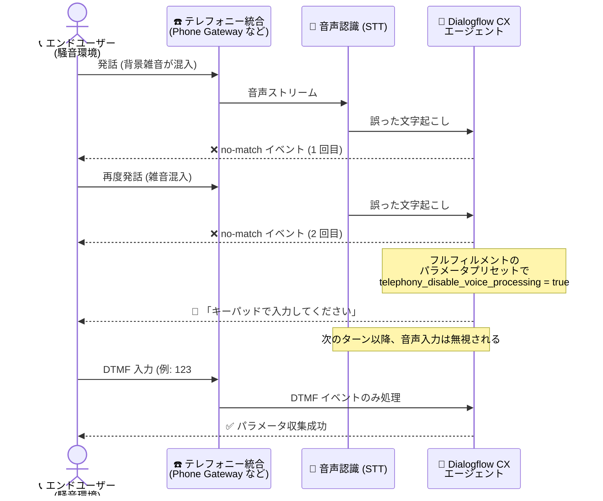

# Dialogflow CX: telephony_disable_voice_processing セッションパラメータによる音声認識の無効化

**リリース日**: 2026-10-19

**サービス**: Dialogflow CX

**機能**: telephony_disable_voice_processing セッションパラメータ (テレフォニーでの音声認識オフ / DTMF 専用モード)

**ステータス**: 一般提供 (Feature)

📊 [このアップデートのインフォグラフィックを見る](https://takech9203.github.io/google-cloud-news-summary/20261019-dialogflow-cx-telephony-disable-voice-processing.html)

## 概要

Dialogflow CX のテレフォニー統合において、セッションパラメータ `telephony_disable_voice_processing` を `true` に設定することで、音声認識 (Speech-to-Text) を無効化し、以降のセッションでは DTMF (電話キーパッド) 入力のみを受け付けられるようになりました。パラメータ設定後の次の会話ターンから Dialogflow CX は音声入力を無視し、DTMF 入力のみを処理します。この設定はセッションの残りの期間、有効であり続けます。`false` に戻すことで音声認識を再度有効化することも可能です。

この機能は、騒がしい環境からの着信に対応する IVR (音声自動応答) システムで特に有効です。従来、背景雑音がエンドユーザーの発話として誤って文字起こしされ、no-match イベントの誤発火や、キーパッドで DTMF 数字を入力中のエンドユーザーの入力が途中で打ち切られるといった問題が発生していました。本アップデートにより、会話の途中でセッション単位で「DTMF 専用モード」へフォールバックできるようになり、コンタクトセンターや IVR ソリューションを構築する開発者にとって、ノイズ環境下での会話完遂率を向上させる実用的な手段が提供されます。

Google は、このパラメータを会話の開始時点ではなく、フォールバックとして使用することを推奨しています。例えば、エンドユーザーが no-match または no-input イベントを 2 回連続でトリガーした場合に、フルフィルメントのパラメータプリセットでこのパラメータを `true` に設定し、キーパッドの使用を促すプロンプトを再生する、という使い方が想定されています。

**アップデート前の課題**

- 騒がしい環境では、音声認識が背景雑音をエンドユーザーの入力として文字起こししてしまい、no-match イベントが誤ってトリガーされることがあった
- エンドユーザーがキーパッドで DTMF 数字を入力している最中に、背景雑音による誤認識で入力が打ち切られることがあった
- セッションの途中で音声認識を無効化して DTMF 入力のみに切り替える手段がなく、ノイズ起因の誤動作をエージェント設計だけで回避することが難しかった

**アップデート後の改善**

- `telephony_disable_voice_processing` セッションパラメータを `true` に設定するだけで、次の会話ターンから音声入力を無視し、DTMF 入力のみを処理できるようになった
- 設定はセッションの残りの期間維持され、`false` に戻すことで音声認識を再度有効化する柔軟な制御が可能になった
- no-match / no-input イベントのハンドラとフルフィルメントのパラメータプリセットを組み合わせることで、ノイズ検出時に DTMF 専用モードへ自動的にフォールバックするエージェントを構築できるようになった

## アーキテクチャ図



騒音環境で no-match イベントが連続発生した際に、フルフィルメントのパラメータプリセットで `telephony_disable_voice_processing` を `true` に設定し、以降のターンを DTMF 専用モードに切り替えるフォールバックフローを示しています。

## サービスアップデートの詳細

### 主要機能

1. **セッション単位での音声認識の無効化**
   - セッションパラメータ `telephony_disable_voice_processing` を `true` に設定すると、次の会話ターンから Dialogflow CX は音声入力を無視し、DTMF 入力のみを処理する
   - 設定はセッションの残りの期間、有効であり続ける (セッション単位のステートフルな制御)

2. **音声認識の再有効化**
   - パラメータを `false` に設定することで、音声認識を再度有効化できる
   - 会話の状況に応じて音声モードと DTMF 専用モードを動的に切り替えられる

3. **フォールバックとしての利用 (推奨パターン)**
   - 会話の開始時点ではなく、フォールバックとして使用することが推奨されている
   - 例: no-match または no-input イベントが 2 回連続でトリガーされた後、フルフィルメントのパラメータプリセットで `true` に設定し、エンドユーザーにキーパッドの使用を促す
   - エンドユーザーが提供する必要のあるパラメータで DTMF が有効になっていることを確認する必要がある

## 技術仕様

### パラメータの動作

| 項目 | 詳細 |
|------|------|
| パラメータ名 | `telephony_disable_voice_processing` |
| スコープ | セッションパラメータ |
| 値 | `true`: 音声認識を無効化し DTMF のみ受付 / `false`: 音声認識を再有効化 |
| 反映タイミング | 設定後の次の会話ターンから |
| 有効期間 | セッションの残りの期間 (明示的に `false` に戻すまで) |
| 対象 | テレフォニー統合 (Phone Gateway などの電話経由のセッション) |
| 前提 | 収集対象のパラメータで DTMF が有効化されていること |

### フルフィルメントのパラメータプリセットでの設定例

no-match イベントハンドラのフルフィルメントで、パラメータプリセットとして以下を設定します。

```json
{
  "setParameterActions": [
    {
      "parameter": "telephony_disable_voice_processing",
      "value": true
    }
  ]
}
```

### DTMF 入力の処理仕様 (既存機能)

- DTMF 入力は通常形式 (例: `123#`) と DTMF 固有形式 (例: `dtmf_digits_123pound`) の両方でエンティティマッチングされる
- DTMF 入力が終了条件 (最大桁数または終了桁) を満たすまでエージェントは入力を待機する
- 音声と DTMF の両方が検出された場合、音声入力は破棄され DTMF 入力のみが考慮される

## 設定方法

### 前提条件

1. テレフォニー統合 (Dialogflow CX Phone Gateway など) を使用するエージェントであること
2. エンドユーザーが入力するパラメータに対して DTMF が有効化されていること (エージェント / フロー / ページ / パラメータレベルで設定可能)

### 手順

#### ステップ 1: DTMF を有効化する

Dialogflow CX コンソールで Agent settings の「Speech and IVR」タブを開き、「Enable DTMF」をオンにして Finish digit や Max digits などを設定します。フォームパラメータで使用する場合は、パラメータ設定で DTMF を有効にします。

#### ステップ 2: フォールバック用のイベントハンドラを構成する

no-match / no-input の組み込みイベントハンドラを構成し、連続発生 (例: 2 回) した場合のルートを用意します。

#### ステップ 3: パラメータプリセットで DTMF 専用モードへ切り替える

ステップ 2 のルートのフルフィルメントで、パラメータプリセットを使用して `telephony_disable_voice_processing` を `true` に設定し、「キーパッドで入力してください」といった案内メッセージを再生します。

#### ステップ 4: (必要に応じて) 音声認識を再有効化する

DTMF での入力収集が完了し、音声での会話に戻したい場合は、フルフィルメントでパラメータを `false` に設定します。

## メリット

### ビジネス面

- **コールの完遂率向上**: 騒音環境 (屋外、車内、工場など) からの着信でも、DTMF 専用モードに切り替えることで入力エラーによる離脱やオペレーター転送を削減できる
- **顧客体験の改善**: 音声認識の誤動作による聞き返しの繰り返しを回避し、確実な入力手段をエンドユーザーに提供できる

### 技術面

- **追加コンポーネント不要**: セッションパラメータの設定のみで実現でき、Webhook やインフラの追加実装なしでエージェント設計 (パラメータプリセット) だけで完結する
- **動的かつ可逆的な制御**: セッションの途中で切り替えられ、`false` に戻すことで音声モードへ復帰できるため、柔軟な会話設計が可能
- **既存の DTMF 機能との統合**: 既存の DTMF 設定 (最大桁数、終了桁、正規表現パターン) をそのまま活用できる

## デメリット・制約事項

### 制限事項

- テレフォニー統合でのセッションを対象とした機能である
- 設定が反映されるのは次の会話ターンからであり、設定したターンの音声入力には適用されない
- DTMF 専用モードの間は音声入力が完全に無視されるため、キーパッド入力で表現できない自由発話 (問い合わせ内容の説明など) は収集できない

### 考慮すべき点

- 会話の開始時点での使用は推奨されておらず、no-match / no-input の連続発生後のフォールバックとしての使用が推奨されている
- エンドユーザーが提供する必要のあるパラメータで DTMF が有効になっていないと、DTMF 専用モードに切り替えても入力を収集できない
- DTMF 専用モードに切り替える際は、エンドユーザーにキーパッドの使用を明確に案内するプロンプトを用意する必要がある

## ユースケース

### ユースケース 1: 騒音環境からの着信に対するフォールバック

**シナリオ**: 屋外や車内など騒がしい環境から電話をかけたエンドユーザーの発話が背景雑音により正しく認識されず、no-match イベントが連続して発生している。

**実装例**:
```
1. no-match イベントハンドラで連続発生回数をカウント (例: session パラメータで管理)
2. 2 回連続で no-match が発生したルートのフルフィルメントで
   パラメータプリセット: telephony_disable_voice_processing = true
3. 応答メッセージ: 「お電話が聞き取りづらいようです。
   以降はキーパッドで入力してください。会員番号を入力し、最後に # を押してください」
4. 会員番号パラメータは DTMF 有効 (Max digits: 10, Finish digit: #) に設定
```

**効果**: 雑音起因の認識エラーによるループや離脱を回避し、確実に必要情報を収集してセルフサービスを完遂できる。

### ユースケース 2: 機密性の高い数値情報の確実な収集

**シナリオ**: IVR で暗証番号やカード番号などの数値情報を収集する際、周囲の雑音で入力が途切れる、または復唱による聞き返しが発生するのを避けたい。

**効果**: 該当セクションで DTMF 専用モードに切り替えることで、背景雑音により DTMF 入力が途中で打ち切られる事象を防ぎ、数値入力の確実性を高められる。収集完了後は `false` に戻して音声対話に復帰できる。

## 料金

本機能自体に追加料金はなく、Dialogflow CX の既存の料金体系が適用されます。テレフォニーを含む音声の入出力は音声リクエストとして課金されます。

### 料金例 (Dialogflow CX Edition)

| 項目 | 料金 |
|--------|-----------------|
| テキストリクエスト (音声を含まない DetectIntent 等) | $0.007 / リクエスト |
| 音声入出力 (音声認識、音声合成、テレフォニー) | $0.06 / 分 |

詳細は [Conversational Agents の料金ページ](https://cloud.google.com/products/conversational-agents/pricing) を参照してください。

## 利用可能リージョン

リージョン固有の記載はリリースノートにありません。なお、Dialogflow CX Phone Gateway 統合は global リージョンで作成されたエージェントでのみ動作する点に注意してください。詳細は [リージョンのドキュメント](https://docs.cloud.google.com/dialogflow/cx/docs/concept/region) を参照してください。

## 関連サービス・機能

- **Dialogflow CX Phone Gateway**: Google がホストする電話番号をエージェントに接続するテレフォニー統合。本パラメータが対象とする代表的な電話経由のセッションを提供する
- **DTMF 設定 (Dialogflow CX)**: エージェント / フロー / ページ / パラメータレベルで有効化できるキーパッド入力機能。本パラメータの前提となる機能で、最大桁数・終了桁・正規表現パターンを設定できる
- **フルフィルメントのパラメータプリセット**: Webhook を使わずにセッションパラメータを設定できる機能。no-match 発生時に本パラメータを `true` に設定するフォールバック実装に使用する
- **組み込みイベントハンドラ (no-match / no-input)**: 認識失敗や無入力を検知するイベント。DTMF 専用モードへのフォールバックのトリガーとして使用する
- **Speech-to-Text (phone_call モデル)**: テレフォニー統合で使用される音声認識。本パラメータで無効化の対象となる処理

## 参考リンク

- 📊 [インフォグラフィック](https://takech9203.github.io/google-cloud-news-summary/20261019-dialogflow-cx-telephony-disable-voice-processing.html)
- [公式リリースノート](https://docs.cloud.google.com/release-notes#October_19_2026)
- [ドキュメント: Turn off speech recognition for telephony](https://docs.cloud.google.com/dialogflow/cx/docs/concept/parameter#session-disable-voice)
- [ドキュメント: DTMF for telephony integrations](https://docs.cloud.google.com/dialogflow/cx/docs/concept/dtmf)
- [ドキュメント: フルフィルメントのパラメータプリセット](https://docs.cloud.google.com/dialogflow/cx/docs/concept/fulfillment#param-preset)
- [料金ページ](https://cloud.google.com/products/conversational-agents/pricing)

## まとめ

騒音環境での音声認識の誤動作は、IVR / ボイスボット運用における長年の課題でしたが、本アップデートによりセッションパラメータ 1 つで DTMF 専用モードへフォールバックできるようになりました。テレフォニー統合で Dialogflow CX を運用しているチームは、no-match / no-input イベントハンドラとパラメータプリセットを組み合わせたフォールバックルートの追加を検討することを推奨します。その際、収集対象パラメータの DTMF 設定 (最大桁数・終了桁) が適切に構成されていることを併せて確認してください。

---

**タグ**: Dialogflow CX, テレフォニー, DTMF, 音声認識, IVR, コンタクトセンター, セッションパラメータ, Conversational Agents
