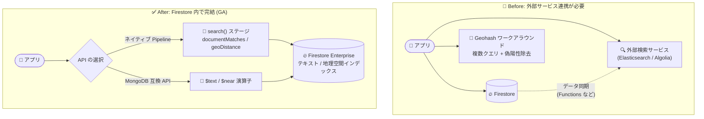

# Firestore: テキスト検索と地理空間検索が一般提供 (GA) に

**リリース日**: 2026-10-19

**サービス**: Firestore / Firestore with MongoDB compatibility

**機能**: テキスト検索 (Text search) と地理空間検索 (Geospatial search) の一般提供 (GA)

**ステータス**: GA (一般提供)

📊 [このアップデートのインフォグラフィックを見る](https://takech9203.github.io/google-cloud-news-summary/20261019-firestore-text-geospatial-search-ga.html)

## 概要

Firestore および Firestore with MongoDB compatibility において、**テキスト検索 (Text search)** と**地理空間検索 (Geospatial search)** が一般提供 (GA) になりました。両機能は Firestore Enterprise edition のデータベースで利用でき、ネイティブ (Firestore Core / Pipeline) と MongoDB 互換 API の両方のインターフェースから同じデータベースエンジン上で実行できます。

テキスト検索では、テキストインデックスを作成したフィールドに対して、キーワード検索・完全一致フレーズ検索・AND 条件・除外条件 (`-` プレフィックス)・スコアによるソートなどの全文検索操作が可能です。地理空間検索では、地理空間インデックス (2dsphere) を作成したフィールドに対して、指定地点からの距離に基づく近傍検索 (距離はメートル単位) を実行できます。

これまで Firestore で全文検索や位置情報検索を実現するには、Elasticsearch や Algolia などの外部検索サービスとの連携、あるいは Geohash を使ったクライアントサイドのワークアラウンドが必要でした。今回の GA により、検索機能をデータベース内で完結させるアーキテクチャを本番環境で採用できるようになり、モバイル/Web アプリ開発者、MongoDB からの移行を検討しているチーム、位置情報サービスを構築する開発者にとって大きな選択肢となります。

**アップデート前の課題**

- Firestore は標準では全文検索をサポートしておらず、キーワード検索を実現するには Elasticsearch、Algolia、Typesense などの外部検索サービスへデータを同期する必要があり、追加のコスト・運用負荷・データ整合性の管理が発生していた
- 位置情報検索は Geohash と GeoFire ライブラリを使ったワークアラウンドが公式ソリューションとして案内されており、複数クエリの発行、クライアントサイドでの偽陽性 (false positive) のフィルタリング、高緯度での精度低下といった制約があった
- テキスト検索・地理空間検索は GA 前のステータスであったため、本番ワークロードでの採用にあたり SLA や長期サポートの観点で慎重な判断が必要だった

**アップデート後の改善**

- テキストインデックスを作成するだけで、`documentMatches` 式 (ネイティブ Pipeline) や `$text` 演算子 (MongoDB 互換) によるデータベースネイティブな全文検索が GA 品質で利用可能になった
- 地理空間インデックス (2dsphere) により、`geoDistance` 式 (ネイティブ Pipeline) や `$near` 演算子 (MongoDB 互換) を使った距離ベースの近傍検索がサーバーサイドで完結し、Geohash ワークアラウンドの偽陽性フィルタリングが不要になった
- GA 昇格により本番環境での利用が正式にサポートされ、外部検索サービスとのデータ同期パイプラインを構築・運用するコストを削減できるようになった

## アーキテクチャ図



これまで外部検索サービスや Geohash ワークアラウンドが必要だった全文検索・位置情報検索が、Firestore Enterprise edition のテキストインデックス・地理空間インデックスによりデータベース内で完結します。ネイティブ Pipeline と MongoDB 互換 API のどちらからも利用できます。

## サービスアップデートの詳細

### 主要機能

1. **テキスト検索 (Text search)**
   - テキストインデックスを作成したフィールドに対する全文検索。複数のインデックスがある場合は Firestore が使用するインデックスを自動選択
   - キーワード検索、ダブルクォートによる完全一致フレーズ検索 (`"belgian waffles"`)、スペース区切りによる AND 条件、ハイフンによる除外条件 (`coffee -waffles`) をサポート
   - 検索結果はデフォルトで作成日時 (新しい順) でソート。`score()` による関連度スコアのソートや、`addFields` でスコアを結果ドキュメントに付与することも可能
   - インデックス単位でデフォルト言語を設定でき、MongoDB 互換 API では `$language` 引数によるクエリ単位の言語指定も可能

2. **地理空間検索 (Geospatial search)**
   - ネイティブ Pipeline では `search()` ステージ内の `geoDistance` 式で、指定した GeoPoint からの距離 (メートル単位、`<=` 演算子のみサポート) によるフィルタリングが可能
   - MongoDB 互換 API では `$near` 演算子 + `$geometry` (GeoJSON) により、近い順にソートされた結果を取得。`$maxDistance` / `$minDistance` で距離範囲を制御可能
   - 対象フィールドは GeoJSON オブジェクトまたは GeoPoint 型

3. **パーティション化インデックス**
   - テキスト/地理空間インデックスを特定フィールド (文字列型、トップレベルフィールド) でパーティション化でき、パーティションフィールドの等価フィルタと組み合わせた高速なクエリが可能
   - 例: `city` でパーティション化し、「パリ市内のレストランに限定したテキスト検索」のような絞り込みを効率的に実行

4. **両インターフェースでの GA**
   - Firestore (ネイティブ: Core / Pipeline 操作) と Firestore with MongoDB compatibility の両方で同時に GA
   - MongoDB 互換アプリケーションは `$text` / `$near` という使い慣れた演算子をそのまま利用可能

## 技術仕様

### 機能比較 (ネイティブ vs MongoDB 互換)

| 項目 | Firestore (ネイティブ) | Firestore with MongoDB compatibility |
|------|------------------------|--------------------------------------|
| テキスト検索の構文 | Pipeline の `search()` ステージ + `documentMatches` 式 | `find` / `aggregate` 内の `$text: { $search: ... }` |
| 地理空間検索の構文 | `search()` ステージ + `geoDistance` 式 (`<=` のみ) | `$near` + `$geometry` (`$maxDistance` / `$minDistance`) |
| 必要なインデックス | テキストインデックス / 地理空間インデックス | テキストインデックス / 2dsphere インデックス |
| ソート | デフォルトは作成日時順。`score()` でスコア順に変更可 | `$near` は近い順に自動ソート |
| 言語設定 | インデックスのデフォルト言語 + 言語オーバーライドパス | `$language` 引数でクエリごとに指定可 |
| 対応エディション | Firestore Enterprise edition | Firestore Enterprise edition |

### テキスト検索のクエリ構文例 (ネイティブ Pipeline / Node.js)

```javascript
// キーワード検索
await db.pipeline().collection('restaurants')
  .search({ query: documentMatches('waffles') })
  .execute();

// 完全一致フレーズ + スコア順ソート
await db.pipeline().collection('restaurants')
  .search({
    query: documentMatches('"belgian waffles"'),
    sort: score().descending()
  })
  .execute();
```

### 地理空間検索のクエリ例 (MongoDB 互換)

```javascript
// 指定地点から 500m 以上 2000m 以内のドキュメントを近い順に取得
db.myCollection.find({
  location: {
    $near: {
      $geometry: { type: 'Point', coordinates: [ -122.084, 37.4221 ] },
      $maxDistance: 2000,
      $minDistance: 500
    }
  }
})
```

## 設定方法

### 前提条件

1. Firestore **Enterprise edition** のデータベースを使用していること (テキスト検索・地理空間検索は Enterprise edition が必須)
2. 検索対象フィールドに対してテキストインデックスまたは地理空間インデックスを作成済みであること
3. 地理空間検索の対象フィールドは GeoJSON オブジェクトまたは GeoPoint 型であること

### 手順

#### ステップ 1: テキストインデックスの作成

```bash
gcloud firestore indexes composite create \
  --database='DATABASE_ID' \
  --collection-group=COLLECTION_GROUP \
  --field-config=field-path=FIELD_NAME,search-config='{"text-spec": {"index-specs": [{"index-type": "tokenized", "match-type": "match-globally"}]}}' \
  --search-index-options=text-language=en \
  --async
```

MongoDB 互換 API 用のインデックスを作成する場合は `--api-scope=mongodb-compatible-api` を追加します。Google Cloud コンソールの「データベース > インデックス」からも Search Type に「Text」を選択して作成できます。

#### ステップ 2: 地理空間インデックスの作成

```bash
gcloud firestore indexes composite create \
  --database='DATABASE_ID' \
  --collection-group=COLLECTION_GROUP \
  --field-config=field-path=FIELD_NAME,search-config='{"geo-spec": {}}' \
  --async
```

コンソールでは Search Type に「Geo (2dsphere)」を選択します。インデックス作成完了後 (一覧に緑のチェックマークが表示された後)、検索クエリを実行できます。

#### ステップ 3: 検索クエリの実行

```bash
# MongoDB 互換 API でのテキスト検索の例 (mongosh)
db.cities.find({ $text: { $search: "french bread" } })
```

ネイティブの場合は各言語の SDK (Web / iOS / Android / Node.js / Python / Java / Go) から Pipeline の `search()` ステージを使用します。

## メリット

### ビジネス面

- **外部検索サービスのコスト削減**: Elasticsearch や Algolia などの外部検索基盤とデータ同期パイプラインが不要になり、ライセンス/利用料と運用工数を削減できる
- **本番採用の正式サポート**: GA 昇格により、本番ワークロードでの利用が正式にサポートされ、ミッションクリティカルなアプリケーションにも採用しやすくなった
- **MongoDB からの移行促進**: `$text` / `$near` という MongoDB 標準の演算子がそのまま使えるため、既存 MongoDB アプリケーションの移行時に検索機能の書き換えが最小限で済む

### 技術面

- **アーキテクチャの簡素化**: 検索がデータベース内で完結するため、データ同期の遅延や整合性の問題が発生しない
- **Geohash ワークアラウンドからの脱却**: 複数クエリの発行とクライアントサイドでの偽陽性フィルタリングが不要になり、読み取りコストとレイテンシを削減できる
- **柔軟な検索構文**: フレーズ検索、除外条件、スコアソート、パーティションによる絞り込みなど、実用的な検索要件に対応

## デメリット・制約事項

### 制限事項

- テキスト検索・地理空間検索は **Firestore Enterprise edition 専用**であり、Standard edition のデータベースでは利用できない
- ネイティブの `geoDistance` は「以下 (`<=`)」演算子のみサポート (距離はメートル単位)
- MongoDB 互換 API では、`$near` と `$text` を同一クエリで併用できない。また `$near` は集計 (aggregation) クエリ、`$not` / `$nor` との併用、複数条件 `$or` へのネスト (単独の場合を除く) をサポートしない
- パーティションフィールドは文字列型のトップレベルフィールド 1 つのみで、クエリ時は `$and` (等価フィルタ) で結合する必要がある
- ネイティブのテキスト検索は、`constraints/firestore.managed.disableEnhancedTextSearch` 組織ポリシーがデフォルトで適用される Assured Workloads の in-use データレジデンシー制御パッケージでは利用できない

### 考慮すべき点

- Enterprise edition は読み取り/書き込みがドキュメント単位ではなく**ユニット単位 (読み取り 4 KiB / 書き込み 1 KiB)** で課金されるため、Standard edition とはコストモデルが異なる
- テキスト/地理空間インデックスへの書き込みは書き込みユニットを消費するため、インデックス対象フィールドが多い・大きい場合は書き込みコストが増加する
- スコア順ソートはドキュメントごとの正確なスコア計算・比較が必要になるため、デフォルトの作成日時順ソートより多くの計算を要する

## ユースケース

### ユースケース 1: アプリ内コンテンツ検索 (EC・メディアアプリ)

**シナリオ**: EC アプリで商品名・説明文に対するキーワード検索を提供したい。これまでは Algolia にデータを同期して検索機能を実現していた。

**実装例**:
```javascript
// 商品説明に対するキーワード検索 (除外条件つき) + スコア順
await db.pipeline().collection('products')
  .search({
    query: documentMatches('ワッフル -冷凍'),
    sort: score().descending()
  })
  .execute();
```

**効果**: 外部検索サービスとの同期パイプラインが不要になり、データの鮮度と整合性が向上。運用コンポーネントが削減される。

### ユースケース 2: 近隣店舗検索 (位置情報サービス)

**シナリオ**: フードデリバリーアプリで、ユーザーの現在地から一定距離内のレストランを近い順に表示したい。

**実装例**:
```javascript
// MongoDB 互換 API: 現在地から 2km 以内のレストランを近い順に取得
db.restaurants.find({
  location: {
    $near: {
      $geometry: { type: 'Point', coordinates: [ 139.7671, 35.6812 ] },
      $maxDistance: 2000
    }
  }
})
```

**効果**: Geohash ベースの複数クエリ + クライアントサイドフィルタリングが不要になり、実装がシンプルになるとともに読み取りコストとレイテンシが削減される。

### ユースケース 3: MongoDB ワークロードの移行

**シナリオ**: セルフマネージドの MongoDB で `$text` / `$near` を使った検索機能を持つアプリケーションを、フルマネージドなデータベースへ移行したい。

**効果**: 検索クエリの構文をほぼそのまま維持したまま Firestore with MongoDB compatibility へ移行でき、GA 品質のサポートの下で運用負荷を削減できる。

## 料金

テキスト検索・地理空間検索に固有の追加料金は発表されていませんが、前提となる Firestore Enterprise edition はユニットベースの課金モデルを採用しています (以下は us-central1 の例)。

| 項目 | Enterprise edition の料金 |
|------|---------------------------|
| 読み取り | $0.05 / 100 万読み取りユニット (4 KiB 単位) |
| 書き込み | $0.26 / 100 万書き込みユニット (1 KiB 単位、インデックス書き込みもユニットを消費) |
| リアルタイム更新 | $0.30 / 100 万ユニット (専用 SKU) |
| ストレージ | $0.00032 / GiB 時 |
| 無料枠 (1 日あたり) | 読み取り 50,000 / 書き込み 40,000 / リアルタイム更新 50,000 / ストレージ 1 GB |

テキスト/地理空間インデックスを作成すると、対象ドキュメントの書き込み時にインデックスエントリ分の書き込みユニットが追加で消費される点に注意してください。最新の料金は [Firestore Enterprise edition の料金ページ](https://cloud.google.com/firestore/enterprise/pricing)を参照してください。

## 利用可能リージョン

Enterprise edition が利用可能なリージョンで使用できます。最新のリージョン情報は[公式ドキュメントの Locations ページ](https://firebase.google.com/docs/firestore/pipelines/locations)を参照してください。なお、ネイティブのテキスト検索は in-use データレジデンシーを強制する Assured Workloads 制御パッケージではサポートされません。

## 関連サービス・機能

- **Firestore Enterprise edition**: 本機能の前提となるエディション。Pipeline 操作と MongoDB 互換操作をサポートし、ユニットベースの課金モデルを採用
- **Firestore Pipeline (search ステージ)**: テキスト検索・地理空間検索を実行するネイティブのクエリインターフェース
- **Vertex AI / Firestore ベクトル検索**: セマンティック検索が必要な場合の補完的な選択肢。キーワード検索 (テキスト検索) と組み合わせたハイブリッドな検索体験を構築可能
- **Assured Workloads**: in-use データレジデンシー制御パッケージ利用時はネイティブのテキスト検索が制限されるため、コンプライアンス要件との整合を確認する必要がある

## 参考リンク

- 📊 [インフォグラフィック](https://takech9203.github.io/google-cloud-news-summary/20261019-firestore-text-geospatial-search-ga.html)
- [公式リリースノート](https://docs.cloud.google.com/release-notes#October_19_2026)
- [テキスト検索ドキュメント (ネイティブ)](https://docs.cloud.google.com/firestore/native/docs/text-search)
- [テキスト検索ドキュメント (MongoDB 互換)](https://firebase.google.com/docs/firestore/enterprise/text-search-mongodb)
- [地理空間クエリドキュメント (ネイティブ)](https://firebase.google.com/docs/firestore/enterprise/geospatial-query)
- [地理空間クエリドキュメント (MongoDB 互換)](https://firebase.google.com/docs/firestore/enterprise/geo-query-mongodb)
- [インデックス作成ガイド](https://docs.cloud.google.com/firestore/native/docs/enterprise-indexing)
- [料金ページ (Enterprise edition)](https://cloud.google.com/firestore/enterprise/pricing)

## まとめ

Firestore と Firestore with MongoDB compatibility のテキスト検索・地理空間検索が GA となり、これまで外部検索サービスや Geohash ワークアラウンドに頼っていた全文検索・位置情報検索をデータベース内で完結できるようになりました。検索機能を含むアプリケーションのアーキテクチャ簡素化や MongoDB からの移行を検討しているチームは、Enterprise edition の課金モデル (ユニット単位、インデックス書き込みコスト) を評価した上で、テキスト/地理空間インデックスの導入を検討することを推奨します。

---

**タグ**: Firestore, MongoDB互換, テキスト検索, 全文検索, 地理空間検索, GA, Enterprise edition, データベース
