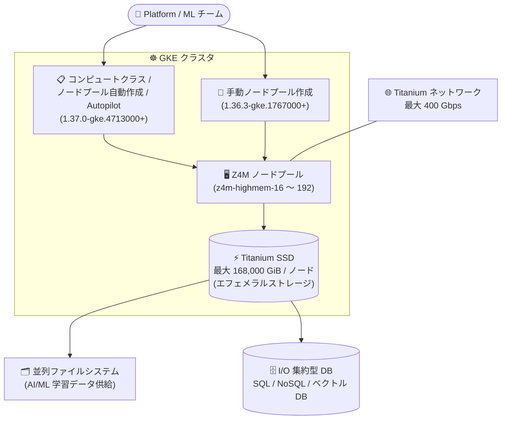

# Google Kubernetes Engine (GKE): ストレージ最適化 Z4M マシンシリーズのノードサポート

**リリース日**: 2026-10-19

**サービス**: Google Kubernetes Engine (GKE)

**機能**: ストレージ最適化 Z4M マシンシリーズによる GKE ノードのプロビジョニング

**ステータス**: Feature (提供開始)

📊 [このアップデートのインフォグラフィックを見る](https://takech9203.github.io/google-cloud-news-summary/20261019-gke-z4m-storage-optimized-nodes.html)

## 概要

GKE で、ストレージ最適化 **Z4M マシンシリーズ**からノードをプロビジョニングできるようになりました。Z4M は第 5 世代 Intel Xeon Scalable プロセッサ (Emerald Rapids)、DDR5 メモリ、Titanium オフロードプロセッサを搭載し、最大 168,000 GiB のローカル Titanium SSD を提供する Compute Engine のマシンシリーズです (2026 年 10 月 15 日に GA)。今回のアップデートにより、この大容量・高 IOPS のローカルストレージを GKE 上のコンテナワークロードから利用できるようになります。

利用方法は GKE バージョンによって段階的に提供されます。

- **手動でのノードプール作成**: GKE バージョン 1.36.3-gke.1767000 以降
- **コンピュートクラス、クラスタオートスケーラー、ノードプール自動作成、Autopilot クラスタでの利用**: GKE バージョン 1.37.0-gke.4713000 以降

Z4M は AI/ML ワークロードを支える大規模並列ファイルシステムや、データベースなどの I/O 集約型ワークロードに適しています。なお、GKE では現時点で Z4M のベアメタルインスタンス (z4m-highmem-192-metal) はサポートされません。

**アップデート前の課題**

- Z4M は Compute Engine の VM としては利用可能 (2026-10-15 GA) だったが、GKE ノードとしてはプロビジョニングできず、Kubernetes 上のワークロードから Z4M の大容量 Titanium SSD を利用できなかった
- GKE のストレージ最適化シリーズは Z3 (最大 72,000 GiB) と Z4D (最大 84,000 GiB、2026-09-28 から GKE 対応) にとどまり、1 ノードあたりのローカルストレージ密度に上限があった

**アップデート後の改善**

- GKE Standard クラスタで Z4M マシンタイプのノードプールを手動作成できるようになった (1.36.3-gke.1767000 以降)
- コンピュートクラス、クラスタオートスケーラー、ノードプール自動作成、Autopilot クラスタでも Z4M を利用できるようになり、宣言的かつ自動的な Z4M ノードのプロビジョニングが可能になった (1.37.0-gke.4713000 以降)
- 1 ノードあたり最大 168,000 GiB の Titanium SSD と最大 400 Gbps のネットワーク帯域を、GKE 上の並列ファイルシステムやデータベースワークロードで活用できるようになった

## アーキテクチャ図



GKE クラスタ上で手動またはコンピュートクラス / オートスケーラー経由で Z4M ノードプールを作成し、ノードに自動付属する Titanium SSD を並列ファイルシステムや I/O 集約型データベースのストレージとして利用する構成です。

## サービスアップデートの詳細

### 主要機能

1. **Z4M ノードプールの手動作成 (GKE 1.36.3-gke.1767000 以降)**
   - GKE Standard クラスタのノードプール作成時に Z4M マシンタイプ (z4m-highmem-16 / 32 / 48 / 192) を指定可能
   - Titanium SSD はマシンタイプに含まれており、ノード作成時に自動的にアタッチされる

2. **コンピュートクラス・オートスケーラー・Autopilot 対応 (GKE 1.37.0-gke.4713000 以降)**
   - カスタムコンピュートクラスの優先順位ルールで Z4M を指定し、ノードプール自動作成と組み合わせた宣言的なプロビジョニングが可能
   - クラスタオートスケーラーによる Z4M ノードプールのスケーリングに対応
   - Autopilot クラスタでも Z4M を利用可能

3. **ストレージ最適化ワークロード向けのローカルストレージ**
   - GKE の Local SSD ドキュメントでは、ストレージ最適化マシン (Z3 / Z4D / Z4M) では Local SSD をエフェメラルストレージとして利用する方法が案内されている
   - emptyDir ボリュームやローカル PersistentVolume を通じて Pod から Titanium SSD にアクセスできる

## 技術仕様

### GKE で利用可能な Z4M マシンタイプ (VM)

Z4M は vCPU あたり 7.625 GB (大型タイプは 7.75 GB) の highmem 構成で提供されます。ベアメタルタイプは GKE では未サポートです。

| マシンタイプ | vCPU | メモリ (GB) | Titanium SSD | NIC 数 | 最大内部帯域 (Gbps) |
|------|------|------|------|------|------|
| z4m-highmem-16 | 16 | 122 | 14,000 GiB (1 x 14,000) | 1 | 最大 32 |
| z4m-highmem-32 | 32 | 244 | 28,000 GiB (2 x 14,000) | 1 | 最大 67 |
| z4m-highmem-48 | 48 | 366 | 42,000 GiB (3 x 14,000) | 1 | 最大 100 |
| z4m-highmem-192 | 192 | 1,488 | 168,000 GiB (12 x 14,000) | 2 | 最大 400 |

### 必要な GKE バージョン

| 利用方法 | 必要な GKE バージョン |
|------|------|
| 手動でのノードプール作成 | 1.36.3-gke.1767000 以降 |
| コンピュートクラス | 1.37.0-gke.4713000 以降 |
| クラスタオートスケーラー | 1.37.0-gke.4713000 以降 |
| ノードプール自動作成 | 1.37.0-gke.4713000 以降 |
| Autopilot クラスタ | 1.37.0-gke.4713000 以降 |

### ライブマイグレーションとメンテナンスの挙動 (GKE Local SSD ドキュメントより)

| 構成 | メンテナンス時の挙動 |
|------|------|
| Titanium SSD 48 TiB 以下かつ Cloud RDMA 未使用の Z4M VM | ライブマイグレーションをサポート |
| Titanium SSD 48 TiB 超の Z4M VM、または Cloud RDMA を使用する Z4M VM | メンテナンス時に終了 (Titanium SSD データ保持を伴う) |

## 設定方法

### 前提条件

1. GKE クラスタが必要バージョン以降であること (手動作成: 1.36.3-gke.1767000 以降、コンピュートクラス / Autopilot など: 1.37.0-gke.4713000 以降)
2. Z4M が利用可能なゾーン・リージョンでクラスタ / ノードプールを作成すること
3. Z4M は Windows OS イメージ非対応のため、Linux ノードイメージを使用すること

### 手順

#### ステップ 1: Z4M ノードプールを手動作成する (Standard クラスタ)

```bash
gcloud container node-pools create z4m-pool \
    --cluster=CLUSTER_NAME \
    --location=LOCATION \
    --machine-type=z4m-highmem-16 \
    --ephemeral-storage-local-ssd count=1
```

ストレージ最適化マシンでは、Local SSD (Titanium SSD) をエフェメラルストレージとして構成する方法が推奨されています。Local SSD 構成はノードプール作成後に変更できない点に注意してください。

#### ステップ 2: コンピュートクラスで Z4M を宣言的に利用する (1.37.0-gke.4713000 以降)

```yaml
apiVersion: cloud.google.com/v1
kind: ComputeClass
metadata:
  name: storage-optimized
spec:
  priorities:
  - machineFamily: z4m
  nodePoolAutoCreation:
    enabled: true
```

Pod がこのコンピュートクラスを要求すると、GKE が Z4M のノードプールを自動作成・スケールします。なお、コンピュートクラスの `machineFamily` 指定ではベアメタルマシンタイプはプロビジョニングされません (GKE 自体が Z4M ベアメタルを未サポート)。

## メリット

### ビジネス面

- **AI/ML ストレージ基盤の Kubernetes 統合**: 並列ファイルシステムなどのストレージ基盤を GKE 上で運用でき、コンテナベースの AI/ML プラットフォームとインフラ運用を統一できる
- **ノード集約によるコスト効率**: 1 ノードあたり最大 168,000 GiB という高いストレージ密度により、少ないノード数で大規模データを扱える

### 技術面

- **Compute Engine 最大のローカルストレージを GKE で利用可能**: Titanium SSD 最大 168,000 GiB / ノード (z4m-highmem-192 で読み取り最大 1,560 万 IOPS、75,600 MiBps) をコンテナワークロードから活用できる
- **自動プロビジョニングへの対応**: コンピュートクラス、クラスタオートスケーラー、ノードプール自動作成、Autopilot に対応し、需要に応じた Z4M ノードの自動スケーリングが可能
- **広帯域ネットワーク**: z4m-highmem-192 は 2 枚の物理 NIC で最大 400 Gbps の内部帯域をサポートし、分散ストレージのノード間通信に適する

## デメリット・制約事項

### 制限事項

- GKE は Z4M ベアメタルインスタンス (z4m-highmem-192-metal) を現時点でサポートしない
- コンピュートクラス / オートスケーラー / Autopilot での利用は GKE 1.37.0-gke.4713000 以降が必要 (手動作成より新しいバージョンが必要)
- Z4M 自体の制約も適用される: 一部ゾーン・リージョンのみで利用可能、GPU 利用不可、カスタムマシンタイプ作成不可、Windows OS イメージ非対応
- Titanium SSD が 48 TiB を超える Z4M VM、および Cloud RDMA を使用する Z4M VM はライブマイグレーション非対応で、メンテナンス時に終了する (Titanium SSD データ保持を伴う)

### 考慮すべき点

- Local SSD (Titanium SSD) 上のデータはエフェメラルであり、Pod やノードの削除・修復・アップグレード時に失われる可能性がある。永続化が必要なデータは Persistent Disk / Hyperdisk、Filestore、Cloud Storage などの永続ストレージを併用する
- Local SSD の構成 (エフェメラルストレージ / raw ブロック) はノードプール作成後に変更できないため、事前にアクセス方式を設計する必要がある
- Z4M ノードが必要なワークロードを確実にスケジュールするには、node affinity やコンピュートクラスによる制御を行う

## ユースケース

### ユースケース 1: GKE 上の AI/ML 向け並列ファイルシステム

**シナリオ**: GKE 上の AI/ML トレーニングに学習データを供給する大規模並列ファイルシステムのストレージノード群を、Kubernetes ネイティブに運用したい。

**実装例**:
```bash
gcloud container node-pools create pfs-pool \
    --cluster=ml-cluster \
    --location=us-central1 \
    --machine-type=z4m-highmem-192 \
    --local-nvme-ssd-block count=12
```

**効果**: raw ブロックモードで Titanium SSD を構成し、ZFS などのファイルシステムや RAID を自前で構成することで、1 ノード 168,000 GiB・最大 400 Gbps のストレージノードを GKE 上で運用できる。

### ユースケース 2: I/O 集約型データベースのホスティング

**シナリオ**: SQL / NoSQL / ベクトルデータベースなど、低レイテンシかつ高 IOPS のローカルストレージを要求するデータベースを GKE 上で StatefulSet として運用したい。

**効果**: Titanium SSD の高い IOPS・スループットをローカル PersistentVolume 経由でデータベース Pod から利用でき、ストレージ密度の高いノードにデータを集約できる。データの永続性はデータベース側のレプリケーションと永続ストレージへのバックアップで担保する。

### ユースケース 3: コンピュートクラスによるストレージ最適化ノードの自動管理

**シナリオ**: ストレージ要件の大きいワークロードが増減する環境で、Z4M ノードプールの作成・スケーリングを自動化したい。

**効果**: GKE 1.37.0-gke.4713000 以降では、コンピュートクラスとノードプール自動作成により、Pod の要求に応じて GKE が Z4M ノードプールを自動作成・スケール・削除する。手動のキャパシティ管理が不要になる。

## 料金

GKE で Z4M ノードを使用する場合、GKE のクラスタ管理料金に加えて、ノードとして使用する Z4M インスタンスの料金 (Titanium SSD を含む) が Compute Engine の料金体系に基づいて課金されます。Z4M はリソースベース確約利用割引 (CUD)、Flexible CUD、Spot VM (ベアメタルを除く)、予約に対応しています。

- [VM インスタンス料金 (Z4M マシンタイプ)](https://docs.cloud.google.com/compute/vm-instance-pricing#z4m_machine_types)
- [GKE の料金](https://cloud.google.com/kubernetes-engine/pricing)
- [ディスクとイメージの料金](https://cloud.google.com/compute/disks-image-pricing)

## 利用可能リージョン

Z4M は一部のゾーン・リージョンで利用可能です。最新の利用可能ゾーンは [リージョンとゾーン](https://docs.cloud.google.com/compute/docs/regions-zones#available) を参照するか、`gcloud compute machine-types list --filter="name=z4m-highmem-16"` で確認してください。

## 関連サービス・機能

- **Compute Engine Z4M マシンシリーズ**: 本アップデートの基盤。2026-10-15 に GA となったストレージ最適化マシンシリーズ (関連レポート: [Compute Engine Z4M GA](./2026-10-15-compute-engine-z4m-ga.md))
- **カスタムコンピュートクラス**: 優先順位ルールで Z4M を宣言し、ノードプール自動作成と組み合わせて自動プロビジョニングを実現する GKE の仕組み
- **GKE Local SSD (エフェメラルストレージ / raw ブロック)**: Z4M の Titanium SSD を Pod から利用するためのノードプール構成オプション
- **Z4D / Z3 マシンシリーズ**: 同じストレージ最適化ファミリーの既存シリーズ。Z4D は 2026-09-28 から GKE 対応済みで、容量・性能要件に応じて選択できる
- **Google Cloud Hyperdisk**: Z4M がサポートする高性能ブロックストレージ。永続データは Hyperdisk、ホットデータは Titanium SSD という使い分けができる

## 参考リンク

- 📊 [インフォグラフィック](https://takech9203.github.io/google-cloud-news-summary/20261019-gke-z4m-storage-optimized-nodes.html)
- [公式リリースノート](https://docs.cloud.google.com/release-notes#October_19_2026)
- [ドキュメント: Machine support with GKE](https://docs.cloud.google.com/kubernetes-engine/docs/concepts/machine-support#machine-support)
- [ドキュメント: Z4M machine series](https://docs.cloud.google.com/compute/docs/storage-optimized-machines#z4m_series)
- [ドキュメント: GKE の Local SSD について](https://docs.cloud.google.com/kubernetes-engine/docs/concepts/local-ssd)
- [ドキュメント: カスタムコンピュートクラスについて](https://docs.cloud.google.com/kubernetes-engine/docs/concepts/about-custom-compute-classes)
- [料金ページ: VM インスタンス料金 (Z4M)](https://docs.cloud.google.com/compute/vm-instance-pricing#z4m_machine_types)

## まとめ

Compute Engine で GA となったばかりの Z4M マシンシリーズが GKE ノードとして利用可能になり、1 ノード最大 168,000 GiB の Titanium SSD を Kubernetes ワークロードから活用できるようになりました。GKE 上で AI/ML 向け並列ファイルシステムや I/O 集約型データベースを運用している場合は、クラスタバージョン (手動作成は 1.36.3-gke.1767000 以降、コンピュートクラス / Autopilot は 1.37.0-gke.4713000 以降) と利用可能ゾーンを確認し、Z4D / Z3 ノードとの比較を含めて採用を検討することをおすすめします。

---

**タグ**: GKE, Z4M, ストレージ最適化, Titanium SSD, Local SSD, コンピュートクラス, Autopilot, AI/ML
