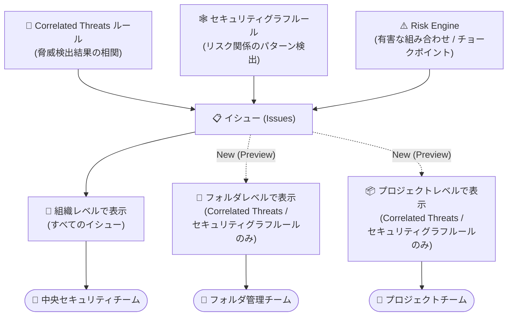

# Security Command Center: フォルダ・プロジェクトレベルでのイシュー表示 (Preview)

**リリース日**: 2026-10-19

**サービス**: Security Command Center

**機能**: Correlated Threats およびセキュリティグラフルールによるイシューのフォルダ・プロジェクトレベル表示

**ステータス**: Preview

📊 [このアップデートのインフォグラフィックを見る](https://takech9203.github.io/google-cloud-news-summary/20261019-security-command-center-issues-folder-project-level.html)

## 概要

Security Command Center において、Correlated Threats ルールおよびセキュリティグラフルールによって作成されたイシュー (Issues) を、組織レベルだけでなく **フォルダレベル・プロジェクトレベル** で表示できるようになりました。本機能は Preview として提供されます。

イシューは、Security Command Center が検出した最も重要なセキュリティリスクを集約する仕組みです。Correlated Threats は複数の関連する脅威検出結果を 1 つのイシューに相関・集約して高信頼度の検出を提供し、セキュリティグラフルールはリソース・ID・データ間のリスク関係をグラフデータベース上のパターン検出によってイシュー化します。今回のアップデートにより、Google Cloud コンソールのスコープピッカーでフォルダやプロジェクトを選択すると、そのスコープ内のリソースを主リソースとするイシューのみを絞り込んで調査できます。

さらに、Issues ページではすべてのイシューを **サービスタイプ、プロジェクト番号、フォルダ ID** でフィルタリングできるようになりました。組織全体のセキュリティ運用を担う中央のセキュリティチームだけでなく、特定のフォルダやプロジェクトを所管するアプリケーションチーム・部門チームが、自分たちの責任範囲のイシューに集中して対応できるようになる点が主な価値です。

**アップデート前の課題**

- 以前は、イシューは組織レベルでのみ表示・調査する必要があり、特定のフォルダやプロジェクトを所管するチームが自分たちの範囲のイシューだけを確認することができなかった
- 組織レベルの閲覧権限を持たないプロジェクトチームは、自プロジェクトに影響するイシューを Issues ページで直接確認する手段が限られていた
- 多数のプロジェクトを持つ組織では、Issues ページ上で担当範囲のイシューを特定するために手動での確認が必要だった

**アップデート後の改善**

- Correlated Threats ルールおよびセキュリティグラフルールが作成したイシューを、組織・フォルダ・プロジェクトの各レベルで表示できるようになった
- Issues ページで、すべてのイシューをサービスタイプ、プロジェクト番号、フォルダ ID でフィルタリングできるようになった
- スコープ属性ルール (Scope attribution rules) により、セキュリティ条件が選択スコープ外の主リソースにある場合でも、イシューが正しいフォルダ・プロジェクトに帰属されるようになった
- フォルダ・プロジェクトレベルの IAM ロールのみを持つユーザーでも、自分のスコープのイシューを調査できるようになった (スコープ外リソースの詳細は権限がなければ非表示)

## アーキテクチャ図



イシューの生成元 (Correlated Threats、セキュリティグラフルール、Risk Engine) と、リソース階層の各レベルでの表示可否を示しています。Correlated Threats とセキュリティグラフルールによるイシューは組織・フォルダ・プロジェクトの各レベルで表示できますが、Risk Engine による有害な組み合わせ・チョークポイントのイシューは引き続き組織レベルでのみ表示されます。

## サービスアップデートの詳細

### 主要機能

1. **フォルダ・プロジェクトレベルでのイシュー表示 (Scoped Issues)**
   - Google Cloud コンソールのスコープピッカーで組織・フォルダ・プロジェクトを選択し、そのスコープのイシューに絞り込んで表示できる
   - フォルダを選択すると、そのフォルダまたはサブフォルダ内のリソースに影響するイシュー (Correlated Threats ルール・セキュリティグラフルール起源) が表示される
   - プロジェクトを選択すると、そのプロジェクト内のリソースに影響するイシューが表示される
   - Overview ページ (All Risk / AI Security ダッシュボード) と Issues ページの両方でスコープ選択に対応

2. **Issues ページのフィルタリング強化**
   - すべてのイシューをサービスタイプ、プロジェクト番号、フォルダ ID でフィルタリング可能
   - 既存のフィルタ (アプリケーション、リソースタイプ、ドメインなど) と組み合わせて絞り込みができる

3. **スコープ属性ルール (Scope Attribution Rules)**
   - 各セキュリティグラフルール・Correlated Threats ルールは、イシューの主リソース (primary resource) を特定する
   - 主リソースが選択スコープ内に存在する場合に、そのフォルダ・プロジェクトにイシューが帰属される
   - セキュリティ条件が選択したフォルダ・プロジェクト外のリソースに存在する場合でも、正しいスコープに帰属されるよう設計されている

4. **スコープに応じたアクセス制御**
   - イシューと関連リソース情報の閲覧には、組織・フォルダ・プロジェクトレベルで必要な IAM ロールが必要
   - 選択スコープ外のリソースに対する閲覧権限がない場合、イシューのカテゴリ (例: 「VM with high-risk CVE with access to sensitive data」) のみが表示され、リソース詳細は非表示になる
   - セカンダリリソースが権限のない別プロジェクト・フォルダにある場合、そのリソースの詳細は隠される

## 技術仕様

### イシューの生成元と表示可能スコープ

| イシューの生成元 | 組織レベル | フォルダレベル | プロジェクトレベル |
|------|------|------|------|
| セキュリティグラフルール | ✅ | ✅ (Preview) | ✅ (Preview) |
| Correlated Threats ルール | ✅ | ✅ (Preview) | ✅ (Preview) |
| Risk Engine (有害な組み合わせ・チョークポイント) | ✅ | ❌ | ❌ |

### イシューのライフサイクル

| 項目 | 詳細 |
|------|------|
| イシューの生成条件 | Security Command Center が**組織レベルで有効化**されている場合のみ生成される |
| アクティブ期間 (通常のイシュー) | 解決されるまでアクティブ。非アクティブ化後の保持期間は 90 日 |
| アクティブ期間 (Correlated Threats イシュー) | 最初の脅威検出から 14 日間 (変更不可)。保持期間も 14 日 |
| Correlated Threats ルールの処理頻度 | 1 時間ごと |
| 対象サービスティア | Premium および Enterprise (Enterprise ティアは 2027 年 5 月 21 日に廃止予定) |

## 設定方法

### 前提条件

1. Security Command Center が組織レベルで有効化されていること (イシューは組織レベル有効化時のみ生成される)
2. 表示したいスコープ (組織・フォルダ・プロジェクト) に対する必要な IAM ロールを持っていること

### 手順

#### ステップ 1: Issues ページでスコープを選択する

1. Google Cloud コンソールで Security Command Center の **Issues** ページに移動する
2. コンソールのスコープピッカー (purview picker) で、組織・フォルダ・プロジェクトのいずれかを選択する
   - 組織スコープ: すべての生成元のイシューが表示される
   - フォルダ / プロジェクトスコープ: 主リソースがそのスコープ内にある、セキュリティグラフルール・Correlated Threats 起源のイシューのみが表示される

#### ステップ 2: フィルタで絞り込む

1. アプリケーションで絞り込む場合は **Application** を選択し、**Select app** メニューからアプリケーションを選択する
2. その他の属性 (サービスタイプ、プロジェクト番号、フォルダ ID、リソースタイプなど) で絞り込む場合は **Add filter** をクリックし、フィルタ条件を選択する
3. 検出グループを展開して個々のイシューをクリックすると、イシューの概要、攻撃パス / エビデンス図、関連する検出結果、修復手順 (How to fix)、JSON データなどの詳細パネルが表示される

## メリット

### ビジネス面

- **責任範囲に応じたリスク管理**: フォルダ・プロジェクト単位で部門やチームにセキュリティ運用を委譲している組織で、各チームが自分たちの責任範囲のイシューに集中できる
- **最小権限の原則との両立**: 組織全体の閲覧権限を付与することなく、フォルダ・プロジェクトレベルの IAM ロールだけで担当範囲のイシュー調査が可能になる

### 技術面

- **スコープ属性の正確性**: スコープ属性ルールにより、セキュリティ条件がスコープ外のリソースにあっても、主リソースに基づいてイシューが正しいフォルダ・プロジェクトに帰属される
- **フィルタリングの柔軟性**: サービスタイプ・プロジェクト番号・フォルダ ID によるフィルタで、大規模環境でも目的のイシューへ素早く到達できる
- **権限に応じた情報開示**: スコープ外リソースの詳細は権限がなければ自動的に秘匿され、情報漏洩リスクを抑えつつイシューのカテゴリは把握できる

## デメリット・制約事項

### 制限事項

- 本機能は Preview であり、Pre-GA Offerings Terms が適用される (サポートが限定される可能性がある)
- イシューは Security Command Center が**組織レベルで有効化されている場合のみ**生成される (プロジェクトレベル有効化では利用できない)
- Risk Engine が作成する有害な組み合わせ (toxic combinations) およびチョークポイントのイシューは、引き続き組織レベルでのみ表示可能
- Correlated Threats のイシューは最初の脅威検出から 14 日間でアクティブ期間が終了し、この期間は変更できない

### 考慮すべき点

- フォルダ・プロジェクトレベルで表示されるのは、主リソースがそのスコープ内にあるイシューのみ。組織全体のリスク (有害な組み合わせ・チョークポイントを含む) を把握するには組織レベルでの確認が引き続き必要
- スコープ外のセカンダリリソースの詳細を確認するには、該当プロジェクト・フォルダへの IAM 権限が別途必要
- Enterprise サービスティアは 2027 年 5 月 21 日に廃止され、Premium ティアへ自動移行される予定のため、ティア構成の確認を推奨

## ユースケース

### ユースケース 1: プロジェクトチームによる自律的な脅威対応

**シナリオ**: 大規模組織で、各アプリケーションチームが自分たちのプロジェクトのセキュリティ対応に責任を持つ運用モデルを採用している。従来はイシューが組織レベルでしか確認できず、中央セキュリティチームからの連絡を待って対応していた。

**実装例**:
```
1. アプリケーションチームにプロジェクトレベルの必要な IAM ロールを付与
2. チームメンバーがコンソールのスコープピッカーで自プロジェクトを選択
3. Issues ページで自プロジェクトを主リソースとする Correlated Threats /
   セキュリティグラフルールのイシューを確認
4. How to fix タブの修復手順に沿って対応
```

**効果**: 中央チームを経由せずにプロジェクトチームが直接イシューを検知・対応でき、脅威への初動が高速化される。

### ユースケース 2: フォルダ単位での部門別リスクレビュー

**シナリオ**: 事業部ごとにフォルダを分けてリソースを管理している企業で、各事業部のセキュリティ担当者が月次でリスクレビューを実施する。

**効果**: スコープピッカーで事業部フォルダを選択するだけで、サブフォルダを含む配下リソースのイシューを一覧でき、さらにサービスタイプやプロジェクト番号でのフィルタにより、レビュー対象の整理と優先順位付けが容易になる。

## 料金

イシュー機能 (Correlated Threats、セキュリティグラフルールを含む) は Security Command Center の Premium / Enterprise サービスティアで利用できます。料金の詳細は公式の料金ページを参照してください。

- [Security Command Center の料金](https://cloud.google.com/security-command-center/pricing)
- [サービスティアの比較](https://docs.cloud.google.com/security-command-center/docs/service-tiers)

## 関連サービス・機能

- **Correlated Threats**: セキュリティグラフに対する事前定義クエリで関連する脅威検出結果を相関させ、イシューとして集約する機能 (Preview)。MITRE ATT&CK にマッピングされた攻撃チェーンの可視化を提供
- **セキュリティグラフ / 事前定義セキュリティグラフルール**: リソース・ID・アプリケーション・データをノード、リスク関係をエッジとして表現するグラフデータベース。パターン検出によりイシューを生成
- **Risk Engine (有害な組み合わせ・チョークポイント)**: 複数のリスクが組み合わさって高価値リソースへの攻撃経路を形成するパターンを検出。これらのイシューは組織レベルでのみ表示可能
- **Event Threat Detection / Container Threat Detection / VM Threat Detection**: Correlated Threats が相関させる脅威検出結果の供給元となる脅威検出サービス群
- **App Hub**: Issues ページ・Overview ページでアプリケーション単位のフィルタリングに利用できる
- **IAM**: スコープごとのイシュー閲覧に必要なロールを管理。権限のないリソースの詳細は自動的に秘匿される

## 参考リンク

- 📊 [インフォグラフィック](https://takech9203.github.io/google-cloud-news-summary/20261019-security-command-center-issues-folder-project-level.html)
- [公式リリースノート](https://docs.cloud.google.com/release-notes#October_19_2026)
- [イシューの概要 (Issues overview)](https://docs.cloud.google.com/security-command-center/docs/issues-overview)
- [イシューの管理と修復 (Manage and remediate issues)](https://docs.cloud.google.com/security-command-center/docs/issues-manage-remediate)
- [Correlated Threats の概要](https://docs.cloud.google.com/security-command-center/docs/correlated-threats-overview)
- [事前定義セキュリティグラフルール](https://docs.cloud.google.com/security-command-center/docs/predefined-security-graph-rules)
- [料金ページ](https://cloud.google.com/security-command-center/pricing)

## まとめ

今回のアップデートにより、Security Command Center のイシューを組織レベルだけでなくフォルダ・プロジェクトレベルで表示・フィルタリングできるようになり、分散型のセキュリティ運用モデルを採用する組織での活用範囲が大きく広がりました。フォルダ・プロジェクト単位でセキュリティ責任を委譲している組織は、各チームへの適切な IAM ロール付与とあわせて本 Preview 機能の検証を開始することを推奨します。なお、有害な組み合わせ・チョークポイントの確認には引き続き組織レベルのビューが必要な点に留意してください。

---

**タグ**: #SecurityCommandCenter #Issues #CorrelatedThreats #SecurityGraph #Preview #セキュリティ #リソース階層
