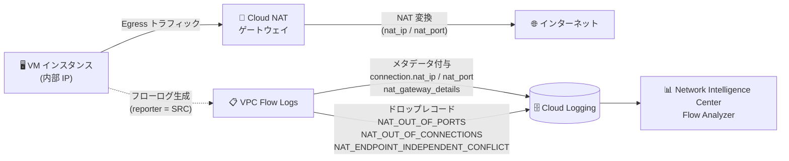

# Virtual Private Cloud (VPC): VPC Flow Logs の Cloud NAT メタデータアノテーションとパケットドロップ理由 (GA)

**リリース日**: 2026-10-19

**サービス**: Virtual Private Cloud (VPC)

**機能**: VPC Flow Logs — Cloud NAT メタデータアノテーションとパケットドロップ理由の一般提供 (GA)

**ステータス**: 一般提供 (GA)

📊 [このアップデートのインフォグラフィックを見る](https://takech9203.github.io/google-cloud-news-summary/20261019-vpc-flow-logs-cloud-nat-annotations.html)

## 概要

VPC Flow Logs に Cloud NAT 関連のメタデータアノテーションとパケットドロップ理由が追加され、一般提供 (GA) となりました。フローログレコードに NAT 変換後の IP アドレス・ポート (`connection.nat_ip`、`connection.nat_port`) と Cloud NAT ゲートウェイの詳細情報 (`nat_gateway_details`) が付与されるようになり、さらに Cloud NAT 起因のパケットドロップが 3 種類の理由 (`NAT_ENDPOINT_INDEPENDENT_CONFLICT`、`NAT_OUT_OF_CONNECTIONS`、`NAT_OUT_OF_PORTS`) とともにフローログに記録されるようになりました。

これにより、Cloud NAT 経由のアウトバウンド通信のトラブルシューティングを、VPC Flow Logs という単一のテレメトリソースで完結できるようになります。NAT ポート枯渇やエンドポイント非依存マッピング (EIM) の競合といった、従来は切り分けが難しかった問題を、ドロップが発生したフロー単位で特定できます。

Cloud NAT を利用してインターネットへアクセスする VM や GKE クラスタを運用するネットワーク管理者、SRE、セキュリティチームにとって、ネットワーク可観測性を大きく向上させるアップデートです。

**アップデート前の課題**

- VPC Flow Logs には NAT 変換後のアドレス情報やゲートウェイ情報が含まれず、Cloud NAT のトラブルシューティングには Cloud NAT 側のロギング (NAT logging) や Cloud Monitoring の VM インスタンスメトリクス (`dropped_sent_packets_count` の理由 `OUT_OF_RESOURCES` / `ENDPOINT_INDEPENDENCE_CONFLICT` など) を別途参照する必要があった
- Cloud NAT のロギングはすべてのイベントを記録するわけではなく、Egress トラフィックが多い期間にはスロットリングされ、変換ログやエラーログが欠落する可能性があり、何が欠落したかを特定できなかった
- フローログ上ではパケットドロップの原因が NAT 起因かどうかを直接判別できず、ポート枯渇や EIM 競合の切り分けに複数のツールを横断する必要があった

**アップデート後の改善**

- フローログの `connection.nat_ip` / `connection.nat_port` で、各フローに Cloud NAT ゲートウェイが割り当てた外部 IP アドレスとポートを確認できるようになった
- `nat_gateway_details` メタデータにより、どの Cloud NAT ゲートウェイ (ゲートウェイ名、Cloud Router 名、プロジェクト、リージョン、PUBLIC / PRIVATE 種別) がフローを変換したかをログレコードから直接特定できるようになった
- NAT 起因のドロップが `drop_reason` フィールド (`NAT_OUT_OF_PORTS` など) 付きのドロップレコードとして記録され、`bytes_dropped` / `packets_dropped` とあわせてドロップの影響規模を定量的に把握できるようになった

## アーキテクチャ図



VM から Cloud NAT ゲートウェイを経由してインターネットへ向かう Egress フローに対し、VPC Flow Logs が NAT 変換情報のアノテーションと NAT 起因のドロップ理由を付与して Cloud Logging に記録します。Flow Analyzer でドロップ理由ごとの分析も可能です。

## サービスアップデートの詳細

### 主要機能

1. **NAT 変換情報のメタデータアノテーション (`connection.nat_ip` / `connection.nat_port`)**
   - `nat_ip`: Cloud NAT ゲートウェイが使用した IP アドレス。レポーターが `SRC` の場合にのみ記録される
   - `nat_port`: Cloud NAT ゲートウェイが割り当てたポート番号。レポーターが `SRC` の場合にのみ記録される
   - 内部 IP のフローと NAT 変換後の外部 IP・ポートをログレコード上で直接対応付けられる

2. **Cloud NAT ゲートウェイ詳細 (`nat_gateway_details`)**
   - フローのレポーターが、Cloud NAT ゲートウェイが NAT を行うサブネット内の `SRC` である場合に記録されるメタデータフィールド
   - ゲートウェイ名、関連付けられた Cloud Router 名、プロジェクト ID、リージョン、NAT 種別 (PUBLIC / PRIVATE) を含む
   - 複数の NAT ゲートウェイを運用する環境で、フローがどのゲートウェイを経由したかを特定できる

3. **Cloud NAT 起因のパケットドロップ理由 (3 種類)**
   - `NAT_ENDPOINT_INDEPENDENT_CONFLICT`: エンドポイント非依存マッピング (EIM) の競合によりアウトバウンドトラフィックがドロップされた
   - `NAT_OUT_OF_CONNECTIONS`: NAT 接続トラッキングテーブルが最大容量に達したためドロップされた
   - `NAT_OUT_OF_PORTS`: Cloud NAT ゲートウェイが VM に割り当てる NAT 2 タプル (ポート) を使い果たしたためドロップされた
   - いずれも Egress 側のドロップとして `SRC` または `SRC_GATEWAY` からレポートされる

## 技術仕様

### NatGatewayDetails フィールド形式

| フィールド | 型 | 説明 |
|------|------|------|
| `gateway_name` | string | Cloud NAT ゲートウェイの名前 |
| `router_name` | string | Cloud NAT ゲートウェイに関連付けられた Cloud Router の名前 |
| `project_id` | string | Cloud NAT ゲートウェイと Cloud Router の Google Cloud プロジェクト ID |
| `region` | string | Cloud NAT ゲートウェイと Cloud Router のリージョン |
| `type` | string | Cloud NAT の種別: `PUBLIC` または `PRIVATE` |

### 追加されたドロップ理由と推奨対応

| ドロップ理由 | 原因 | 推奨対応 |
|------|------|------|
| `NAT_ENDPOINT_INDEPENDENT_CONFLICT` | エンドポイント非依存マッピングの競合 | EIM の無効化、VM あたりの最小 NAT ポート数の引き上げなどを検討 |
| `NAT_OUT_OF_CONNECTIONS` | NAT 接続トラッキングテーブルが上限に到達 | VM あたりの NAT 接続数上限と NAT タイムアウト設定を見直す |
| `NAT_OUT_OF_PORTS` | NAT の IP アドレス・ポートのタプルが枯渇 | NAT IP アドレス数と VM あたりのポート割り当てを見直す (動的ポート割り当ての活用など) |

### ドロップレコードの構造

ドロップされたトラフィックのログレコードは通常のフローレコードとは別に生成され、以下のフィールドを含みます。

| フィールド | 説明 |
|------|------|
| `disposition` | ドロップレコードでは `DROPPED` が設定される |
| `drop_reason` | ドロップ理由 (上記の NAT 系 3 種を含む) |
| `bytes_dropped` | ドロップされたユーザーペイロードの推定バイト数 |
| `packets_dropped` | ドロップされた推定パケット数 |
| `throughput_inclusion` | ドロップされたトラフィックが同一レポーターの `bytes_sent` / `packets_sent` に含まれるかどうか (`INCLUDED` / `EXCLUDED`) |

パケットドロップはフローとドロップ理由ごとに集約され、同一アグリゲーション間隔内の同一理由のドロップは 1 つのログレコードに統合されます。

## 設定方法

### 前提条件

1. 対象サブネット (または VPC ネットワーク・組織) で VPC Flow Logs が有効化されていること
2. メタデータアノテーションを取得するには、フローログ設定でメタデータが有効 (すべて、またはカスタムで対象フィールドを指定) であること
3. Cloud NAT ゲートウェイが対象サブネットのトラフィックを変換していること

### 手順

#### ステップ 1: サブネットで VPC Flow Logs を有効化 (メタデータをすべて含める)

```bash
gcloud compute networks subnets update SUBNET_NAME \
    --region=REGION \
    --enable-flow-logs \
    --logging-metadata=include-all
```

メタデータに「すべて」を選択している場合、新しく追加されたメタデータフィールド (`nat_gateway_details` など) は自動的にフローログに含まれます。カスタムメタデータでフィールドのフルネームを指定している場合は、新フィールドは自動では含まれないため設定の見直しが必要です。

#### ステップ 2: Cloud Logging で NAT 関連ログを確認

```text
logName="projects/PROJECT_ID/logs/compute.googleapis.com%2Fvpc_flows"
jsonPayload.disposition="DROPPED"
jsonPayload.drop_reason=("NAT_OUT_OF_PORTS" OR "NAT_OUT_OF_CONNECTIONS" OR "NAT_ENDPOINT_INDEPENDENT_CONFLICT")
```

ログエクスプローラで上記のようなフィルタを使用すると、Cloud NAT 起因のドロップレコードを抽出できます。

## メリット

### ビジネス面

- **障害対応時間の短縮**: NAT ポート枯渇などの問題をフローログから直接特定でき、複数ツールを横断した切り分け作業が減り MTTR を短縮できる
- **可観測性ツールの一元化**: 既存の VPC Flow Logs ベースの監視・分析パイプライン (Cloud Logging、BigQuery エクスポートなど) に NAT の可視性を統合できる

### 技術面

- **フロー単位の NAT トレーサビリティ**: 内部 IP・ポートと NAT 変換後の外部 IP・ポートの対応をレコード単位で確認でき、外部サービス側のログとの突合が容易になる
- **ドロップの定量把握**: `bytes_dropped` / `packets_dropped` により、NAT 起因ドロップの影響規模をフロー・理由ごとに定量化できる
- **複数ゲートウェイ環境での特定**: `nat_gateway_details` により、どのゲートウェイ・Cloud Router がフローを処理したかを特定できる

## デメリット・制約事項

### 制限事項

- `connection.nat_ip`、`connection.nat_port`、`nat_gateway_details` は、フローのレポーターが `SRC` の場合にのみ記録される
- NAT 系のドロップ理由は Egress 側 (`SRC` / `SRC_GATEWAY` レポート) のドロップとして記録される
- VPC Flow Logs はサンプリングベースであり、すべてのパケットを記録するわけではない (バイト・パケット数はサンプルからの推定値)

### 考慮すべき点

- カスタムメタデータ設定でフィールドのフルネームを指定している場合、新しいメタデータフィールドは自動的に含まれないため、`nat_gateway_details` を利用するには設定の更新が必要
- メタデータアノテーションを追加するとログレコードのサイズが増加するため、ログ生成量と Cloud Logging の保存コストへの影響を考慮する (メタデータのカスタマイズ、セカンダリサンプリングレート、フィルタで調整可能)

## ユースケース

### ユースケース 1: NAT ポート枯渇の検知とチューニング

**シナリオ**: GKE クラスタや大量の VM が Cloud NAT 経由で外部 API に接続しており、断続的な接続エラーが発生している。原因が NAT ポート枯渇かどうかを特定したい。

**実装例**:
```text
# ログエクスプローラで NAT_OUT_OF_PORTS のドロップレコードを抽出
jsonPayload.disposition="DROPPED"
jsonPayload.drop_reason="NAT_OUT_OF_PORTS"
```

**効果**: どの VM・どのフローでポート枯渇が発生しているかを特定し、NAT IP アドレスの追加や VM あたりのポート割り当て (動的ポート割り当ての最小・最大値) の調整といった対策に直接つなげられる。

### ユースケース 2: 外部サービスのアクセスログとの突合

**シナリオ**: 外部 SaaS 側のアクセスログに記録された送信元 IP・ポート (NAT 変換後) から、Google Cloud 内のどの VM が通信したのかを逆引きしたい。

**効果**: フローログの `connection.nat_ip` / `connection.nat_port` と `src_instance` を突き合わせることで、NAT 変換後のアドレスから送信元 VM をレコード単位で特定でき、セキュリティ調査やインシデントフォレンジックが効率化される。

### ユースケース 3: EIM 競合によるパケットロスの切り分け

**シナリオ**: エンドポイント非依存マッピング (EIM) を有効にした Public NAT 環境で原因不明のパケットロスが発生している。

**効果**: `NAT_ENDPOINT_INDEPENDENT_CONFLICT` のドロップレコードにより EIM 競合が原因であることを確認でき、EIM の無効化や最小ポート数の引き上げといった対策を根拠をもって実施できる。

## 料金

VPC Flow Logs の料金は Network Telemetry の料金体系に従います。課金はフローログをレポートするリソースが属するプロジェクトに対して行われます。メタデータの追加によりログ量が増える場合は、メタデータのカスタマイズやセカンダリサンプリングレート、フィルタリングでコストを調整できます。

詳細は [VPC の料金ページ (Network Telemetry)](https://cloud.google.com/vpc/pricing#network-telemetry) を参照してください。

## 関連サービス・機能

- **Cloud NAT**: 本アップデートの対象。NAT ゲートウェイ自体のロギング・モニタリング機能 (NAT logging、`dropped_sent_packets_count` メトリクスなど) と組み合わせることで、ゲートウェイ側と VM 側の両面から NAT の挙動を分析できる
- **Cloud Logging**: VPC Flow Logs の出力先。ログエクスプローラでの検索や、BigQuery などへのエクスポートに対応
- **Network Intelligence Center (Flow Analyzer)**: VPC Flow Logs をもとにトラフィックとパケットドロップを可視化。ドロップ理由 (Drop reason) 列で NAT 起因のドロップを分析できる
- **Cloud Monitoring**: Cloud NAT の VM インスタンスメトリクスやポート使用率 (`compute.googleapis.com/nat/port_usage`) と組み合わせて、ポート割り当てのチューニングに活用できる

## 参考リンク

- 📊 [インフォグラフィック](https://takech9203.github.io/google-cloud-news-summary/20261019-vpc-flow-logs-cloud-nat-annotations.html)
- [公式リリースノート](https://docs.cloud.google.com/release-notes#October_19_2026)
- [VPC Flow Logs レコード形式 (Record format)](https://docs.cloud.google.com/vpc/docs/about-flow-logs-records#record_format)
- [パケットドロップ理由 (Packet drop reasons)](https://docs.cloud.google.com/vpc/docs/about-flow-logs-records#drop-reason)
- [VPC Flow Logs 概要](https://docs.cloud.google.com/vpc/docs/flow-logs)
- [Cloud NAT のトラブルシューティング](https://docs.cloud.google.com/nat/docs/troubleshooting)
- [Cloud NAT のポートとアドレス](https://docs.cloud.google.com/nat/docs/ports-and-addresses)
- [料金ページ (Network Telemetry)](https://cloud.google.com/vpc/pricing#network-telemetry)

## まとめ

VPC Flow Logs に Cloud NAT のメタデータアノテーションとドロップ理由が GA で追加され、NAT 経由の通信のトレーサビリティと障害切り分けが単一のログソースで完結できるようになりました。Cloud NAT を利用している環境では、フローログのメタデータ設定 (特にカスタムメタデータを使用している場合) を確認し、`NAT_OUT_OF_PORTS` などのドロップレコードを監視・アラート対象に加えることを推奨します。

---

**タグ**: #VPC #VPCFlowLogs #CloudNAT #ネットワーク #可観測性 #GA #CloudLogging #NetworkIntelligenceCenter
