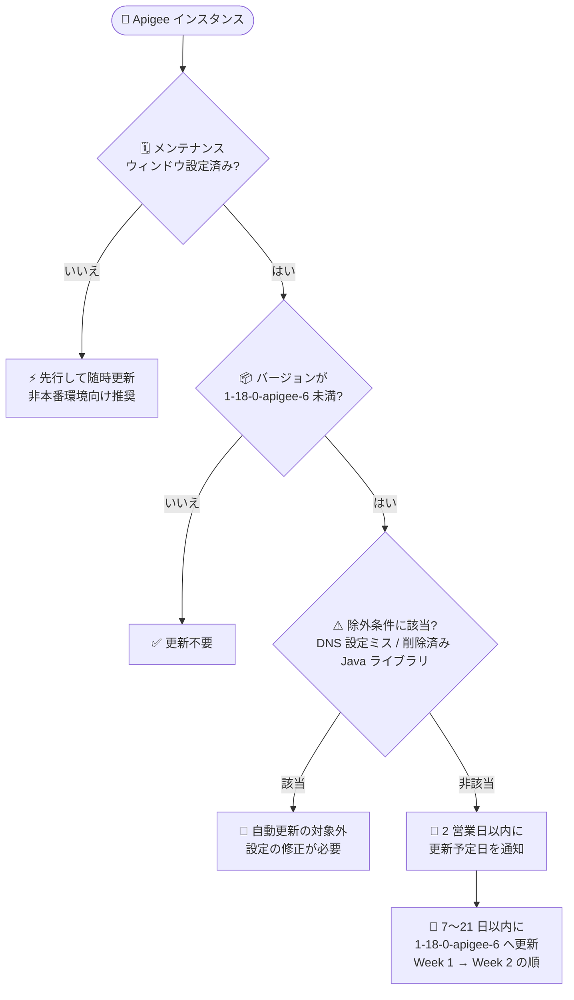

# Apigee: メンテナンスウィンドウ構成インスタンスの 1-18-0-apigee-6 への更新開始

**リリース日**: 2026-10-20

**サービス**: Apigee

**機能**: メンテナンスウィンドウ構成インスタンスの 1-18-0-apigee-6 への自動更新

**ステータス**: アナウンス (メンテナンス)

📊 [このアップデートのインフォグラフィックを見る](https://takech9203.github.io/google-cloud-news-summary/20261020-apigee-maintenance-1-18-0-apigee-6.html)

## 概要

2026 年 10 月 20 日より、Google はメンテナンスウィンドウを構成した Apigee インスタンスのメンテナンス更新を開始しました。優先メンテナンスウィンドウ (preferred maintenance window) を設定済みで、インスタンスのバージョンが `1-18-0-apigee-6` 未満の場合、今後 7〜21 日以内に `1-18-0-apigee-6` へ更新されます。更新予定日を記載した通知は 2 営業日以内に送信されます。

更新先となる `1-18-0-apigee-6` は 2026 年 10 月 2 日にリリースされたバージョンで、Apigee Ingress Gateway (ASM) のセキュリティパッチ、Prometheus ライブラリの複数 CVE (CVE-2026-42151、CVE-2026-42154、CVE-2026-44903、CVE-2026-40179) への対応、JRE 21 への移行、VerifyJWT ポリシーの JWKS キャッシュ更新の改善などが含まれています。

なお、以下のいずれかに該当するインスタンスは今回の自動更新の対象外となります。

1. DNS 設定ミスがあるインスタンス ([Known Issue 445936920](https://docs.cloud.google.com/apigee/docs/release/known-issues))
2. 削除済みの Apigee Java ライブラリを使用しているインスタンス ([2025 年 10 月 16 日付 Apigee リリースノート](https://docs.cloud.google.com/apigee/docs/release/release-notes#October_16_2025) 参照)

**アップデート前の課題**

- メンテナンスウィンドウを設定したインスタンスは、新しい安定版リリースがフリート全体で安定と判断されるまで更新されないため、旧バージョン (1-18-0-apigee-5 以前) のまま稼働していた
- 1-18-0-apigee-6 に含まれるセキュリティ修正 (ASM Ingress Gateway、Prometheus ライブラリの CVE 対応など) が未適用だった
- VerifyJWT の JWKS キャッシュ TTL 失効直後のキーローテーション時エラー (`steps.jwt.NoMatchingPublicKey`) など、既知の不具合が残存していた

**アップデート後の改善**

- メンテナンスウィンドウ設定済みインスタンスが、顧客が指定した曜日・時刻に沿って 7〜21 日以内に安定版 `1-18-0-apigee-6` へ自動更新される
- 更新予定日が 2 営業日以内に通知されるため、事前にテストや監視体制の準備ができる
- セキュリティパッチ (ASM、Prometheus ライブラリの CVE) と不具合修正 (JWKS キャッシュ、ext_proc 応答、SSE データパスなど) が適用され、ランタイムは JRE 21 で動作するようになる

## アーキテクチャ図



メンテナンスウィンドウ設定済みインスタンスが今回の更新対象となるかの判定フローと、通知から更新完了までのロールアウトの流れを示しています。

## サービスアップデートの詳細

### 主要なポイント

1. **メンテナンス更新のロールアウト開始 (2026 年 10 月 20 日)**
   - 優先メンテナンスウィンドウ設定済みかつバージョンが `1-18-0-apigee-6` 未満のインスタンスが対象
   - 今後 7〜21 日以内に `1-18-0-apigee-6` へ更新される
   - 更新予定日を記載した通知が 2 営業日以内に送信される

2. **更新順序 (Order of update) の尊重**
   - Week 1 設定のインスタンスが先に更新され、Week 2 設定のインスタンスは同一リージョン・同一ウィンドウの Week 1 インスタンスの 1 週間後に更新される
   - 通知は Week 1 で少なくとも 1 週間前、Week 2 で少なくとも 2 週間前に送信される
   - 「Week 1 / Week 2」はロールアウトのフェーズと通知リードタイムを指し、暦上の第 1 週・第 2 週を意味しない

3. **自動更新の対象外となるインスタンス**
   - **DNS 設定ミス (Known Issue 445936920)**: Apigee は `1-16-0-apigee-2` にあった DNS 自動フォールバック機能を削除しており、従来は検出されなかった DNS 設定の問題が DNS エラーとして顕在化する可能性がある。ランタイムログで DNS 解決エラーを確認できる
   - **削除済み Apigee Java ライブラリの使用**: 2025 年 10 月 16 日付リリースノートに記載のとおり削除された Java ライブラリに依存する Java Callout を使用しているインスタンスは更新されない

4. **更新先バージョン 1-18-0-apigee-6 の主な内容 (2026 年 10 月 2 日リリース)**
   - セキュリティ: Apigee Ingress Gateway (ASM) のパッチ適用、Prometheus ライブラリのアップグレード (CVE-2026-42151、CVE-2026-42154、CVE-2026-44903、CVE-2026-40179)
   - ランタイムが JRE 21 で動作 (Bug ID 558421499)
   - VerifyJWT ポリシー: JWKS キャッシュ TTL 失効後の最初のリクエストで `steps.jwt.NoMatchingPublicKey` が返る問題を修正 (キャッシュを同期的に再取得)
   - Extension Processor (ext_proc) の拒否応答が、常に HTTP 500 を返すのではなくポリシーや FaultRule が生成したステータス・ボディを返すように修正
   - マルチ証明書トラストストアのトラストアンカー変更が Message Processor の再起動なしで反映されるように修正
   - EventFlow (Server-Sent Events) のバースト負荷時のイベント結合不具合を修正
   - Apigee Analytics に `processing_mode` ディメンションを追加 (プロキシトラフィックと Extension Processor トラフィックを区別)
   - `lookupcache.<n>.isEncrypted` / `responsecache.<n>.isEncrypted` フロー変数が L2 キャッシュのエントリ単位のディスク上暗号化状態を報告するように変更 (L1 キャッシュヒットは `false` を報告。これらの変数に依存するポリシー条件は見直しが必要)

## 技術仕様

### メンテナンスの仕組み

| 項目 | 詳細 |
|------|------|
| 対象 | 優先メンテナンスウィンドウ設定済みで `1-18-0-apigee-6` 未満の Apigee インスタンス (Apigee hybrid は対象外) |
| 更新時期 | 2026 年 10 月 20 日から 7〜21 日以内 |
| 通知 | 2 営業日以内に更新予定日を通知 (通知の受信にはオプトインが必要) |
| メンテナンスウィンドウ | 曜日と開始時刻 (UTC) を指定。インスタンスあたり 1 つのみ設定可能 |
| 更新順序 | Week 1 (通知リードタイム 1 週間以上) / Week 2 (同 2 週間以上)。Week 2 は同一リージョン・同一ウィンドウの Week 1 の 1 週間後 |
| 所要時間 | 構成により異なるが、通常数時間 |
| メンテナンス中の制限 | 新規インスタンス作成、環境のインスタンスへのアタッチ、エンドポイントアタッチメント作成、一部のスケーリング操作が不可 |
| フリーズ / 除外ウィンドウ | 未サポート。スケジュール確定後の設定変更・クリアではイベントをキャンセル・延期できない |
| 必要な権限 | ウィンドウ設定・変更: `roles/apigee.admin` または `apigee.instances.update` 権限。確認: `apigee.instances.get` 権限 |

### メンテナンス設定の確認 (API)

```bash
AUTH="Authorization: Bearer $(gcloud auth print-access-token)"
curl -H "$AUTH" \
  "https://apigee.googleapis.com/v1/organizations/ORGANIZATION_ID/instances/INSTANCE_ID"
```

レスポンスの `scheduledMaintenance` (予定されたメンテナンス開始時刻) と `maintenanceUpdatePolicy` (設定済みウィンドウ) で現在の状態を確認できます。

```json
{
  "scheduledMaintenance": {
    "startTime": "2026-10-28T23:00:00Z"
  },
  "maintenanceUpdatePolicy": {
    "maintenanceWindows": [
      { "day": "SUNDAY", "startTime": { "hours": 23 } }
    ],
    "maintenanceChannel": "WEEK1"
  }
}
```

## 設定方法

### 前提条件

1. Apigee (X) のインスタンスを使用していること (Apigee hybrid は対象外)
2. ウィンドウの設定・変更には `roles/apigee.admin` または `apigee.instances.update` 権限を含むロールが必要

### 手順

#### ステップ 1: 優先メンテナンスウィンドウの設定

```bash
AUTH="Authorization: Bearer $(gcloud auth print-access-token)"
curl -X PATCH \
  -H "$AUTH" \
  -H "Content-Type: application/json" \
  -d '{
    "maintenanceUpdatePolicy": {
      "maintenanceWindows": [
        { "day": "SUNDAY", "startTime": { "hours": 23 } }
      ],
      "maintenanceChannel": "WEEK1"
    }
  }' \
  "https://apigee.googleapis.com/v1/organizations/ORGANIZATION_ID/instances/INSTANCE_ID?updateMask=maintenanceUpdatePolicy.maintenanceWindows,maintenanceUpdatePolicy.maintenanceChannel"
```

開始時刻は UTC で指定します。同一組織内の複数インスタンスにウィンドウを設定する場合は、メンテナンス操作の重複を避けるため各ウィンドウの間隔を 12 時間以上空けることが推奨されています。

#### ステップ 2: メンテナンス通知のオプトイン

1. Google Cloud コンソールで **User preferences > Communication** ページに移動
2. **Apigee, Maintenance window** の行で **Email** のラジオボタンを **On** にする

通知を受け取る必要があるユーザーごとに個別のオプトインが必要です。

#### ステップ 3: 除外条件に該当していないかの確認

```bash
# ランタイムログで DNS 解決エラーの有無を確認 (Known Issue 445936920)
gcloud logging read 'resource.type="apigee.googleapis.com/Environment" AND textPayload:"DNS"' \
  --project=PROJECT_ID --limit=50
```

DNS 設定ミスがある場合や、削除済み Apigee Java ライブラリに依存する Java Callout を使用している場合、今回の自動更新は適用されません。DNS 設定の修正、または Java Callout の依存ライブラリの JAR を API プロキシリソース (`/resources/java`) として明示的に追加するなどの対応を行ってください。

## メリット

### ビジネス面

- **計画的なメンテナンス**: トラフィックが最も少ない時間帯 (例: 日曜深夜) に更新を実施でき、ビジネスへの影響を最小化できる
- **事前通知による準備**: 2 営業日以内に更新予定日が通知されるため、監視強化や関係者への周知を計画的に行える
- **セキュリティリスクの低減**: ASM や Prometheus ライブラリの CVE 対応を含む安定版が自動適用される

### 技術面

- **安定版のみのロールアウト**: メンテナンスウィンドウ向けの更新はフリート全体で高い安定性が確認されたリリースのみがバンドルして配信されるため、更新リスクが低い
- **段階的ロールアウト**: ウィンドウ未設定の (非本番) インスタンスが先に更新されるため、Week 1 / Week 2 と組み合わせて開発 → ステージング → 本番の順で検証できる
- **既知の不具合の解消**: JWKS キーローテーション時のエラー、ext_proc の応答、SSE データパスの問題などが修正される

## デメリット・制約事項

### 制限事項

- メンテナンス中は新規インスタンス作成、環境のアタッチ、エンドポイントアタッチメント作成、一部のスケーリング操作ができない
- メンテナンスの所要時間は正確に見積もれず、通常数時間かかる
- フリーズ / 除外ウィンドウは未サポート。スケジュール確定後にウィンドウ設定を変更・クリアしても、確定済みイベントはキャンセル・延期されない
- 互換性とセキュリティ維持のため、Google が優先ウィンドウ外で更新を実施する場合がある (ベストエフォート)
- DNS 設定ミス (Known Issue 445936920) または削除済み Java ライブラリを使用しているインスタンスは更新対象外となり、旧バージョンのまま残る

### 考慮すべき点

- 更新対象外のまま放置すると、セキュリティパッチ未適用の状態が続くため、除外条件の解消を優先して対応すべき
- `1-18-0-apigee-6` では `isEncrypted` フロー変数の挙動が変わるため、これらの変数に依存するポリシー条件がある場合は事前に見直しが必要
- メンテナンスが失敗した場合、Week 2 のリソースが先に更新され Week 1 のリソースが旧リリースに残ることがある
- 通知はユーザーごとのオプトイン制のため、運用チーム全員が個別に設定しておく必要がある

## ユースケース

### ユースケース 1: 本番環境への影響を最小化した段階的な検証

**シナリオ**: EC サイトのショッピングカート API を Apigee で運用しており、本番インスタンスの更新前に必ずステージングで動作検証を行いたい。

**実装例**:
```
- 開発環境インスタンス: メンテナンスウィンドウなし (最初に更新され、動作確認の起点になる)
- ステージング環境インスタンス: 日曜 0:00 UTC / Week 1
- 本番環境インスタンス: 日曜 0:00 UTC / Week 2
```

**効果**: 通知を受けてから本番更新まで最低 2 週間の猶予があり、開発 → ステージング → 本番の順で `1-18-0-apigee-6` の動作を検証してから本番更新を迎えられる。

### ユースケース 2: 更新対象外インスタンスの是正

**シナリオ**: 通知が届かず、インスタンスが更新対象外になっている可能性がある。

**効果**: ランタイムログで DNS 解決エラーを確認し (Known Issue 445936920)、Java Callout の依存ライブラリを `/resources/java` にリソースとして追加するなどの是正を行うことで、次回のメンテナンスロールアウトで最新のセキュリティパッチを受け取れる状態に戻せる。

## 料金

メンテナンス更新自体に追加料金は発生しません。Apigee の料金体系は従来どおりです。詳細は [Apigee 料金ページ](https://cloud.google.com/apigee/pricing) を参照してください。

## 利用可能リージョン

メンテナンスウィンドウを構成したすべての Apigee インスタンスが対象です (Apigee hybrid は対象外)。リージョンごとの提供状況は [Apigee のロケーション](https://docs.cloud.google.com/apigee/docs/locations) を参照してください。

## 関連サービス・機能

- **Apigee Release Notes**: メンテナンスウィンドウ向けの新しいロールアウトはリリースノートで告知される。RSS フィードの購読を推奨
- **Cloud Logging**: ランタイムログから DNS 解決エラー (Known Issue 445936920) を検出し、更新対象外の原因を特定できる
- **IAM (Apigee Organization Admin)**: メンテナンスウィンドウの設定・変更には `roles/apigee.admin` などの適切なロールが必要
- **Google Cloud コンソール (Communication 設定)**: メンテナンス通知のメール受信オプトインに使用

## 参考リンク

- 📊 [インフォグラフィック](https://takech9203.github.io/google-cloud-news-summary/20261020-apigee-maintenance-1-18-0-apigee-6.html)
- [公式リリースノート](https://docs.cloud.google.com/release-notes#October_20_2026)
- [Apigee リリースノート](https://docs.cloud.google.com/apigee/docs/release/release-notes)
- [メンテナンスの概要 (Maintenance overview)](https://docs.cloud.google.com/apigee/docs/api-platform/system-administration/maintenance)
- [Apigee インスタンスのメンテナンスウィンドウの管理](https://docs.cloud.google.com/apigee/docs/api-platform/system-administration/maintenance-windows)
- [Apigee の既知の問題 (Known Issue 445936920)](https://docs.cloud.google.com/apigee/docs/release/known-issues)
- [2025 年 10 月 16 日付 Apigee リリースノート (Java ライブラリの削除)](https://docs.cloud.google.com/apigee/docs/release/release-notes#October_16_2025)
- [料金ページ](https://cloud.google.com/apigee/pricing)

## まとめ

メンテナンスウィンドウを設定した Apigee インスタンスは、7〜21 日以内にセキュリティパッチと不具合修正を含む `1-18-0-apigee-6` へ自動更新されます。運用チームは 2 営業日以内に届く通知を確認し、`scheduledMaintenance` フィールドで更新予定を把握した上で、検証・監視体制を準備してください。また、DNS 設定ミスや削除済み Java ライブラリへの依存がある場合は更新対象外となり旧バージョンに残るため、該当有無の確認と是正を優先することを推奨します。

---

**タグ**: Apigee, メンテナンス, 自動更新, メンテナンスウィンドウ, 1-18-0-apigee-6, セキュリティパッチ, API 管理
