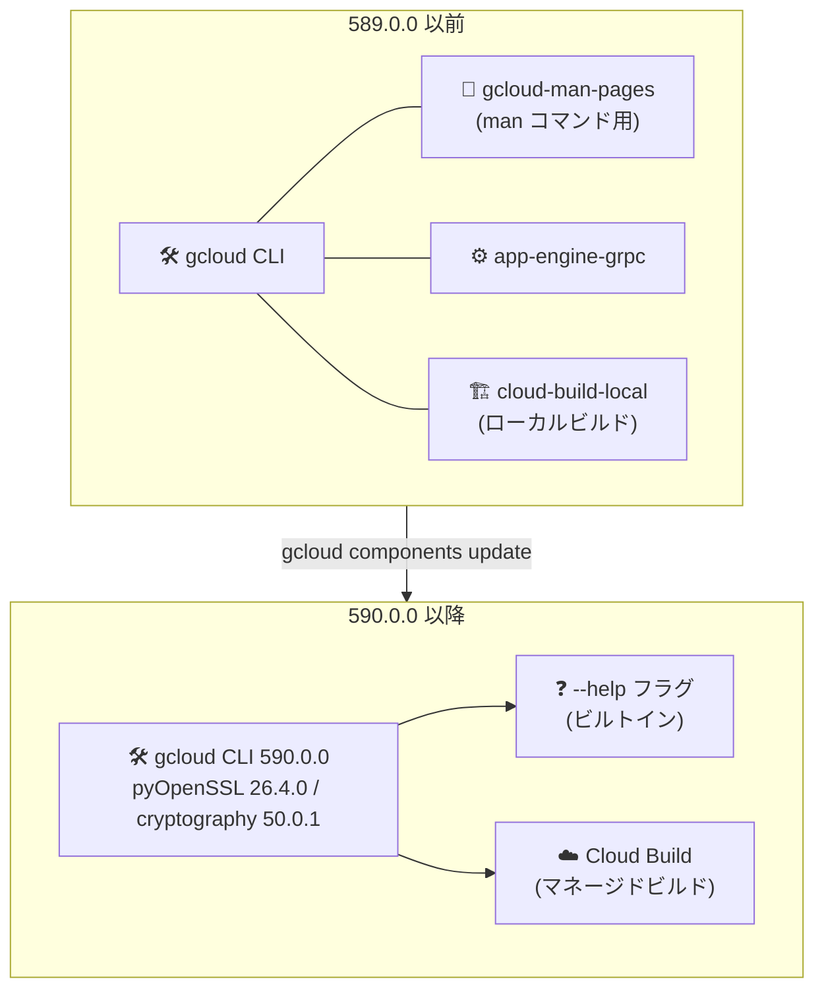

# Cloud SDK: gcloud CLI 590.0.0 リリース (破壊的変更と多数の GA 昇格)

**リリース日**: 2026-10-20

**サービス**: Cloud SDK (gcloud CLI)

**機能**: バージョン 590.0.0 リリース

**ステータス**: GA (一部機能は Beta)

📊 [このアップデートのインフォグラフィックを見る](https://takech9203.github.io/google-cloud-news-summary/20261020-cloud-sdk-590-0-0.html)

## 概要

Google Cloud CLI (gcloud) のバージョン 590.0.0 がリリースされた。本リリースは 3 件の破壊的変更 (Breaking Changes) を含む重要なアップデートであり、`gcloud-man-pages` コンポーネント、App Engine の `app-engine-grpc` コンポーネント、Cloud Build Local Builder (`cloud-build-local`) コンポーネントが削除された。特に `gcloud-man-pages` は 586.0.0 (2026 年 9 月 22 日) で予告されていた通りの削除であり、今後はビルトインの `--help` フラグを使用する必要がある。

機能面では、Cloud Resource Manager の `capability-configs` / `boundary-configs` / `boundaries` コマンド群、Cloud Dataflow の `config-store-settings`、BigLake Iceberg カタログのフェデレーション関連フラグ、Compute Engine の `--instance-flexibility-policy`、GKE Hub の Config Management フラグ、Network Security の WildFire 分析コマンドなど、多数のコマンド・フラグが GA に昇格した。また、バンドル Python のセキュリティライブラリ更新 (pyOpenSSL 26.4.0 / cryptography 50.0.1) や Bigtable 関連コンポーネントの CVE-2026-39820 対応など、セキュリティ面の改善も含まれる。

CI/CD パイプラインやローカル環境で gcloud CLI を利用するすべてのユーザー、特に削除されたコンポーネントに依存しているユーザーは、アップデート前に影響を確認する必要がある。

**アップデート前の課題**

- `gcloud-man-pages`、`app-engine-grpc`、`cloud-build-local` の各コンポーネントは非推奨ながら引き続き配布されており、依存を残したままの環境が存在し得た
- Cloud Run のドメインマッピングは、実際に作成するまでドメインの利用可否を検証できなかった
- Compute Engine のインスタンステンプレートをコードとして出力・取り込みする標準コマンドがなかった (`export` / `import` コマンドが未提供)
- GKE では `--num-nodes=0` でのクラスタ作成ができず、ノードなしの最小構成クラスタを一度の操作で作れなかった
- Cloud SQL は PostgreSQL 19 に未対応だった
- Resource Manager の capability-configs / boundary-configs / boundaries、Dataflow の config-store-settings などは GA 前のリリーストラックでしか利用できず、本番運用での採用判断が難しかった

**アップデート後の改善**

- 削除済みコンポーネントの代替が明確化された (`man` ページ → `--help` フラグ、ローカルビルダー → Cloud Build 本体)
- バンドル Python のセキュリティライブラリ更新と CVE-2026-39820 対応により、CLI 自体のセキュリティ姿勢が向上した
- `gcloud beta run domain-mappings create --dry-run` でドメインマッピングを作成せずに事前検証できるようになった
- `gcloud compute instance-templates export/import` でテンプレートの構成管理 (IaC 的運用) が容易になった
- GKE で `--num-nodes=0` によるノードゼロのクラスタ作成、Windows Server ltsc2025 ノードイメージ、kubelet の `reservedSystemCpus` オプションが利用可能になった
- Cloud SQL で POSTGRES_19 が選択可能になった
- 多数のコマンド・フラグが GA に昇格し、本番環境で SLA のもと利用できるようになった

## アーキテクチャ図



590.0.0 への更新で 3 つのコンポーネントが削除され、コマンドドキュメントはビルトインの `--help` に、ローカルビルドはマネージドの Cloud Build に移行する構成となる。

## サービスアップデートの詳細

### 破壊的変更 (Breaking Changes)

1. **`gcloud-man-pages` コンポーネントの削除**
   - `man gcloud` 形式で参照していた man ページコンポーネントが削除された
   - 586.0.0 (2026-09-22) で非推奨化が予告され、予定通り 590.0.0 で削除
   - 代替: 各コマンドで `--help` フラグを使用する (例: `gcloud compute instances create --help`)

2. **`app-engine-grpc` コンポーネントの削除**
   - App Engine 用の gRPC 拡張コンポーネントが gcloud CLI から削除された
   - このコンポーネントをインストールしていた環境では、更新後にコンポーネントが存在しなくなる

3. **Cloud Build Local Builder (`cloud-build-local`) の削除**
   - ローカルマシン上で Cloud Build のビルドを実行するための Local Builder コンポーネントが削除された
   - ローカル検証に依存していた CI/CD フローは、Cloud Build 本体でのビルド実行への移行が必要

### セキュリティ関連の更新

1. **バンドル Python ライブラリの更新**
   - Linux / Windows / Alpine ベース Docker イメージのバンドル Python が pyOpenSSL 26.4.0 / cryptography 50.0.1 に更新
   - 32-bit Windows はサポート可能な最新版である pyOpenSSL 26.2.0 / cryptography 48.0.1 を使用

2. **CVE-2026-39820 対応**
   - Cloud Bigtable コンポーネントを 1.26.4 でリビルドし CVE-2026-39820 を解消
   - Cloud Bigtable Emulator (cbt-emulator) も同 CVE 対応でリビルド

3. **Apigee mTLS 認証の修正**
   - Mutual TLS (mTLS) で認証するユーザーが `gcloud apigee` コマンド実行時に `UnauthorizedRequestError` で失敗する問題を修正

### 主要な GA 昇格

1. **Cloud Resource Manager: ガバナンス系コマンド群**
   - `gcloud resource-manager capability-configs` が GA に昇格
   - `gcloud resource-manager boundary-configs` が GA に昇格
   - `gcloud resource-manager boundaries` が GA に昇格

2. **BigLake: Iceberg フェデレーテッドカタログ**
   - `gcloud biglake iceberg catalogs create|update` の `--federated-catalog-identity-mode` が GA に昇格
   - 同コマンドの `--metadata-service-directory-name` が GA に昇格
   - `--catalog-type` フラグで `federated` 値をサポート

3. **Cloud Dataflow: 構成ストア設定**
   - `gcloud dataflow config-store-settings` が GA に昇格

4. **Compute Engine: インスタンス柔軟性ポリシー**
   - `--instance-flexibility-policy` フラグが GA に昇格
   - `gcloud compute instance-templates export/import` コマンドを追加 (テンプレートの構成ファイル出力・取り込み)

5. **GKE Hub: Config Management フラグ**
   - Config Management 関連フラグが GA に昇格
   - `--no-install-connect-agent` フラグを追加

6. **Network Security: WildFire 分析コマンド**
   - WildFire 分析関連コマンドが GA に昇格

### その他の注目機能

1. **AI / Vertex AI (Beta)**
   - `gcloud beta ai endpoints deploy-model` が GDC 接続エンドポイント上の Gemini デプロイで自動リソース (automatic resources) をリクエストするように変更
   - レプリカ数未指定の場合、`gemini-2.5-flash` に限り最小レプリカ数がデフォルト 1 になる
   - `--machine-type` や `--accelerator` など専有リソース用フラグを指定すると警告を表示し専有リソースでデプロイ

2. **Agent Identity (Beta)**
   - `gcloud beta agent-identity auth-providers resolve-authorization` コマンドを追加

3. **データベース関連**
   - AlloyDB: `gcloud beta alloydb instances create|update` に `--enable-public-dns` フラグを追加
   - Cloud SQL: データベースバージョンに POSTGRES_19 を追加、MySQL レプリカ再作成用フラグを追加
   - Database Migration: `--failback` フラグを追加
   - Spanner: Spanner CLI のエラー出力を改善

4. **Kubernetes Engine**
   - kubelet オプションに `reservedSystemCpus` を追加
   - Windows ノードイメージ ltsc2025 をサポート
   - デフォルト kubectl を 1.35.9 に更新
   - `--num-nodes=0` でのクラスタ作成をサポート

5. **ネットワーク / サーバーレス関連**
   - Cloud Run: `gcloud beta run domain-mappings create` に `--dry-run` フラグを追加 (ドメインの利用可否を含む事前検証)
   - network-connectivity: `internal-ranges` に `--purpose` フラグを追加
   - Service Extensions: `extension-bindings` と `cdn-edge-extensions` コマンドグループを追加
   - App Engine: `gcloud beta app migrate-to-run` のデフォルトリージョンを `us-central1` から App Engine アプリケーションのリージョンに変更

6. **その他**
   - Cloud IAM: `gcloud iam workforce-pools providers create-oidc|create-saml|update-oidc|update-saml` に `--vendor-type` フラグを追加
   - Certificate Authority Service: `gcloud privateca subordinates list` に `--filter` フラグを追加
   - Cloud Dataplex: `dbt metadata-jobs create` のドット入りリソース名拒否と、同一エントリ ID 衝突でジョブ全体が失敗する問題を修正
   - Cloud Workstations: ブースト構成に `enable-automatic-failover` を追加

## 技術仕様

### 削除されたコンポーネントと代替手段

| 削除コンポーネント | 用途 | 代替手段 |
|------|------|------|
| `gcloud-man-pages` | man コマンドでの CLI ドキュメント参照 | 各コマンドの `--help` フラグ |
| `app-engine-grpc` | App Engine gRPC 拡張 | (削除、代替指定なし) |
| `cloud-build-local` | Cloud Build のローカル実行 | Cloud Build (マネージド) でのビルド実行 |

### バンドル Python ライブラリ

| プラットフォーム | pyOpenSSL | cryptography |
|------|------|------|
| Linux / Windows (64-bit) / Alpine Docker | 26.4.0 | 50.0.1 |
| Windows (32-bit) | 26.2.0 | 48.0.1 |

## 設定方法

### 前提条件

1. gcloud CLI がインストールされていること (パッケージマネージャー経由の場合はコンポーネントマネージャーが無効なため、apt / yum でパッケージを更新する)
2. 削除対象コンポーネント (`gcloud-man-pages`、`app-engine-grpc`、`cloud-build-local`) への依存有無を確認済みであること

### 手順

#### ステップ 1: インストール済みコンポーネントの確認

```bash
gcloud components list
```

削除対象のコンポーネントがインストールされているかを確認する。

#### ステップ 2: 590.0.0 への更新

```bash
gcloud components update
```

更新により削除対象コンポーネントは自動的に取り除かれる。問題が発生した場合は `gcloud components update --version 589.0.0` で直前バージョンに戻せる (直接インストールの場合)。

#### ステップ 3: 代替手段への移行確認

```bash
# man ページの代わりに --help を使用
gcloud compute instances create --help

# ドメインマッピングの事前検証 (新機能の例)
gcloud beta run domain-mappings create \
  --service=my-service \
  --domain=example.com \
  --dry-run
```

`--help` によるドキュメント参照と、新規追加されたフラグの動作を確認する。

## メリット

### ビジネス面

- **本番採用の判断が容易に**: Resource Manager のガバナンス系コマンドや Dataflow の config-store-settings など多数の機能が GA となり、本番環境での利用判断がしやすくなった
- **セキュリティコンプライアンスの維持**: CVE-2026-39820 対応と暗号ライブラリ更新により、CLI を含むツールチェーンの脆弱性管理要件を満たしやすくなった

### 技術面

- **CLI のスリム化**: 利用頻度の低いコンポーネントの削除により、インストールサイズと保守対象が削減された
- **IaC 運用の強化**: `instance-templates export/import` により Compute Engine テンプレートの構成ファイル管理が可能になった
- **安全な事前検証**: Cloud Run の `--dry-run` により、ドメインマッピングを作成せずに検証できるようになった

## デメリット・制約事項

### 制限事項

- `gcloud-man-pages` 削除後は `man` コマンドでの CLI ドキュメント参照ができない (`--help` のみ)
- `cloud-build-local` 削除により、Cloud Build のビルドをローカルで実行する公式コンポーネントはなくなった
- 32-bit Windows は最新の pyOpenSSL / cryptography に追従できず、1 世代前のバージョン (26.2.0 / 48.0.1) に留まる

### 考慮すべき点

- CI/CD パイプラインで削除対象コンポーネントを明示的にインストールしている場合 (`gcloud components install cloud-build-local` など)、590.0.0 以降はインストールが失敗する可能性があるため、スクリプトの修正が必要
- apt / yum でコンポーネントを個別パッケージ (例: `google-cloud-cli-cloud-build-local`) として導入している環境も、パッケージ構成の見直しが必要
- `gcloud beta app migrate-to-run` のデフォルトリージョンが変更されたため、`us-central1` 前提の移行スクリプトは挙動が変わる点に注意

## ユースケース

### ユースケース 1: CI/CD パイプラインの 590.0.0 対応

**シナリオ**: GitHub Actions や Cloud Build で gcloud CLI の最新イメージを使用しており、一部ジョブで `cloud-build-local` によるローカルビルド検証を行っている。

**実装例**:
```bash
# 変更前 (590.0.0 で失敗する)
gcloud components install cloud-build-local
cloud-build-local --config=cloudbuild.yaml --dryrun=true .

# 変更後 (Cloud Build 本体で検証)
gcloud builds submit --config=cloudbuild.yaml .
```

**効果**: 削除済みコンポーネントへの依存を排除し、マネージドな Cloud Build に一本化することでパイプラインの破損を回避できる。

### ユースケース 2: Cloud Run カスタムドメインの安全な事前検証

**シナリオ**: 本番サービスにカスタムドメインを割り当てる前に、ドメインが利用可能かどうかを確認したい。

**実装例**:
```bash
gcloud beta run domain-mappings create \
  --service=prod-frontend \
  --domain=www.example.com \
  --region=asia-northeast1 \
  --dry-run
```

**効果**: 実リソースを作成せずにドメインマッピングの妥当性 (ドメインの利用可否を含む) を検証でき、本番変更作業のリスクを低減できる。

## 料金

gcloud CLI 自体は無料で利用できる。CLI から操作する各 Google Cloud サービス (Cloud Build、Cloud Run、Cloud SQL など) の利用には、それぞれのサービスの料金が適用される。

- [Google Cloud の料金](https://cloud.google.com/pricing)

## 利用可能リージョン

gcloud CLI はクライアントツールのためリージョン制約はない。Linux、macOS、Windows、および Docker イメージとして提供される。

## 関連サービス・機能

- **Cloud Build**: `cloud-build-local` の削除に伴うローカルビルドの移行先。`gcloud builds submit` でマネージドビルドを実行する
- **Cloud Run**: ドメインマッピングの `--dry-run` 検証、App Engine からの移行 (`migrate-to-run`) のデフォルトリージョン変更が含まれる
- **Cloud Resource Manager**: GA 昇格した boundaries / boundary-configs / capability-configs によるリソースガバナンス
- **GKE / GKE Hub**: kubectl 1.35.9 への更新、`--num-nodes=0`、Config Management フラグの GA 昇格
- **Artifact Registry / Docker**: Alpine ベースの gcloud CLI Docker イメージもセキュリティライブラリ更新の対象

## 参考リンク

- 📊 [インフォグラフィック](https://takech9203.github.io/google-cloud-news-summary/20261020-cloud-sdk-590-0-0.html)
- [公式リリースノート](https://docs.cloud.google.com/release-notes#October_20_2026)
- [gcloud CLI リリースノート](https://docs.cloud.google.com/sdk/docs/release-notes)
- [gcloud CLI コンポーネント管理](https://docs.cloud.google.com/sdk/docs/components)
- [gcloud CLI インストール](https://docs.cloud.google.com/sdk/docs/install)

## まとめ

gcloud CLI 590.0.0 は、予告済みの `gcloud-man-pages` を含む 3 コンポーネントの削除という破壊的変更と、Resource Manager ガバナンス系コマンドをはじめとする多数の GA 昇格、セキュリティライブラリ更新を含む重要なリリースである。CI/CD パイプラインやスクリプトで削除対象コンポーネント (特に `cloud-build-local`) に依存していないかを更新前に確認し、`--help` や Cloud Build 本体への移行を進めることを推奨する。

---

**タグ**: Cloud SDK, gcloud CLI, Breaking Changes, Cloud Build, Cloud Run, Resource Manager, GKE, Cloud SQL, セキュリティ
