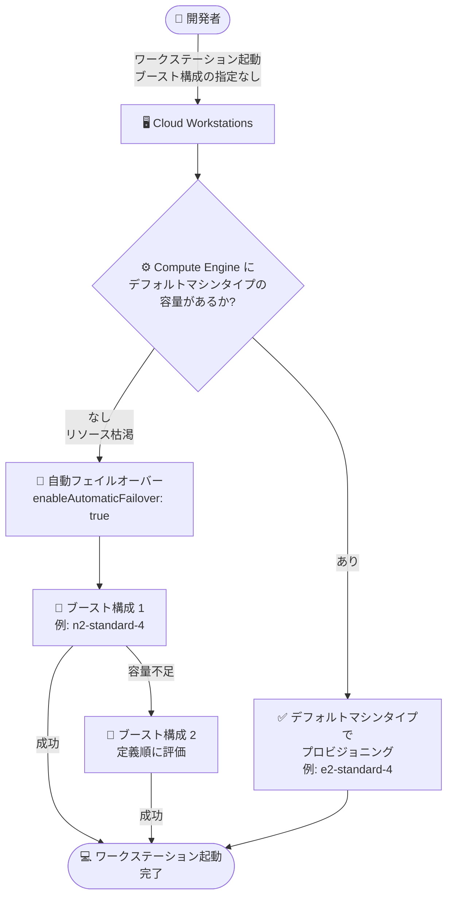

# Cloud Workstations: ブースト構成への自動フェイルオーバー (Preview)

**リリース日**: 2026-10-20

**サービス**: Cloud Workstations

**機能**: ブースト構成 (Boost Configuration) の自動フェイルオーバー

**ステータス**: Preview

📊 [このアップデートのインフォグラフィックを見る](https://takech9203.github.io/google-cloud-news-summary/20261020-cloud-workstations-boost-auto-failover.html)

## 概要

Cloud Workstations で、ブースト構成 (Boost Configuration) への自動フェイルオーバー機能が Preview として利用可能になりました。自動フェイルオーバーを有効にすると、ワークステーション起動時に Compute Engine 側でデフォルトのマシンタイプの容量が不足している場合、Cloud Workstations が自動的にブースト構成で定義されたマシンタイプを使用してワークステーション VM をプロビジョニングします。

この機能は、リージョンまたはゾーンのリソース枯渇 (Resource Exhaustion) によるワークステーションの起動失敗を防ぐことを目的としています。特定のマシンタイプの在庫が一時的に不足していても、別のマシンシリーズのブースト構成に自動的に切り替わるため、開発者は中断なく作業を開始できます。

クラウドベースの開発環境を標準化している組織や、特定リージョンでのキャパシティ不足により開発者の作業開始が妨げられるリスクを低減したいプラットフォームチームにとって有用なアップデートです。

**アップデート前の課題**

- ワークステーション起動時に、デフォルトのマシンタイプが Compute Engine のリソース枯渇により確保できない場合、起動が失敗していた
- 起動失敗時には、ユーザーが手動でブースト構成を指定して再起動するなどの対応が必要だった
- リージョン・ゾーンの一時的なキャパシティ不足が、開発者の作業開始を直接妨げるリスクがあった

**アップデート後の改善**

- デフォルトのマシンタイプの容量不足時に、ブースト構成を使用した VM プロビジョニングへ自動的にフェイルオーバーするようになった
- 複数のブースト構成で自動フェイルオーバーを有効化でき、ワークステーション構成に記載された順序で成功するまで順次評価される
- リソース枯渇に起因する起動失敗を自動で回避でき、手動での再試行が不要になった

## アーキテクチャ図



ワークステーション起動時に Compute Engine のデフォルトマシンタイプの容量を確認し、リソース枯渇の場合は自動フェイルオーバーが有効なブースト構成を定義順に評価してプロビジョニングを試行するフローです。

## サービスアップデートの詳細

### 主要機能

1. **ブースト構成への自動フェイルオーバー**
   - ワークステーション起動時に Compute Engine がデフォルトのマシンタイプをリソース枯渇によりプロビジョニングできない場合、自動フェイルオーバーが有効なブースト構成を使用して VM のプロビジョニングを自動的に試行する
   - リージョンまたはゾーンのリソース枯渇に起因するワークステーションの起動失敗を防止する

2. **複数ブースト構成の順次評価**
   - 複数のブースト構成で自動フェイルオーバーを有効にしている場合、ワークステーション構成に記載されている順序で評価され、プロビジョニングが成功するまで順次試行される

3. **アクティブセッション限定のフェイルオーバー**
   - 自動フェイルオーバーは、そのときのアクティブなワークステーションセッションにのみ適用される
   - 次回以降の起動では、まずデフォルトのマシンタイプでのプロビジョニングが試行される

## 技術仕様

### 自動フェイルオーバーの要件と動作

| 項目 | 詳細 |
|------|------|
| 有効化方法 (gcloud CLI) | `--boost-config` フラグ内で `enable-automatic-failover=true` を設定 |
| 有効化方法 (API) | `BoostConfig` リソースで `enableAutomaticFailover` を `true` に設定 |
| デフォルト値 | `false` (無効) |
| マシンシリーズの制約 | 自動フェイルオーバーを有効にするブースト構成は、デフォルトのマシンタイプとは**異なるマシンシリーズ**のマシンタイプを指定する必要がある (例: デフォルトが `e2-standard-4` の場合、E2 以外の `n2-standard-4` など) |
| 発動条件 | ブースト構成を指定せずに起動し、Compute Engine がリソース枯渇によりデフォルトのマシンタイプをプロビジョニングできない場合 |
| 複数構成の評価順 | ワークステーション構成に記載された順序で、成功するまで順次評価 |
| 適用範囲 | アクティブなセッションのみ (次回起動時はデフォルトのマシンタイプを優先) |
| ステータス | Preview |

### ブースト構成 (BoostConfig) の概要

ブースト構成は、ワークステーションにオンデマンドで追加のコンピュートリソースを一時的に割り当てる機能です。より大きなマシンタイプ、GPU、大容量ブートディスク、ネストされた仮想化などを指定できます。今回のアップデートにより、この仕組みがキャパシティ不足時のフォールバック先としても活用できるようになりました。

## 設定方法

### 前提条件

1. Cloud Workstations のワークステーションクラスタが作成済みであること
2. 自動フェイルオーバー用のブースト構成には、デフォルトのマシンタイプとは異なるマシンシリーズのマシンタイプを指定すること

### 手順

#### ステップ 1: 自動フェイルオーバーを有効にしたブースト構成付きのワークステーション構成を作成

```bash
gcloud beta workstations configs create WORKSTATION_CONFIG_ID \
  --cluster=WORKSTATION_CLUSTER_ID \
  --region=LOCATION \
  --project=PROJECT_ID \
  --machine-type=e2-standard-4 \
  --boost-config=id=BOOST_CONFIG_ID,machine-type=n2-standard-4,enable-automatic-failover=true
```

`enable-automatic-failover=true` を指定すると、デフォルトのマシンタイプ (この例では `e2-standard-4`) の容量不足時に、ブースト構成のマシンタイプ (この例では `n2-standard-4`) へ自動的にフェイルオーバーします。ブースト構成のマシンタイプは、デフォルトとは異なるマシンシリーズである必要があります。

#### ステップ 2: ワークステーションを起動

```bash
gcloud beta workstations start WORKSTATION_ID
```

ブースト構成を指定せずに起動した場合でも、デフォルトのマシンタイプが確保できないときは自動フェイルオーバーが発動します。なお、従来どおり `--boost=BOOST_CONFIG_ID` を指定して明示的にブーストされた VM で起動することも可能です。

## メリット

### ビジネス面

- **開発者の生産性維持**: リージョン・ゾーンの一時的なキャパシティ不足があっても開発環境の起動が失敗しにくくなり、開発者の作業開始の遅延を防げる
- **運用負荷の軽減**: 起動失敗時の問い合わせ対応や手動での再試行が不要になり、プラットフォームチームの運用負荷を軽減できる

### 技術面

- **リソース枯渇への自動対処**: マシンシリーズの異なるマシンタイプへのフォールバックにより、特定シリーズの在庫不足の影響を回避できる
- **柔軟なフォールバック戦略**: 複数のブースト構成を定義順に評価するため、優先度付きの多段フォールバックを構成できる

## デメリット・制約事項

### 制限事項

- Preview 段階の機能であり、GA 前の利用条件が適用される
- 自動フェイルオーバーを有効にするブースト構成は、デフォルトのマシンタイプと同じマシンシリーズを指定できない (例: デフォルトが E2 の場合、E2 系は不可)
- 自動フェイルオーバーはアクティブなセッションにのみ適用され、次回以降の起動ではデフォルトのマシンタイプが優先される

### 考慮すべき点

- フェイルオーバー先のマシンタイプはデフォルトと異なるマシンシリーズになるため、性能特性や時間あたりのコンピュート料金が変わる可能性がある
- フェイルオーバー先のブースト構成でも容量が不足している場合に備え、複数のブースト構成と評価順序を設計しておくことが望ましい

## ユースケース

### ユースケース 1: キャパシティ不足が発生しやすいリージョンでの開発環境の安定運用

**シナリオ**: 特定リージョンで E2 シリーズのマシンタイプを標準とした開発環境を提供しているが、時間帯によってリソース枯渇による起動失敗が発生することがある。

**実装例**:
```bash
gcloud beta workstations configs create dev-config \
  --cluster=dev-cluster \
  --region=asia-northeast1 \
  --machine-type=e2-standard-4 \
  --boost-config=id=failover-n2,machine-type=n2-standard-4,enable-automatic-failover=true
```

**効果**: E2 シリーズの容量不足時に N2 シリーズへ自動的にフェイルオーバーし、開発者は起動失敗を意識することなく作業を開始できる。

### ユースケース 2: 多段フォールバックによる起動成功率の最大化

**シナリオ**: 開発環境の起動成功率を最大化するため、複数のマシンシリーズをフォールバック先として用意したい。

**効果**: 自動フェイルオーバーを有効にした複数のブースト構成をワークステーション構成に定義しておくことで、記載順に評価され、いずれかのマシンシリーズで容量が確保できれば起動が成功する。

## 料金

Cloud Workstations の料金は、主に以下で構成されます (自動フェイルオーバー機能自体への追加料金の記載はありません)。

- **ワークステーション管理料金**: アクティブなワークステーションごとに $0.05 / vCPU / 時間
- **クラスタ管理料金**: ワークステーションクラスタごとに $0.20 / 時間 (使用の有無にかかわらず発生)
- **コンピュートリソース料金**: ワークステーション VM の稼働中に使用する Compute Engine リソース (vCPU、メモリ、ディスクなど) の料金

**注意**: 自動フェイルオーバーが発動した場合、ブースト構成のマシンタイプ (デフォルトとは別のマシンシリーズ) で VM がプロビジョニングされるため、そのセッション中のコンピュートリソース料金と vCPU 数ベースの管理料金はフェイルオーバー先のマシンタイプに基づいて課金される点に留意してください。

詳細は [Cloud Workstations 料金ページ](https://cloud.google.com/workstations/pricing) を参照してください。

## 関連サービス・機能

- **Compute Engine**: ワークステーション VM の基盤。本機能は Compute Engine のマシンタイプ別の容量 (リソース枯渇) を起点にフェイルオーバーを行う
- **ブースト構成 (Boost Configuration)**: ワークステーションに大きなマシンタイプや GPU などを一時的に割り当てる既存機能。今回のアップデートでフォールバック先としての役割が追加された

## 参考リンク

- 📊 [インフォグラフィック](https://takech9203.github.io/google-cloud-news-summary/20261020-cloud-workstations-boost-auto-failover.html)
- [公式リリースノート](https://docs.cloud.google.com/release-notes#October_20_2026)
- [ドキュメント: Boost your workstation (Automatic failover)](https://docs.cloud.google.com/workstations/docs/boost-workstation#automatic-failover)
- [BoostConfig API リファレンス](https://docs.cloud.google.com/workstations/docs/reference/rest/v1beta/projects.locations.workstationClusters.workstationConfigs#boostconfig)
- [料金ページ](https://cloud.google.com/workstations/pricing)

## まとめ

Cloud Workstations のブースト構成への自動フェイルオーバーにより、Compute Engine のリソース枯渇に起因するワークステーションの起動失敗を自動的に回避できるようになりました。クラウド開発環境の可用性を高めたい組織は、デフォルトとは異なるマシンシリーズを指定したブースト構成に `enable-automatic-failover=true` を設定し、Preview 段階で動作を検証することを推奨します。

---

**タグ**: #CloudWorkstations #BoostConfiguration #AutomaticFailover #ComputeEngine #Preview #DevOps #開発環境
