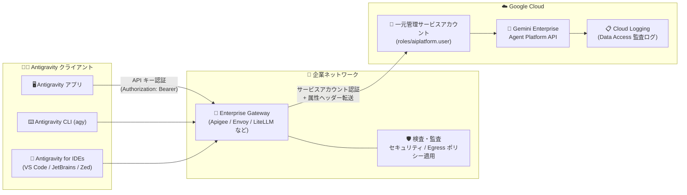

# Gemini Enterprise: Antigravity Enterprise Gateway サポート (GA)

**リリース日**: 2026-10-20

**サービス**: Gemini Enterprise

**機能**: Antigravity Enterprise Gateway サポート

**ステータス**: GA (一般提供)

📊 [このアップデートのインフォグラフィックを見る](https://takech9203.github.io/google-cloud-news-summary/20261020-gemini-enterprise-antigravity-enterprise-gateway.html)

## 概要

Antigravity Enterprise Gateway が一般提供 (GA) になりました。この機能により、Antigravity アプリ、Antigravity CLI、Antigravity for IDEs からのモデル推論リクエストを、組織が運用する一元的なエンタープライズゲートウェイ経由で Google Cloud に転送できます。開発者のワークステーションは Google に直接接続する代わりにゲートウェイと通信するため、組織はモデルトラフィックの検査・監査、カスタムセキュリティポリシーやネットワーク Egress ポリシーの適用が可能になります。

認証面では、開発者は個々の Google アカウントでのサインインを行わず、ゲートウェイが発行する API キーで認証します。ゲートウェイは一元管理された Google Cloud サービスアカウントを使用してリクエストを Gemini Enterprise Agent Platform に転送します。課金は Gemini Enterprise Agent Platform を通じた従量課金 (PAYG) ベースで行われ、Gemini Enterprise のシートベースのサブスクリプションクォータ (Standard / Plus の月間利用枠など) は消費しません。

対象ユーザーは、規制業界などで厳格なネットワーク制御を運用しており、開発者ワークステーションから外部サービスへの直接のインターネット接続や、対話型のブラウザベース Google サインインを許可できない組織の管理者・セキュリティアーキテクトです。

**アップデート前の課題**

- Antigravity の利用には開発者ごとの対話型 Google アカウントサインイン (ブラウザベース) が必要で、外部への直接接続やブラウザサインインを禁止する厳格なネットワーク環境では利用が困難だった
- モデル推論トラフィックが開発者ワークステーションから Google に直接送信されるため、組織が自前のゲートウェイでトラフィックを検査・監査したり、独自のセキュリティ / Egress ポリシーを適用したりできなかった

**アップデート後の改善**

- Antigravity アプリ / CLI / IDE 拡張のモデル推論リクエストを、組織運用のエンタープライズゲートウェイ経由でルーティングできるようになった
- 組織がゲートウェイ上でモデルトラフィックの検査・監査、カスタムセキュリティポリシーおよびネットワーク Egress ポリシーの適用を行えるようになった
- ゲートウェイ API キーによる開発者認証が可能になり、個別の Google アカウントサインインが不要になった (MDM で `admin_settings.json` を配布すれば開発者側の設定作業も不要)
- 一元管理された Google Cloud サービスアカウントで認証し、PAYG 従量課金として組織の Gemini Enterprise 契約に使用量を帰属 (attribution) できるようになった

## アーキテクチャ図



Antigravity の各クライアントはゲートウェイ API キーで企業内のエンタープライズゲートウェイに接続し、ゲートウェイがトラフィックの検査・監査とポリシー適用を行ったうえで、一元管理されたサービスアカウントとして Gemini Enterprise Agent Platform API にリクエストを転送します。

## サービスアップデートの詳細

### 主要機能

1. **エンタープライズゲートウェイ経由のルーティング**
   - Antigravity アプリ、Antigravity CLI、Antigravity for IDEs のモデル推論リクエストを、組織運用のゲートウェイ経由で Google Cloud に転送
   - 組織はゲートウェイ上でモデルトラフィックの検査・監査、カスタムセキュリティ / ネットワーク Egress ポリシーの適用が可能
   - ゲートウェイは Apigee のようなマネージド API ゲートウェイでも、Envoy や LiteLLM など自社インフラ上のゲートウェイでも構築可能

2. **ゲートウェイ API キーによる開発者認証**
   - 開発者は組織のゲートウェイが発行する API キーで認証し、個別の Google アカウントサインインは不要
   - Antigravity は API キーを `Authorization` ヘッダーの Bearer トークンとして送信 (Google Cloud の認証情報や OAuth トークンは取得しない)
   - 共有キーの代わりに開発者ごとのキー発行も可能 (`admin_settings.json` から `gateway.apiKey` を省略し、各ワークステーションで `AGY_LLM_GATEWAY_API_KEY` を設定)

3. **PAYG 課金と契約への使用量帰属**
   - リクエストは一元管理された Google Cloud サービスアカウントを使用し、Gemini Enterprise Agent Platform を通じた従量課金 (PAYG) で請求
   - Gemini Enterprise のシートベースサブスクリプションクォータ (Standard / Plus の月間利用枠など) は消費しない
   - Antigravity が自動付与する属性ヘッダー (`User-Agent`、`X-Goog-Api-Client`) をゲートウェイが保持・転送することで、使用量が組織の既存の Gemini Enterprise 契約として認識される

4. **MDM による一元的な設定配布**
   - Jamf、Microsoft Intune、Ansible、Google Workspace MDM などで `admin_settings.json` をワークステーションに配布可能
   - 設定の優先順位は「管理者設定ファイル > 環境変数 (`AGY_LLM_GATEWAY_*`) > ユーザー設定ファイル」で、管理者設定は開発者が上書きできない
   - コンテナ、リモート SSH ホスト、CI/CD パイプラインなど非管理環境では環境変数で設定可能

## 技術仕様

### サポート対象ツールとバージョン

| ツール | 最小バージョン | 対応プラットフォーム |
|------|------|------|
| Antigravity アプリ | 2.15.0 以降 | macOS、Windows、Linux |
| Antigravity CLI (`agy`) | 1.2.15 以降 | macOS、Linux |
| Antigravity for IDEs | VS Code / Visual Studio: CLI 1.2.15 以降 (拡張機能が自動管理)、JetBrains IDE / Zed (ACP サーバー): 1.3.0 以降 | VS Code、Visual Studio、JetBrains IDE、Zed |

**注**: Web 版 Antigravity はエンタープライズゲートウェイ経由のルーティングに対応しておらず、対話型の Google サインインが必要です。

### 主な設定項目 (`admin_settings.json`)

| 項目 | 詳細 |
|------|------|
| `gateway.enabled` | `true` でゲートウェイルーティングを有効化。全推論リクエストがゲートウェイに送信され、Google アカウントサインインを要求しない |
| `gateway.url` | エンタープライズゲートウェイの HTTPS エンドポイント |
| `gateway.apiKey` | ゲートウェイが発行する API キー。`Authorization` ヘッダーの Bearer トークンとして送信 |
| `gateway.wireProtocol` | `genai` (デフォルト、Gemini API プロトコル) または `openai` (OpenAI Chat Completions プロトコル)。JetBrains IDE / Zed の ACP サーバーは `genai` のみ対応 |
| `gateway.customHeaders` | コストセンターなどを付与するカスタム HTTP ヘッダー |
| `caCertPath` | 社内ルート CA バンドルの絶対パス (ゲートウェイの内部 TLS 証明書を信頼させる) |
| `models.defaultModelId` / `models.list` | デフォルトモデルと、開発者が選択できる承認済みモデルのリスト |

### 設定例

```json
{
  "gateway": {
    "enabled": true,
    "url": "https://gateway.cymbal.com",
    "apiKey": "GATEWAY_API_KEY",
    "wireProtocol": "genai",
    "customHeaders": {
      "X-Cost-Center": "Platform-Engineering",
      "X-Corporate-BU": "DevTools"
    }
  },
  "caCertPath": "/etc/ssl/certs/cymbal-root-ca.pem",
  "models": {
    "defaultModelId": "gemini-3.8-flash",
    "list": [
      { "modelId": "gemini-3.8-flash" },
      { "modelId": "gemini-3.7-flash" },
      { "modelId": "gemini-3.1-pro-preview" }
    ]
  }
}
```

### 非管理環境向け環境変数

| 変数 | 必須 | 説明 |
|------|------|------|
| `AGY_LLM_GATEWAY_URL` | はい | エンタープライズゲートウェイの HTTPS URL |
| `AGY_LLM_GATEWAY_API_KEY` | はい | ゲートウェイが発行する API キー |
| `AGY_LLM_GATEWAY_WIRE_PROTOCOL` | いいえ | `genai` (デフォルト) または `openai` |
| `AGY_LLM_GATEWAY_CA_CERT` | いいえ | ルート CA 証明書バンドルのパス (未設定時は `SSL_CERT_FILE` を使用) |
| `AGY_LLM_GATEWAY_MODELS` | いいえ | 許可モデルのカンマ区切りリスト |
| `AGY_LLM_GATEWAY_HEADERS` | いいえ | カスタム HTTP ヘッダー (`KEY: VALUE` 形式) |

## 設定方法

### 前提条件

1. Gemini Enterprise Agent Platform (旧 Vertex AI) にアクセスでき、Gemini Enterprise Agent Platform API (`aiplatform.googleapis.com`) が有効な Google Cloud プロジェクト
2. `roles/aiplatform.user` IAM ロールを付与した Google Cloud サービスアカウント (ゲートウェイが Google Cloud への認証に使用)
3. 課金帰属を Cloud Logging で検証するための、Gemini Enterprise Agent Platform API に対するデータアクセス監査ログの有効化
4. サポート対象バージョンの Antigravity クライアント

### 手順

#### ステップ 1: API の有効化とサービスアカウントの作成

```bash
gcloud services enable \
    aiplatform.googleapis.com \
    secretmanager.googleapis.com \
    --project=PROJECT_ID

gcloud iam service-accounts create agy-gateway-sa \
    --project=PROJECT_ID \
    --display-name="Antigravity Enterprise Gateway"

gcloud projects add-iam-policy-binding PROJECT_ID \
    --member="serviceAccount:agy-gateway-sa@PROJECT_ID.iam.gserviceaccount.com" \
    --role="roles/aiplatform.user"
```

ゲートウェイが Gemini Enterprise Agent Platform API を呼び出すためのサービスアカウントを作成し、必要な API を有効化します。

#### ステップ 2: ゲートウェイ API キーの生成と Secret Manager への保存

```bash
openssl rand -base64 32 | tr -d '\n' | gcloud secrets create agy-gateway-api-key \
    --project=PROJECT_ID \
    --data-file=-

gcloud secrets add-iam-policy-binding agy-gateway-api-key \
    --project=PROJECT_ID \
    --member="serviceAccount:agy-gateway-sa@PROJECT_ID.iam.gserviceaccount.com" \
    --role="roles/secretmanager.secretAccessor"
```

生成した API キーを Secret Manager に保存し、ゲートウェイのサービスアカウントに読み取り権限を付与します。ゲートウェイはこのキーを検証し、有効なキーを持たないリクエストを拒否するよう構成します。長いストリーミングレスポンスが途切れないよう、リクエストは最低 60 分間実行できるようにします。

#### ステップ 3: ゲートウェイの直接テスト

```bash
curl -N -X POST "https://gateway.example.com/v1beta/models/MODEL_ID:streamGenerateContent?alt=sse" \
    -H "Authorization: Bearer GATEWAY_API_KEY" \
    -H "Content-Type: application/json" \
    -H "User-Agent: antigravity/1.2.15 (aidev_client; auth_method=gateway)" \
    -d '{"contents": [{"role": "user", "parts": [{"text": "Reply with PONG"}]}]}'
```

ワークステーション配布前に、ネットワークルーティング、TLS 証明書検証、認証、バッファリングなしの SSE ストリーミングが機能することを確認します。

#### ステップ 4: MDM による `admin_settings.json` の配布

`admin_settings.json` を以下のパスに MDM (Jamf、Microsoft Intune、Ansible、Google Workspace MDM など) で配布します。

- macOS: `/Library/Application Support/Antigravity/admin_settings.json`
- Linux: `/etc/antigravity/admin_settings.json`
- Windows: `%ProgramData%\Antigravity\admin_settings.json`

ファイルは管理者アカウント所有とし、開発者は読み取りのみ可能にします。配布後に Antigravity を再起動すると、ステータスバーに「Connected: Enterprise Gateway」と表示されます。

#### ステップ 5: Cloud Logging で課金帰属を確認

```
resource.type="aiplatform.googleapis.com/Endpoint" OR protoPayload.serviceName="aiplatform.googleapis.com"
```

Logs Explorer で上記クエリを実行し、`protoPayload.requestMetadata.callerSuppliedUserAgent` に `antigravity/VERSION (aidev_client; auth_method=gateway)` が含まれることを確認します。

## メリット

### ビジネス面

- **規制業界での Antigravity 導入が可能に**: 外部直接接続やブラウザサインインを禁止する厳格なネットワーク統制下でも、エージェント型 AI 開発ツールを展開できる
- **コスト配賦の可視化**: `customHeaders` によるコストセンター / 部門ヘッダー付与で、ゲートウェイログや SIEM 上でチーム別の使用量を追跡できる
- **契約への使用量帰属**: 属性ヘッダーの転送により、モデル使用量が未契約の生 API 消費ではなく、組織の既存の Gemini Enterprise 契約として課金される

### 技術面

- **トラフィックの集中検査・監査**: プロンプト、コンテキストファイル、レスポンスが組織のゲートウェイを通過するため、監査とポリシー適用が一元化できる
- **モデルガバナンス**: `models.list` で開発者が利用できるモデルを承認済みリストに制限できる
- **柔軟なゲートウェイ実装**: Apigee などのマネージド API ゲートウェイのほか、Envoy や LiteLLM を自社インフラに展開する構成も選択可能。ワイヤプロトコルも Gemini API (`genai`) と OpenAI Chat Completions (`openai`) から選択できる
- **ローカル保護は維持**: ゲートウェイ経由でもターミナルコマンド実行やファイル変更は Antigravity のローカルサンドボックス内で実行され、破壊的操作前の人間による承認 (Human-in-the-loop) も維持される

## デメリット・制約事項

### 制限事項

- ゲートウェイ利用と Google アカウントサインインは同時に使用できない。シートベースサブスクリプションの利用枠を使いたい場合は、ゲートウェイを無効化して Google アカウントでサインインする必要がある
- ゲートウェイ経由の利用は PAYG 従量課金となり、Gemini Enterprise のシートベースサブスクリプションクォータ (Standard / Plus の月間利用枠) は適用されない
- Web 版 Antigravity はゲートウェイルーティング非対応 (対話型 Google サインインが必須)
- JetBrains IDE / Zed (ACP サーバー) は `genai` ワイヤプロトコルのみサポート。また ACP サーバーはユーザー設定ファイル (`~/.antigravity/settings.json`) を読み込まない

### 考慮すべき点

- API キーは `admin_settings.json` または環境変数から平文で読み込まれるため、ゲートウェイを社内ネットワークに限定公開し、キーを Secret Manager で管理して定期的にローテーションすることが推奨される。開発者単位の帰属が必要なら開発者ごとに個別キーを発行する
- ゲートウェイを Cloud Run の IAM invoker チェックや Identity-Aware Proxy など、`Authorization` ヘッダーを自ら解釈する認証レイヤーの背後に配置してはならない (ゲートウェイ API キーが Google 署名付き ID トークンと誤認され、リクエストが拒否される)
- ゲートウェイは公開エンドポイントを持たせず、Cloud VPN / Cloud Interconnect 経由の内部アプリケーションロードバランサなどで社内ネットワークからのみ到達可能にする
- ゲートウェイは属性ヘッダー (`User-Agent`、`X-Goog-Api-Client`) を必ず保持・転送する必要がある。転送しない場合、使用量が Gemini Enterprise 契約ではなく未契約の生 API 消費として課金されるおそれがある
- 長いストリーミングレスポンス対応のため、ゲートウェイのリクエストタイムアウトは 60 分以上に設定する

## ユースケース

### ユースケース 1: 規制業界 (金融・医療など) での Antigravity 全社展開

**シナリオ**: 開発者ワークステーションからの外部インターネット直接接続とブラウザベースのサインインが禁止されている金融機関が、AI コーディング支援を導入したい。

**実装例**:
```
1. 社内ネットワーク内に Envoy / LiteLLM ベースのゲートウェイを構築し、
   内部アプリケーションロードバランサ + Cloud Interconnect で Google Cloud に接続
2. サービスアカウント (roles/aiplatform.user) でゲートウェイから
   Gemini Enterprise Agent Platform API に認証
3. MDM (Intune / Jamf) で admin_settings.json を全開発端末に配布
```

**効果**: 開発者は Google アカウントサインインなしで Antigravity を利用でき、全モデルトラフィックが社内ゲートウェイで検査・監査される。セキュリティ統制を満たしながら AI 開発ツールを展開できる。

### ユースケース 2: CI/CD パイプライン・開発サンドボックスでの利用

**シナリオ**: コンテナ化された CI/CD ランナーやリモート SSH ホストなど、対話型サインインが不可能な非管理環境で Antigravity CLI を使ったエージェントワークフローを実行したい。

**効果**: `AGY_LLM_GATEWAY_URL` と `AGY_LLM_GATEWAY_API_KEY` の環境変数設定だけでゲートウェイ経由の認証が完結し、ブラウザサインインなしで `agy` コマンドを自動化パイプラインに組み込める。

### ユースケース 3: 部門別コスト配賦とモデルガバナンス

**シナリオ**: プラットフォームエンジニアリング部門が、チーム別の AI 利用コストを追跡しつつ、承認済みモデルのみ利用を許可したい。

**効果**: `customHeaders` (例: `X-Cost-Center`) でゲートウェイログ / SIEM 上のチーム別使用量追跡が可能になり、`models.list` で利用可能モデルを承認済みリストに制限できる。

## 料金

Antigravity Enterprise Gateway 経由のリクエストは、一元管理された Google Cloud サービスアカウントを使用し、**Gemini Enterprise Agent Platform を通じた従量課金 (PAYG)** で請求されます。

- このデプロイモデルでは、Gemini Enterprise のシートベースサブスクリプションクォータ (Standard / Plus の月間利用枠など) は使用されない
- ゲートウェイのデプロイ自体に請求書払いの Cloud Billing アカウントは不要
- Agent Platform の PAYG にはデフォルトの Standard PayGo のほか、Priority PayGo、Flex PayGo などのオプションがある
- PAYG 使用コストは Gemini Enterprise の「Usage & Spending」ページの「Billing」タブで確認可能 (「AI developer tools (such as Antigravity)」として表示)

詳細な単価はモデルごとに異なるため、[Gemini Enterprise Agent Platform の料金オプション](https://docs.cloud.google.com/gemini-enterprise-agent-platform/models/standard-paygo)を参照してください。

## 関連サービス・機能

- **Gemini Enterprise Agent Platform (旧 Vertex AI)**: ゲートウェイが推論リクエストを転送する先の API (`aiplatform.googleapis.com`)。課金もこのプラットフォーム経由の PAYG で行われる
- **Cloud Logging (データアクセス監査ログ)**: 属性ヘッダーが正しく転送され、使用量が組織に帰属していることを検証するために使用
- **Secret Manager**: ゲートウェイ API キーの安全な保管とローテーションに使用
- **Apigee**: マネージド API ゲートウェイとしてエンタープライズゲートウェイを構築する選択肢の 1 つ
- **Cloud VPN / Cloud Interconnect + 内部アプリケーションロードバランサ**: ゲートウェイを社内ネットワーク限定で公開するためのネットワーク構成

## 参考リンク

- 📊 [インフォグラフィック](https://takech9203.github.io/google-cloud-news-summary/20261020-gemini-enterprise-antigravity-enterprise-gateway.html)
- [公式リリースノート](https://docs.cloud.google.com/release-notes#October_20_2026)
- [Deploy Antigravity Enterprise Gateway (管理者向け)](https://docs.cloud.google.com/gemini/enterprise/docs/ai-developer-tools/deploy-enterprise-gateway)
- [Connect Antigravity to an Enterprise Gateway (開発者向け)](https://docs.cloud.google.com/gemini/enterprise/docs/ai-developer-tools/connect-enterprise-gateway)
- [Gemini Enterprise Agent Platform の料金オプション (Standard PayGo)](https://docs.cloud.google.com/gemini-enterprise-agent-platform/models/standard-paygo)
- [Antigravity ドキュメント](https://antigravity.google/docs)

## まとめ

Antigravity Enterprise Gateway の GA により、厳格なネットワーク統制を持つ組織でも、個別の Google アカウントサインインなしで Antigravity アプリ / CLI / IDE を全社展開し、モデルトラフィックの一元的な検査・監査とポリシー適用が可能になりました。課金はシートベースのサブスクリプション枠ではなく Gemini Enterprise Agent Platform の PAYG 従量課金となる点に注意が必要です。導入時は、属性ヘッダーの転送設定とゲートウェイの非公開化 (社内ネットワーク限定) を必ず確認し、まずは curl による直接テストと Cloud Logging での帰属検証から始めることを推奨します。

---

**タグ**: Gemini Enterprise, Antigravity, Enterprise Gateway, GA, セキュリティ, ガバナンス, AI 開発ツール, PAYG
