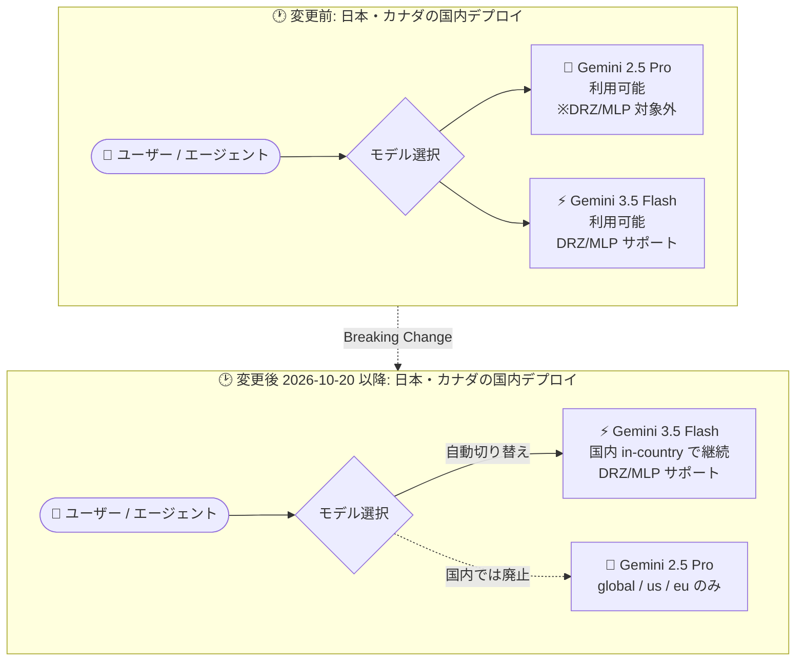

# Gemini Enterprise: カナダ・日本の国内デプロイで Gemini 2.5 Pro が廃止 (Breaking Change)

**リリース日**: 2026-10-20

**サービス**: Gemini Enterprise

**機能**: Gemini 2.5 Pro の国内 (in-country) デプロイでの提供終了 (カナダ・日本)

**ステータス**: 廃止 (Breaking Change)

📊 [このアップデートのインフォグラフィックを見る](https://takech9203.github.io/google-cloud-news-summary/20261020-gemini-enterprise-gemini-2-5-pro-discontinued-canada-japan.html)

## 概要

Gemini Enterprise アプリの国内 (in-country) デプロイにおいて、カナダおよび日本リージョンでの Gemini 2.5 Pro の提供が終了しました。これは **Breaking Change (破壊的変更)** として発表されており、該当リージョンでこれまで Gemini 2.5 Pro を使用していたエージェントおよびチャットセッションは、**国内 (in-country) の Gemini 3.5 Flash に自動的に切り替わります**。

Gemini 2.5 Pro 自体は引き続き `global`、`us`、`eu` の各リージョンで利用可能です。影響を受けるのは、データレジデンシー (データ所在地) 要件のために国内リージョン (日本: `asia-northeast1`、カナダ: `ca`) に Gemini Enterprise アプリをデプロイしている組織です。**特に日本国内でのデータ保管・処理を要件として Gemini Enterprise を利用している日本のお客様は、エージェントやチャットの挙動が自動的に変わるため、影響範囲の確認が必要です。**

モデルは自動で切り替わるため移行作業自体は不要ですが、使用モデルが Gemini 2.5 Pro から Gemini 3.5 Flash に変わることで、エージェントの応答品質や挙動が変化する可能性があります。管理者は、国内デプロイで稼働中のエージェント・ワークフローの動作確認を推奨します。

**アップデート前の課題 (変更前の状態)**

- カナダ・日本の国内 (in-country) Gemini Enterprise アプリデプロイでは、Gemini 2.5 Pro を使用するエージェントやチャットセッションが存在していた
- ただし公式ドキュメントによると、Gemini 2.5 Pro は国内リージョンでは保存データのデータレジデンシー (at-rest DRZ) および機械学習処理 (MLP) のコミットメント対象外だった

**アップデート後の変更**

- カナダ・日本の国内デプロイでは Gemini 2.5 Pro が提供終了となった
- 該当リージョンで Gemini 2.5 Pro を使用していたエージェント・チャットセッションは、国内 (in-country) の Gemini 3.5 Flash に自動的に切り替わる
- Gemini 3.5 Flash は国内リージョンで at-rest DRZ および MLP の両方をサポートしており、データレジデンシーのコミットメントを維持したまま利用を継続できる
- Gemini 2.5 Pro は `global`、`us`、`eu` リージョンでは引き続き利用可能

## アーキテクチャ図

日本 (`asia-northeast1`) とカナダ (`ca`) の国内デプロイにおけるモデル提供状況の Before/After 比較です。Gemini 2.5 Pro を使用していたエージェント・チャットセッションは、国内の Gemini 3.5 Flash へ自動的に切り替わります。

## サービスアップデートの詳細

### 変更内容

1. **カナダ・日本の国内デプロイでの Gemini 2.5 Pro 提供終了**
   - 国内 (in-country) Gemini Enterprise アプリデプロイが対象
   - 日本は `asia-northeast1`、カナダは `ca` リージョンが該当

2. **Gemini 3.5 Flash への自動切り替え**
   - 該当リージョンで Gemini 2.5 Pro を使用していたエージェント・チャットセッションは、国内の Gemini 3.5 Flash に自動的に切り替わる
   - 利用者・管理者による移行操作は不要
   - Gemini 3.5 Flash は GA モデルであり、公式ドキュメントによると管理者がトグルをオフにすることはできない (常時利用可能)

3. **Gemini 2.5 Pro の継続提供リージョン**
   - `global`、`us`、`eu` リージョンでは引き続き利用可能 (デフォルトでオン)
   - 管理者は「Manage web app features」の設定からトグルで無効化も可能

## 技術仕様

### Gemini Enterprise の国内 (in-country) リージョン

公式ドキュメント「Data residency for Gemini Enterprise」に記載されている国内リージョンは以下の通りです。国内リージョンの利用は GA (許可リスト制) で、利用には Google アカウントチームへの連絡が必要です。

| 国 | リージョン名 |
|------|------|
| カナダ | `ca` |
| インド | `in` |
| 日本 | `asia-northeast1` |
| シンガポール | `sg` |
| 英国 | `europe-west2` |

### 変更後のモデル提供状況 (公式ドキュメントより)

| モデル | US/EU マルチリージョン | 国内リージョン (CA, IN, JP, SG, UK) |
|------|------|------|
| Gemini 2.5 Pro | at-rest DRZ・MLP サポート。`global`/`us`/`eu` でデフォルトオン | **提供なし** (at-rest DRZ・MLP 非サポート) |
| Gemini 3.5 Flash | at-rest DRZ・MLP サポート | **at-rest DRZ・MLP サポート** |

- **at-rest DRZ**: 保存データのデータレジデンシーゾーンのコミットメント
- **MLP**: 機械学習処理 (学習・推論・チューニング) が指定ロケーション内で行われるコミットメント

国内リージョンで提供されないモデル (Gemini 2.5 Pro を含む) を使いたい場合、管理者がモデルのトグルをオンにすると警告ダイアログが表示され、確認するとトラフィックは **global エンドポイントにルーティング**されます。この場合、国内のデータレジデンシーコミットメントの対象外となる点に注意が必要です。

## 対応方法 (管理者向け)

### 推奨される確認事項

1. **影響範囲の確認**: 日本 (`asia-northeast1`) またはカナダ (`ca`) の国内デプロイで、Gemini 2.5 Pro を使用していたエージェント・チャットセッション・ワークフローを棚卸しする
2. **動作確認**: 自動切り替え後の Gemini 3.5 Flash での応答品質・挙動を確認する
3. **モデル設定の確認**: Google Cloud コンソールの Gemini Enterprise ページで、対象アプリの「Configurations」→「Feature Management」タブからモデルの有効化状態を確認する

### Gemini モデルのトグル操作手順 (公式ドキュメントより)

1. Google Cloud コンソールで Gemini Enterprise ページに移動する
2. 設定するアプリ名をクリックする
3. 「Configurations」をクリックし、「Feature Management」タブをクリックする
4. 「Gemini model availability」セクションに移動する
5. オン/オフを切り替えたい Gemini モデルのトグルをクリックする (サポート対象外の国内リージョンでモデルをオンにする場合は、global エンドポイントへのルーティングに関する警告ダイアログを確認する)
6. 「Save」をクリックする (変更は数分後に反映)

## 影響と考慮事項

### ポジティブな側面

- **データレジデンシーの一貫性**: 切り替え先の Gemini 3.5 Flash は国内リージョンで at-rest DRZ・MLP の両方をサポートしており、日本国内でのデータ保管・処理のコミットメントを維持したまま利用を継続できる
- **移行作業が不要**: エージェント・チャットセッションは自動的に切り替わるため、手動での移行オペレーションは発生しない

### 考慮すべき点・制約

- **Breaking Change である**: モデルが Pro 系から Flash 系へ自動的に変わるため、エージェントの応答品質・出力の傾向が変化する可能性がある。本番運用中のエージェントは動作検証を推奨
- **国内リージョンで Gemini 2.5 Pro は利用不可**: どうしても Gemini 2.5 Pro が必要な場合は `global`/`us`/`eu` リージョンの利用、または警告ダイアログを確認した上での global エンドポイントへのルーティングが必要となるが、その場合は国内データレジデンシーのコミットメント対象外となる
- **国内リージョンは許可リスト制**: 国内リージョンの利用自体が GA (許可リスト制) であり、アクセスには Google アカウントチームへの連絡が必要

## 利用可能リージョン

- **Gemini 2.5 Pro**: `global`、`us`、`eu` で引き続き利用可能。国内リージョン (`ca`、`asia-northeast1`、`in`、`sg`、`europe-west2`) では利用不可
- **Gemini 3.5 Flash**: `global`、`us`、`eu` および国内リージョンで利用可能 (国内リージョンで at-rest DRZ・MLP サポート)

詳細は [Data residency for Gemini Enterprise](https://docs.cloud.google.com/gemini/enterprise/docs/locations) を参照してください。

## 関連サービス・機能

- **Gemini Enterprise (Feature Management)**: Web アプリで利用可能なモデルを管理者がトグルで制御する機能。今回の変更に伴うモデル利用状況の確認・制御に使用する
- **Gemini Enterprise データレジデンシー (DRZ/MLP)**: 保存データの所在地と機械学習処理のロケーションに関するコミットメント。国内リージョン選択の主な動機となる機能
- **Agent Registry / Workflow Builder**: 国内リージョンの Gemini Enterprise 基本機能に含まれるエージェント関連機能。Gemini 2.5 Pro を使用していたカスタムエージェントは自動切り替えの影響を受ける

## 参考リンク

- 📊 [インフォグラフィック](https://takech9203.github.io/google-cloud-news-summary/20261020-gemini-enterprise-gemini-2-5-pro-discontinued-canada-japan.html)
- [公式リリースノート (2026-10-20)](https://docs.cloud.google.com/release-notes#October_20_2026)
- [Data residency for Gemini Enterprise (ドキュメント)](https://docs.cloud.google.com/gemini/enterprise/docs/locations)
- [Manage web app features (ドキュメント)](https://docs.cloud.google.com/gemini/enterprise/docs/manage-web-app-features)

## まとめ

日本・カナダの国内 (in-country) Gemini Enterprise デプロイで Gemini 2.5 Pro が廃止され、該当するエージェント・チャットセッションは国内の Gemini 3.5 Flash に自動的に切り替わる Breaking Change です。データレジデンシー要件で `asia-northeast1` を利用している日本のお客様は、移行作業こそ不要なものの応答品質・挙動が変化する可能性があるため、稼働中のエージェントの動作検証と、Gemini 2.5 Pro が必須な場合のリージョン戦略 (global/us/eu の利用とデータレジデンシーのトレードオフ) の検討を推奨します。

---

**タグ**: #GeminiEnterprise #Gemini25Pro #Gemini35Flash #BreakingChange #データレジデンシー #日本リージョン #asia-northeast1 #カナダ
