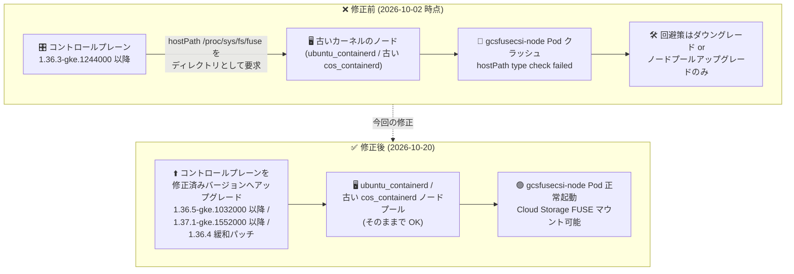

# Google Kubernetes Engine: Cloud Storage FUSE CSI driver の Pod 起動失敗問題が解決 (コントロールプレーンのアップグレードで修正可能に)

**リリース日**: 2026-10-20

**サービス**: Google Kubernetes Engine (GKE)

**機能**: Cloud Storage FUSE CSI driver (gcsfusecsi-node DaemonSet)

**ステータス**: Fixed (解決済み)

📊 [このアップデートのインフォグラフィックを見る](https://takech9203.github.io/google-cloud-news-summary/20261020-gke-cloud-storage-fuse-csi-driver-fix.html)

## 概要

2026 年 10 月 2 日に公表された、Cloud Storage FUSE CSI driver の DaemonSet Pod (`gcsfusecsi-node`) が特定のノードプール上で起動に失敗する既知の問題が **解決 (RESOLVED)** されました。今回のアップデートは、10 月 2 日のリリースノートに対する更新として公開されたものです。

元の問題は、GKE コントロールプレーンが 1.36.3-gke.1244000 以降にアップグレードされた際、新しい `gcsfusecsi-node` DaemonSet がホストパス `/proc/sys/fs/fuse` をディレクトリとして要求するのに対し、古いカーネルで動作するノードプール (すべての `ubuntu_containerd` ノードプール、および古い `cos_containerd` ノードプール) ではこのパスがディレクトリとして存在せず、hostPath のタイプチェックが失敗して Pod がクラッシュするというものでした。この結果、Cloud Storage バケットをファイルシステムとしてマウントする AI/ML ワークロードやデータ処理ワークロードが影響を受けていました。

今回の修正により、**クラスタのコントロールプレーンを修正済みバージョンへアップグレードするだけで**、`ubuntu_containerd` および古い `cos_containerd` ノードプールの問題を解消できるようになりました。該当クラスタの運用者は、以下の修正済みバージョンへの計画的なアップグレードが推奨されます。

**アップデート前の課題**

10 月 2 日の問題公表時点では、以下の制約がありました。

- コントロールプレーン 1.36.3-gke.1244000 以降と古いカーネルのノードプールの組み合わせ (バージョンスキュー) で、`gcsfusecsi-node` Pod が `MountVolume.SetUp failed ... /proc/sys/fs/fuse is not a directory` エラーで起動に失敗していた
- `ubuntu_containerd` ノードプール向けの修正は「対応中 (fix is in progress)」であり、コントロールプレーンを 1.36.3-gke.1244000 より前へダウングレードする以外の回避策がなかった
- `cos_containerd` ノードプールでは、ノードプール側を 1.34.6-gke.1154000 以降 / 1.35.3-gke.1389000 以降へアップグレードする必要があった
- Cloud Storage FUSE CSI ボリュームを使用するワークロードのマウント操作が失敗し、学習データやモデルの読み込みに支障が出る可能性があった

**アップデート後の改善**

- 問題が正式に **解決 (RESOLVED)** とアナウンスされた
- コントロールプレーンを **1.36.5-gke.1032000 以降** または **1.37.1-gke.1552000 以降** へアップグレードすることで、`ubuntu_containerd` および古い `cos_containerd` ノードプールでも問題が修正されるようになった
- 1.36.4 系に留まる必要がある場合向けに、**8 つの緩和パッチバージョン** (1.36.4-gke.1247001 など) が提供された
- `ubuntu_containerd` ノードプール利用者が、コントロールプレーンのダウングレードやアップグレード保留という暫定運用から脱却できるようになった

## アーキテクチャ図



修正前はバージョンスキューにより Pod が起動できずダウングレード等の回避策が必要でしたが、修正後はコントロールプレーンのアップグレードのみで問題が解消されることを示しています。

## サービスアップデートの詳細

### 修正内容

1. **問題の解決 (RESOLVED)**
   - 2026 年 10 月 2 日に公表された Cloud Storage FUSE CSI driver の既知の問題が解決された
   - 対象は `ubuntu_containerd` および古い `cos_containerd` ノードプールを持つクラスタ

2. **修正済みコントロールプレーンバージョン**
   - 1.36.5-gke.1032000 以降
   - 1.37.1-gke.1552000 以降
   - コントロールプレーンのアップグレードのみで修正が適用され、ノードプール側の変更は不要

3. **1.36.4 系向けの緩和パッチ**
   - 1.36.4 系に留まりたいクラスタ向けに、以下の 8 つの緩和パッチバージョンが提供された
   - 1.36.4-gke.1247001 / 1.36.4-gke.1247002 / 1.36.4-gke.1391001 / 1.36.4-gke.1391003 / 1.36.4-gke.1495001 / 1.36.4-gke.1495003 / 1.36.4-gke.2046001 / 1.36.4-gke.2202002

## 技術仕様

### 元の問題と修正の対応関係

| 項目 | 詳細 |
|------|------|
| 元の問題の公表日 | 2026 年 10 月 2 日 |
| 問題のトリガー | コントロールプレーン 1.36.3-gke.1244000 以降への更新 |
| 影響コンポーネント | Cloud Storage FUSE CSI driver (`gcsfusecsi-node` DaemonSet) |
| エラー内容 | `MountVolume.SetUp failed for volume "host-proc-sys-fs-fuse": hostPath type check failed: /proc/sys/fs/fuse is not a directory` |
| 影響ノードプール | すべての `ubuntu_containerd`、および 1.33 以前 / 1.34.6-gke.1154000 より前 / 1.35.3-gke.1389000 より前の `cos_containerd` |
| 修正方法 | コントロールプレーンを修正済みバージョンへアップグレード |
| 修正済みバージョン | 1.36.5-gke.1032000 以降、1.37.1-gke.1552000 以降 |
| 1.36.4 緩和パッチ | 1.36.4-gke.1247001, 1247002, 1391001, 1391003, 1495001, 1495003, 2046001, 2202002 |

## 設定方法

### 前提条件

1. Cloud Storage FUSE CSI driver (GcsFuseCsiDriver アドオン) を有効にしたクラスタで、10 月 2 日公表の問題の影響を受けている (または受ける可能性がある) こと
2. クラスタのメンテナンスウィンドウ・アップグレードポリシーを確認済みであること

### 手順

#### ステップ 1: 現在のバージョンと影響状況を確認

```bash
# コントロールプレーンとノードプールのバージョン、OS イメージを確認
gcloud container clusters describe CLUSTER_NAME \
  --location=LOCATION \
  --format="value(currentMasterVersion)"

gcloud container node-pools list --cluster=CLUSTER_NAME --location=LOCATION \
  --format="table(name,version,config.imageType)"

# gcsfusecsi-node Pod の状態を確認
kubectl get pods -n kube-system -l k8s-app=gcs-fuse-csi-driver -o wide
```

コントロールプレーンが 1.36.3-gke.1244000 以降で、`ubuntu_containerd` または古い `cos_containerd` ノードプールが存在する場合は影響対象です。

#### ステップ 2: コントロールプレーンを修正済みバージョンへアップグレード

```bash
# 利用可能なバージョンを確認
gcloud container get-server-config --location=LOCATION

# コントロールプレーンを修正済みバージョンへアップグレード
gcloud container clusters upgrade CLUSTER_NAME \
  --master \
  --cluster-version=1.36.5-gke.1032000 \
  --location=LOCATION
```

1.36.5-gke.1032000 以降、1.37.1-gke.1552000 以降、または 1.36.4 系の緩和パッチバージョンを指定します。

#### ステップ 3: 修正の適用を確認

```bash
# gcsfusecsi-node Pod がすべてのノードで Running になっていることを確認
kubectl get pods -n kube-system -l k8s-app=gcs-fuse-csi-driver -o wide

# Cloud Storage FUSE ボリュームを使用する Pod のマウント状態を確認
kubectl describe pod POD_NAME -n NAMESPACE
```

## メリット

### ビジネス面

- **暫定運用からの脱却**: `ubuntu_containerd` 利用者はコントロールプレーンのダウングレードやアップグレード保留という暫定運用を解消し、通常のアップグレードサイクルに復帰できる
- **AI/ML ワークロードの安定稼働**: Cloud Storage バケットをマウントする学習・推論ワークロードのマウント失敗リスクが解消される

### 技術面

- **ノードプール変更が不要**: コントロールプレーンのアップグレードのみで修正が適用され、ノードプールの再作成やノードの再起動を伴う大規模な変更を回避できる
- **柔軟なバージョン選択**: 1.36.5 以降 / 1.37.1 以降への移行に加え、1.36.4 系に留まるための緩和パッチも用意されており、クラスタのバージョン戦略に応じて選択できる

## デメリット・制約事項

### 考慮すべき点

- 修正の適用にはコントロールプレーンのアップグレードが必要であり、メンテナンスウィンドウ内での計画的な実施が望ましい
- 1.36.4 緩和パッチは特定の 8 バージョンに限定されるため、リリースチャンネルで利用可能か事前に確認する必要がある
- コントロールプレーンのダウングレードで回避していたクラスタは、アップグレード経路 (スキップ可能なバージョン) を確認してから修正済みバージョンへ移行する

## ユースケース

### ユースケース 1: Ubuntu ノードプールを使う AI/ML クラスタの正常化

**シナリオ**: `ubuntu_containerd` ノードプールで GPU ワークロードを実行しており、Cloud Storage FUSE で学習データをマウントしている。10 月 2 日の問題のためコントロールプレーンのアップグレードを保留していた。

**実装例**:
```bash
gcloud container clusters upgrade CLUSTER_NAME \
  --master \
  --cluster-version=1.37.1-gke.1552000 \
  --location=LOCATION
```

**効果**: アップグレード保留を解除し、ノードプールを変更することなく `gcsfusecsi-node` Pod の起動失敗を解消できる。

### ユースケース 2: 1.36.4 系を維持したいクラスタへの緩和パッチ適用

**シナリオ**: 社内の検証ポリシー上、マイナーバージョンを 1.36 に固定したまま問題だけを解消したい。

**効果**: 1.36.4-gke.1247001 などの緩和パッチバージョンを指定してアップグレードすることで、マイナーバージョンを維持しつつ修正を適用できる。

## 関連サービス・機能

- **Cloud Storage**: Cloud Storage FUSE CSI driver がマウント対象とするオブジェクトストレージ。バケットを Pod のファイルシステムとして公開する
- **Cloud Storage FUSE**: Cloud Storage バケットをファイルシステムとしてマウントする FUSE ベースのツール。CSI driver のバックエンドとして動作する
- **GKE リリースチャンネル / クラスタアップグレード**: 修正済みバージョンの適用経路。本問題の根本原因であったバージョンスキューの管理にも関係する
- **Cloud Logging / Cloud Monitoring**: `gcsfusecsi-node` Pod の状態確認や、修正適用後のマウント状態の監視に利用できる

## 参考リンク

- 📊 [インフォグラフィック](https://takech9203.github.io/google-cloud-news-summary/20261020-gke-cloud-storage-fuse-csi-driver-fix.html)
- [公式リリースノート (2026-10-20)](https://docs.cloud.google.com/release-notes#October_20_2026)
- [元の問題のリリースノート (2026-10-02)](https://docs.cloud.google.com/release-notes#October_02_2026)
- [Cloud Storage FUSE CSI driver の概要](https://docs.cloud.google.com/kubernetes-engine/docs/concepts/cloud-storage-fuse-csi-driver)
- [Cloud Storage FUSE CSI driver のセットアップ](https://docs.cloud.google.com/kubernetes-engine/docs/how-to/cloud-storage-fuse-csi-driver-setup)
- [Cloud Storage FUSE CSI driver トラブルシューティングガイド (GitHub)](https://github.com/GoogleCloudPlatform/gcs-fuse-csi-driver/blob/main/docs/troubleshooting.md)

## まとめ

10 月 2 日に公表された Cloud Storage FUSE CSI driver の Pod 起動失敗問題が解決され、コントロールプレーンを 1.36.5-gke.1032000 以降、1.37.1-gke.1552000 以降、または 1.36.4 系の緩和パッチへアップグレードするだけで修正を適用できるようになりました。本問題のためにアップグレードを保留またはダウングレードで回避していたクラスタ (特に `ubuntu_containerd` ノードプール利用クラスタ) は、修正済みバージョンへの計画的なアップグレードを実施してください。

---

**タグ**: #GKE #CloudStorageFUSE #CSIDriver #Fixed #Kubernetes #クラスタアップグレード #トラブルシューティング
