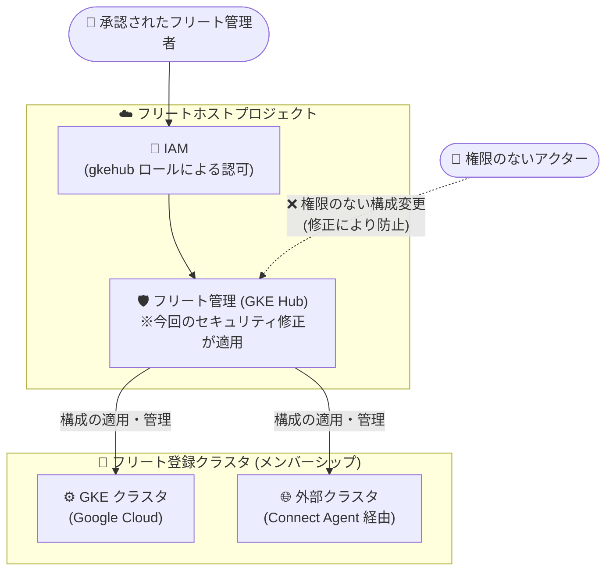

# Google Kubernetes Engine (GKE): フリート管理のセキュリティ問題を修正

**リリース日**: 2026-10-20

**サービス**: Google Kubernetes Engine (GKE)

**機能**: フリート管理のセキュリティ問題の修正

**ステータス**: Fixed (修正済み)

📊 [このアップデートのインフォグラフィックを見る](https://takech9203.github.io/google-cloud-news-summary/20261020-gke-fleet-management-security-fix.html)

## 概要

2026 年 10 月 20 日、Google Cloud は GKE のフリート管理 (fleet management) におけるセキュリティ問題が解決されたことを発表しました。この問題は、フリートに登録されたクラスタに対して「権限のない構成変更 (unauthorized configuration changes)」が行われる可能性があったというものです。修正はすべてのリージョンに展開済みで、ユーザー側の対応は不要です。

フリートは、複数の Kubernetes クラスタを論理的にグループ化して一元管理するための Google Cloud の仕組みです。フリートホストプロジェクトにクラスタを「メンバーシップ」として登録することで、Google Cloud 上の GKE クラスタだけでなく、オンプレミス (Google Distributed Cloud) や他のパブリッククラウド上のクラスタ (GKE on AWS/Azure、アタッチされたクラスタ) もまとめて管理できます。フリートを通じて Config Sync のフリートデフォルト設定やチームスコープなど、複数クラスタに影響する構成を適用できるため、フリート管理のセキュリティ境界は多数のクラスタの安全性に直結します。

なお、Google は本リリースノートにおいて脆弱性の技術的詳細 (悪用経路、影響を受けた API、CVE 番号など) は公表していません。本レポートは公表された情報と、フリート管理に関する公式ドキュメントの一般的な情報に基づいています。

**修正前の状態 (公表された内容)**

- GKE フリート管理に、フリートに登録されたクラスタへの権限のない構成変更を許してしまう可能性のあるセキュリティ問題が存在していた

**修正後の状態**

- 当該セキュリティ問題は解決された
- 修正はすべてのリージョンに展開済み
- ユーザー側での対応 (アップグレードや設定変更など) は不要

## アーキテクチャ図



フリート管理は、フリートホストプロジェクトを起点に登録クラスタへ構成を適用するセキュリティ境界です。今回の修正により、この境界を越えて権限のない構成変更が行われる可能性があった問題が解消されました。

## サービスアップデートの詳細

### 修正内容のポイント

1. **セキュリティ問題の解決**
   - GKE フリート管理において、フリートに登録されたクラスタへの権限のない構成変更を許す可能性があった問題が修正された
   - 脆弱性の技術的詳細 (CVE 番号、悪用条件など) は公表されていない

2. **全リージョンへの展開完了**
   - 修正はすべてのリージョンにロールアウト済み
   - 展開状況をユーザーが確認・操作する必要はない

3. **ユーザー側の対応は不要**
   - サーバーサイド (Google 管理側) での修正のため、クラスタのアップグレードや設定変更は不要
   - GKE ノードやコントロールプレーンのバージョンアップ作業も発生しない

## 技術仕様

### フリート管理の構成要素 (背景情報)

今回の修正対象である「フリート管理」の主な構成要素は以下のとおりです。

| 構成要素 | 説明 |
|------|------|
| フリートホストプロジェクト | フリートを所有するプロジェクト。クラスタはここにメンバーシップとして登録される |
| メンバーシップ | フリートに登録された各クラスタ。フリート内で一意の名前を持つ。GKE クラスタはリージョナルまたはグローバルの Fleet サービスで管理される |
| Connect Agent | Google Cloud 外のクラスタをフリートに登録した際にインストールされ、クラスタと Google Cloud 間のコントロールプレーン接続を担うエージェント |
| Connect gateway | フリートを基盤として、登録クラスタに対し Google Cloud の ID で一貫した認証・接続を提供する仕組み |
| フリートレベル機能 | Config Sync のフリートデフォルト設定など、フリート単位で登録クラスタに構成を適用する機能群 |
| チームスコープ | フリート内のクラスタのサブセットをアプリケーションチームに関連付け、アクセス制御や可観測性をチーム単位で提供する仕組み |

### フリート管理に関連する主な IAM ロール

フリートへのアクセス制御は、以下のような `gkehub` 系の事前定義ロールで行われます。

| ロール | 説明 |
|------|------|
| `roles/gkehub.admin` (Fleet Admin) | フリートリソースへのフルアクセス (メンバーシップ、機能、スコープの作成・変更・IAM ポリシー設定など) |
| `roles/gkehub.editor` (Fleet Editor) | フリートリソースの編集アクセス |
| `roles/gkehub.viewer` (Fleet Viewer) | フリートと関連リソースへの読み取り専用アクセス |
| `roles/gkehub.gatewayAdmin` / `gatewayEditor` / `gatewayReader` | Connect gateway 経由のクラスタアクセス権限 |
| `roles/gkehub.scopeAdmin` など | フリートスコープの管理権限 (IAM バインディング、RBACRoleBinding の設定) |

## 必要な対応

**ユーザー側の対応は不要です。** 修正は Google 側ですべてのリージョンに展開済みです。

そのうえで、フリートを利用している組織では、一般的なセキュリティベストプラクティスとして以下の確認を推奨します (今回の修正に必須の作業ではありません)。

1. フリートホストプロジェクトの IAM を確認し、`gkehub.admin` / `gkehub.editor` などの強い権限が最小権限の原則に沿って付与されているかを見直す

   ```bash
   # フリートのメンバーシップ一覧を確認
   gcloud container fleet memberships list --project=FLEET_HOST_PROJECT_ID
   ```

2. フリート関連の構成変更が意図したものかを Cloud Audit Logs (GKE Hub API の管理アクティビティログ) で定期的に確認する

## デメリット・制約事項

### 考慮すべき点

- リリースノートでは脆弱性の技術的詳細 (影響範囲、悪用の有無、CVE 番号) が公表されていないため、個別の影響評価はできない
- フリートはフリートホストプロジェクトを信頼の起点とする設計のため、今回のような修正とは別に、フリートホストプロジェクト自体の IAM 管理を継続的に厳格に行う必要がある

## 利用可能リージョン

修正はすべてのリージョンに展開済みです。

## 関連サービス・機能

- **GKE Hub (Fleet API)**: フリートとメンバーシップを管理する API。今回の修正対象であるフリート管理の中核
- **Connect gateway**: フリートを基盤に、登録クラスタへ Google Cloud の ID で安全に接続する仕組み。クラスタに直接の IP 到達性がなくても CLI からコマンドを実行できる
- **Connect Agent**: Google Cloud 外のクラスタとフリート間の通信を担うエージェント。NAT やプロキシ越しの接続に対応
- **Config Sync**: フリートデフォルト設定により、フリートに登録された新規クラスタへ構成管理 (GitOps) を自動適用できる機能。フリート経由でクラスタ構成が適用される代表例
- **Cloud Audit Logs**: フリートや GKE Hub API に対する管理操作の監査に利用
- **IAM**: `gkehub` 系ロールによるフリートへのアクセス制御

## 参考リンク

- 📊 [インフォグラフィック](https://takech9203.github.io/google-cloud-news-summary/20261020-gke-fleet-management-security-fix.html)
- [公式リリースノート (2026 年 10 月 20 日)](https://docs.cloud.google.com/release-notes#October_20_2026)
- [フリート管理の概要](https://docs.cloud.google.com/kubernetes-engine/fleet-management/docs)
- [フリートの作成 (クラスタの登録)](https://docs.cloud.google.com/kubernetes-engine/fleet-management/docs/fleet-creation)
- [Connect Agent の概要](https://docs.cloud.google.com/kubernetes-engine/fleet-management/docs/connect-agent)
- [Connect gateway ガイド](https://docs.cloud.google.com/kubernetes-engine/enterprise/multicluster-management/gateway)
- [GKE Hub の IAM ロールと権限](https://docs.cloud.google.com/iam/docs/roles-permissions/gkehub)

## まとめ

GKE フリート管理において、フリート登録クラスタへの権限のない構成変更を許す可能性があったセキュリティ問題が修正され、全リージョンに展開済みです。ユーザー側の対応は不要ですが、フリートは多数のクラスタへ構成を一括適用できる強力な仕組みであるため、これを機にフリートホストプロジェクトの IAM 権限の棚卸しと監査ログの確認体制を見直すことを推奨します。

---

**タグ**: #GKE #FleetManagement #GKEHub #Security #Fixed #Kubernetes #マルチクラスタ
