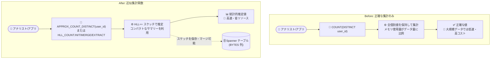

# Spanner: GoogleSQL / PostgreSQL 両ダイアレクトで近似集計関数をサポート

**リリース日**: 2026-10-20

**サービス**: Spanner

**機能**: 近似集計関数 (Approximate aggregate functions)

**ステータス**: 一般提供 (GA)

📊 [このアップデートのインフォグラフィックを見る](https://takech9203.github.io/google-cloud-news-summary/20261020-spanner-approximate-aggregate-functions.html)

## 概要

Spanner が GoogleSQL と PostgreSQL の両ダイアレクトで近似集計関数 (approximate aggregate functions) をサポートしました。これらの関数は、個別値のカウント (distinct count) の統計的推定値を生成するもので、大規模データセットに対して正確な集計 (`COUNT(DISTINCT ...)` など) を行う場合と比較して、より高速に結果を計算し、リソースを節約できます。

提供される機能は大きく 2 系統あります。1 つは `APPROX_COUNT_DISTINCT` (PostgreSQL ダイアレクトでは `spanner.approx_count_distinct`) のように、入力データから直接推定値を計算するシンプルな近似集計関数です。もう 1 つは HyperLogLog++ (HLL++) 関数群 (`HLL_COUNT.INIT` / `EXTRACT` / `MERGE` / `MERGE_PARTIAL`) で、「スケッチ」と呼ばれるデータ集約のコンパクトなサマリーを生成・保存・マージでき、精度のカスタマイズ (10〜24) にも対応します。

大量のユーザーイベントやトランザクションデータを Spanner に保持し、ダッシュボードやレポートでユニークユーザー数などの集計を頻繁に実行しているワークロードにとって、クエリの実行時間とコンピュートリソース消費を大きく削減できるアップデートです。BigQuery で長らく提供されてきた `APPROX_COUNT_DISTINCT` や HLL++ 関数と同等の機能が、オペレーショナルデータベースである Spanner でも利用できるようになりました。

**アップデート前の課題**

- 大規模データセットに対する個別値カウントは `COUNT(DISTINCT ...)` による正確な集計しか選択肢がなく、入力データ量に対して線形にメモリを消費するため、大規模データストリームでは実行時間とリソース消費が大きかった
- 集計の中間結果 (スケッチ) を保存して後からマージするインクリメンタルな集計パターンを Spanner の SQL だけで実現できなかった
- 近似集計を行いたい場合は BigQuery など他のサービスにデータを移してから処理する必要があった

**アップデート後の改善**

- `APPROX_COUNT_DISTINCT` により、`COUNT(DISTINCT ...)` の近似結果を少ないリソースで高速に取得できるようになった
- HLL++ 関数により、スケッチの生成・保存・部分集計・再集計 (マージ) が可能になり、精度 (10〜24) も指定できるようになった
- GoogleSQL / PostgreSQL のどちらのダイアレクトでも同等の近似集計が利用可能になった

## アーキテクチャ図



従来の `COUNT(DISTINCT ...)` による正確な集計 (Before) と、HLL++ スケッチに基づく近似集計 (After) の比較です。近似集計ではスケッチを BYTES として保存し、後からマージ・再集計するインクリメンタルな処理も可能になります。

## サービスアップデートの詳細

### 主要機能

1. **APPROX_COUNT_DISTINCT (GoogleSQL)**
   - `COUNT(DISTINCT expression)` の近似結果を返す集計関数
   - 返り値は統計的推定値であり、正確な集計より精度は落ちるが、非常に大きな入力に対して高いパフォーマンスを発揮する
   - 入力データから直接推定値を計算するため、スケッチの保存や精度指定は不可 (詳細な制御が不要なクイックなクエリ向け)
   - 返り値の型は `INT64`

2. **HyperLogLog++ (HLL++) 関数 (GoogleSQL)**
   - `HLL_COUNT.INIT(input [, precision])`: 入力値を HLL++ スケッチ (BYTES) に集約。精度は 10〜24 で指定可能 (デフォルト 15)
   - `HLL_COUNT.MERGE(sketch)`: 複数のスケッチの和集合を計算し、カーディナリティ (INT64) を返す
   - `HLL_COUNT.MERGE_PARTIAL(sketch)`: 複数のスケッチをマージして新しいスケッチ (BYTES) を返す
   - `HLL_COUNT.EXTRACT(sketch)`: 単一スケッチからカーディナリティ推定値を抽出する

3. **PostgreSQL ダイアレクト対応**
   - `spanner.approx_count_distinct(expression)`: 非 NULL の個別値数の近似カウントを返す (`int8`)
   - `hll_count.init` / `hll_count.extract` / `hll_count.merge` / `hll_count.merge_partial` も同様に提供
   - パフォーマンスを最大化するには、テーブルのカラムナストレージ有効化 (`COLUMNAR POLICY enabled`) とカラムナスキャンヒント (`/*@ scan_method=columnar */`) の併用が推奨されている

4. **スケッチ (Sketches) の保存と連携**
   - スケッチはデータ集約のコンパクトなサマリーで、保存して後からマージ (再集計) できる
   - Dataflow、Apache Spark、ZetaSketch などの外部アプリケーションで構築した HLL++ スケッチを GoogleSQL で利用でき、その逆も可能

## 技術仕様

### 関数一覧と入出力型

| 関数 (GoogleSQL / PostgreSQL) | 入力型 | 返り値 | 説明 |
|------|------|------|------|
| `APPROX_COUNT_DISTINCT` / `spanner.approx_count_distinct` | GoogleSQL: ARRAY・STRUCT・PROTO・INTERVAL 以外の任意の型 / PostgreSQL: int8, text, varchar, bytea, numeric, bool, float4, float8, timestamptz, date, uuid (interval 非対応) | `INT64` / `int8` | `COUNT(DISTINCT ...)` の近似結果 |
| `HLL_COUNT.INIT` / `hll_count.init` | GoogleSQL: INT64, NUMERIC, STRING, BYTES / PostgreSQL: int8, text, varchar, bytea, numeric | `BYTES` / `bytea` | 入力値から HLL++ スケッチを生成 (精度 10〜24、デフォルト 15) |
| `HLL_COUNT.EXTRACT` / `hll_count.extract` | BYTES / bytea | `INT64` / `int8` | スケッチからカーディナリティ推定値を抽出 |
| `HLL_COUNT.MERGE` / `hll_count.merge` | BYTES / bytea | `INT64` / `int8` | スケッチをマージして推定値を返す |
| `HLL_COUNT.MERGE_PARTIAL` / `hll_count.merge_partial` | BYTES / bytea | `BYTES` / `bytea` | スケッチをマージして新しいスケッチを返す |

### HLL++ スケッチの精度と誤差 (抜粋)

精度を上げるほど誤差は小さくなりますが、スケッチの処理・保存に必要なメモリ/ストレージが増加します。

| 精度 | 最大ストレージサイズ | 65% CI | 95% CI | 99% CI |
|------|------|------|------|------|
| 10 | 1 KiB + 28 B | ±3.25% | ±6.50% | ±9.75% |
| 12 | 4 KiB + 28 B | ±1.63% | ±3.25% | ±4.88% |
| 15 (デフォルト) | 32 KiB + 30 B | ±0.57% | ±1.15% | ±1.72% |
| 20 | 1024 KiB + 30 B | ±0.10% | ±0.20% | ±0.30% |
| 24 | 16384 KiB + 32 B | ±0.03% | ±0.05% | ±0.08% |

### クエリ例

```sql
-- APPROX_COUNT_DISTINCT: シンプルな近似個別値カウント
SELECT APPROX_COUNT_DISTINCT(x) AS approx_distinct
FROM UNNEST([0, 1, 1, 2, 3, 5]) AS x;
-- 結果: 5

-- HLL++: 国別にスケッチを生成し、マージして全体のユニーク顧客数を推定
SELECT HLL_COUNT.MERGE(hll_sketch) AS distinct_customers_with_open_invoice
FROM (
  SELECT country, HLL_COUNT.INIT(customer_id) AS hll_sketch
  FROM Invoices
  GROUP BY country
);
```

## メリット

### ビジネス面

- **コスト削減**: 正確な集計 (`COUNT(DISTINCT ...)`) と比較して使用リソースが少なく、大規模データセットに対する分析クエリのコンピュート消費を抑えられる
- **分析の内製化**: ユニークユーザー数などの集計のために BigQuery へデータを移送しなくても、Spanner 上で直接近似集計を実行できる

### 技術面

- **スケーラビリティ**: 線形のメモリ使用が現実的でない大規模データストリームにも適用できる
- **インクリメンタル集計**: スケッチを BYTES として保存し、`MERGE` / `MERGE_PARTIAL` で部分集計・再集計できるため、日次スケッチを保存して月次集計するといったパターンが実現できる
- **精度の制御**: HLL++ 関数では精度 (10〜24) を指定して、誤差とストレージ/メモリのトレードオフを調整できる
- **エコシステム連携**: Dataflow、Apache Spark、ZetaSketch で生成したスケッチと相互運用できる

## デメリット・制約事項

### 制限事項

- 返り値は統計的推定値であり、正確な値が必要なユースケース (課金、会計など) には適さない
- `APPROX_COUNT_DISTINCT` は精度指定、スケッチの保存、部分集計・再集計に対応していない (必要な場合は HLL++ 関数を使用)
- GoogleSQL の `APPROX_COUNT_DISTINCT` は ARRAY、STRUCT、PROTO、INTERVAL 型の入力に非対応
- 異なる型で初期化されたスケッチ同士はマージできない。また PostgreSQL の `numeric` から初期化したスケッチと GoogleSQL の `NUMERIC` から初期化したスケッチはマージ不可
- HLL++ スケッチから値を削除することはできない
- 異なる精度のスケッチをマージすると、最も低い精度にダウングレードされる

### 考慮すべき点

- 精度を上げるとスケッチの最大ストレージサイズが増加する (精度 15 で約 32 KiB、精度 24 で約 16 MiB) ため、保存するスケッチ数と精度のバランスを検討する
- PostgreSQL ダイアレクトで最良のパフォーマンスを得るには、カラムナストレージの有効化とカラムナスキャンヒントの使用が推奨されている

## ユースケース

### ユースケース 1: ダッシュボード向けユニークユーザー数の高速集計

**シナリオ**: 数十億行のイベントテーブルから、日次アクティブユーザー数 (DAU) をダッシュボードに表示したい。正確な値である必要はなく、応答速度とリソース消費を優先したい。

**実装例**:
```sql
SELECT event_date, APPROX_COUNT_DISTINCT(user_id) AS approx_dau
FROM UserEvents
WHERE event_date >= DATE_SUB(CURRENT_DATE(), INTERVAL 30 DAY)
GROUP BY event_date;
```

**効果**: `COUNT(DISTINCT user_id)` と比較して高速かつ省リソースで日次ユニークユーザー数を取得できる。

### ユースケース 2: スケッチの保存によるインクリメンタルなユニーク数集計

**シナリオ**: 日次でユニーク顧客数のスケッチを計算・保存しておき、月次や四半期のユニーク顧客数は保存済みスケッチのマージだけで算出したい (生データの再スキャンを避けたい)。

**実装例**:
```sql
-- 日次バッチ: スケッチを生成して保存 (BYTES 列)
INSERT INTO DailyCustomerSketches (sketch_date, hll_sketch)
SELECT CURRENT_DATE(), HLL_COUNT.INIT(customer_id, 15)
FROM Orders
WHERE order_date = CURRENT_DATE();

-- 月次集計: 保存済みスケッチをマージするだけ
SELECT HLL_COUNT.MERGE(hll_sketch) AS monthly_unique_customers
FROM DailyCustomerSketches
WHERE sketch_date BETWEEN '2026-10-01' AND '2026-10-31';
```

**効果**: 月次集計時に生データを再スキャンする必要がなく、コンパクトなスケッチのマージのみで推定値を取得できる。

## 料金

近似集計関数の利用自体に追加料金はなく、Spanner の通常の料金体系 (コンピュート容量、ストレージ、ネットワーク) が適用されます。近似集計は正確な集計よりも少ないリソースでクエリを実行できるため、同じワークロードに必要なコンピュート消費の削減につながります。

詳細は [Spanner の料金ページ](https://cloud.google.com/spanner/pricing) を参照してください。

## 関連サービス・機能

- **BigQuery**: `APPROX_COUNT_DISTINCT` に加えて `APPROX_QUANTILES`、`APPROX_TOP_COUNT`、`APPROX_TOP_SUM`、HLL++ 関数、KLL 関数など、より広範な近似集計機能を以前から提供している。Spanner との間でスケッチベースの集計パターンを揃えやすくなった
- **Dataflow / Apache Spark / ZetaSketch**: 外部アプリケーションで構築した HLL++ スケッチを Spanner の GoogleSQL で利用でき、その逆も可能
- **Spanner カラムナエンジン**: PostgreSQL ダイアレクトの近似集計関数で最良のパフォーマンスを得るために、カラムナストレージの有効化とカラムナスキャンヒントの使用が推奨されている

## 参考リンク

- 📊 [インフォグラフィック](https://takech9203.github.io/google-cloud-news-summary/20261020-spanner-approximate-aggregate-functions.html)
- [公式リリースノート](https://docs.cloud.google.com/release-notes#October_20_2026)
- [近似集計関数 (GoogleSQL)](https://docs.cloud.google.com/spanner/docs/reference/standard-sql/approximate_aggregate_functions)
- [近似集計関数 (PostgreSQL)](https://docs.cloud.google.com/spanner/docs/reference/postgresql/functions)
- [HyperLogLog++ 関数](https://docs.cloud.google.com/spanner/docs/reference/standard-sql/hll_functions)
- [スケッチ (Sketches)](https://docs.cloud.google.com/spanner/docs/reference/standard-sql/sketches)
- [料金ページ](https://cloud.google.com/spanner/pricing)

## まとめ

Spanner の近似集計関数は、大規模データセットに対する個別値カウントを「正確さと引き換えに高速・省リソース」で実行する選択肢を、GoogleSQL / PostgreSQL 両ダイアレクトにもたらしました。ダッシュボードやレポートで `COUNT(DISTINCT ...)` を多用しているワークロードでは、`APPROX_COUNT_DISTINCT` への置き換えや、HLL++ スケッチを保存するインクリメンタル集計パターンの導入を検討することを推奨します。

---

**タグ**: Spanner, GoogleSQL, PostgreSQL, APPROX_COUNT_DISTINCT, HyperLogLog++, スケッチ, 近似集計, GA
