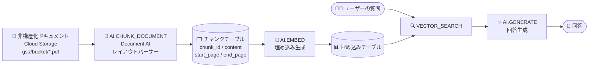

# BigQuery: AI.CHUNK_DOCUMENT 関数が一般提供 (GA) に

**リリース日**: 2026-10-21

**サービス**: BigQuery

**機能**: AI.CHUNK_DOCUMENT 関数 (テーブル値関数)

**ステータス**: GA (一般提供)

📊 [このアップデートのインフォグラフィックを見る](https://takech9203.github.io/google-cloud-news-summary/20261021-bigquery-ai-chunk-document-ga.html)

## 概要

BigQuery の `AI.CHUNK_DOCUMENT` 関数が一般提供 (GA) になりました。この関数は、非構造化ドキュメント (PDF など) をドキュメントのレイアウトと構造に基づいて意味的に一貫したテキストチャンクに分割するテーブル値関数 (TVF) です。生成されるチャンクは、ベクトル埋め込み (Vector Embedding) や検索拡張生成 (RAG: Retrieval-Augmented Generation) ワークフロー向けに最適化されています。

内部では Document AI のレイアウトパーサーを使用してドキュメント構造 (見出し、セクション、段落、リスト、テーブル) を解析し、構造の境界をまたいでも意味的なコンテキストを保持したチャンクを生成します。BigQuery がレイアウトパーサーのプロビジョニングと管理を自動的に行うため、ユーザーがモデルを作成・トレーニングする必要はありません。

SQL だけでドキュメントのチャンク化から埋め込み生成、ベクトル検索、テキスト生成までを完結できるため、BigQuery 上で RAG パイプラインを構築するデータエンジニアや AI アプリケーション開発者にとって重要なアップデートです。

**アップデート前の課題**

- ドキュメントを RAG 用にチャンク化するには、Document AI のレイアウトパーサー プロセッサを別途作成・管理するか、BigQuery の外部で独自のチャンク化処理を実装する必要があった
- 文字数や単語数による機械的な分割では、見出し・段落・テーブルなどの文書構造が無視され、意味的に分断されたチャンクが生成されやすかった
- クエリごとにプロセッサを個別に用意すると、プロジェクト内で冗長なプロビジョニングが発生する可能性があった

**アップデート後の改善**

- `AI.CHUNK_DOCUMENT` を実行すると、BigQuery がプロジェクト内に `bq-created-layout-parser` という Document AI プロセッサを自動作成・管理するため、モデルの作成やトレーニングが不要になった
- 文字数や単語数による恣意的な分割ではなく、ドキュメント構造に基づいた意味的に一貫したチャンクを SQL 一文で生成できるようになった
- プロジェクトごとに単一のプロセッサを共用する設計により、クエリ間での冗長なプロビジョニングが防止される
- `'gs://bucket/folder/*.pdf'` のような URI パスパターン指定で、Cloud Storage 上のドキュメントを直接処理できるようになった

## アーキテクチャ図



Cloud Storage 上のドキュメントを `AI.CHUNK_DOCUMENT` で意味的なチャンクに分割し、`AI.EMBED` で埋め込みを生成、`VECTOR_SEARCH` と `AI.GENERATE` を組み合わせることで、BigQuery 内で完結する RAG パイプラインを構築できます。

## サービスアップデートの詳細

### 主要機能

1. **レイアウト構造に基づくセマンティックチャンキング**
   - Document AI レイアウトパーサーが見出し、セクション、段落、リスト、テーブルなどの文書構造を解析
   - 構造の境界をまたいで意味的コンテキストを保持し、ベクトル埋め込みと RAG に最適化されたチャンクを生成

2. **プロセッサの自動プロビジョニング**
   - 関数の実行時に、プロジェクト内に `bq-created-layout-parser` プロセッサが存在しなければ自動作成される
   - プロジェクトごとに単一のプロセッサを使用し、クエリ間の冗長なプロビジョニングを防止
   - コンソールからプロセッサを削除しても、次回実行時に自動再作成される

3. **柔軟な入力ソース**
   - Cloud Storage URI の文字列リテラル (末尾ワイルドカード `*` や拡張子フィルタ `*.pdf` に対応)
   - オブジェクトテーブル (`TABLE` 指定)
   - `ref` という名前の ObjectRef 列を返すサブクエリ (`OBJ.LIST` や `OBJ.MAKE_REF` と組み合わせ可能)

4. **チャンクサイズの制御**
   - `chunk_size` 引数でチャンクの目標最大サイズをトークン数で指定可能 (1〜2000、デフォルト 1000)

## 技術仕様

### 構文

```sql
AI.CHUNK_DOCUMENT(
  { 'STORAGE_URI' | TABLE INPUT_TABLE | (QUERY_STATEMENT) }
  [, connection_id => 'CONNECTION_ID' ]
  [, chunk_size => CHUNK_SIZE ]
)
```

### 引数

| 引数 | 詳細 |
|------|------|
| `STORAGE_URI` | Cloud Storage URI の文字列リテラル。末尾ワイルドカード (`gs://my-bucket/docs/*`) や拡張子フィルタ (`*.pdf`) に対応。URI 指定時はエンドユーザー認証 (EUC) が必要 |
| `TABLE INPUT_TABLE` | `ref` という ObjectRef 列を持つテーブルまたはオブジェクトテーブル。オブジェクトテーブルの場合、`connection_id` は必須でテーブルの接続 ID と一致させる |
| `QUERY_STATEMENT` | `ref` という ObjectRef 列を返すサブクエリ |
| `connection_id` | Document AI への認証と Cloud Storage アクセスに使用する Cloud リソース接続 ID (例: `'myproject.us.my_connection'`)。省略時は EUC を使用 |
| `chunk_size` | チャンクの目標最大トークン数。1〜2000 の INT64 値、デフォルトは 1000 |

### 出力スキーマ (主な列)

| 列名 | 型 | 説明 |
|------|-----|------|
| `chunk_id` | INT64 | ドキュメント内のチャンクの連番 (1 始まり) |
| `start_page` / `end_page` | INT64 | チャンクの開始 / 終了ページ番号 (1 始まり) |
| `content` | STRING | 抽出されたチャンクのテキスト内容 |
| `status` | STRING | 実行ステータス。空文字列は成功。失敗時は `INVALID_ARGUMENT` などのエラーコードとメッセージ |
| `uri` | STRING | オブジェクトの Cloud Storage URI |
| `content_type` | STRING | MIME タイプ (例: `application/pdf`) |
| `size` / `md5_hash` / `updated` / `generation` / `metadata` / `ref` | - | Cloud Storage オブジェクトのメタデータと ObjectRef 値 |

### 認証に必要なロール

| 認証方式 | 必要なロール |
|----------|-------------|
| エンドユーザー認証 (EUC) | プロセッサ作成に `roles/documentai.editor` (既存の場合は `roles/documentai.viewer`)、バケットに `roles/storage.objectViewer` または `roles/storage.objectUser` |
| Cloud リソース接続 | 接続のサービスアカウントに `roles/documentai.editor` (既存の場合は `roles/documentai.viewer`) と `roles/storage.objectViewer`、ユーザーに `roles/bigquery.connectionUser` |

## 設定方法

### 前提条件

1. Document AI API (`documentai.googleapis.com`) を有効化する
2. 処理対象のドキュメントを Cloud Storage バケットに格納する
3. 認証方式 (EUC または Cloud リソース接続) に応じた IAM ロールを付与する

### 手順

#### ステップ 1: Cloud Storage URI を指定してチャンク化

```sql
SELECT chunk_id, start_page, end_page, content
FROM AI.CHUNK_DOCUMENT(
  'gs://cloud-samples-data/bigquery/tutorials/cymbal-pets/documents/crittercuisine_5000_user_manual.pdf'
);
```

PDF ファイルを Cloud Storage から直接読み込み、レイアウト構造に基づいたチャンクを返します。

#### ステップ 2: 接続とチャンクサイズを指定して複数ファイルを処理

```sql
SELECT chunk_id, start_page, end_page, content, ref.uri
FROM AI.CHUNK_DOCUMENT(
  (SELECT ref FROM OBJ.LIST(
    'gs://cloud-samples-data/bigquery/tutorials/cymbal-pets/document_chunks/*.pdf',
    'us.example_connection')),
  connection_id => 'us.example_connection',
  chunk_size => 250
);
```

接続経由で認証が必要な場合は、`OBJ.LIST` と `AI.CHUNK_DOCUMENT` の両方で同じ接続 ID を指定します。

#### ステップ 3: チャンクをテーブルに保存して埋め込みを生成 (RAG パイプライン)

```sql
CREATE OR REPLACE TABLE bqml_tutorial.chunked_pdf AS (
  SELECT * FROM AI.CHUNK_DOCUMENT('gs://BUCKET_NAME/scf23.pdf', chunk_size => 250)
);

CREATE OR REPLACE TABLE bqml_tutorial.embeddings AS (
  SELECT *, AI.EMBED(content, endpoint => 'text-embedding-005').result AS embedding
  FROM bqml_tutorial.chunked_pdf
);
```

チャンク化の結果をテーブルに書き出し、`AI.EMBED` で埋め込みを生成すれば、`VECTOR_SEARCH` と `AI.GENERATE` による RAG へ接続できます。

## メリット

### ビジネス面

- **RAG 導入の高速化**: ドキュメント処理基盤を別途構築せず、SQL だけで社内文書を RAG のナレッジソースに変換できるため、生成 AI アプリケーションの立ち上げが速くなる
- **運用負荷の軽減**: プロセッサの自動プロビジョニングと自動再作成により、インフラ管理の手間が最小化される。GA となったことで本番ワークロードにも採用しやすい

### 技術面

- **検索精度の向上に寄与**: 文字数ベースの機械的な分割ではなく、文書構造を保持したセマンティックなチャンクにより、ベクトル検索と LLM 回答生成の品質向上が期待できる
- **BigQuery 内で完結するパイプライン**: `AI.CHUNK_DOCUMENT` → `AI.EMBED` → `VECTOR_SEARCH` → `AI.GENERATE` と組み合わせ、データ移動なしで RAG パイプラインを構築できる
- **柔軟な入力と認証**: URI リテラル、オブジェクトテーブル、ObjectRef サブクエリの 3 つの入力形式と、EUC / Cloud リソース接続の 2 つの認証方式に対応

## デメリット・制約事項

### 制限事項

- 対応ファイル形式は Document AI レイアウトパーサーが扱える形式に限定され、レイアウトパーサーの制限事項 (ファイルサイズやページ数の上限など) が適用される
- `chunk_size` は 1〜2000 トークンの範囲でのみ指定可能
- 利用可能なロケーションは US / EU マルチリージョンと、US / EU 内のシングルリージョン (`europe-west2` と `europe-west6` を除く) に限定される
- Cloud Storage URI を直接指定する場合はエンドユーザー認証 (EUC) が必須

### 考慮すべき点

- Document AI API の有効化と、プロセッサ作成のための `roles/documentai.editor` などの IAM ロール付与が事前に必要
- 処理はページ単位で Document AI の料金が課金されるため、大量ドキュメントの一括処理ではコストを事前に見積もること
- ファイルが読み取り不能・破損・サイズ超過の場合は処理が失敗し、`status` 列にエラーコードが返るため、エラーハンドリングを組み込むこと

## ユースケース

### ユースケース 1: 社内マニュアルを対象とした RAG パイプラインの構築

**シナリオ**: Cloud Storage に蓄積された製品マニュアル (PDF) を元に、BigQuery 内で質問応答システムのナレッジベースを構築したい。

**実装例**:
```sql
-- 1. ドキュメントをチャンク化してテーブルに保存
CREATE OR REPLACE TABLE rag.chunked_manuals AS (
  SELECT * FROM AI.CHUNK_DOCUMENT('gs://my-bucket/manuals/*.pdf', chunk_size => 500)
);

-- 2. 埋め込みを生成
CREATE OR REPLACE TABLE rag.manual_embeddings AS (
  SELECT *, AI.EMBED(content, endpoint => 'text-embedding-005').result AS embedding
  FROM rag.chunked_manuals
);
```

**効果**: ETL や外部のドキュメント処理基盤を構築せずに、SQL のみで RAG 用のチャンク・埋め込みテーブルを整備できる。チャンクには `start_page` / `end_page` が付与されるため、回答の出典ページを提示することも可能。

### ユースケース 2: オブジェクトテーブルによる大量ドキュメントの一括チャンク化

**シナリオ**: 接続認証が必要な Cloud Storage バケット内の多数の PDF を、オブジェクトテーブル経由で一括処理したい。

**実装例**:
```sql
CREATE OR REPLACE EXTERNAL TABLE cymbal_pets.product_manual
WITH CONNECTION us.example_connection
OPTIONS (
  object_metadata = 'SIMPLE',
  uris = ['gs://cloud-samples-data/bigquery/tutorials/cymbal-pets/document_chunks/*.pdf']
);

SELECT * FROM AI.CHUNK_DOCUMENT(
  TABLE cymbal_pets.product_manual,
  connection_id => 'us.example_connection');
```

**効果**: オブジェクトテーブルでドキュメント群を管理しながら、接続のサービスアカウント権限で安全に一括チャンク化できる。

## 料金

`AI.CHUNK_DOCUMENT` によるドキュメント処理は Document AI Layout Parser API を使用し、標準の Document AI 料金に従って処理ページ数単位で課金されます。プロセッサの維持に対するアイドル保持料金はありません。BigQuery のクエリスロット使用量は通常どおり課金されます。

### 料金例 (Document AI Layout Parser)

| 項目 | 料金 |
|------|------|
| Layout Parser (初期チャンキングを含む) | $10 / 1,000 ページ (月間 1〜1,000,000 ページ) |
| プロセッサのアイドル保持料金 | なし |
| BigQuery クエリ | 通常のスロット / オンデマンド課金 |

詳細は [Document AI の料金ページ](https://cloud.google.com/document-ai/pricing) を参照してください。

## 利用可能リージョン

- US / EU マルチリージョン
- US / EU 内のすべてのシングルリージョン (ただし `europe-west2` と `europe-west6` を除く)

## 関連サービス・機能

- **Document AI (レイアウトパーサー)**: `AI.CHUNK_DOCUMENT` の内部で使用される文書構造解析エンジン。BigQuery が `bq-created-layout-parser` プロセッサを自動管理する
- **AI.EMBED 関数**: チャンク化されたテキストから埋め込みベクトルを生成し、RAG パイプラインの次工程を担う
- **VECTOR_SEARCH 関数**: 埋め込みに対するベクトル検索で、質問と意味的に類似したチャンクを取得する
- **AI.GENERATE 関数**: ベクトル検索結果をプロンプトに組み込み、検索拡張生成 (RAG) による回答を生成する
- **オブジェクトテーブル / ObjectRef (OBJ.LIST, OBJ.MAKE_REF)**: Cloud Storage 上の非構造化データを BigQuery から参照するための仕組みで、本関数の入力ソースとして利用できる
- **Cloud Storage**: 処理対象ドキュメントの格納先

## 参考リンク

- 📊 [インフォグラフィック](https://takech9203.github.io/google-cloud-news-summary/20261021-bigquery-ai-chunk-document-ga.html)
- [公式リリースノート](https://docs.cloud.google.com/release-notes#October_21_2026)
- [AI.CHUNK_DOCUMENT 関数リファレンス](https://docs.cloud.google.com/bigquery/docs/reference/standard-sql/bigqueryml-syntax-ai-chunk-document)
- [RAG パイプラインで PDF を解析するチュートリアル](https://docs.cloud.google.com/bigquery/docs/rag-pipeline-pdf)
- [Document AI レイアウトパーサー](https://docs.cloud.google.com/document-ai/docs/layout-parse-chunk)
- [Document AI 料金ページ](https://cloud.google.com/document-ai/pricing)

## まとめ

`AI.CHUNK_DOCUMENT` 関数の GA により、BigQuery 内で SQL だけを使って非構造化ドキュメントを RAG に最適化されたセマンティックチャンクへ変換できるようになりました。Document AI プロセッサの自動プロビジョニングにより運用負荷も最小限に抑えられます。Cloud Storage に蓄積した PDF などの文書資産を生成 AI で活用したいチームは、`AI.EMBED` / `VECTOR_SEARCH` / `AI.GENERATE` と組み合わせた BigQuery 完結型 RAG パイプラインの構築を検討することをおすすめします。

---

**タグ**: #BigQuery #DocumentAI #RAG #生成AI #ベクトル検索 #GA
