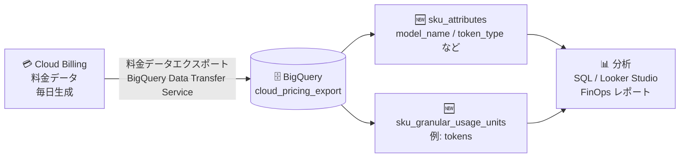

# Cloud Billing: 料金データの BigQuery エクスポートに SKU 属性と詳細使用量単位を追加 (Preview)

**リリース日**: 2026-10-21

**サービス**: Cloud Billing

**機能**: 料金データの BigQuery エクスポートにおける SKU 属性 (sku_attributes) と詳細使用量単位 (sku_granular_usage_units)

**ステータス**: Preview

📊 [このアップデートのインフォグラフィックを見る](https://takech9203.github.io/google-cloud-news-summary/20261021-cloud-billing-pricing-export-sku-attributes.html)

## 概要

Cloud Billing の料金データ (pricing data) の BigQuery エクスポートに、SKU 属性 (`sku_attributes`) と詳細使用量単位 (`sku_granular_usage_units`) の 2 つのフィールドが Preview として追加されました。これにより、エクスポートされた料金テーブルから SKU のメタデータを構造化データとして取得できるようになります。

`sku_attributes` は SKU を説明する key-value ペアで、例えば Key: `model_name` / Value: `gemini_2_5_flash` のように、どの生成 AI モデルに対応する SKU かをプログラムから判別できます。`sku_granular_usage_units` は `tokens` のような SKU の詳細な使用量単位を示します。いずれも現時点では生成 AI (Generative AI) 関連の SKU に限定された機能です。

Vertex AI や Gemini API の利用が拡大する中で、モデル別・モダリティ別・トークン種別ごとの単価分析を BigQuery 上で機械的に行いたい FinOps チームやコスト管理担当者にとって有用なアップデートです。

**アップデート前の課題**

- 料金エクスポートの SKU 情報は `sku.id` と人間可読の `sku.description` (文字列) が中心で、「どのモデルの SKU か」「入力/出力どちらのトークンか」といった属性を判別するには説明文の文字列解析に頼る必要があった
- 使用量単位は `pricing_unit` (例: `GiBy.mo`) と `pricing_unit_description` で表現され、生成 AI 特有の「トークン」のような粒度の単位情報を構造化データとして取得する手段がなかった
- モデル単位の単価比較やトークン単価の集計など、生成 AI コスト分析のクエリを安定して書くことが難しかった

**アップデート後の改善**

- `sku_attributes` の key-value ペア (例: `model_name`, `serving_method`, `modality`, `token_type`) により、SKU の属性を構造化データとしてクエリで直接フィルタ・集計できるようになった
- `sku_granular_usage_units` により、`tokens` のような SKU の詳細な使用量単位を取得できるようになった
- モデル別 (例: `gemini_2_5_flash`)、提供方式別 (例: `batch`)、モダリティ別 (例: `text`)、トークン種別 (例: `input`) といった軸での料金分析が SQL で可能になった

## アーキテクチャ図



Cloud Billing の料金データは毎日 BigQuery にエクスポートされ、新フィールドの `sku_attributes` と `sku_granular_usage_units` を使って生成 AI SKU のモデル別・トークン単位の料金分析が可能になります。

## サービスアップデートの詳細

### 主要機能

1. **SKU 属性 (`sku_attributes`)**
   - SKU を説明する key-value ペアの構造体 (Struct)
   - Key の例: `model_name`, `serving_method`, `modality`, `token_type`
   - Value の例: `gemini_2_5_flash`, `batch`, `text`, `input`
   - 生成 AI SKU に限定して提供される

2. **詳細使用量単位 (`sku_granular_usage_units`)**
   - SKU の詳細な使用量単位を示す文字列 (String) フィールド
   - 例: `tokens`
   - 従来の `pricing_unit` (例: `GiBy.mo`) より生成 AI の課金実態に即した粒度の単位情報を提供
   - 生成 AI SKU に限定して提供される

## 技術仕様

### 追加されたフィールド

| フィールド | 型 | 説明 |
|------|------|------|
| `sku_attributes` | Struct | SKU を説明する key-value ペア。Preview であり形式は変更される可能性あり |
| `sku_attributes.key` | String | 属性のキー。例: `model_name`, `serving_method`, `modality`, `token_type` |
| `sku_attributes.value` | String | 属性の値。例: `gemini_2_5_flash`, `batch`, `text`, `input` |
| `sku_granular_usage_units` | String | SKU の詳細な使用量単位。例: `tokens` |

### 関連する既存フィールド

| フィールド | 説明 |
|------|------|
| `sku.id` / `sku.description` | SKU の一意な ID と人間可読の説明 |
| `pricing_unit` / `pricing_unit_description` | 料金設定の単位 (例: `GiBy.mo` / gibibyte month) |
| `product_taxonomy` | SKU に適用される製品カテゴリのリスト (Preview) |
| `geo_taxonomy` | SKU に関連する地理的メタデータ (Preview) |
| `tiered_rates` | 料金ティアの情報 (USD 単価、ティア開始量など) |

## 設定方法

新フィールドは料金データエクスポートのテーブルに追加されるため、既存の設定手順と同じです。料金データエクスポートを未設定の場合は以下の手順で有効化します。

### 前提条件

1. Cloud Billing アカウントに対する **Billing Account Administrator** ロール (料金データエクスポートの有効化に必要)
2. エクスポート先データセットを含むプロジェクトに対する **BigQuery Admin** ロールと `resourcemanager.projects.update` 権限
3. **BigQuery Data Transfer Service API** の有効化 (料金データエクスポートに必須)

### 手順

#### ステップ 1: エクスポート先の準備

```bash
# BigQuery Data Transfer Service API を有効化
gcloud services enable bigquerydatatransfer.googleapis.com --project=BILLING_EXPORT_PROJECT

# エクスポート先データセットを作成 (マルチリージョン推奨)
bq mk --dataset --location=US BILLING_EXPORT_PROJECT:billing_export
```

エクスポート先のデータセットはマルチリージョン (EU / US) またはサポート対象のリージョンロケーションで作成します。

#### ステップ 2: 料金データエクスポートの有効化

Google Cloud コンソールの「お支払い」→「課金データのエクスポート」(Billing export) ページで、**Pricing (料金)** エクスポートを有効化し、プロジェクトとデータセットを選択して保存します。

#### ステップ 3: 新フィールドのクエリ

```sql
-- 生成 AI SKU の属性と詳細使用量単位を確認する例
SELECT
  sku.id AS sku_id,
  sku.description AS sku_description,
  attr.key AS attribute_key,
  attr.value AS attribute_value,
  sku_granular_usage_units
FROM
  `BILLING_EXPORT_PROJECT.billing_export.cloud_pricing_export`,
  UNNEST(sku_attributes) AS attr
WHERE
  attr.key = 'model_name'
```

エクスポートされた `cloud_pricing_export` テーブルに対して、`sku_attributes` を展開してモデル名などの属性でフィルタできます (フィールド形式は Preview のため変更される可能性があります)。

## メリット

### ビジネス面

- **生成 AI コストの可視化**: どのモデル (例: Gemini 2.5 Flash) にどのような単価が設定されているかを構造化データで把握でき、FinOps レポートの精度が向上する
- **コスト予測の精緻化**: トークンなどの詳細使用量単位をもとに、生成 AI ワークロードの単価分析とコスト見積もりがしやすくなる

### 技術面

- **文字列解析からの脱却**: `sku.description` の文字列パースに依存せず、key-value 属性で安定したクエリを記述できる
- **既存パイプラインへの統合**: 料金データエクスポートの既存テーブルにフィールドが追加される形のため、既存の BigQuery 分析基盤やダッシュボードに組み込みやすい

## デメリット・制約事項

### 制限事項

- Preview 機能であり、`sku_attributes` および `sku_granular_usage_units` のフィールド形式とデータは今後変更される可能性がある
- 両フィールドとも対象は生成 AI SKU に限定されている
- 料金データエクスポートは有効化した日以降のデータのみが収集され、過去に遡ってのバックフィルは行われない

### 考慮すべき点

- 形式変更の可能性があるため、本番のダッシュボードや自動処理に組み込む場合はスキーマ変更への耐性を考慮する
- BigQuery へのエクスポートデータの保存と分析には BigQuery のストレージ料金とクエリ (コンピューティング) 料金が発生する
- 料金データエクスポートの有効化には Billing Account Administrator という強い権限が必要なため、権限付与の運用に注意する

## ユースケース

### ユースケース 1: Gemini モデル別の単価カタログ作成

**シナリオ**: 複数の Gemini モデルを利用する組織で、モデルごと・トークン種別 (入力/出力) ごとの単価一覧を自動生成し、社内のコスト見積もりに活用したい。

**実装例**:
```sql
SELECT
  MAX(IF(attr.key = 'model_name', attr.value, NULL)) AS model_name,
  MAX(IF(attr.key = 'token_type', attr.value, NULL)) AS token_type,
  sku_granular_usage_units,
  sku.description
FROM
  `BILLING_EXPORT_PROJECT.billing_export.cloud_pricing_export`,
  UNNEST(sku_attributes) AS attr
GROUP BY
  sku.id, sku_granular_usage_units, sku.description
```

**効果**: モデル名やトークン種別を文字列解析なしで取得でき、単価カタログの生成・更新を自動化できる。

### ユースケース 2: FinOps チームによる生成 AI コストガバナンス

**シナリオ**: FinOps チームが、バッチ処理 (`serving_method: batch`) とオンライン処理で単価がどう異なるかを分析し、コスト最適化の推奨 (バッチ API への移行など) を行いたい。

**効果**: 提供方式やモダリティといった属性軸で単価を比較でき、データに基づいた生成 AI コスト最適化の提案が可能になる。

## 料金

新フィールド自体の追加料金はリリースノートおよびドキュメントに記載されていません。ただし、Cloud Billing データを BigQuery にエクスポートして保存・分析する際には、BigQuery のストレージ料金とクエリ処理 (コンピューティング) 料金が発生します。

- [BigQuery の料金](https://cloud.google.com/bigquery/pricing)
- [Cloud Billing データエクスポートのコストについて](https://docs.cloud.google.com/billing/docs/how-to/export-data-bigquery#cost)

## 関連サービス・機能

- **BigQuery**: 料金データのエクスポート先。エクスポートには BigQuery Data Transfer Service API が必要
- **Cloud Billing データエクスポート (使用コストデータ)**: Standard / Detailed usage cost エクスポートと組み合わせることで、実際の使用コストと料金 (単価) の両面から分析が可能
- **FOCUS usage cost エクスポート (Preview)**: FinOps Open Cost and Usage Specification (FOCUS) 標準に正規化されたコストデータのエクスポート
- **Cloud Billing Catalog API / Pricing Table レポート**: `sku.id` をキーに公開リスト価格と対応付けが可能
- **Vertex AI / Gemini API**: 今回の新フィールドの対象となる生成 AI SKU を提供するサービス

## 参考リンク

- 📊 [インフォグラフィック](https://takech9203.github.io/google-cloud-news-summary/20261021-cloud-billing-pricing-export-sku-attributes.html)
- [公式リリースノート](https://docs.cloud.google.com/release-notes#October_21_2026)
- [料金データエクスポートのスキーマ](https://docs.cloud.google.com/billing/docs/how-to/export-data-bigquery-tables/pricing-data)
- [SKU 属性のドキュメント](https://docs.cloud.google.com/billing/docs/how-to/export-data-bigquery-tables/pricing-data#sku_attributes)
- [詳細使用量単位のドキュメント](https://docs.cloud.google.com/billing/docs/how-to/export-data-bigquery-tables/pricing-data#sku_granular_usage_units)
- [Cloud Billing データエクスポートの設定](https://docs.cloud.google.com/billing/docs/how-to/export-data-bigquery-setup)
- [BigQuery の料金](https://cloud.google.com/bigquery/pricing)

## まとめ

生成 AI の利用拡大に伴い、モデル別・トークン単位でのコスト分析のニーズが高まる中、料金データエクスポートに構造化された SKU 属性と詳細使用量単位が追加されたことで、BigQuery 上での生成 AI 単価分析が大幅に容易になります。Preview 段階のためフィールド形式の変更には注意が必要ですが、FinOps チームはまず料金データエクスポートを有効化し、`sku_attributes` を使ったモデル別単価分析を試すことをおすすめします。

---

**タグ**: Cloud Billing, BigQuery, FinOps, 生成AI, Gemini, コスト管理, Preview
