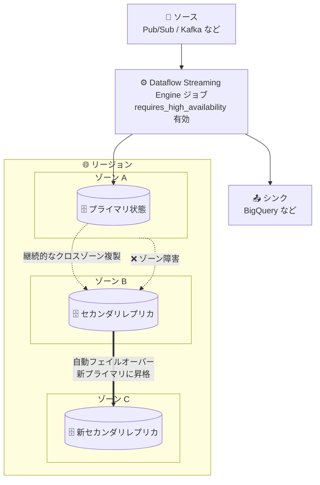

# Dataflow: ストリーミング高可用性 (Streaming High Availability)

**リリース日**: 2026-10-21

**サービス**: Dataflow

**機能**: Streaming Engine ジョブのストリーミング高可用性

**ステータス**: Preview

📊 [このアップデートのインフォグラフィックを見る](https://takech9203.github.io/google-cloud-news-summary/20261021-dataflow-streaming-high-availability.html)

## 概要

Dataflow が Streaming Engine ジョブ向けの「ストリーミング高可用性 (Streaming High Availability)」を Preview として提供開始しました。`requires_high_availability` サービスオプションを有効にすると、Dataflow はバックエンド状態 (ステート) をリージョン内の複数ゾーンに複製し、単一ゾーン障害からストリーミングジョブを保護します。

従来、Dataflow のストリーミングジョブはバックエンドリソースの一部を単一の Compute Engine ゾーンで実行しており、ゾーン障害 (zonal outage) の際にデータ損失の影響を受ける可能性がありました。本機能により、Streaming Engine ジョブはリージョンリソースとなり、ゾーン障害が発生してもジョブは自動的にフェイルオーバーし、データを失うことなく処理を継続できます。

ミッションクリティカルなストリーミングパイプライン (リアルタイム分析、CDC、イベント処理など) を運用し、ゾーン障害に対する耐障害性を求めるユーザーに特に有用なアップデートです。

**アップデート前の課題**

- Dataflow ストリーミングジョブはバックエンドリソースの一部を単一ゾーンで実行しており、ゾーン障害時にデータ損失の影響を受ける可能性があった
- ゾーン障害に備えるためのマネージドなステート複製の仕組みが Dataflow 自体には存在しなかった

**アップデート後の改善**

- バックエンド状態がリージョン内の複数ゾーンに複製され、単一ゾーン障害でもストリーミングジョブが停止しなくなった
- ゾーン障害時はデータをドロップすることなく自動的にフェイルオーバーし、ユーザーの対応は不要
- `dataflow.googleapis.com/job/high_availability_mode` メトリクスにより、高可用性の状態とフェイルオーバーイベントを Cloud Monitoring で追跡可能になった

## アーキテクチャ図



ストリーミング高可用性を有効にすると、バックエンド状態がリージョン内の複数ゾーンに複製されます。プライマリのゾーンで障害が発生すると、セカンダリレプリカが新しいプライマリに自動昇格し、別ゾーンに新たなセカンダリレプリカが作成されます。

## サービスアップデートの詳細

### 主要機能

1. **クロスゾーンのステート複製**
   - Streaming Engine ジョブのバックエンド状態をリージョン内の複数ゾーンに複製
   - ジョブがリージョンリソースとなり、単一ゾーン障害の影響を受けなくなる

2. **自動フェイルオーバー**
   - ゾーン障害時はデータをドロップすることなく自動的にフェイルオーバーし、ユーザーの操作は不要
   - フェイルオーバー中は、新しいプライマリ状態への切り替えと別ゾーンでの新セカンダリレプリカ確立の間、数秒から数分程度スループットが低下する可能性がある

3. **高可用性ステータスのモニタリング**
   - `dataflow.googleapis.com/job/high_availability_mode` メトリクス (ブール型ゲージ) で状態を監視可能
   - `status` ラベルの値: `Disabled` (無効)、`Highly Available` (複製済みで高可用)、`Establishing High Availability` (ゾーン障害後などで新セカンダリレプリカを作成中)

## 技術仕様

### 要件と制限事項

| 項目 | 詳細 |
|------|------|
| Streaming Engine | 必須。Streaming Engine を使用するストリーミングパイプラインであること |
| ワーカー配置 | リージョナル配置が必須。特定のワーカーゾーン指定 (`--workerZone`、`--worker_zone`、`--zone`) を含むジョブは拒否される |
| 設定タイミング | ジョブ作成時のみ有効化可能。実行中のパイプラインのインプレース更新では有効化・無効化できない |
| ウォーターマークへの影響 | データが処理されかつクロスゾーン複製された後にウォーターマークが進むため、数秒程度の追加ラグが発生し得る |
| 課金方式 | リソースベース課金 (resource-based billing) が常に適用され、データ処理量ベース課金は使用されない |

### ソースとシンクの可用性

- ジョブをリージョンリソースとして構成しても、ソースとシンクが自動的にリージョナル/グローバルになるわけではない
- Pub/Sub、BigQuery、Google Cloud Managed Service for Apache Kafka など多くの Google Cloud ソース/シンクは、デフォルトでリージョナルまたはグローバルの可用性を提供
- セルフホスト Apache Kafka や Apache Iceberg などカスタム/自己管理のソース/シンクを使う場合は、そのリージョン可用性を独自に構成・維持する必要がある

## 設定方法

### 前提条件

1. Streaming Engine を使用するストリーミングパイプラインであること
2. ワーカーがリージョナル配置であること (特定のワーカーゾーンを指定しない)

### 手順

#### 新規ジョブ起動時にサービスオプションを指定

```bash
# Java
--dataflowServiceOptions=requires_high_availability

# Python / Go
--dataflow_service_options=requires_high_availability
```

#### gcloud でテンプレート / Flex Template を実行する場合

```bash
gcloud dataflow flex-template run JOB_NAME \
  --project=PROJECT_ID \
  --template-file-gcs-location=TEMPLATE_LOCATION \
  --region=REGION \
  --enable-streaming-engine \
  --additional-experiments=requires_high_availability
```

Google Cloud コンソールからテンプレートを実行する場合は、「オプション パラメータ」の「Additional experiments」フィールドに `requires_high_availability` を入力します。REST API の場合は `RuntimeEnvironment` / `FlexTemplateRuntimeEnvironment` オブジェクトの `additionalExperiments` フィールドに指定します。

```json
{
  "additionalExperiments": ["requires_high_availability"]
}
```

既存の実行中パイプラインに適用するには、自動 stop-and-replace 更新を実行するか、パイプラインを停止 (またはドレイン) してから `--update` フラグなしで新規ジョブを起動します。

## メリット

### ビジネス面

- **ゾーン障害に対する事業継続性**: 単一ゾーン障害でストリーミングジョブが停止しなくなり、リアルタイムデータ処理の SLA 維持に寄与する
- **運用負荷の軽減**: フェイルオーバーは自動で行われ、障害時のユーザー対応が不要

### 技術面

- **データ損失なしの自動フェイルオーバー**: ゾーン障害時もデータをドロップせずに処理を継続できる
- **可観測性**: 専用メトリクスにより高可用性の状態とフェイルオーバーイベントを Cloud Monitoring で監視できる

## デメリット・制約事項

### 制限事項

- Streaming Engine を使用するストリーミングジョブのみ対応 (バッチジョブは対象外)
- 特定のワーカーゾーンを指定したジョブは拒否される (リージョナルワーカー配置が必須)
- ジョブ作成時のみ有効化可能で、実行中パイプラインのインプレース更新では変更できない
- Preview 機能のため、Pre-GA Offerings Terms が適用され、サポートが限定される場合がある

### 考慮すべき点

- クロスゾーン複製を待ってからウォーターマークが進むため、数秒程度の追加ウォーターマークラグが発生し得る (超低レイテンシ要件のパイプラインでは影響を評価すること)
- フェイルオーバー時には数秒から数分程度のスループット低下が発生し得る
- 常にリソースベース課金が適用されるため、データ処理量ベース課金を利用しているジョブは課金方式が変わる点に注意
- ソース/シンクの可用性は別途確認が必要 (特にセルフマネージドなソース/シンク)

## ユースケース

### ユースケース 1: ミッションクリティカルなリアルタイム分析パイプライン

**シナリオ**: Pub/Sub から受信したイベントを Dataflow で集計し BigQuery に書き込むリアルタイム分析基盤で、ゾーン障害によるデータ損失や長時間の停止を許容できない。

**実装例**:
```bash
--dataflow_service_options=requires_high_availability
```

**効果**: バックエンド状態が複数ゾーンに複製され、ゾーン障害時もデータ損失なく自動フェイルオーバーで処理を継続できる。Pub/Sub と BigQuery はデフォルトでリージョナル/グローバル可用性を持つため、エンドツーエンドでゾーン障害に耐える構成になる。

### ユースケース 2: 高可用性ステータスの監視体制の構築

**シナリオ**: 高可用性を有効にしたジョブについて、複製状態の劣化 (ゾーン障害後の再確立中など) を検知したい。

**効果**: `dataflow.googleapis.com/job/high_availability_mode` メトリクスの `status` ラベル (`Highly Available` / `Establishing High Availability` / `Disabled`) を Cloud Monitoring でアラート化し、フェイルオーバーイベントを追跡できる。

## 料金

- **Preview 期間中**: ストリーミング高可用性の利用に追加料金は発生しない
- **GA 以降**: レプリケーションの使用量はプライマリ状態の使用量と同じレートで課金される予定。状態の使用量は Streaming Engine Compute Units の一部として計測される
- ストリーミング高可用性ジョブは常にリソースベース課金を使用し、データ処理量ベース課金は使用されない

詳細は [Dataflow の料金ページ](https://cloud.google.com/dataflow/pricing) を参照してください。

## 関連サービス・機能

- **Streaming Engine**: 本機能の前提となる Dataflow のバックエンド実行基盤。パイプライン実行をワーカー VM から Dataflow サービスバックエンドに移す
- **Cloud Monitoring**: `job/high_availability_mode` メトリクスで高可用性ステータスとフェイルオーバーイベントを監視
- **Pub/Sub / BigQuery / Managed Service for Apache Kafka**: デフォルトでリージョナル/グローバル可用性を提供するソース/シンクとして、高可用性パイプラインと組み合わせて利用

## 参考リンク

- 📊 [インフォグラフィック](https://takech9203.github.io/google-cloud-news-summary/20261021-dataflow-streaming-high-availability.html)
- [公式リリースノート](https://docs.cloud.google.com/release-notes#October_21_2026)
- [ドキュメント: Streaming high availability](https://docs.cloud.google.com/dataflow/docs/guides/streaming-high-availability)
- [ドキュメント: Streaming Engine](https://docs.cloud.google.com/dataflow/docs/streaming-engine)
- [料金ページ](https://cloud.google.com/dataflow/pricing)

## まとめ

Dataflow の Streaming Engine ジョブが、サービスオプション 1 つでゾーン障害に耐えるリージョンリソースになる重要なアップデートです。ミッションクリティカルなストリーミングパイプラインを運用している場合は、Preview 期間中 (追加料金なし) にウォーターマークラグや課金方式の変更の影響を検証することを推奨します。有効化はジョブ作成時のみ可能なため、既存ジョブへの適用は stop-and-replace 更新またはドレイン後の再起動を計画してください。

---

**タグ**: Dataflow, Streaming Engine, 高可用性, マルチゾーン, Preview, ストリーミング処理
