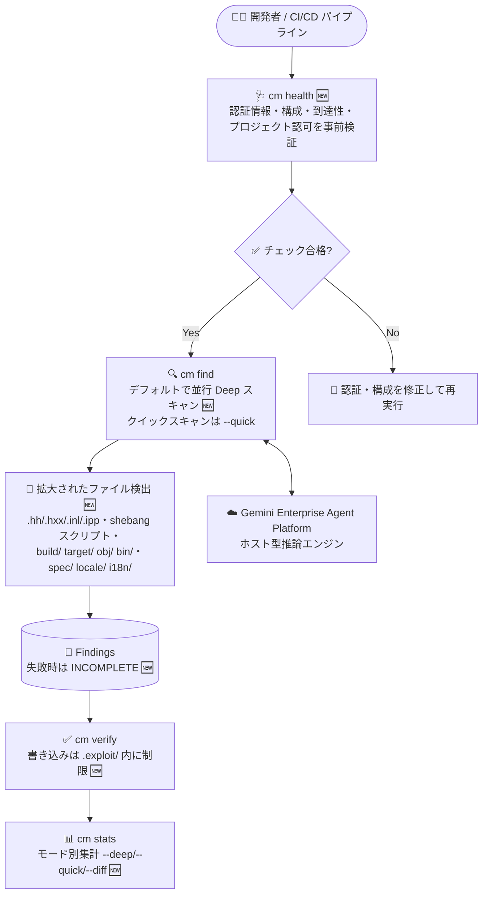

# Gemini Enterprise Agent Platform: CodeMender v0.16.0 アップデート

**リリース日**: 2026-10-21

**サービス**: Gemini Enterprise Agent Platform (CodeMender)

**機能**: CodeMender v0.16.0 (Deep スキャンのデフォルト化・`cm health` 事前ヘルスチェック・ファイル検出範囲の拡大)

**ステータス**: Fixed (CodeMender 自体は Preview)

📊 [このアップデートのインフォグラフィックを見る](https://takech9203.github.io/google-cloud-news-summary/20261021-gemini-enterprise-agent-platform-codemender-v0-16-0.html)

## 概要

Gemini Enterprise Agent Platform 上で提供される AI コードセキュリティエージェント「CodeMender」が v0.16.0 にアップデートされた。CodeMender は、コードベースの脆弱性をスキャン (`cm find`)、検証 (`cm verify`)、修正 (`cm fix`) する自律型エージェントで、推論は Google Cloud 側のホスト型エージェントが担い、コードの読み取り・ビルド・PoC (概念実証) エクスプロイトの実行はローカルの `cm` CLI サンドボックス内で行われる。

v0.16.0 の最大の変更点は、`cm find` のデフォルト動作が「ファイル単位の並行 Deep スキャン (`--deep`)」になったことである。従来はオプトインだった網羅的スキャンが標準となり、リポジトリ全体での脆弱性の検出率 (recall) が向上する。従来の単一セッションによるクイックスキャンは `--quick` フラグで引き続き利用できる。また、新コマンド `cm health` により、認証情報・構成・エンドポイント到達性・プロジェクト認可をスキャン実行前に検証できるようになり、CI/CD パイプラインでの事前チェックが容易になった。さらに、C++ ヘッダーの追加拡張子や拡張子なしスクリプト、ネストされたビルドディレクトリ配下のソースコードなど、ファイル検出範囲も大幅に拡大されている。

CodeMender を定期監査や CI/CD に組み込んでいるセキュリティチーム・開発チームにとって、検出カバレッジの底上げと運用前チェックの自動化につながるアップデートである。

**アップデート前の課題**

- `cm find` のデフォルトは単一セッションのスキャンであり、リポジトリ全体を網羅する Deep スキャンは `--deep` フラグを明示的に指定する必要があった
- 認証情報・構成・エンドポイント到達性・プロジェクト認可に問題があっても、実際にスキャンを実行するまで気付けず、事前に検証する専用コマンドがなかった
- `.hh` / `.hxx` / `.inl` / `.ipp` といった C++ ヘッダーや、shebang 付きの拡張子なしスクリプト、ネストされた `build/`・`target/`・`obj/`・`bin/` 配下のソース、`spec/`・`locale/`・`i18n/` 配下のプロダクションコードがスキャン対象から漏れていた
- `cm verify` のファイル書き込み先がプロジェクトルート内の `.exploit/` に制限されておらず、ワークスペース復元時に欠損・スコープ外のセッションアーティファクトで問題が発生することがあった
- 大きなファイルの単一ターン読み取りや unified diff 生成に上限がなく、`run_command` のタイムアウトも短めだった
- サンドボックス化されたセッションがツール呼び出しエントリを `~/.codemender/audit.log` に書き込めない問題があった
- マルチファイルの `--deep` / `--diff` スキャンで一部のファイルスキャンが失敗しても、ステータスからそれを判別できなかった

**アップデート後の改善**

- `cm find` がデフォルトでファイル単位の並行 Deep スキャンを実行し、リポジトリ全体での脆弱性検出率が向上した。従来の単一セッションスキャンは `--quick` で選択可能
- `cm stats` がスキャン利用状況をモード別 (`--deep` / `--quick` / `--diff`) に集計表示するようになった
- 新コマンド `cm health` (`--json` / `--strict` / `--timeout` フラグ対応) で、スキャン前に認証情報・構成・エンドポイント到達性・プロジェクト認可を検証できるようになった
- C++ ヘッダー (`.hh`, `.hxx`, `.inl`, `.ipp`)、サポート言語 (python / node / ruby / php) の shebang を持つ拡張子なしスクリプト、ネストされた `build/`・`target/`・`obj/`・`bin/` 配下のソース、`spec/`・`locale/`・`i18n/` 配下のプロダクションコードがスキャン対象になった
- `cm verify` のファイル書き込みがプロジェクトルート内の `.exploit/` に制限され、ワークスペース復元時には欠損・スコープ外のセッションアーティファクトをスキップするようになった
- 単一ターンのファイル読み取りが 256 KiB 上限 + ページネーションヒント付きになり、大きなファイルでの unified diff 生成が制限され、`run_command` のデフォルト/最大タイムアウトが 120 秒 / 300 秒に引き上げられた
- サンドボックス化されたセッションが `~/.codemender/audit.log` にツール呼び出しエントリを書き込めるようになった
- マルチファイルの `--deep` / `--diff` スキャンで 1 つ以上のファイルスキャンが失敗した場合、INCOMPLETE ステータスが報告されるようになった

## アーキテクチャ図



v0.16.0 では、`cm health` による事前ヘルスチェックを起点に、デフォルトで Deep スキャンとなった `cm find`、書き込み先が制限された `cm verify`、モード別集計に対応した `cm stats` までのワークフロー全体が強化された。

## サービスアップデートの詳細

### 主要機能

1. **Deep スキャンのデフォルト化 (`cm find`)**
   - `cm find` がデフォルトで、ファイル単位の並行 Deep スキャン (`--deep`) を実行するようになった。リポジトリ全体での脆弱性検出率 (recall) の向上が目的
   - 従来の単一セッションによるクイックスキャンを実行したい場合は `--quick` フラグを指定する
   - `cm stats` がスキャン利用状況をモード別 (`--deep` / `--quick` / `--diff`) に分けて集計するようになった

2. **事前ヘルスチェック (`cm health`)**
   - 新コマンド `cm health` が追加され、スキャン実行前に認証情報 (credentials)、構成 (configuration)、エンドポイント到達性 (endpoint reachability)、プロジェクト認可 (project authorization) を検証できる
   - `--json` (機械可読出力)、`--strict`、`--timeout` の各フラグに対応し、CI/CD パイプラインでの前段チェックに組み込みやすい

3. **ファイル検出範囲の拡大 (`cm find`)**
   - C++ ヘッダーの追加拡張子: `.hh`、`.hxx`、`.inl`、`.ipp`
   - サポート言語 (python、node、ruby、php) の shebang を持つ、拡張子なしのスクリプト
   - ネストされた `build/`、`target/`、`obj/`、`bin/` ディレクトリ配下のソースコード
   - `spec/`、`locale/`、`i18n/` 配下のプロダクションコード

4. **バグ修正**
   - `cm verify` のファイル書き込みをプロジェクトルート内の `.exploit/` に制限し、ワークスペース復元時には欠損・スコープ外のセッションアーティファクトをスキップするようにした
   - 単一ターンのファイル読み取りを 256 KiB に制限 (ページネーションヒント付き) し、大きなファイルでの unified diff 生成を制限、`run_command` のデフォルト/最大タイムアウトを 120 秒 / 300 秒に引き上げた
   - サンドボックス化されたセッションがツール呼び出しエントリを `~/.codemender/audit.log` に書き込めない問題を修正
   - マルチファイルの `--deep` / `--diff` スキャンで 1 つ以上のファイルスキャンが失敗した場合に INCOMPLETE ステータスを報告するようにした

## 技術仕様

### CodeMender の基本アーキテクチャ

| 項目 | 詳細 |
|------|------|
| 実行モデル | ローカルファースト (推論は Google Cloud 側、コード読み取り・ビルド・PoC 実行はローカルサンドボックス) |
| 構成要素 | Agent (ホスト型マルチエージェントシステム) + Client (CLI 兼デーモン) |
| スキャンモード | Deep (デフォルト 🆕) / Quick (`--quick` 🆕) / Diff (`cm find --diff`) |
| Deep スキャン並列数 | `--deep-workers` (1〜16、既定: 8) |
| サポート言語 (デフォルト) | C/C++、C#/.NET、Go、Java、JavaScript/TypeScript、Kotlin、Python、Ruby、Rust、PHP |
| レポート出力形式 | table / JSON / SARIF / HTML / Markdown |
| 提供リージョン | グローバル |

### v0.16.0 で変更された動作上の上限値

| 項目 | v0.16.0 での動作 |
|------|------------------|
| 単一ターンのファイル読み取り | 256 KiB 上限 (ページネーションヒント付き) |
| unified diff 生成 | 大きなファイルに対して制限あり |
| `run_command` デフォルトタイムアウト | 120 秒 |
| `run_command` 最大タイムアウト | 300 秒 |
| `cm verify` のファイル書き込み先 | プロジェクトルート内の `.exploit/` に制限 |

### `cm health` のフラグ

| フラグ | 説明 |
|--------|------|
| `--json` | 結果を JSON 形式で出力 |
| `--strict` | 厳格モードでチェックを実行 |
| `--timeout` | チェックのタイムアウトを設定 |

## 設定方法

### 前提条件

1. Google Cloud プロジェクトのセットアップ (必要な API の有効化と IAM ロールの付与)
2. CodeMender CLI のダウンロード・インストールと Google Cloud 認証情報 (ADC) の構成
3. CodeMender は Public Preview のため、利用には対象顧客としてのアクセスが必要

### 手順

#### ステップ 1: 事前ヘルスチェック (v0.16.0)

```bash
# 認証情報・構成・エンドポイント到達性・プロジェクト認可を検証
cm health

# CI/CD 向け: JSON 出力 + 厳格モード + タイムアウト指定
cm health --json --strict --timeout=<SECONDS>
```

スキャン実行前に環境の問題を検出できるため、CI/CD パイプラインの前段チェックとして組み込める。

#### ステップ 2: スキャンの実行 (Deep がデフォルト)

```bash
# v0.16.0 以降: デフォルトでファイル単位の並行 Deep スキャンを実行
cm find .

# 単一セッションのクイックスキャンを実行したい場合
cm find ./src --quick

# プルリクエストの差分スキャン (従来どおり)
cm find . --diff=origin/main
```

#### ステップ 3: 検証とモード別の利用状況確認

```bash
# Finding を検証 (ファイル書き込みは .exploit/ 内に制限される)
cm verify FINDING_ID

# スキャン利用状況をモード別 (--deep / --quick / --diff) に確認
cm stats
```

## メリット

### ビジネス面

- **検出カバレッジの底上げ**: Deep スキャンがデフォルトになったことで、意識的にフラグを指定しなくても網羅的な監査が行われ、スキャン漏れによるリスクが減る。ファイル検出範囲の拡大により、これまで対象外だったコード (C++ ヘッダー、ビルドディレクトリ配下のソースなど) の脆弱性も捕捉できる
- **運用の信頼性向上**: `cm health` により環境起因のスキャン失敗を事前に防止でき、INCOMPLETE ステータスにより「一部のファイルがスキャンできていない監査結果」を誤って完全な結果として扱うリスクを回避できる

### 技術面

- **CI/CD との統合性向上**: `cm health --json --strict` をパイプラインの前段に置くことで、認証・構成の問題をスキャン実行前に fail-fast できる
- **検証のセキュリティ強化**: `cm verify` の書き込み先がプロジェクトルート内の `.exploit/` に制限され、PoC 実行時の副作用の範囲が明確になった
- **大規模リポジトリでの安定性**: ファイル読み取りの 256 KiB 上限 (ページネーション付き) と diff 生成の制限、`run_command` タイムアウトの引き上げ (120s / 300s) により、大きなファイルを含むリポジトリでも安定して動作する
- **監査ログの完全性**: サンドボックス化されたセッションでも `~/.codemender/audit.log` へのツール呼び出し記録が確実に残るようになった

## デメリット・制約事項

### 制限事項

- CodeMender は Preview (Pre-GA) であり、限定された顧客向けの提供。商用・本番目的での利用は不可で、テスト・評価目的に限定される
- 解析対象は、自身が所有または利用を許可されたコード、もしくは OSI 承認ライセンスで配布される OSS に限られる
- Deep スキャンは標準 (クイック) スキャンや Diff スキャンに比べて実行時間が長く、トークン消費も多い。プルリクエストをブロックする同期チェックには不向き

### 考慮すべき点

- **デフォルト動作の変更に注意**: v0.16.0 以降、`cm find` はデフォルトで Deep スキャンを実行するため、従来と同じコマンドでも実行時間とトークン消費 (コスト) が増加する可能性がある。これまでのクイックな挙動を維持したい場合は `--quick` を明示する必要がある
- ビルドディレクトリ (`build/`、`target/`、`obj/`、`bin/`) 配下のソースや `spec/` 配下のコードが新たにスキャン対象となったことで、Finding の件数やスキャン時間が増える可能性がある。スキャン対象を調整したい場合は `config.yaml` の `scan` 設定 (`exclude_dirs` など) を確認するとよい
- Pre-GA 製品のため、重大なエラーが修正できない状況では使用せず、人間による監督のもとで利用することが求められる

## ユースケース

### ユースケース 1: CI/CD パイプラインでの事前ヘルスチェック

**シナリオ**: 夜間の定期 Deep スキャンジョブが、認証情報の期限切れやプロジェクト認可の不備で失敗し、翌朝まで気付かないことがあった。

**実装例**:
```bash
# パイプラインの前段で環境を検証し、問題があれば即座に失敗させる
cm health --json --strict --timeout=60 || exit 1

# 検証に合格したら Deep スキャン (v0.16.0 以降はデフォルト) を実行
cm find . --output=report.json --format=json
```

**効果**: 環境起因の失敗をスキャン開始前に検出でき、長時間のスキャンが無駄になることを防げる。`--json` 出力により失敗理由の機械的な解析も可能。

### ユースケース 2: C++ プロジェクトの網羅的な定期監査

**シナリオ**: `.hh` / `.hxx` / `.inl` / `.ipp` 形式のヘッダーを多用する C++ リポジトリで、これらのファイルが従来のスキャン対象から漏れていた。

**効果**: v0.16.0 のファイル検出拡大により、これらの C++ ヘッダーやネストされたビルドディレクトリ配下のソースも自動的にスキャン対象となり、追加設定なしで監査カバレッジが向上する。一部のファイルスキャンが失敗した場合は INCOMPLETE ステータスで通知されるため、監査結果の完全性も確認できる。

### ユースケース 3: 開発中のクイックチェックと定期監査の使い分け

**シナリオ**: 開発者がローカルで特定モジュールを素早く確認したい一方、チームとしては網羅的な定期監査も運用している。

**実装例**:
```bash
# ローカルでの素早い確認は --quick で単一セッションスキャン
cm find ./src/auth --quick

# 定期監査はデフォルトの Deep スキャン
cm find .

# モード別の利用状況を把握してコストを管理
cm stats
```

**効果**: `cm stats` のモード別集計 (`--deep` / `--quick` / `--diff`) により、チーム内でどのモードがどれだけ使われているかを可視化し、トークン消費の傾向を把握できる。

## 関連サービス・機能

- **Gemini Enterprise Agent Platform**: CodeMender のホスト型推論エンジンが稼働する基盤。`cm health` はこのエンドポイントへの到達性も検証する
- **Gemini 3.8 Flash / Gemini 3.8 Flash Cyber**: CodeMender のバックエンドモデル。`--model` フラグで切り替え可能 (Cyber はサイバーセキュリティ特化版)
- **Cloud Billing**: CodeMender のトークン使用量に基づく課金レポートの確認に使用
- **Cloud Build / GitHub Actions**: `cm health` を前段チェック、`cm find --diff` を PR ゲートとして組み込む CI/CD パイプライン

## 参考リンク

- 📊 [インフォグラフィック](https://takech9203.github.io/google-cloud-news-summary/20261021-gemini-enterprise-agent-platform-codemender-v0-16-0.html)
- [公式リリースノート](https://docs.cloud.google.com/release-notes#October_21_2026)
- [CodeMender ドキュメント](https://docs.cloud.google.com/gemini-enterprise-agent-platform/agents/codemender)
- [CodeMender find モード](https://docs.cloud.google.com/gemini-enterprise-agent-platform/agents/codemender/find-modes)
- [脆弱性のスキャンと検証](https://docs.cloud.google.com/gemini-enterprise-agent-platform/agents/codemender/scan-and-verify)
- [環境のセットアップ](https://docs.cloud.google.com/gemini-enterprise-agent-platform/agents/codemender/set-up-environment)

## まとめ

CodeMender v0.16.0 は、`cm find` のデフォルトを並行 Deep スキャンに変更して検出率を底上げし、`cm health` による事前ヘルスチェックと INCOMPLETE ステータスで運用の信頼性を高めるアップデートである。既存ユーザーは、デフォルト動作の変更による実行時間・トークン消費の増加に留意しつつ、クイックチェックには `--quick` を明示し、CI/CD パイプラインの前段に `cm health --json --strict` を組み込むことを推奨する。

---

**タグ**: #GeminiEnterpriseAgentPlatform #CodeMender #セキュリティ #AIエージェント #CICD #脆弱性スキャン #DevSecOps
