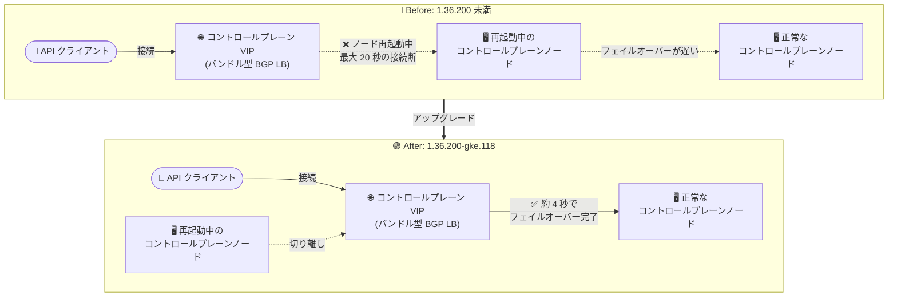

# Google Distributed Cloud (software only): 1.36.200-gke.118 リリース (VMware 版 / ベアメタル版)

**リリース日**: 2026-10-21

**サービス**: Google Distributed Cloud (software only) for VMware / for bare metal

**機能**: バージョン 1.36.200-gke.118 のリリース (アナウンス + 機能改善 + 修正)

**ステータス**: GA (ダウンロード提供開始)

📊 [このアップデートのインフォグラフィックを見る](https://takech9203.github.io/google-cloud-news-summary/20261021-google-distributed-cloud-1-36-200.html)

## 概要

Google Distributed Cloud (software only) のパッチバージョン **1.36.200-gke.118** が、VMware 版とベアメタル版の両プラットフォームで同日にダウンロード提供開始されました。本バージョンは **Kubernetes v1.36.4-gke.100** 上で動作します。オンプレミス環境で GDC を運用するユーザーは、アップグレードによって可用性の改善と脆弱性修正を取り込めます。

ベアメタル版では、バンドル型 BGP ロードバランシングを使用するクラスタにおいて、コントロールプレーンのアップグレードや構成変更時に最大 20 秒間の API サーバー接続断が発生し得た問題が修正され、正常なコントロールプレーンノードへのフェイルオーバーが約 4 秒で完了するようになりました。また、メンテナンスモードでのノードドレイン時にアタッチ済みストレージボリュームのデタッチを待たない問題や、メンテナンスモード遷移中の BareMetalMachine の conditions に関する問題も修正されています。VMware 版・ベアメタル版の両方で脆弱性修正が含まれます。

なお、リリース後、GKE On-Prem API クライアント (Google Cloud コンソール、gcloud CLI、Terraform) でこのバージョンが利用可能になるまで約 7〜14 日かかります。サードパーティ製ストレージベンダーを利用している場合は、事前認定済みストレージパートナーの一覧を確認してください。

**アップデート前の課題**

- ベアメタル版でバンドル型 BGP ロードバランシングを使用するクラスタでは、コントロールプレーンのアップグレードや構成更新の際、コントロールプレーンノードの再起動中に最大 20 秒間の API サーバー接続障害が発生する可能性があった
- メンテナンスモードでのノードドレインが、アタッチされたストレージボリュームのデタッチ完了を待たずに進行していた
- メンテナンスモード遷移中に BareMetalMachine の conditions に問題があった
- 既知の脆弱性が未修正のまま残っていた

**アップデート後の改善**

- バンドル型 BGP ロードバランシング使用時のコントロールプレーンノード再起動時に、正常なコントロールプレーンノードへのフェイルオーバーが約 4 秒で完了するようになった (従来は最大 20 秒の接続断)
- メンテナンスモードでのノードドレインがアタッチ済みストレージボリュームのデタッチを待機するようになり、安全性が向上した
- メンテナンスモード遷移中の BareMetalMachine conditions の問題が修正された
- VMware 版・ベアメタル版の両方で脆弱性修正が適用された

## アーキテクチャ図

ベアメタル版のバンドル型 BGP ロードバランシング構成において、コントロールプレーンノード再起動時の API サーバー接続断が最大 20 秒から約 4 秒のフェイルオーバーに短縮される Before/After を示しています。

## サービスアップデートの詳細

### 主要機能

1. **1.36.200-gke.118 のダウンロード提供開始 (VMware 版 / ベアメタル版共通)**
   - 両プラットフォームで同一バージョンが同日にリリース
   - Kubernetes v1.36.4-gke.100 上で動作
   - GKE On-Prem API クライアント (Google Cloud コンソール、gcloud CLI、Terraform) での利用は、リリース後約 7〜14 日で可能になる

2. **バンドル型 BGP ロードバランシングのコントロールプレーンフェイルオーバー改善 (ベアメタル版)**
   - コントロールプレーンのアップグレードや構成更新でノードが再起動する際、最大 20 秒間の API サーバー接続障害が発生し得た問題を修正
   - 修正後は、正常なコントロールプレーンノードへのフェイルオーバーが約 4 秒で完了
   - バンドル型 BGP ロードバランシングでは、各コントロールプレーンノードがインフラ内の BGP ピア (ToR スイッチなど) とピアリングセッションを確立し、コントロールプレーン VIP を広報する構成のため、ノード再起動時の経路切り替え速度が API 可用性に直結する

3. **メンテナンスモード関連の修正 (ベアメタル版)**
   - ノードドレイン時にアタッチ済みストレージボリュームのデタッチを待機するようになり、ストレージを利用するワークロードの安全な退避が改善
   - メンテナンスモード遷移中の BareMetalMachine conditions の問題を修正

4. **脆弱性修正 (VMware 版 / ベアメタル版共通)**
   - 両プラットフォームで脆弱性修正を適用
   - 詳細は各プラットフォームの Vulnerability fixes ページを参照

## 技術仕様

### リリース概要

| 項目 | 詳細 |
|------|------|
| バージョン | 1.36.200-gke.118 |
| 対象プラットフォーム | Google Distributed Cloud (software only) for VMware / for bare metal |
| Kubernetes バージョン | v1.36.4-gke.100 |
| GKE On-Prem API クライアントでの利用 | リリース後約 7〜14 日で利用可能 (コンソール、gcloud CLI、Terraform) |
| ストレージ | サードパーティ製ストレージベンダー利用時は事前認定済みストレージパートナー一覧の確認が必要 |

### プラットフォーム別の修正内容

| プラットフォーム | 修正内容 |
|------------------|----------|
| ベアメタル版 | バンドル型 BGP LB のコントロールプレーンフェイルオーバー改善 (最大 20 秒 → 約 4 秒)、メンテナンスモードのノードドレインでのボリュームデタッチ待機、BareMetalMachine conditions の修正、脆弱性修正 |
| VMware 版 | 脆弱性修正 |

## 設定方法

### 前提条件

1. 既存の Google Distributed Cloud (software only) クラスタ (VMware 版またはベアメタル版) を運用していること
2. アップグレード対象バージョンへのアップグレードパスがサポートされていることを確認すること
3. サードパーティ製ストレージベンダー利用時は、[事前認定済みストレージパートナー](https://docs.cloud.google.com/kubernetes-engine/enterprise/docs/resources/partner-storage)で対象バージョンの認定状況を確認すること

### 手順

アップグレード手順はプラットフォームごとに公式ドキュメントを参照してください。

- VMware 版: [クラスタのアップグレード](https://docs.cloud.google.com/kubernetes-engine/distributed-cloud/vmware/docs/how-to/upgrading)
- ベアメタル版: リリースノート記載の Upgrade clusters ドキュメントを参照

GKE On-Prem API クライアント (Google Cloud コンソール、gcloud CLI、Terraform) からのアップグレードは、リリース後約 7〜14 日経過してバージョンが利用可能になってから実施できます。

## メリット

### ビジネス面

- **計画メンテナンス時のサービス影響最小化**: コントロールプレーンのアップグレードや構成変更時の API サーバー接続断が最大 20 秒から約 4 秒に短縮され、クラスタ運用作業中の管理系・自動化系の処理への影響が大幅に軽減される
- **セキュリティリスクの低減**: 両プラットフォームで脆弱性修正が適用され、オンプレミス環境のコンプライアンス維持に寄与する

### 技術面

- **フェイルオーバーの高速化**: バンドル型 BGP ロードバランシングにおけるコントロールプレーン VIP のフェイルオーバーが約 4 秒で完了し、kubectl や Operator などの API サーバー依存コンポーネントのタイムアウト・リトライ発生が抑制される
- **ストレージの安全な退避**: メンテナンスモードでのノードドレインがボリュームのデタッチを待機するようになり、ステートフルワークロードのデータ整合性リスクが低減される
- **メンテナンスモードの状態把握の正確化**: BareMetalMachine conditions の修正により、メンテナンスモード遷移中のマシン状態をより正確に把握できる

## デメリット・制約事項

### 制限事項

- GKE On-Prem API クライアント (Google Cloud コンソール、gcloud CLI、Terraform) でこのバージョンが利用可能になるまで、リリース後約 7〜14 日かかる
- BGP フェイルオーバー改善とメンテナンスモード関連の修正はベアメタル版のみ (VMware 版の修正内容は脆弱性修正)

### 考慮すべき点

- サードパーティ製ストレージベンダーを利用している場合、アップグレード前に事前認定済みストレージパートナーの一覧で対象バージョンのサポート状況を確認する必要がある
- BGP フェイルオーバー改善の恩恵を受けるのは、ベアメタル版でバンドル型 BGP ロードバランシング (`loadBalancer.mode: bundled`, `type: bgp`) を使用しているクラスタ

## ユースケース

### ユースケース 1: バンドル型 BGP LB を使用するベアメタルクラスタの計画アップグレード

**シナリオ**: ベアメタル版 GDC でバンドル型 BGP ロードバランシングを使用しており、コントロールプレーンのアップグレード時に API サーバーへの接続断 (最大 20 秒) が監視アラートや CI/CD パイプラインの失敗を引き起こしていた。

**効果**: 1.36.200-gke.118 へのアップグレード後は、コントロールプレーンノード再起動時のフェイルオーバーが約 4 秒で完了するため、アップグレード作業中の API 断時間が大幅に短縮され、運用作業の予測可能性が向上する。

### ユースケース 2: ステートフルワークロードを含むノードのメンテナンス

**シナリオ**: 永続ボリュームをアタッチしたステートフルワークロードが動作するノードをメンテナンスモードに移行する際、ボリュームのデタッチ完了を待たずにドレインが進行することが懸念されていた。

**効果**: 修正後はノードドレインがアタッチ済みストレージボリュームのデタッチを待機するため、ストレージの整合性を保ったまま安全にノードメンテナンスを実施できる。

## 料金

Google Distributed Cloud (software only) の料金体系自体に変更はありません。料金の詳細は以下を参照してください。

- [Google Distributed Cloud (software only) の料金](https://cloud.google.com/distributed-cloud/pricing)

## 関連サービス・機能

- **GKE On-Prem API (Google Cloud コンソール / gcloud CLI / Terraform)**: GDC クラスタのライフサイクル管理に使用。新バージョンはリリース後約 7〜14 日で利用可能になる
- **バンドル型 BGP ロードバランシング (ベアメタル版)**: コントロールプレーン VIP と Service VIP を BGP ピアリング経由で広報するバンドル型 LB。今回のフェイルオーバー改善の対象
- **メンテナンスモード (ベアメタル版)**: `maintenanceBlocks` によるノードの安全なドレインと退避の仕組み。今回のボリュームデタッチ待機の修正対象
- **GKE Enterprise パートナーストレージ**: サードパーティ製ストレージの事前認定一覧。アップグレード前の確認が推奨される

## 参考リンク

- 📊 [インフォグラフィック](https://takech9203.github.io/google-cloud-news-summary/20261021-google-distributed-cloud-1-36-200.html)
- [公式リリースノート (2026 年 10 月 21 日)](https://docs.cloud.google.com/release-notes#October_21_2026)
- [VMware 版: クラスタのアップグレード](https://docs.cloud.google.com/kubernetes-engine/distributed-cloud/vmware/docs/how-to/upgrading)
- [VMware 版: 脆弱性修正一覧](https://docs.cloud.google.com/kubernetes-engine/distributed-cloud/vmware/docs/vulnerabilities)
- [ベアメタル版: 脆弱性修正一覧](https://docs.cloud.google.com/kubernetes-engine/distributed-cloud/bare-metal/docs/vulnerabilities)
- [ベアメタル版: バンドル型 BGP ロードバランシングの構成](https://docs.cloud.google.com/kubernetes-engine/distributed-cloud/bare-metal/docs/how-to/lb-bundled-bgp)
- [ベアメタル版: ノードをメンテナンスモードにする](https://docs.cloud.google.com/kubernetes-engine/distributed-cloud/bare-metal/docs/how-to/maintenance-mode)
- [事前認定済みストレージパートナー](https://docs.cloud.google.com/kubernetes-engine/enterprise/docs/resources/partner-storage)

## まとめ

Google Distributed Cloud (software only) 1.36.200-gke.118 は、VMware 版・ベアメタル版の両方に脆弱性修正を提供するとともに、ベアメタル版ではバンドル型 BGP ロードバランシングのコントロールプレーンフェイルオーバーを最大 20 秒から約 4 秒に短縮する重要な可用性改善を含むリリースです。特にバンドル型 BGP LB を使用するベアメタルクラスタや、ステートフルワークロードを運用するクラスタの管理者は、ストレージパートナーの認定状況を確認のうえ、早期のアップグレード計画を推奨します。

---

**タグ**: Google Distributed Cloud, GDC, VMware, ベアメタル, Kubernetes, BGP, ロードバランシング, メンテナンスモード, 脆弱性修正, オンプレミス
