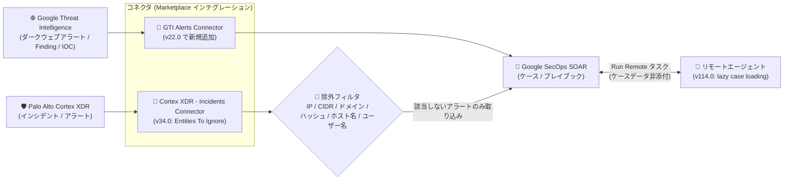

# Google SecOps Marketplace: インテグレーション更新 (Google Threat Intelligence v22.0 / Siemplify v114.0 / Palo Alto Cortex XDR v34.0)

**リリース日**: 2026-10-21

**サービス**: Google SecOps Marketplace

**機能**: インテグレーション更新 (GTI Alerts Connector 追加、lazy case loading 対応、Entities To Ignore パラメータ追加)

**ステータス**: Feature / Changed

📊 [このアップデートのインフォグラフィックを見る](https://takech9203.github.io/google-cloud-news-summary/20261021-google-secops-marketplace-integration-updates.html)

## 概要

Google SecOps Marketplace のレスポンスインテグレーションに 3 件の更新が公開されました。対象は Google Threat Intelligence (v22.0)、Siemplify (v114.0)、Palo Alto Cortex XDR (v34.0) の 3 つのインテグレーションです。

Google Threat Intelligence v22.0 では、新コネクタ「Google Threat Intelligence - GTI Alerts Connector」が追加されました。このコネクタは、Google Threat Intelligence からダークウェブインテリジェンス (DWI) アラート、Finding、ドキュメント、関連エンティティを取得し、Google SecOps へのアラート取り込みとトリアージを自動化します。あわせて、Submit File アクションにおけるコメント取得時のプライベートサブミッションの扱いが改善されました。

Siemplify v114.0 では、Run Remote アクションにおいて lazy case loading (遅延ケース読み込み) がサポートされ、プラットフォーム側で有効化されている場合、ケースデータがリモートエージェントのタスクに添付されなくなりました。Palo Alto Cortex XDR v34.0 では、Palo Alto Cortex XDR - Incidents Connector に「Entities To Ignore」パラメータが追加され、指定した IP アドレス、CIDR 範囲、ドメイン、ファイルハッシュ、ホスト名、ユーザー名を含むアラートを取り込み対象から除外できるようになりました。SOC チームや MSSP で Google SecOps SOAR を運用している組織に関係するアップデートです。

**アップデート前の課題**

- Google Threat Intelligence のダークウェブインテリジェンスアラートを Google SecOps に取り込む専用コネクタが提供されていなかった
- Siemplify インテグレーションの Run Remote アクションでは、ケースデータがリモートエージェントのタスクに添付されていた
- Palo Alto Cortex XDR - Incidents Connector には、特定のエンティティ (IP アドレスやホスト名など) を含むアラートを取り込みから除外する手段がなかった

**アップデート後の改善**

- GTI Alerts Connector により、ダークウェブインテリジェンスアラートと関連 IOC の Google SecOps への自動取り込み・トリアージが可能になった
- lazy case loading がプラットフォームで有効な場合、Run Remote アクションのリモートエージェントタスクにケースデータが添付されなくなった
- Entities To Ignore パラメータにより、指定エンティティを含む Cortex XDR のアラート/インシデントを取り込み前に除外できるようになり、ノイズ削減が可能になった

## アーキテクチャ図



アラートソース (Google Threat Intelligence、Palo Alto Cortex XDR) から各コネクタを経由して Google SecOps SOAR にアラートが取り込まれるフローです。Cortex XDR 側は Entities To Ignore による取り込み前フィルタリング、SOAR とリモートエージェント間は lazy case loading による軽量化が今回の更新ポイントです。

## サービスアップデートの詳細

### 主要機能

1. **Google Threat Intelligence v22.0: GTI Alerts Connector の追加 (Feature)**
   - Google Threat Intelligence からダークウェブインテリジェンス (DWI) アラート、Finding、ドキュメント、関連エンティティを取得する新コネクタ
   - 取り込んだアラートごとに、メインアラート、関連 Finding、ダークウェブドキュメント、複数値の IOC を個別の Google SecOps イベントにマッピングし、自動調査・対応につなげる
   - ダイナミックリストで `detailType` 値 (例: `data_leak`、`insider_threat`、`initial_access_broker`、`target_technology`) をフィルタリング可能

2. **Google Threat Intelligence v22.0: Submit File アクションの改善 (Changed)**
   - コメント取得 (Retrieve Comments) 時のプライベートサブミッションの扱いが改善された
   - Submit File アクションはファイルを送信して解析結果を返すアクションで、Private Submission パラメータによる非公開モードでの送信に対応している (プライベート送信には VirusTotal Premium API が必要)

3. **Siemplify v114.0: Run Remote アクションの lazy case loading 対応 (Changed)**
   - プラットフォーム側で lazy case loading が有効化されている場合、ケースデータがリモートエージェントのタスクに添付されなくなった
   - リモートエージェントは Publisher (マネージドプロキシ) を介して Google SecOps からタスクを取得・実行する仕組みであり、本変更は Run Remote アクションのタスクペイロードに関するもの

4. **Palo Alto Cortex XDR v34.0: Entities To Ignore パラメータの追加 (Changed)**
   - Palo Alto Cortex XDR - Incidents Connector に追加された任意パラメータ
   - 取り込みから除外するエンティティ (IP アドレス、CIDR 範囲、ドメイン、ファイルハッシュ、ホスト名、ユーザー名) をカンマ区切りで指定
   - インシデントまたはアラートに指定エンティティが含まれる場合、そのアラートは取り込まれない。CIDR 表記による IP 範囲指定をサポート

## 技術仕様

### GTI Alerts Connector の主なパラメータ

| パラメータ | 説明 |
|------|------|
| API Root | 必須。Google Threat Intelligence インスタンスの API ルート (Google Cloud プロジェクトパスを含む形式も可)。デフォルトは `https://threatintelligence.googleapis.com` |
| API Key | 必須。Google Threat Intelligence の API キー |
| Lowest Severity To Fetch | 任意。取得するアラートの最低重大度 (Critical / High / Medium / Low / Informational)。未設定時は全重大度を取り込み |
| Alert Type Filter | 任意。取得するダークウェブアラートの `detailType` のカンマ区切りリスト (例: `data_leak`、`insider_threat`、`initial_access_broker`、`target_technology`) |
| Max Hours Backwards | 必須。初回実行時に何時間前までさかのぼってアラートを取得するか。デフォルトは 1 |
| Max Alerts To Fetch | 必須。1 回のイテレーションで処理する最大アラート数。最大 100、デフォルト 25 |
| Verify SSL | 必須。SSL 証明書を検証するか。デフォルトで有効 |
| Proxy Server Address / Username / Password | 任意。プロキシ経由の接続をサポート |

### Palo Alto Cortex XDR - Incidents Connector: Entities To Ignore

| 項目 | 詳細 |
|------|------|
| パラメータ名 | Entities To Ignore (任意) |
| 指定形式 | カンマ区切りリスト |
| 指定可能なエンティティ | IP アドレス、CIDR 範囲、ドメイン、ファイルハッシュ、ホスト名、ユーザー名 |
| 動作 | 指定エンティティを含むインシデント/アラートは取り込まれない |
| 補足 | IP 範囲の CIDR 表記をサポート |

### リモートエージェントのタスク実行フロー (Run Remote 関連)

| コンポーネント | 役割 |
|------|------|
| Google SecOps | タスクを発行し、最終結果を取得する。リモートエージェントと直接通信しない |
| Publisher | Google SecOps が管理するセキュアな中継サービス。暗号化された実行データやメタデータを一時保存。TLS (ポート 443) で通信 |
| リモートエージェント | リモート環境に配置され、Publisher にタスクをポーリングして実行し、結果を返す |

Siemplify v114.0 の変更により、プラットフォームで lazy case loading が有効な場合、Run Remote アクションのタスクにケースデータが添付されなくなります。

## 設定方法

### 前提条件

1. Google SecOps SOAR 環境で対象インテグレーション (Google Threat Intelligence / Siemplify / Palo Alto Cortex XDR) を Content Hub から構成していること
2. GTI Alerts Connector を使用する場合は Google Threat Intelligence の API キーが必要
3. リモート実行を行う場合は、リモートエージェントをデプロイし、インテグレーションで「Run Remotely」を有効化していること

### 手順

#### ステップ 1: コネクタの作成 (GTI Alerts Connector / Cortex XDR Incidents Connector)

```text
SOAR Settings > Ingestion > Connectors > Create New Connector
```

対象のコネクタを選択し、API Root や API キーなどの必須パラメータを設定します。Cortex XDR - Incidents Connector では、必要に応じて Entities To Ignore に除外対象のエンティティをカンマ区切りで指定します。

#### ステップ 2: リモート実行の構成 (Run Remote を使用する場合)

```text
Content Hub > 対象インテグレーション > Configure Integration > Run Remotely を選択 > Save
```

リモートコネクタを使用する場合は、コネクタ作成時に「Remote Connector」を選択し、対象環境とリモートエージェントを割り当てます。

## メリット

### ビジネス面

- **脅威インテリジェンスの運用自動化**: GTI Alerts Connector により、ダークウェブインテリジェンスアラートの取り込みとトリアージを自動化でき、SOC チームの手作業を削減できる
- **アラートノイズの削減**: Entities To Ignore により、既知の除外対象 (テスト用ホストや特定ユーザーなど) を含むアラートを取り込み前に除外でき、アナリストが対応すべきケースに集中できる

### 技術面

- **IOC の自動マッピング**: GTI Alerts Connector はアラート、Finding、ダークウェブドキュメント、複数値 IOC を個別の Google SecOps イベントにマッピングし、プレイブックでの自動調査・対応に利用できる
- **柔軟なフィルタリング**: GTI Alerts Connector は重大度フィルタと `detailType` ベースのダイナミックリストフィルタに対応。Cortex XDR 側は CIDR 表記を含むエンティティ単位の除外に対応
- **リモートエージェントタスクの軽量化**: lazy case loading が有効な場合、Run Remote のタスクにケースデータが添付されない

## デメリット・制約事項

### 制限事項

- GTI Alerts Connector の 1 イテレーションあたりの最大取得アラート数は 100 (デフォルト 25)
- Submit File アクションでファイルをプライベート送信するには VirusTotal Premium API が必要
- Siemplify v114.0 の lazy case loading は、プラットフォーム側で有効化されている場合に適用される

### 考慮すべき点

- Entities To Ignore は指定エンティティを含むアラートを「取り込まない」動作のため、除外リストの設定ミスにより必要なアラートが欠落しないよう運用ルールを整備する必要がある
- 新コネクタ・新パラメータを利用するには、対象インテグレーションを最新バージョン (GTI v22.0 / Siemplify v114.0 / Cortex XDR v34.0) に更新する必要がある

## ユースケース

### ユースケース 1: ダークウェブ上の情報漏洩アラートの自動トリアージ

**シナリオ**: SOC チームが Google Threat Intelligence のダークウェブインテリジェンスで自社に関するデータ漏洩 (data_leak) やイニシャルアクセスブローカー (initial_access_broker) のアラートを監視しており、これらを Google SecOps のケースとして自動起票したい。

**実装例**:
```text
GTI Alerts Connector の設定例:
- Alert Type Filter: data_leak, initial_access_broker
- Lowest Severity To Fetch: Medium
- Max Alerts To Fetch: 25 (デフォルト)
```

**効果**: 該当タイプのアラートが関連 Finding・ドキュメント・IOC とともに個別イベントとして Google SecOps に取り込まれ、プレイブックによる自動調査・対応につなげられる。

### ユースケース 2: Cortex XDR アラートからの既知エンティティ除外

**シナリオ**: Cortex XDR から Google SecOps にインシデントを取り込んでいるが、脆弱性スキャナーの IP レンジや特定のサービスアカウントに起因するアラートが大量に発生し、ノイズになっている。

**実装例**:
```text
Palo Alto Cortex XDR - Incidents Connector の設定例:
- Entities To Ignore: 10.10.0.0/24, scanner01.example.com, svc-scan-user
```

**効果**: 指定した CIDR 範囲・ホスト名・ユーザー名を含むアラートが取り込み前に除外され、アナリストが対応すべきケースのみが SOAR に起票される。

## 料金

Marketplace インテグレーション自体の更新に伴う追加料金の記載はリリースノートにありません。Google SecOps の料金は公式ページを参照してください。

- [Google SecOps の料金](https://cloud.google.com/chronicle/docs/preview/sku-overview)

## 関連サービス・機能

- **Google Threat Intelligence**: 本アップデートで GTI Alerts Connector が追加されたインテリジェンスソース。ダークウェブインテリジェンスや Livehunt、ASM、DTM 向けのコネクタも提供されている
- **Google SecOps SOAR リモートエージェント**: Run Remote アクションの実行基盤。Publisher を介した TLS 通信でタスクを取得・実行する
- **Palo Alto Cortex XDR - Sync Incidents ジョブ**: Google SecOps と Cortex XDR の間でインシデントのステータス・コメント・担当者を双方向同期するジョブ

## 参考リンク

- 📊 [インフォグラフィック](https://takech9203.github.io/google-cloud-news-summary/20261021-google-secops-marketplace-integration-updates.html)
- [公式リリースノート (Google Cloud Release Notes)](https://docs.cloud.google.com/release-notes#October_21_2026)
- [Google SecOps Response Integrations リリースノート](https://docs.cloud.google.com/chronicle/docs/soar/marketplace-integrations/release-notes)
- [Google Threat Intelligence インテグレーション](https://docs.cloud.google.com/chronicle/docs/soar/marketplace-integrations/google-threat-intelligence)
- [Siemplify インテグレーション](https://docs.cloud.google.com/chronicle/docs/soar/marketplace-integrations/siemplify)
- [Palo Alto Cortex XDR インテグレーション](https://docs.cloud.google.com/chronicle/docs/soar/marketplace-integrations/palo-alto-cortex-xdr)
- [リモートエージェントの概要](https://docs.cloud.google.com/chronicle/docs/soar/working-with-remote-agents/what-is-a-remote-agent)

## まとめ

Google SecOps Marketplace の 3 インテグレーションが更新され、特に GTI Alerts Connector の追加により、ダークウェブインテリジェンスアラートの Google SecOps への自動取り込みが可能になりました。Cortex XDR 連携のノイズ削減 (Entities To Ignore) やリモートエージェントタスクの軽量化 (lazy case loading) も運用改善に直結するため、該当インテグレーションを利用中の場合は最新バージョンへの更新と設定見直しを推奨します。

---

**タグ**: Google SecOps, SOAR, Marketplace, Google Threat Intelligence, Siemplify, Palo Alto Cortex XDR, コネクタ, セキュリティ
