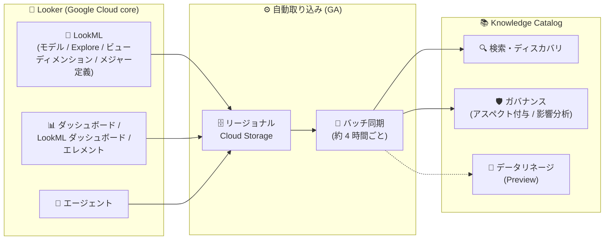

# Looker (Google Cloud core): Knowledge Catalog によるメタデータの自動カタログ化・取り込みが GA

**リリース日**: 2026-10-21

**サービス**: Looker (Google Cloud core)

**機能**: Knowledge Catalog によるメタデータの自動カタログ化・取り込み

**ステータス**: 一般提供 (GA) ※データリネージ統合は引き続き Preview

📊 [このアップデートのインフォグラフィックを見る](https://takech9203.github.io/google-cloud-news-summary/20261021-looker-knowledge-catalog-ga.html)

## 概要

Looker (Google Cloud core) のメタデータを Knowledge Catalog (旧 Dataplex Catalog) に自動的にカタログ化・取り込みする機能が一般提供 (GA) になりました。この統合により、本番環境の LookML、LookML プロジェクト、ダッシュボードのメタデータを Knowledge Catalog 上でインデックス化・保存・管理でき、組織全体のデータ資産とその関係性を単一のビューで把握できます。

今回の GA では、より詳細な粒度のメタデータ (ディメンション / メジャーの定義、デフォルトクエリ、リレーションシップ) のサポートが追加されたほか、新しいアセットタイプとして LookML ダッシュボード、LookML ダッシュボードエレメント、エージェントが追加されました。BI 環境のメタデータをデータカタログに統合することで、データディスカバリ、影響分析、変更管理をデータガバナンス基盤上で一元的に行えるようになります。

なお、BigQuery から Looker ダッシュボードまでのデータフローを可視化するデータリネージ統合は、引き続き Preview として提供されます。

**アップデート前の課題**

- 本機能は Preview (Pre-GA) として提供されており、Pre-GA 提供条件の下で「現状のまま」の提供かつ限定的なサポートであったため、本番ワークロードでの採用判断が難しかった
- 取り込まれるメタデータの粒度が限られており、ディメンション / メジャーの定義、デフォルトクエリ、リレーションシップといった詳細なメタデータは対象外だった
- LookML ダッシュボード、LookML ダッシュボードエレメント、エージェントはカタログ化の対象アセットタイプに含まれていなかった

**アップデート後の改善**

- メタデータの自動カタログ化・取り込みが GA となり、本番環境のデータガバナンス基盤として安心して利用できるようになった
- ディメンション / メジャーの定義、デフォルトクエリ、リレーションシップなど、より詳細な粒度のメタデータが Knowledge Catalog で検索・参照可能になった
- LookML ダッシュボード、LookML ダッシュボードエレメント、エージェントの 3 つのアセットタイプが新たにカタログ化の対象になり、Looker 資産のカバレッジが拡大した

## アーキテクチャ図



Looker (Google Cloud core) がファーストパーティコネクタ経由で LookML・ダッシュボード・エージェントのメタデータをリージョナル Cloud Storage に発行し、バッチ同期プロセスで Knowledge Catalog に取り込まれます。取り込まれたメタデータは検索・ガバナンス・影響分析に活用でき、データリネージは Preview として提供されます。

## サービスアップデートの詳細

### 主要機能

1. **メタデータの自動カタログ化・取り込み (GA)**
   - Looker (Google Cloud core) インスタンスでデフォルトで有効。設定変更なしでメタデータが自動的に Knowledge Catalog へ取り込まれる
   - LookML モデルを本番環境に push すると、ビュー / Explore の詳細、フィールド定義、モデル情報が自動同期される
   - ダッシュボードのタイトル、所有者、使用統計などのメタデータもカタログに反映される
   - 内部バッチ同期プロセスは約 4 時間ごとに実行され、Looker からのデータはおよそ 1 時間ごとに Knowledge Catalog へ反映される

2. **より詳細な粒度のメタデータのサポート (今回追加)**
   - ディメンション / メジャーの定義
   - デフォルトクエリ
   - リレーションシップ (アセット間の関係性)

3. **新しいアセットタイプ (今回追加)**
   - LookML ダッシュボード
   - LookML ダッシュボードエレメント
   - エージェント
   - 既存の対象アセット (Looker インスタンス、ダッシュボード、ダッシュボードエレメント、Look、LookML プロジェクト、モデル、Explore、ビュー) に加えて拡充された

4. **Knowledge Catalog での検索・キュレーション**
   - Knowledge Catalog の検索ページで、System フィルタ (`Looker`) や Type エイリアスを使ってアセットを絞り込み可能
   - `system=Looker AND type=DASHBOARD` のようなキーワード検索や自然言語検索に対応
   - アスペクト (ビジネスメタデータ) を Looker アセットに付与し、ビジネス観点での検索・キュレーションが可能

5. **データリネージ統合 (引き続き Preview)**
   - BigQuery → LookML ビュー / Explore → ダッシュボード / Look という end-to-end のデータフローを可視化
   - スキーマ変更前の下流影響分析や、経営ダッシュボードの指標の上流監査に活用可能

## 技術仕様

### 統合の仕組み

| 項目 | 詳細 |
|------|------|
| コネクタ | ファーストパーティコネクタによるメタデータ取り込み |
| 転送方式 | Looker がリージョナル Cloud Storage リポジトリにメタデータを発行し、バッチ同期で Knowledge Catalog が取り込み |
| 同期間隔 | バッチ同期は約 4 時間ごと、Knowledge Catalog への反映は約 1 時間ごと |
| デフォルト状態 | Looker (Google Cloud core) インスタンスで有効 (オプトアウト可能) |
| 必要な API | Dataplex API (`dataplex.googleapis.com`) |
| VPC Service Controls | サポート (サービス境界内では Dataplex API と内部 Cloud Storage へのアクセス許可が必要) |
| 対象外 | Looker (original) インスタンスは Knowledge Catalog と統合されない |

### 必要な IAM ロール

| ロール | 用途 |
|--------|------|
| `roles/dataplex.viewer` | Knowledge Catalog リソースの閲覧 |
| `roles/looker.schemaViewer` | Knowledge Catalog 上の Looker メタデータへのアクセス (プロジェクトレベルで付与、gcloud CLI でのみ付与可能) |
| `roles/looker.admin` | 統合の有効化 / 無効化 |
| `roles/datalineage.viewer` | データリネージグラフの閲覧 (Preview) |

## 設定方法

### 前提条件

1. Looker (Google Cloud core) インスタンスをホストする Google Cloud プロジェクトで Dataplex API (`dataplex.googleapis.com`) が有効であること
2. 閲覧ユーザーに `roles/dataplex.viewer` と `roles/looker.schemaViewer` が付与されていること

### 手順

#### ステップ 1: 統合の状態確認・有効化

統合はデフォルトで有効です。無効化されている場合は、以下のコマンドで有効化します。

```bash
gcloud looker instances update INSTANCE_NAME --catalog-integration-enabled
```

有効化後、Looker データが Knowledge Catalog で利用可能になるまで最大 1 日かかります。無効化する場合は `--no-catalog-integration-enabled` フラグを使用します (無効化後も既存メタデータはカタログに残りますが、更新は停止します)。

#### ステップ 2: メタデータ閲覧用ロールの付与

```bash
gcloud projects add-iam-policy-binding YOUR_PROJECT_ID \
  --member=PRINCIPAL_TYPE:PRINCIPAL_ID \
  --role=roles/looker.schemaViewer
```

`roles/looker.schemaViewer` はプロジェクトレベルで付与する必要があり、付与されたユーザーは統合が有効なプロジェクト内のすべての Looker (Google Cloud core) インスタンスのメタデータを閲覧できる点に注意してください。

#### ステップ 3: Knowledge Catalog で検索

Google Cloud コンソールの Knowledge Catalog の検索ページで、Filters パネルの System セクションから `Looker` を選択するか、検索フィールドにクエリを入力します。

```text
system=Looker AND type=DASHBOARD
```

## メリット

### ビジネス面

- **データディスカバリの向上**: 組織全体のダッシュボード、Explore、ビューを横断検索でき、既存のデータ資産の再利用が促進される
- **ガバナンスの一元化**: BigQuery などのデータ資産と Looker の BI 資産を同じカタログで管理でき、アスペクトによるビジネスメタデータの付与・検索が可能
- **GA による本番採用の安心感**: Pre-GA 提供条件から GA に昇格したことで、エンタープライズのデータガバナンス基盤として本番採用しやすくなった

### 技術面

- **設定不要の自動同期**: デフォルトで有効であり、LookML の本番 push に追随してメタデータが自動的にカタログへ同期される
- **詳細メタデータによる理解促進**: ディメンション / メジャーの定義やリレーションシップまでカタログで確認でき、セマンティックレイヤーの理解や変更管理が容易になる
- **影響分析**: データリネージ (Preview) と組み合わせることで、BigQuery のスキーマ変更が影響するダッシュボードを事前に特定できる

## デメリット・制約事項

### 制限事項

- Looker のメタデータはカタログに即時反映されない (バッチ同期は一定間隔で実行され、データ更新は約 1 時間ごと)
- この統合用のパブリック API は公開されていない
- データリネージ統合は引き続き Preview であり、以下の制限がある
  - リネージは BigQuery データソースのみサポート
  - オブジェクトレベル (テーブル、ビュー、Explore、ダッシュボード) のリネージのみで、カラムレベルのリネージは未サポート
  - リネージの同期には通常 4 時間、最大 8 時間程度かかる
  - 複雑なカスタム SQL (Liquid テンプレート、複雑な JOIN を含む派生テーブルなど) を使う LookML は完全にパースされず、ノードが分断される場合がある

### 考慮すべき点

- `roles/looker.schemaViewer` はプロジェクトレベルで付与する必要があり、付与されたユーザーはプロジェクト内の統合が有効な全インスタンスのメタデータを閲覧できる
- リネージでは LookML 内の SQL テーブル参照の大文字・小文字が BigQuery テーブルと厳密に一致している必要がある (不一致だと下流リネージが表示されない)
- VPC Service Controls を利用している場合は、Dataplex API を制限付きサービスとして構成し、メタデータ転送に使用される内部 Cloud Storage リソースへのアクセスを許可する必要がある

## ユースケース

### ユースケース 1: スキーマ変更前の影響分析

**シナリオ**: データエンジニアが BigQuery テーブルのカラム削除を計画しており、どの Looker ダッシュボードに影響するか事前に確認したい。

**実装例**:
```text
1. Knowledge Catalog で対象の BigQuery テーブルを検索
2. Lineage タブでリネージグラフを開く (Preview)
3. 下流の LookML ビュー → Explore → ダッシュボードを特定
4. ノードの Aspects セクションで所有者 (メールアドレス) を確認し、事前に連絡
```

**効果**: ダッシュボードの破損を未然に防ぎ、変更管理プロセスを安全に実施できる。

### ユースケース 2: 組織横断の BI 資産ディスカバリ

**シナリオ**: データアナリストが新しい分析を始める前に、既存のダッシュボードやディメンション / メジャーの定義を調べて重複開発を避けたい。

**効果**: `system=Looker` の検索でダッシュボードや Explore を横断的に発見でき、GA で追加されたディメンション / メジャー定義により指標の意味をカタログ上で直接確認できる。

## 料金

- Looker (Google Cloud core) のテクニカルメタデータを Knowledge Catalog に保存すること自体には料金はかかりません
- API 呼び出しや追加のビジネスメタデータによるエンリッチメントには、標準の Knowledge Catalog 料金が適用されます
- データリネージ (Preview) は Preview 期間中は無料ですが、GA 時には課金が発生する予定です。将来の課金影響を避けるため、リネージの Preview リリース時点で Data Lineage API が有効かつ Looker (Google Cloud core) インスタンスをホストしていたプロジェクトでは、Looker のリネージ取り込みがデフォルトで無効になっています

詳細は [Knowledge Catalog の料金ページ](https://cloud.google.com/dataplex/pricing)を参照してください。

## 関連サービス・機能

- **Knowledge Catalog (Dataplex Universal Catalog)**: Looker メタデータの取り込み先。検索、アスペクトによるメタデータエンリッチメント、ガバナンス機能を提供
- **BigQuery**: データリネージ (Preview) で上流データソースとして可視化される。BigQuery テーブルから Looker ダッシュボードまでのデータフローを追跡可能
- **Cloud Storage**: メタデータ転送の内部経路として利用 (リージョナルリポジトリ経由のバッチ同期)
- **Data Lineage API**: リネージ機能の利用に必要 (`datalineage.googleapis.com`、Preview)
- **VPC Service Controls**: サービス境界内での統合をサポート

## 参考リンク

- 📊 [インフォグラフィック](https://takech9203.github.io/google-cloud-news-summary/20261021-looker-knowledge-catalog-ga.html)
- [公式リリースノート](https://docs.cloud.google.com/release-notes#October_21_2026)
- [ドキュメント: Knowledge Catalog によるメタデータリソースの管理](https://docs.cloud.google.com/looker/docs/looker-core-dataplex)
- [ドキュメント: Knowledge Catalog によるデータリネージの追跡 (Preview)](https://docs.cloud.google.com/looker/docs/looker-core-lineage)
- [料金ページ](https://cloud.google.com/dataplex/pricing)

## まとめ

Looker (Google Cloud core) のメタデータ自動カタログ化が GA となり、ディメンション / メジャー定義などの詳細メタデータと LookML ダッシュボード・エージェントを含む新アセットタイプが加わったことで、BI レイヤーまで含めたデータガバナンスを Knowledge Catalog 上で実現できるようになりました。Looker (Google Cloud core) を利用中の組織は、統合がデフォルトで有効である点と `roles/looker.schemaViewer` の権限設計を確認した上で、カタログ検索と (Preview の) リネージによる影響分析の活用を検討することを推奨します。

---

**タグ**: Looker, Knowledge Catalog, Dataplex, メタデータ管理, データガバナンス, データリネージ, GA
