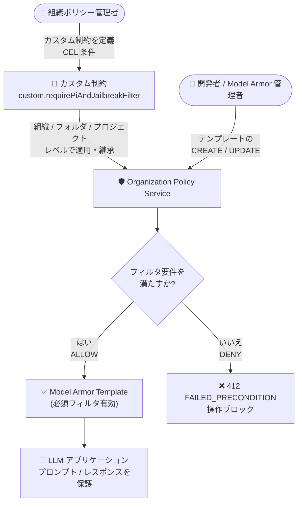

# Model Armor: Template リソースに対するカスタム組織ポリシーが GA

**リリース日**: 2026-10-21

**サービス**: Model Armor

**機能**: Model Armor Template リソースに対するカスタム組織ポリシー (カスタム制約)

**ステータス**: GA (一般提供)

📊 [このアップデートのインフォグラフィックを見る](https://takech9203.github.io/google-cloud-news-summary/20261021-model-armor-custom-org-policies.html)

## 概要

Model Armor の Template リソース (`modelarmor.googleapis.com/Template`) に対して、Organization Policy Service のカスタム制約 (custom constraints) を使用できる機能が一般提供 (GA) になりました。これにより、組織内で新規作成または更新されるすべての Model Armor テンプレートに対して、責任ある AI (Responsible AI) フィルタやプロンプトインジェクション・ジェイルブレイク検出などの必須フィルタの有効化を、組織ポリシーとして強制できるようになります。

Model Armor は、LLM アプリケーションのプロンプトとレスポンスをスクリーニングし、プロンプトインジェクション、ジェイルブレイク、有害コンテンツ、機密データ漏えい、悪意のある URI などのリスクから保護するサービスです。フィルタの構成はテンプレートとして定義しますが、今回のアップデートにより、組織ポリシー管理者が CEL (Common Expression Language) で記述した条件をテンプレートの作成・更新操作に適用し、組織・フォルダ・プロジェクトの各レベルでガバナンスを一元的に効かせられるようになりました。

AI アプリケーションを全社展開する企業のセキュリティ管理者やプラットフォームチームにとって、個々の開発チームがテンプレートの必須フィルタを無効化してしまうリスクを、リソース階層全体で予防的に排除できる重要なアップデートです。

**アップデート前の課題**

- テンプレートのフィルタ構成は各プロジェクトの Model Armor 管理者に委ねられており、必須フィルタ (プロンプトインジェクション検出など) が無効なテンプレートの作成を組織レベルで予防的にブロックする仕組みがなかった
- フロア設定 (floor settings) は最低基準の定義と違反検出 (Security Command Center Premium / Enterprise での検出結果生成) には対応するが、組織ポリシーの標準的な仕組み (カスタム制約 + CEL) を使った、フィールド単位の細かい条件でのきめ細かな制御は別途必要だった
- コンプライアンス要件 (責任ある AI、機密データ保護) をテンプレート構成に落とし込むルールを、プログラマブルかつ一元的に強制する手段が限られていた

**アップデート後の改善**

- `modelarmor.googleapis.com/Template` リソースの CREATE / UPDATE 操作に対し、CEL 条件によるカスタム制約を GA 品質で適用できるようになった
- 責任ある AI フィルタ (ヘイトスピーチ、ハラスメント検出など)、Sensitive Data Protection 設定、プロンプトインジェクション・ジェイルブレイクフィルタの有効化を、組織・フォルダ・プロジェクトレベルで強制できるようになった
- ポリシーはリソース階層の子孫に継承されるため、組織全体への一括適用と、特定フォルダ・プロジェクトへの限定適用を柔軟に使い分けられるようになった

## アーキテクチャ図



組織ポリシー管理者が定義したカスタム制約が Organization Policy Service によってリソース階層全体に適用され、必須フィルタを満たさない Model Armor テンプレートの作成・更新が API レベルでブロックされます。

## サービスアップデートの詳細

### 主要機能

1. **Model Armor Template リソースへのカスタム制約 (GA)**
   - 対象リソースタイプ: `modelarmor.googleapis.com/Template`
   - 対象メソッド: `CREATE` および `UPDATE`
   - テンプレートの `filterConfig` フィールドを CEL 条件で評価し、`ALLOW` / `DENY` のアクションを指定可能

2. **必須フィルタの強制**
   - **責任ある AI**: ヘイトスピーチやハラスメント検出など、特定の Responsible AI フィルタの有効化を必須にできる
   - **機密データ保護**: Sensitive Data Protection の設定や匿名化 (de-identification) テンプレートの適用を必須にできる
   - **プロンプトインジェクション対策**: プロンプトインジェクション・ジェイルブレイクフィルタの有効化を必須にできる

3. **リソース階層への適用と継承**
   - 組織・フォルダ・プロジェクトの各レベルでポリシーを適用可能
   - デフォルトでポリシーは子孫リソースに継承される (階層評価ルールで変更可能)

4. **ポリシー違反時の動作**
   - 制約に違反する操作は拒否され、HTTP 412 (`FAILED_PRECONDITION`) エラーと制約の説明文が返される
   - `UPDATE` メソッドに制約を適用した場合、違反状態のリソースへの変更は、違反を解消する変更でない限りブロックされる

## 技術仕様

### カスタム制約の仕様

| 項目 | 詳細 |
|------|------|
| 対象リソースタイプ | `modelarmor.googleapis.com/Template` |
| 対象メソッド | `CREATE`、`UPDATE` |
| 条件記述言語 | CEL (Common Expression Language)、最大 1,000 文字 |
| アクション | `ALLOW` (条件を満たす場合のみ許可) / `DENY` (条件を満たす場合に拒否) |
| 制約 ID | `custom.` プレフィックス + 最大 70 文字 (英数字) |
| 制約数の上限 | ほとんどのリソースタイプで最大 20 個のカスタム制約 |
| ポリシー反映時間 | 適用後、強制開始まで約 2 分 |
| 適用レベル | 組織 / フォルダ / プロジェクト (子孫に継承) |

### 必要な IAM ロール

| 操作 | ロール | 付与先 |
|------|--------|--------|
| 組織ポリシーの管理 | Organization Policy Administrator (`roles/orgpolicy.policyAdmin`) | 組織リソース |
| テンプレートの作成・更新 (動作確認) | Model Armor Admin (`roles/modelarmor.admin`) | プロジェクトリソース |

### カスタム制約の定義例 (プロンプトインジェクション・ジェイルブレイクフィルタの必須化)

```yaml
name: organizations/ORGANIZATION_ID/customConstraints/custom.requirePiAndJailbreakFilter
resourceTypes:
- modelarmor.googleapis.com/Template
methodTypes:
- CREATE
- UPDATE
condition: "has(resource.filterConfig.piAndJailbreakFilterSettings.filterEnforcement) && resource.filterConfig.piAndJailbreakFilterSettings.filterEnforcement == 'ENABLED'"
actionType: ALLOW
displayName: Require prompt injection and jailbreak filter
description: All templates must have the prompt injection and jailbreak filter enabled.
```

公式ドキュメントでは、このほかにヘイトスピーチフィルタの必須化 (`resource.filterConfig.raiSettings.raiFilters.exists(f, f.filterType == 'HATE_SPEECH')`) や、Sensitive Data Protection 基本フィルタの必須化 (`resource.filterConfig.sdpSettings.basicConfig.filterEnforcement == 'ENABLED'`) の例が提供されています。

## 設定方法

### 前提条件

1. 組織 ID およびプロジェクト ID を確認していること
2. 組織リソースに対する `roles/orgpolicy.policyAdmin` が付与されていること
3. 動作確認用に、プロジェクトに対する `roles/modelarmor.admin` が付与されていること

### 手順

#### ステップ 1: カスタム制約を作成する

```bash
# constraint-require-pi-filter.yaml (前述の YAML) を保存した上で実行
gcloud org-policies set-custom-constraint constraint-require-pi-filter.yaml

# 制約が作成されたことを確認
gcloud org-policies list-custom-constraints --organization=ORGANIZATION_ID
```

組織レベルでカスタム制約を登録します。登録した制約は組織内の組織ポリシーで利用可能になります。

#### ステップ 2: 組織ポリシーを適用する

```yaml
# policy-require-pi-filter.yaml
name: projects/PROJECT_ID/policies/custom.requirePiAndJailbreakFilter
spec:
  rules:
  - enforce: true
```

```bash
gcloud org-policies set-policy policy-require-pi-filter.yaml

# ポリシーが適用されたことを確認
gcloud org-policies list --project=PROJECT_ID
```

この例ではプロジェクトレベルで適用していますが、組織・フォルダレベルでも適用できます。適用後、強制が開始されるまで約 2 分かかります。

#### ステップ 3: ポリシーをテストする

```bash
# プロンプトインジェクションフィルタを無効にしたテンプレート作成を試行
curl -X POST \
  -H "Authorization: Bearer $(gcloud auth print-access-token)" \
  -H "Content-Type: application/json" \
  -d '{
    "filterConfig": {
      "piAndJailbreakFilterSettings": {
        "filterEnforcement": "DISABLED"
      }
    }
  }' \
  "https://modelarmor.LOCATION.rep.googleapis.com/v1/projects/PROJECT_ID/locations/LOCATION/templates?templateId=TEMPLATE_ID"
```

違反する操作は以下のように拒否されます。

```json
{
  "error": {
    "code": 412,
    "message": "Operation denied by custom org policies: [\"customConstraints/custom.requirePiAndJailbreakFilter\": \"All templates must have the prompt injection and jailbreak filter enabled.\"]",
    "status": "FAILED_PRECONDITION"
  }
}
```

## メリット

### ビジネス面

- **コンプライアンスの担保**: 責任ある AI や機密データ保護の要件を、組織全体のテンプレートに対して予防的 (preventative) に強制でき、監査対応やガバナンス説明が容易になる
- **ガバナンスの一元化**: セキュリティチームが定義したルールをリソース階層全体に継承させることで、プロジェクトごとの設定ばらつきを排除できる

### 技術面

- **きめ細かな制御**: CEL により `filterConfig` の特定フィールド (フィルタ種別、有効化状態など) を条件にした柔軟なルールを定義できる
- **予防的な強制**: 違反するテンプレートは作成・更新の時点で API レベルでブロックされるため、事後検出・修正の手間が減る
- **既存の組織ポリシー運用との統合**: 他の Google Cloud サービスと同じ Organization Policy Service の仕組み (gcloud / コンソール) で管理できる

## デメリット・制約事項

### 制限事項

- CEL 条件は最大 1,000 文字、制約 ID は `custom.` プレフィックスを除き最大 70 文字、説明は最大 2,000 文字
- ほとんどのリソースタイプでカスタム制約は最大 20 個まで。超過して作成しようとすると失敗する
- ポリシー適用後、強制開始まで約 2 分のタイムラグがある

### 考慮すべき点

- `UPDATE` メソッドに制約を適用すると、既存の違反テンプレートは違反を解消する変更以外がブロックされるため、適用前に既存テンプレートの棚卸しが推奨される
- 制約の表示名・説明・ID はエラーメッセージに露出するため、PII や機密情報を含めないこと
- `ALLOW` アクションは条件に明示した場合以外をすべてブロックするため、条件設計は慎重に行う必要がある

## ユースケース

### ユースケース 1: 全社の LLM アプリにプロンプトインジェクション対策を必須化

**シナリオ**: 複数の開発チームが Vertex AI 上で LLM アプリケーションを開発しており、各チームが Model Armor テンプレートを個別に管理している。セキュリティチームは、すべてのテンプレートでプロンプトインジェクション・ジェイルブレイクフィルタを必ず有効にしたい。

**実装例**:
```yaml
condition: "has(resource.filterConfig.piAndJailbreakFilterSettings.filterEnforcement) && resource.filterConfig.piAndJailbreakFilterSettings.filterEnforcement == 'ENABLED'"
actionType: ALLOW
```

**効果**: フィルタを無効化したテンプレートの作成・更新が組織全体で自動的にブロックされ、ガードレールの抜け漏れを防止できる。

### ユースケース 2: 責任ある AI 要件 (ヘイトスピーチ検出) の全社強制

**シナリオ**: 社内の AI 利用ガイドラインで、顧客向け生成 AI サービスにはヘイトスピーチ検出の適用が義務付けられている。

**実装例**:
```yaml
condition: "has(resource.filterConfig.raiSettings.raiFilters) && resource.filterConfig.raiSettings.raiFilters.exists(f, f.filterType == 'HATE_SPEECH')"
actionType: ALLOW
```

**効果**: ヘイトスピーチフィルタを含まないテンプレートが作成できなくなり、ガイドライン違反を構成段階で予防できる。

### ユースケース 3: 機密データ保護 (Sensitive Data Protection) の必須化

**シナリオ**: 金融・医療など規制業種で、LLM への入出力に含まれる機密データの検出・保護を必須にしたい。

**効果**: Sensitive Data Protection の基本フィルタが有効なテンプレートのみ許可することで、機密データ漏えいリスクを組織レベルで低減できる。

## 料金

Organization Policy Service (事前定義の制約およびカスタム組織ポリシーを含む) は無料で提供されます。Model Armor 自体の利用料金については料金ページを参照してください。

- [Model Armor の料金 (Security Command Center 料金ページ内)](https://cloud.google.com/security-command-center/pricing)

## 関連サービス・機能

- **Organization Policy Service**: カスタム制約の基盤となるサービス。組織リソースに対する一元的・プログラマブルな制御を提供し、組織・フォルダ・プロジェクトの階層でポリシーを継承させる
- **Model Armor フロア設定 (floor settings)**: テンプレートが満たすべき最低基準を組織・フォルダ・プロジェクトレベルで定義する補完機能。フロア設定違反は Security Command Center (Premium / Enterprise ティア) で高重大度の検出結果として生成される
- **Security Command Center**: Model Armor の検出結果 (フロア設定違反など) を集約し、セキュリティ態勢の可視化を提供する
- **Sensitive Data Protection**: カスタム制約で有効化を強制できる機密データ検出・匿名化機能
- **IAM**: `roles/orgpolicy.policyAdmin` と `roles/modelarmor.admin` によるロール分離で、ポリシー管理者とテンプレート管理者の責務を分離できる

## 参考リンク

- 📊 [インフォグラフィック](https://takech9203.github.io/google-cloud-news-summary/20261021-model-armor-custom-org-policies.html)
- [公式リリースノート](https://docs.cloud.google.com/release-notes#October_21_2026)
- [Use custom organization policies (Model Armor)](https://docs.cloud.google.com/model-armor/access-control/custom-constraints)
- [Model Armor の概要](https://docs.cloud.google.com/model-armor/overview)
- [Model Armor テンプレートの作成と管理](https://docs.cloud.google.com/model-armor/manage-templates)
- [Model Armor フロア設定の構成](https://docs.cloud.google.com/model-armor/configure-floor-settings)
- [Organization Policy Service の概要](https://docs.cloud.google.com/organization-policy/overview)
- [料金ページ (Security Command Center)](https://cloud.google.com/security-command-center/pricing)

## まとめ

Model Armor Template へのカスタム組織ポリシーの GA により、LLM アプリケーションのセキュリティガードレールを「推奨」から「強制」へ引き上げる仕組みが整いました。生成 AI を組織横断で展開している場合は、まずプロンプトインジェクション・ジェイルブレイクフィルタの必須化制約から導入し、既存テンプレートの棚卸しと合わせて段階的に責任ある AI・機密データ保護の制約へ拡大することを推奨します。

---

**タグ**: Model Armor, Organization Policy, カスタム制約, GA, セキュリティ, 生成 AI, プロンプトインジェクション, 責任ある AI, ガバナンス
