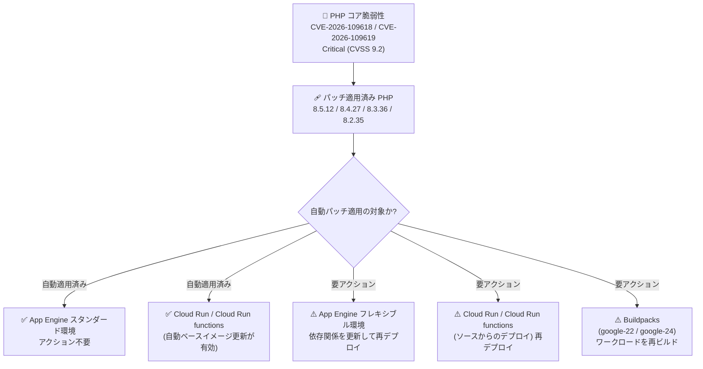

# App Engine / Cloud Run / Buildpacks: PHP ランタイムセキュリティパッチ (CVE-2026-109618 / CVE-2026-109619)

> **⚠️ 訂正 (2026-10-22)**: 本レポートの元となった 2026 年 10 月 21 日の Release Notes 注記 (App Engine スタンダード / フレキシブル環境、Cloud Run、Cloud Run functions) は、公式に「This note is incorrect; follow guidance in the entry for October 22, 2026.」とマークされました。訂正版ガイダンスでは、サポート対象の PHP 8.2 以降はすべてパッチ済みであり、**4 サービスすべてのユーザーが更新された依存関係で直ちに再デプロイする** よう一律に指示されています (「自動適用済みのためアクション不要」の区分はなくなりました)。最新のガイダンスは訂正版レポート [2026-10-22-php-runtime-security-patches-update.md](./2026-10-22-php-runtime-security-patches-update.md) を参照してください。

**リリース日**: 2026-10-21

**サービス**: App Engine (スタンダード環境 / フレキシブル環境), Cloud Run, Cloud Run functions, Buildpacks

**機能**: PHP ランタイムのセキュリティパッチ (PHP 8.5.12 / 8.4.27 / 8.3.36 / 8.2.35)

**ステータス**: セキュリティパッチ提供開始

📊 [このアップデートのインフォグラフィックを見る](https://takech9203.github.io/google-cloud-news-summary/20261021-php-runtime-security-patches.html)

## 概要

2026 年 10 月 21 日、PHP コア言語ランタイムに影響する 2 件の重大な脆弱性 **CVE-2026-109618** および **CVE-2026-109619** (いずれも Critical、CVSS 9.2) が協調的に公開されました。これらの脆弱性は、認証不要のリモートコード実行 (RCE) やメモリ内容の漏えいにつながる可能性があり、PHP 5.4 から 8.5.11 までの全バージョンが影響を受けます。修正版として PHP **8.5.12 / 8.4.27 / 8.3.36 / 8.2.35** がリリースされました。

これを受けて Google Cloud は同日、PHP ワークロードを実行する 5 つのプロダクト (App Engine スタンダード環境、App Engine フレキシブル環境、Cloud Run、Cloud Run functions、Buildpacks) について、パッチ適用済み PHP ランタイムの提供を Release Notes で一斉に発表しました。Google Cloud 自体は脆弱ではありませんが、顧客の PHP ワークロードは影響を受ける可能性があるため、サービスごとに「自動でパッチ適用済み」か「再デプロイ / 再ビルドが必要」かを確認し、必要なアクションを取ることが重要です。

本レポートは、同日に発表された 5 件の関連アップデートを 1 つにまとめ、サービスごとに必要な対応を整理したものです。PHP アプリケーションを Google Cloud のサーバーレス環境で運用するすべてのユーザーが対象です。

**アップデート前の課題**

- PHP 5.4 〜 8.5.11 のすべてのバージョンに、OOM (メモリ不足) 処理時にリクエスト内部データが部分的にしか初期化されない問題 (CVE-2026-109618) と、解放済みメモリに紐づく内部状態が後続リクエストで再利用されうる問題 (CVE-2026-109619) が存在していた
- 攻撃者がこれらを悪用すると、認証なしでのリモートコード実行やメモリ開示、データの窃取・改ざん・破壊が可能になるリスクがあった
- 脆弱性公開時点では、Google Cloud 上の PHP ワークロードも修正版ランタイムが適用されるまで影響を受ける状態にあった

**アップデート後の改善**

- パッチ適用済み PHP ランタイム (8.5.12 / 8.4.27 / 8.3.36 / 8.2.35) が 5 つのプロダクトすべてで利用可能になった
- App Engine スタンダード環境の PHP ワークロードは **自動的にパッチが適用済み** となり、ユーザーのアクションは不要になった
- Cloud Run / Cloud Run functions で **自動ベースイメージ更新 (automatic base image updates) を有効化しているリソースは、再デプロイなしで自動的にパッチ適用済み** となった
- それ以外のワークロードも、再デプロイ / 再ビルドするだけで修正版ランタイムを取り込める状態になった

## アーキテクチャ図



脆弱性への対応として提供されたパッチ済み PHP ランタイムが、自動的に適用されるサービスと、ユーザー自身による再デプロイ / 再ビルドが必要なサービスに分かれることを示しています。

## サービスアップデートの詳細

### サービス別の必要なアクション (重要)

| サービス | パッチの適用方法 | 必要なアクション |
|---------|----------------|----------------|
| **App Engine スタンダード環境** | 自動適用 | **不要** (PHP ワークロードは自動的にパッチ適用済み) |
| **App Engine フレキシブル環境** | ソースからのデプロイ時に適用 | **更新された依存関係でアプリを再デプロイ**。カスタムランタイム利用者は依存関係を更新して再デプロイ |
| **Cloud Run** | 自動ベースイメージ更新が有効な場合は自動適用 / ソースからのデプロイ時に適用 | 自動ベースイメージ更新が有効なリソースは **不要** (適用済み)。それ以外のソースデプロイのリソースは **再デプロイ** |
| **Cloud Run functions** | 自動ベースイメージ更新が有効な場合は自動適用 / ソースからのデプロイ時に適用 | 自動ベースイメージ更新が有効な関数は **不要** (適用済み)。それ以外は **再デプロイ** |
| **Buildpacks** | `google-22` / `google-24` タグでパッチ済みランタイムを提供 | **ワークロードを再ビルド** |

### 主要なポイント

1. **5 つのプロダクトで同日にパッチ提供**
   - App Engine スタンダード / フレキシブル環境、Cloud Run、Cloud Run functions、Buildpacks の PHP ランタイムが一斉に更新された
   - 対象バージョンは PHP 8.5.12 / 8.4.27 / 8.3.36 / 8.2.35

2. **自動パッチと手動対応の区分**
   - App Engine スタンダード環境と、自動ベースイメージ更新を有効化した Cloud Run / Cloud Run functions は自動的に保護される
   - ソースからデプロイしたワークロードや Buildpacks ベースのイメージは、ユーザー自身の再デプロイ / 再ビルドが必要

3. **PHP 8.1 以前はパッチ対象外**
   - PHP 8.1 以前は EOL (サポート終了) のため修正版は提供されない
   - 該当バージョンを利用している場合は PHP 8.2 以降へのアップグレードと再デプロイが必要

## 技術仕様

### 脆弱性の詳細

| 項目 | 詳細 |
|------|------|
| CVE-2026-109618 (GHSA-w8hw-w9fx-j79w) | OOM (メモリ不足) 処理が PHP の内部リクエストデータが部分的にしか初期化されていない状態で割り込み、リクエストのクリーンアップ処理が不正なデータを有効なものとして扱う可能性がある |
| CVE-2026-109619 (GHSA-6wmf-4rv5-p3rp) | リクエストが所有する内部状態が、そのメモリ解放後も残存し、同一ワーカー上の後続リクエストが古い状態を使用する可能性がある (use-after-free 型) |
| 深刻度 | いずれも Critical (CVSS 9.2) |
| 想定される影響 | 認証不要のリモートコード実行、メモリ開示、データの窃取・改ざん・破壊 |
| 影響を受けるバージョン | PHP 5.4 〜 8.5.11 |
| 修正バージョン | PHP 8.5.12 / 8.4.27 / 8.3.36 / 8.2.35 |
| パッチ対象外 | PHP 8.1 以前 (EOL のため修正なし。8.2 以降へのアップグレードが必要) |
| 発見・開示 | PHP プロジェクトと Wiz Research による協調的開示 (2026-10-21)。Google Cloud セキュリティ速報 GCP-2026-070 |

### Cloud Run の自動ベースイメージ更新の仕組み

Cloud Run / Cloud Run functions の自動ベースイメージ更新を有効にすると、ベースイメージ (OS と言語ランタイム) のセキュリティパッチを Google が自動的に適用します。再ビルドや再デプロイは不要で、新しいリビジョンも作成されず、ゼロダウンタイムで更新されます。`gcloud functions` コマンドや Cloud Functions v2 API でデプロイされた関数では、自動セキュリティ更新がデフォルトで有効です。

## 設定方法

### 前提条件

1. 利用中の PHP バージョンがサポート対象 (PHP 8.2 以降) であることを確認する。PHP 8.1 以前の場合は、まず 8.2 以降へのランタイムアップグレードが必要
2. 自分のワークロードが「自動パッチ適用済み」か「要再デプロイ」かを上記の表で確認する

### 手順

#### ステップ 1: App Engine フレキシブル環境 — 依存関係を更新して再デプロイ

```bash
# 依存関係を更新したうえでソースから再デプロイ
gcloud app deploy
```

カスタムランタイムを利用している場合は、イメージ内の PHP 依存関係を更新してから再デプロイします。

#### ステップ 2: Cloud Run / Cloud Run functions — 再デプロイ

```bash
# ソースからサービスを再デプロイ (パッチ済みランタイムでビルドされる)
gcloud run deploy SERVICE --source .

# 以後の自動パッチ適用のため、自動ベースイメージ更新を有効化する例
gcloud run deploy SERVICE --source . --base-image php85 --automatic-updates
```

自動ベースイメージ更新が有効なリソースは、すでにパッチ適用済みのため対応は不要です。

#### ステップ 3: Buildpacks — ワークロードを再ビルド

`google-22` または `google-24` タグのパッチ済み PHP ランタイムを使用して、ワークロードを再ビルドします。

## メリット

### ビジネス面

- **重大リスクの迅速な低減**: CVSS 9.2 の Critical 脆弱性に対し、脆弱性公開と同日にパッチ済みランタイムが全対象プロダクトで提供され、エクスポージャ期間を最小化できる
- **運用負荷の軽減**: App Engine スタンダード環境および自動ベースイメージ更新が有効な Cloud Run / Cloud Run functions では、ユーザーのアクションなしで保護が完了する

### 技術面

- **マネージドランタイムの価値**: ランタイム層のセキュリティ対応を Google が実施するため、ユーザーはアプリケーション層に集中できる
- **ゼロダウンタイム更新**: 自動ベースイメージ更新では新しいリビジョンを作成せず、無停止でパッチが適用される
- **複数 PHP バージョンへの同時対応**: 8.2 / 8.3 / 8.4 / 8.5 の 4 系統すべてに修正版が提供され、バージョンアップを急がずにパッチを適用できる

## デメリット・制約事項

### 制限事項

- PHP 8.1 以前のランタイムには修正版が提供されない (EOL)。PHP 8.2 以降へのアップグレードが必須
- 自動ベースイメージ更新を有効にしていない Cloud Run / Cloud Run functions、App Engine フレキシブル環境、Buildpacks ベースのワークロードは、ユーザー自身が再デプロイ / 再ビルドするまで脆弱な状態が続く
- 自前でビルドしたコンテナイメージ (GKE 上の PHP コンテナなどを含む) の再ビルド・再デプロイはユーザーの責任で行う必要がある

### 考慮すべき点

- Cloud Armor のマネージドルール (File Upload / RFI カテゴリ) や大きなリクエストボディを制限するルールは緩和策として有効だが、あくまで補完的な対策であり、パッチ適用の代替にはならない
- 影響範囲の確認には On-Demand Scanning API / Artifact Analysis によるイメージスキャンや Security Command Center の脅威検出が活用できる
- Cloud Marketplace 経由でデプロイした PHP ベースのソリューション (CMS、LAMP スタックなど) は、ソリューションプロバイダーの更新適用または直接の PHP パッチ適用が必要

## ユースケース

### ユースケース 1: ソースデプロイしている Cloud Run サービスの一斉パッチ適用

**シナリオ**: 複数の Cloud Run サービスを `gcloud run deploy --source` で運用しているが、自動ベースイメージ更新は有効化していない。今回の脆弱性に対応しつつ、今後は自動でパッチが適用されるようにしたい。

**実装例**:
```bash
gcloud run deploy my-php-service \
  --source . \
  --base-image php85 \
  --automatic-updates
```

**効果**: 再デプロイにより今回のパッチ済みランタイム (PHP 8.5.12 など) が即時適用され、以後のランタイムセキュリティパッチは再デプロイなしで自動適用されるようになる。

### ユースケース 2: App Engine フレキシブル環境のカスタムランタイムの更新

**シナリオ**: App Engine フレキシブル環境でカスタムランタイムを使い、独自に PHP をバンドルしている。

**効果**: イメージ内の PHP 依存関係を 8.5.12 / 8.4.27 / 8.3.36 / 8.2.35 のいずれかに更新して再デプロイすることで、RCE / メモリ開示のリスクを解消できる。

## 関連サービス・機能

- **Cloud Armor**: マネージドルール (File Upload / RFI カテゴリ) により、パッチ適用までの間の緩和策として悪用の試みをブロックできる
- **Security Command Center**: コンテナおよび Cloud Run に対する脅威検出で、悪用の兆候を監視できる
- **Artifact Analysis / On-Demand Scanning API**: コンテナイメージをスキャンし、脆弱な PHP バージョンを含むイメージを特定できる
- **Google Security Operations**: 本脆弱性に関連する 23 件のキュレート済み検出ルール (Mandiant Frontline Threats ルールパック) が追加された
- **GKE**: パッチ済み PHP を含むコンテナイメージへの更新と Pod の再デプロイが必要 (本 Release Notes の対象外だが、セキュリティブログで案内)

## 参考リンク

- 📊 [インフォグラフィック](https://takech9203.github.io/google-cloud-news-summary/20261021-php-runtime-security-patches.html)
- [公式リリースノート (2026-10-21)](https://docs.cloud.google.com/release-notes#October_21_2026)
- [Google Cloud Blog: Responding to core PHP vulnerabilities CVE-2026-109618, CVE-2026-109619](https://cloud.google.com/blog/products/identity-security/responding-to-core-php-vulnerabilities-cve-2026-109618-cve-2026-109619)
- [App Engine フレキシブル環境 PHP サポートスケジュール](https://docs.cloud.google.com/appengine/docs/flexible/lifecycle/support-schedule#php)
- [App Engine スタンダード環境 PHP サポートスケジュール](https://docs.cloud.google.com/appengine/docs/standard/lifecycle/support-schedule#php)
- [Cloud Run ランタイムサポート (PHP)](https://docs.cloud.google.com/run/docs/runtime-support#php)
- [Cloud Run 自動ベースイメージ更新](https://docs.cloud.google.com/run/docs/configuring/services/automatic-base-image-updates)
- [Cloud Run functions ランタイムサポート (PHP)](https://docs.cloud.google.com/functions/docs/runtime-support#php)

## まとめ

CVSS 9.2 の Critical な PHP コア脆弱性 2 件に対し、Google Cloud は 5 つのプロダクトでパッチ済みランタイム (8.5.12 / 8.4.27 / 8.3.36 / 8.2.35) を同日提供しました。App Engine スタンダード環境と自動ベースイメージ更新が有効な Cloud Run / Cloud Run functions は対応不要ですが、それ以外の PHP ワークロードは **速やかな再デプロイ / 再ビルドが必要** です。PHP 8.1 以前を利用中の場合は、パッチが提供されないため PHP 8.2 以降への移行を直ちに計画してください。

---

**タグ**: #AppEngine #CloudRun #CloudRunFunctions #Buildpacks #PHP #セキュリティ #CVE
