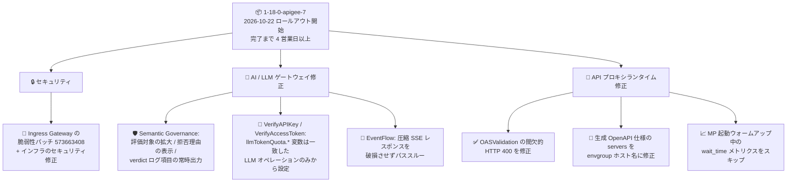

# Apigee: セキュリティ修正と不具合修正を含む 1-18-0-apigee-7 のリリース

**リリース日**: 2026-10-22

**サービス**: Apigee

**機能**: Apigee ランタイム更新版 1-18-0-apigee-7 (セキュリティ修正 + 不具合修正)

**ステータス**: アナウンス (セキュリティ / 修正)

📊 [このアップデートのインフォグラフィックを見る](https://takech9203.github.io/google-cloud-news-summary/20261022-apigee-maintenance-1-18-0-apigee-7.html)

## 概要

2026 年 10 月 22 日、Google は Apigee の更新版 `1-18-0-apigee-7` をリリースしました。ロールアウトは同日に開始され、すべての Google Cloud ゾーンに行き渡るまで 4 営業日以上かかる場合があります。ロールアウトが完了するまで、各インスタンスで本リリースの機能・修正が利用できない可能性があります。

本リリースには、Ingress Gateway のセキュリティ脆弱性パッチ (Bug ID 573663408) と Apigee インフラストラクチャのセキュリティ修正に加え、API プロキシランタイムの幅広い不具合修正が含まれます。特に、生成 AI / LLM ゲートウェイ関連の修正が多く含まれている点が特徴で、Semantic Governance Policies (SGP) の評価カバレッジ拡大と拒否メッセージの改善、VerifyAPIKey / VerifyAccessToken の `apiproduct.operation.llmTokenQuota.*` フロー変数の挙動修正、圧縮された `text/event-stream` レスポンスの EventFlow パススルー対応などが行われています。そのほか、OASValidation ポリシーの間欠的な HTTP 400 エラーの修正、生成 OpenAPI 仕様の `servers[]` ホスト名修正、Message Processor 起動時のメトリクス誤検知対策も含まれます。

Apigee を API ゲートウェイや LLM ゲートウェイとして運用しているチームは、本リリースの挙動変更 (特に Semantic Governance の評価対象拡大と llmTokenQuota フロー変数の設定条件の変更) を確認しておくことを推奨します。

**アップデート前の課題**

- Ingress Gateway に未パッチのセキュリティ脆弱性が存在していた
- Message Processor の起動ウォームアップ中に `main_task_wait_time` / `nio_task_wait_time` メトリクスが収集され、起動直後の誤った値がモニタリングに現れる可能性があった
- 自動生成される OpenAPI 仕様の `servers[]` にバックエンドターゲットのホスト名が記載され、クライアントに公開すべき Apigee 環境グループ (envgroup) のホスト名になっていなかった
- OASValidation ポリシーの strict パラメータ検証で、有効なリクエストが間欠的に HTTP 400 で拒否されることがあった
- 圧縮された `text/event-stream` レスポンスが EventFlow を通ると、ボディが破損した状態で返されていた
- SGP による拒否時に、一致したポリシーに拒否メッセージが未設定の場合、ユーザーには汎用的なフォールバックメッセージしか表示されず、拒否理由が分からなかった
- VerifyAPIKey / VerifyAccessToken が、リクエストに一致していない LLM オペレーションからも `apiproduct.operation.llmTokenQuota.*` フロー変数を設定してしまうことがあった
- Semantic Governance が一部の LLM リクエスト (例: メッセージコンテンツがパーツの配列である OpenAI リクエスト) の評価をスキップしていた

**アップデート後の改善**

- Ingress Gateway がアップグレードされ、セキュリティ脆弱性がパッチされた (Apigee インフラストラクチャのセキュリティ修正も適用)
- Message Processor 起動ウォームアップ中は最初の 12 回の Prometheus スクレイプで対象メトリクスがスキップされ、起動直後のノイズが排除された
- 生成 OpenAPI 仕様の `servers[]` が Apigee envgroup のホスト名を持つようになり、仕様をそのままクライアントに配布できるようになった
- OASValidation の strict パラメータ検証が正しく動作し、有効なリクエストが誤って拒否されなくなった
- 圧縮された `text/event-stream` レスポンスは EventFlow 処理をスキップしてそのままパススルーされ、破損せずクライアントに届くようになった
- SGP の拒否時、一致したポリシーに拒否メッセージが未設定の場合はポリシーエンジンの rationale (拒否理由) が表示されるようになった
- `apiproduct.operation.llmTokenQuota.*` フロー変数は、リクエストに一致した LLM オペレーションからのみ設定されるようになり、トークンクォータの誤適用が防止された
- Semantic Governance が従来スキップしていた LLM リクエストも評価するようになり、ガバナンスの抜け漏れが減った (新たな拒否や judge モデルの使用が発生し得る)

## アーキテクチャ図



`1-18-0-apigee-7` に含まれる修正を、セキュリティ、AI / LLM ゲートウェイ関連、API プロキシランタイム関連の 3 カテゴリに整理した図です。

## サービスアップデートの詳細

### セキュリティ修正

1. **Ingress Gateway のアップグレード (Bug ID 573663408)**
   - Apigee の Ingress Gateway をアップグレードし、セキュリティ脆弱性をパッチ
   - あわせて Apigee インフラストラクチャのセキュリティ修正も適用

### 不具合修正: AI / LLM ゲートウェイ関連

1. **Semantic Governance の評価カバレッジ拡大 (Bug ID 567244615)**
   - 従来スキップしていた LLM リクエスト (例: メッセージコンテンツがパーツの配列である OpenAI リクエスト) を評価するようになった
   - 最後のシステムメッセージだけでなく、すべてのシステムメッセージを考慮するようになった
   - 非ストリーミングの OpenAI または Ollama のツールコールで引数が有効な JSON でない場合は評価エラーとなる
   - **運用への影響**: 評価対象が増えるため、新たな拒否 (DENY) や judge モデルのトークン使用量の増加が発生し得る

2. **SGP 拒否メッセージの改善 (Bug ID 549078690)**
   - 従来は、拒否に対して帰属するポリシーに拒否メッセージが構成されていない場合、汎用フォールバックメッセージが表示されていた
   - 一致したポリシーに拒否メッセージの構成がない場合は、ショートサーキットして rationale (拒否理由) を表示するように修正

3. **verdict ログの `sgpUserIntentMatchingMode` フィールドを常時出力 (Bug ID 562964081)**
   - ドライランのポリシーレコードを含め、`sgpUserIntentMatchingMode` フィールドが常に出力されるようになった
   - `sgpUserIntentMatching` が未設定の場合も、評価に使用されたモード (`CONSTRAINTS_AND_INTENT`、またはツールコールに一致するポリシーがない場合は `INTENT_ONLY`) が記録される

4. **llmTokenQuota フロー変数の設定条件の修正 (Bug ID 492041991)**
   - VerifyAPIKey / VerifyAccessToken ポリシーは、リクエストに一致した LLM オペレーションからのみ `apiproduct.operation.llmTokenQuota.*` フロー変数を設定するようになった
   - 一致していない LLM オペレーションや、どの LLM オペレーションにも一致しないリクエストに対しては設定されなくなった
   - **運用への影響**: これらのフロー変数を LLMTokenQuota ポリシーの動的クォータ (countRef など) の参照元にしている場合、変数が設定されるケースが変わるため、プロキシの挙動を確認しておくことを推奨

5. **圧縮 SSE レスポンスの EventFlow パススルー (Bug ID 572025634)**
   - 圧縮された `text/event-stream` ボディを持つレスポンスが EventFlow を構成したプロキシに流れた場合、EventFlow 処理をスキップしてそのままパススルーするようになった
   - 従来は破損したボディが返されていた

### 不具合修正: API プロキシランタイム関連

1. **OASValidation の間欠的 HTTP 400 を修正 (Bug ID 524115876)**
   - OASValidation ポリシーの strict パラメータ検証が、有効なリクエストを間欠的に HTTP 400 で拒否する問題を修正

2. **生成 OpenAPI 仕様の `servers[]` を修正 (Bug ID 573602919)**
   - 自動生成される OpenAPI 仕様の `servers[]` が、バックエンドターゲットのホスト名ではなく Apigee 環境グループ (envgroup) のホスト名を持つように修正

3. **Message Processor 起動時のメトリクススキップ (Bug ID 568535165)**
   - Message Processor の起動ウォームアップ中、最初の 12 回の Prometheus スクレイプで `main_task_wait_time` と `nio_task_wait_time` メトリクスをスキップするようになった
   - 起動直後の不安定な値によるモニタリングのノイズや誤アラートを防止

### その他の修正

[Apigee リリースノート (2026 年 10 月 22 日)](https://docs.cloud.google.com/apigee/docs/release/release-notes#October_22_2026) によると、本リリースには上記のほかにも、JWS / JWT ポリシーの RFC 7797 (unencoded payload) 対応と検証強化、SanitizeModelResponse ポリシーの SSE ストリームにおける双方向 gRPC 連続スキャン対応、SGP ドライランポリシーの評価・ログ記録、ext_proc の ImmediateResponse の Content-Type 保持、AppGroup アプリの OAuth レイテンシ改善など、多数の修正・改善が含まれています。詳細は公式リリースノートを参照してください。

## 技術仕様

### リリース情報

| 項目 | 詳細 |
|------|------|
| バージョン | `1-18-0-apigee-7` |
| リリース日 | 2026 年 10 月 22 日 |
| ロールアウト | 同日開始。全 Google Cloud ゾーンへの完了まで 4 営業日以上かかる場合がある |
| 対象 | Apigee (X)。ロールアウト完了までは機能・修正が利用できないインスタンスがある |
| 種別 | セキュリティ修正 (Ingress Gateway、インフラ) + 不具合修正 |

### 主な Bug ID 一覧

| Bug ID | 区分 | 内容 |
|--------|------|------|
| 573663408 | セキュリティ | Ingress Gateway のアップグレード (脆弱性パッチ) |
| N/A | セキュリティ | Apigee インフラストラクチャのセキュリティ修正 |
| 568535165 | 修正 | MP 起動ウォームアップ中の `main_task_wait_time` / `nio_task_wait_time` メトリクスをスキップ (最初の 12 スクレイプ) |
| 573602919 | 修正 | 生成 OpenAPI 仕様の `servers[]` を envgroup ホスト名に修正 |
| 562964081 | 修正 | `sgpUserIntentMatchingMode` verdict ログフィールドを常時出力 |
| 524115876 | 修正 | OASValidation の strict パラメータ検証の間欠的 HTTP 400 を修正 |
| 572025634 | 修正 | 圧縮 `text/event-stream` レスポンスの EventFlow パススルー |
| 549078690 | 修正 | SGP 拒否時に汎用メッセージではなく rationale を表示 |
| 492041991 | 修正 | `apiproduct.operation.llmTokenQuota.*` を一致した LLM オペレーションのみから設定 |
| 567244615 | 修正 | Semantic Governance が従来スキップしていた LLM リクエストを評価 |

## 設定方法

本リリースは Google が管理するロールアウトとして自動適用されるため、ユーザー側での更新操作は不要です。ただし、以下の確認を推奨します。

### 前提条件

1. Apigee (X) を使用していること
2. インスタンスの状態確認には `apigee.instances.get` 権限が必要

### 手順

#### ステップ 1: ロールアウト状況の把握

ロールアウトは 2026 年 10 月 22 日に開始され、完了まで 4 営業日以上かかる場合があります。優先メンテナンスウィンドウを設定しているインスタンスは、新しいリリースがフリート全体で安定と判断された後のメンテナンスロールアウトで更新されます (直前の例では `1-18-0-apigee-6` へのメンテナンス更新が 10 月 20 日に開始されています)。

```bash
AUTH="Authorization: Bearer $(gcloud auth print-access-token)"
curl -H "$AUTH" \
  "https://apigee.googleapis.com/v1/organizations/ORGANIZATION_ID/instances/INSTANCE_ID"
```

レスポンスの `scheduledMaintenance` や `maintenanceUpdatePolicy` フィールドで、メンテナンスウィンドウ構成インスタンスの更新予定を確認できます。

#### ステップ 2: 挙動変更の影響確認

本リリース適用後に挙動が変わる可能性がある構成を確認します。

- **Semantic Governance を使用している場合**: 従来評価がスキップされていた LLM リクエスト (OpenAI の配列形式メッセージなど) が評価対象になるため、新たな拒否が発生していないか、judge モデルのトークン使用量が想定内かを `semantic-governance-policy` ログで確認する
- **LLMTokenQuota ポリシーで `apiproduct.operation.llmTokenQuota.*` を参照している場合**: 変数が「一致した LLM オペレーションのみ」から設定されるようになったため、クォータの適用対象が意図どおりかを確認する
- **EventFlow 付きプロキシで圧縮 SSE レスポンスを扱う場合**: 圧縮された `text/event-stream` レスポンスは EventFlow の処理をスキップしてパススルーされるため、EventFlow 内のポリシー (DataCapture、LLMTokenQuota など) がそのレスポンスには実行されない点を考慮する

## メリット

### ビジネス面

- **セキュリティリスクの低減**: API トラフィックの入口となる Ingress Gateway の脆弱性がパッチされ、追加のインフラセキュリティ修正も適用される
- **エンドユーザー体験の改善**: SGP による拒否時に具体的な理由 (rationale) が表示されるようになり、エージェント / アプリケーション側でユーザーへ適切な説明が可能になる
- **AI ガバナンスの網羅性向上**: 従来評価をすり抜けていた形式の LLM リクエストも Semantic Governance の評価対象となり、ポリシーの抜け漏れが減る

### 技術面

- **検証・課金制御の正確性向上**: OASValidation の誤検知 (HTTP 400) 解消と、llmTokenQuota フロー変数の設定条件修正により、リクエスト検証とトークンクォータ制御が仕様どおりに動作する
- **ストリーミングの信頼性向上**: 圧縮 SSE レスポンスが破損せずパススルーされ、LLM ストリーミング応答の安定性が向上する
- **モニタリング品質の向上**: 起動ウォームアップ中のメトリクススキップと verdict ログフィールドの常時出力により、監視・ログ分析の精度が上がる
- **仕様配布の正確性**: 生成 OpenAPI 仕様の `servers[]` が公開ホスト名 (envgroup) を指すため、仕様をそのままコンシューマに提供できる

## デメリット・制約事項

### 制限事項

- ロールアウト完了まで 4 営業日以上かかる場合があり、それまではインスタンスごとに適用状況が異なる
- ロールアウトのタイミングはユーザー側で制御できない (メンテナンスウィンドウ構成インスタンスは安定版判定後のメンテナンスロールアウトで更新)

### 考慮すべき点

- **Semantic Governance の評価対象拡大**は意図した修正だが、これまで通過していたリクエストが新たに拒否される可能性と、judge モデルの使用量 (= コスト) が増える可能性がある。適用後はログとコストの監視を強化することを推奨
- **llmTokenQuota フロー変数の挙動変更**により、一致しない LLM オペレーション由来の値に (意図せず) 依存していたプロキシでは、変数が未設定になるケースが生じる。該当するポリシー条件や countRef 参照の見直しが必要
- 圧縮 SSE レスポンスは EventFlow をスキップするため、EventFlow 内でのトークン集計やデータ収集を確実に行いたい場合は、ターゲットとの間で圧縮を使わない構成も検討する

## ユースケース

### ユースケース 1: LLM ゲートウェイとしての Apigee のガバナンス強化確認

**シナリオ**: Apigee を OpenAI 互換 API や Gemini へのゲートウェイとして運用し、Semantic Governance Policies でエージェントのツールコールを統制している。

**実装例**:
```
1. 1-18-0-apigee-7 適用後、semantic-governance-policy ログを確認
2. sgpUserIntentMatchingMode フィールド (常時出力されるようになった) で
   評価モード (CONSTRAINTS_AND_INTENT / INTENT_ONLY) の分布を把握
3. 新たに発生した DENY verdict を抽出し、正当な拒否か誤検知かをレビュー
4. judge モデルのトークン使用量の推移を確認し、コスト影響を評価
```

**効果**: 配列形式メッセージなど従来スキップされていたリクエストもポリシー評価の対象となり、ガバナンスの抜け漏れを塞ぎつつ、ログから評価モードと拒否理由を正確に追跡できる。

### ユースケース 2: API プロダクトのトークンクォータ運用の見直し

**シナリオ**: API プロダクトの LLM オペレーションごとにトークンクォータを設定し、VerifyAPIKey の `apiproduct.operation.llmTokenQuota.*` フロー変数を LLMTokenQuota ポリシーから参照している。

**効果**: フロー変数がリクエストに一致した LLM オペレーションからのみ設定されるようになったため、別オペレーションのクォータ値が誤って適用される事象がなくなる。適用後に意図したクォータ値が参照されているかをデバッグセッションで確認することで、課金・制限の正確な運用に移行できる。

## 料金

本リリースの適用自体に追加料金は発生しません。Apigee の料金体系は従来どおりです。なお、Semantic Governance の評価対象拡大により judge モデルのトークン使用量が増える場合があります。詳細は [Apigee 料金ページ](https://cloud.google.com/apigee/pricing) を参照してください。

## 利用可能リージョン

すべての Google Cloud ゾーンへ順次ロールアウトされます (完了まで 4 営業日以上かかる場合があります)。リージョンごとの提供状況は [Apigee のロケーション](https://docs.cloud.google.com/apigee/docs/locations) を参照してください。

## 関連サービス・機能

- **Semantic Governance Policies (SGP)**: AI エージェントのツールコールを自然言語制約で評価・統制する仕組み。本リリースで評価カバレッジと拒否メッセージ、verdict ログが改善
- **LLMTokenQuota ポリシー**: LLM レスポンスのトークン消費を数えて制限するポリシー。API プロダクトの LLM オペレーションと連動する動的クォータで `apiproduct.operation.llmTokenQuota.*` フロー変数を参照する
- **EventFlow (Server-Sent Events)**: SSE ストリーミング応答をポリシーで加工するための特別なフロー。本リリースで圧縮 SSE レスポンスのパススルー挙動が修正
- **OASValidation ポリシー**: OpenAPI 仕様に基づくリクエスト検証ポリシー。strict パラメータ検証の誤検知が修正
- **Cloud Monitoring / Prometheus メトリクス**: Message Processor の `main_task_wait_time` / `nio_task_wait_time` メトリクスの起動時ノイズが解消

## 参考リンク

- 📊 [インフォグラフィック](https://takech9203.github.io/google-cloud-news-summary/20261022-apigee-maintenance-1-18-0-apigee-7.html)
- [公式リリースノート](https://docs.cloud.google.com/release-notes#October_22_2026)
- [Apigee リリースノート (2026 年 10 月 22 日)](https://docs.cloud.google.com/apigee/docs/release/release-notes#October_22_2026)
- [Semantic Governance の概要](https://docs.cloud.google.com/gemini-enterprise-agent-platform/govern/policies/semantic-governance-overview)
- [LLMTokenQuota ポリシー](https://docs.cloud.google.com/apigee/docs/api-platform/reference/policies/llm-token-quota-policy)
- [Server-Sent Events (SSE) と EventFlow](https://docs.cloud.google.com/apigee/docs/api-platform/develop/server-sent-events)
- [メンテナンスの概要 (Maintenance overview)](https://docs.cloud.google.com/apigee/docs/api-platform/system-administration/maintenance)
- [料金ページ](https://cloud.google.com/apigee/pricing)

## まとめ

`1-18-0-apigee-7` は、Ingress Gateway の脆弱性パッチに加え、Semantic Governance・LLMTokenQuota・EventFlow といった LLM ゲートウェイ機能の修正が中心のリリースです。ロールアウトは 10 月 22 日から 4 営業日以上かけて順次進むため、適用後は Semantic Governance の新たな拒否や judge モデル使用量、llmTokenQuota フロー変数に依存するプロキシの挙動を確認してください。特に AI / エージェント向けの API を Apigee で統制しているチームは、評価対象拡大による影響のモニタリングを推奨します。

---

**タグ**: Apigee, セキュリティパッチ, 1-18-0-apigee-7, Ingress Gateway, Semantic Governance, LLMTokenQuota, EventFlow, OASValidation, API 管理, LLM ゲートウェイ
