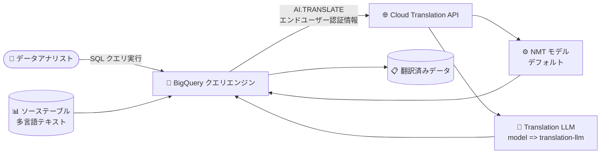

# BigQuery: AI.TRANSLATE 関数が一般提供 (GA) に

**リリース日**: 2026-10-22

**サービス**: BigQuery

**機能**: AI.TRANSLATE 関数 (テキスト翻訳)

**ステータス**: GA (一般提供)

📊 [このアップデートのインフォグラフィックを見る](https://takech9203.github.io/google-cloud-news-summary/20261022-bigquery-ai-translate-ga.html)

## 概要

BigQuery の `AI.TRANSLATE` 関数が一般提供 (GA) になりました。`AI.TRANSLATE` は、SQL クエリの中から直接テキスト文字列を言語間で翻訳できる関数です。標準の Neural Machine Translation (NMT) ワークロードに加えて、高品質な Translation LLM (TLLM) の機能を SQL ワークフローに取り込むことができます。

この関数の大きな特徴は、標準的な翻訳タスクではデフォルトでエンドユーザー認証情報を使用する点です。これにより、リモートモデルの作成や BigQuery 接続 (Connection) のセットアップ、サービスアカウントへの権限付与といった追加の設定・認証手順を減らし、`SELECT AI.TRANSLATE('Hello', 'ja')` のようにすぐに翻訳を実行できます。

多言語のテキストデータ (レビュー、問い合わせ、ログなど) を BigQuery 上に保持しているデータアナリストやデータエンジニアにとって、データを外部に移動させることなく、使い慣れた SQL だけで翻訳処理をデータパイプラインに組み込めるようになります。

**アップデート前の課題**

- BigQuery 内でテキスト翻訳を行うには、従来 `ML.TRANSLATE` 関数を使用する必要があり、事前に `CREATE MODEL` でリモートモデル (`REMOTE_SERVICE_TYPE = CLOUD_AI_TRANSLATE_V3`) を作成し、BigQuery 接続の作成と接続用サービスアカウントへの IAM 権限付与が必要だった
- `ML.TRANSLATE` では入力テキストを `text_content` という列名 (またはエイリアス) で渡す必要があり、テーブル/クエリ単位の呼び出し構文のため、スカラー関数のように式の中で手軽に使うことができなかった
- Translation LLM (TLLM) による高品質な翻訳を SQL から直接利用する標準的な手段がなかった

**アップデート後の改善**

- `AI.TRANSLATE` が GA となり、本番ワークロードで安心して利用できるようになった
- デフォルトでエンドユーザー認証情報を使用するため、リモートモデルや接続の事前セットアップなしに、スカラー関数として SQL 式の中で直接翻訳を実行できるようになった
- `model => 'translation-llm'` を指定するだけで、NMT と Translation LLM (TLLM) をクエリ単位で切り替えられるようになった
- `return_details => TRUE` により、翻訳結果に加えて実行ステータスや Translation API のレスポンス詳細 (検出された言語コードなど) を STRUCT で取得できるようになった

## アーキテクチャ図



BigQuery のクエリエンジンが `AI.TRANSLATE` 関数を介して Cloud Translation API を呼び出し、NMT または Translation LLM で翻訳した結果をクエリ結果として返すデータフローです。リモートモデルや接続の事前作成は不要です。

## サービスアップデートの詳細

### 主要機能

1. **スカラー関数によるシンプルな翻訳**
   - `AI.TRANSLATE(content, target_language)` の形式で、文字列リテラル・列名・文字列式をそのまま翻訳できる
   - `source_language` を省略した場合は、基盤の API が自動言語検出を行う
   - 標準的な翻訳タスクではデフォルトでエンドユーザー認証情報を使用し、追加のセットアップや認証手順を削減

2. **NMT と Translation LLM (TLLM) の選択**
   - `model` 引数を省略するとデフォルトで NMT モデル (`nmt`) を使用
   - `model => 'translation-llm'` を指定すると Translation LLM による高品質な翻訳を利用可能

3. **詳細情報の取得 (return_details)**
   - `return_details => TRUE` を指定すると、`result` (翻訳テキスト)、`status` (実行ステータス)、`details` (Translation API のレスポンス JSON) を含む STRUCT を返す
   - `details` には `translated_text`、`model`、自動検出時の `detected_language_code`、エラー時のエラーコード・理由が含まれる

## 技術仕様

### 関数シグネチャと引数

```sql
AI.TRANSLATE(
  content,
  target_language
  [, source_language => source_language]
  [, model => model_name]
  [, return_details => return_details]
)
```

| 引数 | 型 | 説明 |
|------|-----|------|
| `content` | STRING | 翻訳対象のテキスト (リテラル、列名、文字列式) |
| `target_language` | STRING | 翻訳先の言語コード (Cloud Translation のサポート言語) |
| `source_language` | STRING (省略可) | 元テキストの言語コード。省略時は自動言語検出 |
| `model` | STRING (省略可) | バックエンドの翻訳エンジン。`translation-llm` で TLLM、省略時は `nmt` |
| `return_details` | BOOL (省略可) | `TRUE` で STRUCT (result / status / details) を返す。省略時は `FALSE` で翻訳テキストの STRING のみ |

### 出力

| return_details | 出力 |
|----------------|------|
| `FALSE` (デフォルト) | STRING。翻訳成功時は翻訳テキスト、エラー時は `NULL` |
| `TRUE` | STRUCT。`result` (STRING)、`status` (STRING、成功時は "OK")、`details` (JSON) |

### データ処理ロケーション

| クエリのロケーション | Cloud Translation API の処理場所 |
|---------------------|----------------------------------|
| US マルチリージョン | US 内で処理 |
| EU マルチリージョン | EU 内で処理 |
| その他 (us-central1、europe-west1 などの単一リージョン) | グローバルエンドポイントで処理 (処理ロケーションの保証なし) |

データ処理ロケーションの要件がある場合は、US または EU マルチリージョンで `AI.TRANSLATE` を実行してください。

## 設定方法

### 前提条件

1. BigQuery でクエリジョブを実行できる権限 (BigQuery Job User など) があること
2. 標準的な翻訳タスクではデフォルトでエンドユーザー認証情報が使用されるため、リモートモデルや接続の事前作成は不要 (権限の詳細は [AI 関数の権限設定ドキュメント](https://docs.cloud.google.com/bigquery/docs/permissions-for-ai-functions)を参照)

### 手順

#### ステップ 1: デフォルト (NMT) モデルで翻訳する

```sql
SELECT AI.TRANSLATE('Hello, how are you?', 'fr');
-- 出力例: "Bonjour, comment allez-vous ?"
```

ソース言語を省略すると自動言語検出が行われます。明示する場合は `source_language => 'en'` を指定します。

#### ステップ 2: Translation LLM (TLLM) を使用する

```sql
SELECT AI.TRANSLATE(
  'Hello, how are you?',
  'fr',
  model => 'translation-llm'
);
```

#### ステップ 3: 翻訳の詳細情報を取得する

```sql
SELECT AI.TRANSLATE(
  'Hello, how are you?',
  'fr',
  return_details => TRUE
);
-- 出力例: {"result":"Bonjour, comment allez-vous ?","status":"OK","details":"..."}
```

## メリット

### ビジネス面

- **多言語データ活用の高速化**: 多言語のレビュー・問い合わせ・ログなどを BigQuery から移動させずに SQL だけで翻訳・分析でき、インサイト獲得までの時間を短縮できる
- **セットアップコストの削減**: リモートモデルや接続の構築・権限管理が不要になり、導入・運用の工数を削減できる

### 技術面

- **スカラー関数としての使いやすさ**: `SELECT` 句や式の中で直接呼び出せるため、`ML.TRANSLATE` のようなテーブル単位の構文や `text_content` 列名の制約がない
- **モデルの柔軟な切り替え**: 引数 1 つで NMT と Translation LLM をクエリ単位で使い分けられる
- **エラーハンドリング**: `return_details => TRUE` でステータスやエラー理由を行単位で取得でき、堅牢なパイプラインを構築しやすい

## デメリット・制約事項

### 制限事項

- US / EU マルチリージョン以外のロケーションで実行した場合、翻訳処理は Cloud Translation API のグローバルエンドポイントで行われ、処理ロケーションは保証されない
- `target_language` / `source_language` には Cloud Translation のサポート言語コードを指定する必要がある

### 考慮すべき点

- 翻訳エラー時、デフォルト (`return_details => FALSE`) では結果が `NULL` になるだけでエラー理由が分からないため、本番パイプラインでは `return_details => TRUE` の利用を検討する
- 大量の行に対して実行すると、基盤となる Cloud Translation API の呼び出しが発生するため、文字数ベースの翻訳コストとクォータを事前に見積もる
- データ処理ロケーションの要件 (データレジデンシー) がある場合は、US または EU マルチリージョンでクエリを実行する

## ユースケース

### ユースケース 1: 多言語カスタマーレビューの一元分析

**シナリオ**: グローバル EC サイトの商品レビューが多言語で BigQuery に蓄積されている。言語ごとに分析基盤を分けずに、英語に統一して感情分析やダッシュボード化を行いたい。

**実装例**:
```sql
SELECT
  review_id,
  original_language,
  AI.TRANSLATE(review_text, 'en') AS review_text_en
FROM `myproject.mydataset.product_reviews`
WHERE review_date >= '2026-10-01';
```

**効果**: ETL で外部翻訳サービスを呼び出す独自実装が不要になり、SQL のみで多言語レビューを統一言語に正規化して下流の分析につなげられる。

### ユースケース 2: 高品質翻訳が必要なコンテンツの TLLM 翻訳

**シナリオ**: マーケティングコンテンツやナレッジベース記事など、翻訳品質が重要なテキストを日本語に展開したい。詳細なステータスも記録して失敗行を再処理したい。

**実装例**:
```sql
SELECT
  article_id,
  AI.TRANSLATE(
    body,
    'ja',
    source_language => 'en',
    model => 'translation-llm',
    return_details => TRUE
  ) AS translation
FROM `myproject.mydataset.kb_articles`;
```

**効果**: Translation LLM による高品質な翻訳を SQL から直接利用でき、`status` フィールドで失敗行を特定して再実行するワークフローを構築できる。

## 料金

`AI.TRANSLATE` は基盤として Cloud Translation API (NMT / Translation LLM) を使用します。BigQuery 側のクエリ処理料金 (オンデマンドまたはエディション) に加えて、Cloud Translation API の文字数ベースの料金が適用されます。Cloud Translation の料金 (2026 年 10 月時点、USD) は以下のとおりです。

### 料金例 (Cloud Translation API)

| モデル / 使用量 | 料金 (概算) |
|--------|-----------------|
| NMT テキスト翻訳: 月間 50 万文字まで | 無料 (毎月 $10 クレジットとして適用) |
| NMT テキスト翻訳: 月間 50 万文字超 | $20.00 / 100 万文字 |
| Translation LLM (TLLM) テキスト翻訳 | 入力 $10.00 / 100 万文字 + 出力 $10.00 / 100 万文字 (NMT とほぼ同等のコスト) |

最新の料金は [Cloud Translation の料金ページ](https://cloud.google.com/translate/pricing)および [BigQuery の料金ページ](https://cloud.google.com/bigquery/pricing)を確認してください。

## 利用可能リージョン

クエリのロケーションに応じて翻訳の処理場所が決まります。US マルチリージョンでは US 内、EU マルチリージョンでは EU 内で処理され、それ以外のロケーション (単一リージョンを含む) では Cloud Translation API のグローバルエンドポイントで処理されます。詳細は[公式ドキュメントの Locations セクション](https://docs.cloud.google.com/bigquery/docs/reference/standard-sql/bigqueryml-syntax-ai-translate)を参照してください。

## 関連サービス・機能

- **Cloud Translation API**: `AI.TRANSLATE` の基盤となる翻訳サービス。NMT モデルと Translation LLM を提供し、サポート言語や文字数クォータは Cloud Translation 側の仕様に準拠する
- **ML.TRANSLATE 関数**: リモートモデル (`CLOUD_AI_TRANSLATE_V3`) と BigQuery 接続を使用する従来のテーブル単位の翻訳関数。言語検出モード (`DETECT_LANGUAGE`) などを提供
- **BigQuery AI 関数群 (AI.GENERATE など)**: SQL から生成 AI・Cloud AI API を呼び出す関数ファミリー。エンドユーザー認証情報による簡易セットアップという共通の権限モデルを採用
- **ML.PROCESS_DOCUMENT / ML.UNDERSTAND_TEXT**: 非構造化ドキュメント処理やテキスト分析など、翻訳と組み合わせて多言語テキストパイプラインを構成できる関数

## 参考リンク

- 📊 [インフォグラフィック](https://takech9203.github.io/google-cloud-news-summary/20261022-bigquery-ai-translate-ga.html)
- [公式リリースノート](https://docs.cloud.google.com/release-notes#October_22_2026)
- [AI.TRANSLATE 関数ドキュメント](https://docs.cloud.google.com/bigquery/docs/reference/standard-sql/bigqueryml-syntax-ai-translate)
- [AI 関数の権限設定](https://docs.cloud.google.com/bigquery/docs/permissions-for-ai-functions)
- [ML.TRANSLATE 関数ドキュメント](https://docs.cloud.google.com/bigquery/docs/reference/standard-sql/bigqueryml-syntax-translate)
- [Cloud Translation サポート言語](https://docs.cloud.google.com/translate/docs/languages)
- [Cloud Translation 料金ページ](https://cloud.google.com/translate/pricing)

## まとめ

`AI.TRANSLATE` の GA により、リモートモデルや接続のセットアップなしに、SQL のスカラー関数として NMT / Translation LLM によるテキスト翻訳を本番ワークロードで利用できるようになりました。既存の `ML.TRANSLATE` ベースのパイプラインを運用している場合や、多言語テキストの分析を BigQuery 内で完結させたい場合は、`AI.TRANSLATE` への移行・採用を検討することをおすすめします。

---

**タグ**: BigQuery, AI.TRANSLATE, Cloud Translation, Translation LLM, NMT, GA, 生成AI, SQL
