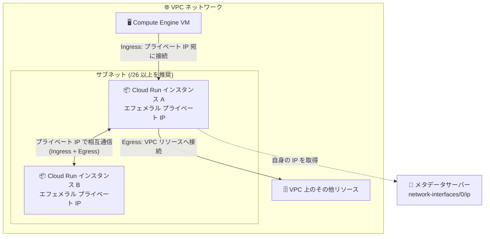

# Cloud Run: Direct VPC ingress (インスタンス向け)

**リリース日**: 2026-10-22

**サービス**: Cloud Run

**機能**: Cloud Run インスタンス向け Direct VPC ingress

**ステータス**: Preview

📊 [このアップデートのインフォグラフィックを見る](https://takech9203.github.io/google-cloud-news-summary/20261022-cloud-run-direct-vpc-ingress.html)

## 概要

Cloud Run インスタンス (Cloud Run instances) 向けの **Direct VPC ingress** が Preview として発表された。Direct VPC ingress を構成すると、VPC ネットワーク上の Cloud Run インスタンスが自身のエフェメラルなプライベート IP アドレスを持ち、そのプライベート IP を使ってインスタンス同士、および VPC ネットワーク上の他のリソースと直接通信できるようになる。

Cloud Run インスタンスは、リクエスト駆動でオートスケールするサービスとは異なり、長時間稼働するシングルトンのランタイム環境を提供する Preview のリソースタイプで、長時間稼働する AI エージェントやワークフローエンジン、VPS のような常時稼働コンピュート、開発・デバッグ環境などを想定している。今回のアップデートにより、Cloud Run の Direct VPC 構成は「サービス: Egress のみ」「ジョブ: Egress のみ」「ワーカープール: Egress + Ingress」「インスタンス: Egress + Ingress」となり、インスタンスでも VPC 内部からの着信 (ingress) がサポートされた。

VPC 内のプライベートな通信を前提としたアーキテクチャ (内部 API、エージェント間通信、VM からのアクセスなど) を、Serverless VPC Access コネクタなしで Cloud Run インスタンスに適用したい開発者・インフラ担当者に有用なアップデートである。

**アップデート前の課題**

- Cloud Run の Direct VPC は、サービスとジョブでは Egress (Cloud Run から VPC への送信) のみの対応で、VPC 側から Cloud Run のコンテナにプライベート IP で直接到達する手段は限られていた
- Serverless VPC Access コネクタは ingress に対応しておらず、VPC 内リソースから Cloud Run インスタンスへのプライベートな直接通信経路がなかった
- Cloud Run インスタンス同士が VPC 上でプライベート IP を使って相互に通信することができなかった

**アップデート後の改善**

- Cloud Run インスタンスが構成したネットワーク/サブネット上のエフェメラルなプライベート IP アドレスを受け取り、VPC 上のリソース (VM など) がそのプライベート IP を使ってインスタンスに直接到達できるようになった
- Cloud Run インスタンス同士がプライベート IP を使って相互に通信できるようになり、VPC 内に閉じたセキュアな内部通信が可能になった
- コンテナ内からメタデータサーバーに問い合わせることで、インスタンス自身のプライベート IP (IPv4/IPv6) を取得できる

## アーキテクチャ図



Direct VPC ingress を構成した Cloud Run インスタンスはサブネットからプライベート IP を受け取り、VPC 上の VM や他のインスタンスと双方向のプライベート通信ができる。インスタンスは自身の IP をメタデータサーバーから取得できる。

## サービスアップデートの詳細

### 主要機能

1. **プライベート IP による Ingress (着信)**
   - 各インスタンスは構成されたネットワークとサブネット上のプライベート IP アドレスを受け取る
   - VPC ネットワーク上のリソースが、そのプライベート IP を使ってインスタンスに到達できる
   - Ingress は Direct VPC でのみサポートされ、Serverless VPC Access コネクタでは利用できない

2. **インスタンス間のプライベート通信**
   - VPC ネットワーク上のインスタンス同士がプライベート IP を使って相互にアクセスでき、セキュアな内部通信を実現できる
   - 複数のサービス、ジョブ、ワーカープール、インスタンスを同一サブネットにデプロイできる

3. **メタデータサーバーによる IP アドレス取得**
   - コンテナ内から `http://metadata.google.internal/computeMetadata/v1/instance/network-interfaces/0/ip` に問い合わせて IPv4 アドレスを取得できる
   - デュアルスタックサブネットを使用する場合は `.../network-interfaces/0/ipv6` で IPv6 アドレスを取得できる
   - VPC に接続されていない場合、これらのパスは `404: Not Found` を返す

## 技術仕様

### Cloud Run リソースタイプ別の Direct VPC 対応状況

| リソース | Direct VPC 対応 |
|------|------|
| サービス | Egress のみ |
| ジョブ | Egress のみ |
| ワーカープール | Egress + Ingress |
| インスタンス | Egress + Ingress (Ingress が今回 Preview で追加) |

### IP アドレスの割り当て

| 項目 | 詳細 |
|------|------|
| IP アドレスの性質 | エフェメラル (Ingress/Egress とも)。固定 IP ではないため、個別 IP に基づくポリシーは作成しない |
| ファイアウォールルール | 個別 IP ではなくサブネット全体の IP 範囲を使用する |
| サブネットサイズ | IPv4 アドレス範囲は /26 以上が必要 |
| IP 予約単位 | スケールアップ高速化のため 16 個 (/28) 単位でブロック予約 |
| ネットワーク/サブネット指定 | いずれか一方または両方を指定。ネットワークのみ指定時はサブネットも同名が使用される |

### YAML 構成例 (Direct VPC ingress)

```yaml
apiVersion: run.googleapis.com/v1
kind: Instance
metadata:
  name: INSTANCE_NAME
  labels:
    cloud.googleapis.com/location: REGION
  annotations:
    run.googleapis.com/launch-stage: BETA
    run.googleapis.com/network-interfaces: '[{"network":"NETWORK","subnetwork":"SUBNET"}]'
spec:
  containers:
  - image: IMAGE_URL
```

Direct VPC ingress のみの場合は、`run.googleapis.com/vpc-access-egress` アノテーションと `tags` 属性を削除する。

## 設定方法

### 前提条件

1. プロジェクトに VPC ネットワークが存在すること (なければ作成する)
2. Compute Engine API が有効であること (`gcloud services enable compute.googleapis.com`)
3. gcloud コンポーネントが最新であること (`gcloud components update`)
4. サブネットのリージョンとインスタンスのリージョンが一致していること

### 手順

#### ステップ 1: Direct VPC ingress を構成してインスタンスをデプロイ

```bash
gcloud beta run instances deploy INSTANCE_NAME \
  --image=IMAGE_URL \
  --network=NETWORK \
  --subnet=SUBNET \
  --region=REGION
```

Direct VPC ingress の場合、ネットワークタグ (`--network-tags`) は指定しない (Egress のみで利用可能)。

#### ステップ 2: インスタンスが VPC ネットワーク上にあることを確認

```bash
gcloud beta run instances describe INSTANCE_NAME \
  --region=REGION
```

#### ステップ 3: コンテナ内からプライベート IP を取得

```bash
curl "http://metadata.google.internal/computeMetadata/v1/instance/network-interfaces/0/ip" \
  -H "Metadata-Flavor: Google"
```

取得したプライベート IP を使って、VPC 上の他のリソースやインスタンスから接続できる。

## メリット

### ビジネス面

- **コネクタ不要によるコスト効率**: Direct VPC は Serverless VPC Access コネクタのような追加の VM 課金が発生しない
- **アーキテクチャの簡素化**: VPC 内部に閉じた通信を追加コンポーネントなしで実現でき、運用負荷を低減できる

### 技術面

- **双方向のプライベート通信**: Egress に加えて Ingress がサポートされ、VPC リソースから Cloud Run インスタンスへの直接到達とインスタンス間通信が可能になる
- **VPC ファイアウォールによるアクセス制御**: サブネットの IP 範囲を使ったファイアウォールルールで VPC 内リソースへのアクセスを制限できる
- **IPv4/IPv6 対応**: デュアルスタックサブネットを使用すれば IPv6 アドレスも利用できる

## デメリット・制約事項

### 制限事項

- Preview のため、Pre-GA Offerings Terms が適用され、サポートが限定される場合がある
- IP アドレスはエフェメラルで固定されないため、個別 IP に依存した構成は不可 (ファイアウォールはサブネット範囲で指定)
- Ingress のファイアウォールルールのターゲットにネットワークタグを使用できない
- Ingress は Direct VPC のみ対応で、Serverless VPC Access コネクタでは利用できない
- コンテナインスタンスあたりのスループットは最大 1 Gbps で、超過時はスロットリングされる
- ネットワークインフラのメンテナンスイベント中に接続が切断される場合があるため、接続リセットに対応したクライアントライブラリの使用が推奨される

### 考慮すべき点

- サブネットの IPv4 範囲は /26 以上を確保し、IP 枯渇に注意する (Cloud Run は 16 個単位で IP をブロック予約する)
- サブネットを削除するには、先に Cloud Run リソースの削除または再デプロイでサブネットの使用を停止し、1〜2 時間待つ必要がある
- Cloud Run インスタンス自体も Preview のリソースタイプである点に留意する

## ユースケース

### ユースケース 1: 長時間稼働 AI エージェント間のプライベート通信

**シナリオ**: 複数の長時間稼働 AI エージェントを Cloud Run インスタンスとして稼働させ、エージェント同士がインターネットを経由せず VPC 内で直接やり取りする。

**実装例**:
```bash
# エージェント A / B をそれぞれ同一サブネットにデプロイ
gcloud beta run instances deploy agent-a \
  --image=IMAGE_URL --network=my-vpc --subnet=my-subnet --region=asia-northeast1
gcloud beta run instances deploy agent-b \
  --image=IMAGE_URL --network=my-vpc --subnet=my-subnet --region=asia-northeast1

# 各コンテナ内で自身のプライベート IP を取得して相手に通知
curl "http://metadata.google.internal/computeMetadata/v1/instance/network-interfaces/0/ip" \
  -H "Metadata-Flavor: Google"
```

**効果**: パブリックエンドポイントを公開せずに、エージェント間のステートフルな内部通信を VPC 内に閉じて実現できる。

### ユースケース 2: VPC 内の VM から Cloud Run インスタンスへの直接アクセス

**シナリオ**: Compute Engine VM 上の既存システムから、Cloud Run インスタンスで稼働する内部向けプロセスにプライベート IP で接続する。

**効果**: Serverless VPC Access コネクタや外部公開 URL を使わずに、VPC ファイアウォールルールで制御されたプライベートな経路で通信できる。

## 料金

Direct VPC では、Serverless VPC Access コネクタと異なり追加の VM (コンピュート) 課金は発生せず、ネットワーク Egress 料金のみが発生する (Direct VPC egress のドキュメントに基づく)。Cloud Run インスタンス自体の料金を含む詳細は、Cloud Run の料金ページを参照。

- [Cloud Run 料金ページ](https://cloud.google.com/run/pricing)

## 利用可能リージョン

Cloud Run インスタンス (Preview) は、以下を除く Cloud Run のサポート対象リージョンで作成できる。

- europe-west1
- us-central1
- us-east1

最新のリージョン情報は [Cloud Run のロケーション](https://docs.cloud.google.com/run/docs/locations) を参照。

## 関連サービス・機能

- **Cloud Run ワーカープール**: インスタンスと同様に Direct VPC で Egress + Ingress をサポートするリソースタイプ。常時稼働のバックグラウンド処理向け
- **Direct VPC egress**: Cloud Run から VPC への送信トラフィックをコネクタなしで実現する機能 (サービス/ジョブは Egress のみ対応)
- **VPC ファイアウォールルール**: サブネットの IP 範囲を使って Cloud Run インスタンスへのアクセスを制御
- **Serverless VPC Access コネクタ**: 従来の VPC 接続手段。Ingress には非対応
- **デュアルスタックサブネット**: IPv6 アドレスを利用する場合に必要

## 参考リンク

- 📊 [インフォグラフィック](https://takech9203.github.io/google-cloud-news-summary/20261022-cloud-run-direct-vpc-ingress.html)
- [公式リリースノート](https://docs.cloud.google.com/release-notes#October_22_2026)
- [ドキュメント: Direct VPC によるインスタンスの接続](https://docs.cloud.google.com/run/docs/configuring/vpc-direct-vpc#direct-vpc-instance)
- [ドキュメント: Cloud Run インスタンスの作成と管理](https://docs.cloud.google.com/run/docs/instances/create-and-manage-instances)
- [ドキュメント: VPC ネットワークへの接続方法の比較](https://docs.cloud.google.com/run/docs/configuring/connecting-vpc)
- [料金ページ](https://cloud.google.com/run/pricing)

## まとめ

Direct VPC ingress の追加により、Cloud Run インスタンスは VPC 上でプライベート IP を持つ双方向通信可能なコンピュートリソースとなり、AI エージェントや常時稼働ワークロードを VPC 内に閉じたセキュアな構成で運用できるようになった。Preview のため本番適用は慎重に判断しつつ、IP アドレスがエフェメラルである点とサブネット設計 (/26 以上) に留意して検証を始めることを推奨する。

---

**タグ**: Cloud Run, Direct VPC, ingress, VPC, ネットワーキング, プライベート IP, Preview, サーバーレス
