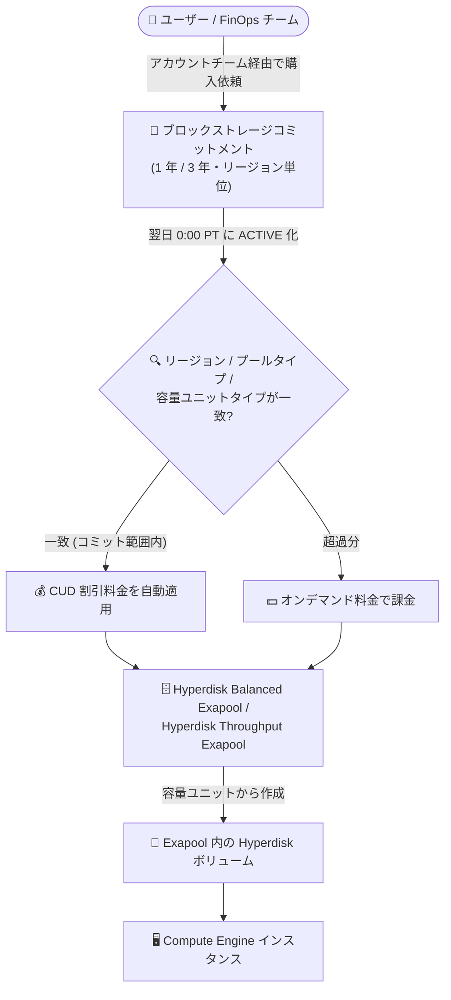

# Compute Engine: ブロックストレージ向けリソースベース確約利用割引 (CUD) が GA

**リリース日**: 2026-10-22

**サービス**: Compute Engine

**機能**: Hyperdisk Exapool 容量向けブロックストレージ確約利用割引 (CUD)

**ステータス**: GA (一般提供)

📊 [このアップデートのインフォグラフィックを見る](https://takech9203.github.io/google-cloud-news-summary/20261022-compute-engine-hyperdisk-block-storage-cud-ga.html)

## 概要

Compute Engine のブロックストレージリソースに対するリソースベースの確約利用割引 (CUD: Committed Use Discounts) が一般提供 (GA) になりました。対象は Google Cloud Hyperdisk Balanced Exapool と Google Cloud Hyperdisk Throughput Exapool の容量で、1 年または 3 年のブロックストレージコミットメントを購入することで、Exapool で消費する容量ユニットに割引料金が適用されます。

Hyperdisk Exapool は、容量とパフォーマンスを「容量ユニット」(1 ユニット = 1 GiB + 一定のパフォーマンス) 単位で購入するエクサバイト級のブロックストレージプールです。今回の GA により、従来 vCPU・メモリ・GPU・ローカル SSD などに限られていたリソースベース CUD の対象カテゴリに「ブロックストレージコミットメント」が加わり、大規模かつ定常的なストレージ利用を持つ組織がストレージコストを計画的に削減できるようになりました。

コミットメントが有効化されると、コミットメントで指定したリージョン・プールタイプに一致する Exapool の容量ユニットに対して CUD が自動適用されます。コミットメントを超過した容量ユニットはオンデマンド料金で課金されます。大規模な AI/ML、分析、エンタープライズワークロードでエクサバイト級ストレージを長期利用するユーザーが主な対象です。

**アップデート前の課題**

- リソースベース CUD の対象は vCPU、メモリ、GPU、ローカル SSD、ソールテナントノード、OS ライセンスなどに限られ、Hyperdisk などのブロックストレージ容量には確約利用割引を適用できなかった
- Hyperdisk ボリュームや Hyperdisk Storage Pool は継続利用割引 (SUD) の対象でもなく、長期の定常的なストレージ利用でもオンデマンド料金を支払う必要があった
- 大規模ストレージの長期コストを契約ベースで最適化する手段がなかった

**アップデート後の改善**

- Hyperdisk Balanced Exapool および Hyperdisk Throughput Exapool の容量に対して 1 年 / 3 年のブロックストレージコミットメントを購入し、割引料金で容量ユニットを利用できるようになった
- 容量ユニットタイプ (capacity-optimized / read-optimized / write-optimized) を組み合わせた「ブレンド」単位でコミットでき、ワークロードの読み書き特性に合わせたコスト最適化が可能になった
- CUD 共有を有効にしている場合、Cloud Billing アカウント配下の複数プロジェクトにまたがる Exapool 利用にもコミットメントを適用できる

## アーキテクチャ図



ブロックストレージコミットメントはリージョン・プールタイプ単位で購入し、一致する Exapool の容量ユニットに CUD が自動適用されます。コミットメント量を超えた容量ユニットはオンデマンド料金で課金されます。

## サービスアップデートの詳細

### 主要機能

1. **1 年 / 3 年のブロックストレージコミットメント**
   - Hyperdisk Balanced Exapool と Hyperdisk Throughput Exapool の容量ユニット (GiB 単位) に対して 1 年または 3 年プランのコミットメントを購入可能
   - コミットメント期間中は、Exapool を作成するかどうかにかかわらず、コミットした容量分の割引料金を支払う (購入後のキャンセルは不可)
   - 自動更新 (auto-renewal) の設定が可能

2. **容量ユニットタイプの「ブレンド」指定**
   - コミットメント購入時に、capacity-optimized / read-optimized / write-optimized の容量ユニットタイプとそれぞれの容量 (GiB) を指定
   - 1 つのコミットメント内で複数の容量ユニットタイプを組み合わせ (ブレンド) 可能
   - 1 つのコミットメントは 1 つの Exapool タイプにのみ適用。Balanced と Throughput の両方で割引を受けるには別々のコミットメントが必要

3. **割引の自動適用と超過分のオンデマンド課金**
   - コミットメントは特定のディスクや特定の Exapool に紐付かず、リージョン内の一致する容量ユニットに自動適用される
   - 適格利用はマイクロ秒単位で計算され、時間単位で割引料金が課金される
   - コミット量を超えた容量ユニットはオンデマンド料金で課金される

4. **CUD 共有によるプロジェクト横断の適用**
   - CUD 共有を有効にすると、コミットメントは Cloud Billing アカウントレベルでプールされ、アカウント配下の全プロジェクトの適格利用をカバーできる
   - 2026 年 6 月 16 日以降に作成された Cloud Billing アカウントでは、デフォルトで CUD 共有が有効

## 技術仕様

### 対象リソースと容量ユニットタイプ

| 項目 | 詳細 |
|------|------|
| 対象 Exapool タイプ | Hyperdisk Balanced Exapool、Hyperdisk Throughput Exapool |
| 対象外 | Persistent Disk、Hyperdisk Storage Pool、Exapool 外の単体 Hyperdisk ボリューム |
| コミットメント期間 | 1 年または 3 年 |
| 容量ユニットタイプ | CAPACITY_OPTIMIZED (読み書きバランス型) / READ_OPTIMIZED (読み取り特化) / WRITE_OPTIMIZED (書き込み特化) |
| 容量ユニット | 1 ユニット = 1 GiB の容量 + GiB あたり一定の IOPS / スループット |
| 適用スコープ | 購入したリージョン内。CUD 共有有効時は Cloud Billing アカウント配下の全プロジェクト |
| 有効化タイミング | 購入翌日の 0:00 (米国太平洋時間) に ACTIVE 化 |
| キャンセル | 購入後のキャンセル不可 |

### Hyperdisk Exapool の主な仕様 (参考)

| 項目 | Hyperdisk Balanced Exapool | Hyperdisk Throughput Exapool |
|------|---------------------------|------------------------------|
| 最小容量 | 500 TiB | 500 PiB |
| 最大容量 | 1 EiB | 5 EiB |
| 最大スループット | 10 TiB/s | 10 TiB/s |
| プールあたり最大ディスク数 | 500,000 | 500,000 |
| 容量の増分 | 1 TiB | 1 PiB |

### 必要な IAM ロール

コミットメント作成後の表示・管理に必要なロール:

| 操作 | 必要なロール / 権限 |
|------|---------------------|
| コミットメントの表示 | `roles/compute.viewer` または `roles/compute.admin` (`compute.commitments.get`、`compute.commitments.list`) |
| 自動更新の有効化 / 無効化 | `roles/compute.admin` (`compute.commitments.update`) |

## 設定方法

### 前提条件

1. [Hyperdisk Exapool の概要](https://docs.cloud.google.com/compute/docs/disks/hyperdisk-exapools)とブロックストレージコミットメントのドキュメント、サービス固有の利用規約を確認する
2. コミットメントを購入するリージョンで、プロジェクトに十分なリージョン Commitments クォータがあることを確認する

### 手順

#### ステップ 1: Google Cloud アカウントチームに購入を依頼

ブロックストレージコミットメントは、Google Cloud コンソール・gcloud CLI・REST によるセルフサービス購入に対応していません。アカウントチームに連絡し、以下の情報を伝えます。

- **プロジェクト ID**: コミットメントを購入するプロジェクト
- **リージョン**: Exapool 容量をプロビジョニングする予定のリージョン
- **コミットメントプラン**: 1 年または 3 年
- **Exapool タイプ**: Hyperdisk Balanced Exapool または Hyperdisk Throughput Exapool
- **容量ユニットタイプと容量**: capacity-optimized / read-optimized / write-optimized ごとのコミット容量 (GiB)
- **自動更新設定**: 期間終了時に自動更新するかどうか

#### ステップ 2: コミットメントの有効化を確認

購入後、コミットメントは翌日の 0:00 (米国太平洋時間) に有効化されます。有効化までのステータスは `NOT_YET_ACTIVE` (コンソールでは `PENDING`)、有効化後は `ACTIVE` になります。

```bash
# コミットメントの一覧と状態を確認
gcloud compute commitments list --project=PROJECT_ID
```

#### ステップ 3: Exapool を作成・変更して容量ユニットを消費

コミットメントは Exapool を自動作成しません。コミットした容量ユニットに一致する Exapool を作成または変更し、その中にディスクを作成することで割引対象の利用が発生します。

## メリット

### ビジネス面

- **ストレージコストの計画的削減**: 定常的に利用するエクサバイト級ストレージを 1 年 / 3 年契約で割引価格に固定でき、長期の TCO を削減できる
- **予算の予見性向上**: コミット分は期間中一定の割引料金で課金されるため、大規模ストレージの予算計画が立てやすくなる
- **プロジェクト横断の活用**: CUD 共有により、Billing アカウント配下の複数プロジェクトでコミットメントを無駄なく消化できる

### 技術面

- **自動適用で運用負荷が低い**: コミットメントは特定のディスクやプールに紐付かず、一致する容量ユニットに自動で割引が適用されるため、割引適用のための運用作業が不要
- **ワークロード特性に合わせた最適化**: 読み取り特化・書き込み特化・バランス型の容量ユニットをブレンドしてコミットでき、I/O プロファイルに合わせたコスト効率を実現できる
- **既存の CUD 管理と一貫した運用**: 有効化タイミング、自動更新、`gcloud compute commitments` による確認など、既存のリソースベース CUD と同じ仕組みで管理できる

## デメリット・制約事項

### 制限事項

- 対象は Hyperdisk Exapool の容量ユニットのみ。Persistent Disk、Hyperdisk Storage Pool、Exapool 外の単体 Hyperdisk ボリュームは対象外
- セルフサービス購入 (コンソール / gcloud CLI / REST) に非対応で、購入には Google Cloud アカウントチームへの依頼が必要
- 1 つのコミットメントは 1 つの Exapool タイプにのみ適用され、Balanced と Throughput の両方には別々の購入が必要
- 購入後のキャンセルは不可。Exapool を作成しなくてもコミット分の料金は発生する
- ハードウェア、ソフトウェアライセンス、ブロックストレージのコミットメントは別個であり、複数カテゴリを 1 つのコミットメントにまとめることはできない

### 考慮すべき点

- Exapool 自体の最小容量が大きい (Balanced: 500 TiB、Throughput: 500 PiB) ため、エクサバイト級の大規模ワークロード向けの機能である
- 割引率は公開されておらず、見積もりにはアカウントチームへの問い合わせが必要
- コミットメントはリージョン単位のため、将来のリージョン配置計画を踏まえてコミットする必要がある
- コミットメントに関連付けられたプロジェクトを別の Cloud Billing アカウントに移動すると、移動先アカウントの CUD 共有設定が適用される

## ユースケース

### ユースケース 1: AI/ML プラットフォームの大規模学習データストレージのコスト最適化

**シナリオ**: 機械学習プラットフォームで数百 TiB〜PiB 級の学習データを Hyperdisk Balanced Exapool に常時保持しており、読み取り中心の I/O プロファイルが今後 3 年間継続する見込みがある。

**実装例**: アカウントチームに依頼し、対象リージョンで Hyperdisk Balanced Exapool 向けに read-optimized ユニット中心のブレンドで 3 年コミットメントを購入。既存 Exapool の容量ユニットに CUD が自動適用される。

**効果**: 読み取り特化ユニットで必要な読み取り性能を確保しつつ、3 年契約の割引率で定常的なストレージコストを削減できる。

### ユースケース 2: 複数プロジェクトにまたがる分析基盤のストレージコミットメント共有

**シナリオ**: 同一 Cloud Billing アカウント配下の複数プロジェクトで、大規模ログ・シーケンシャルデータ処理用に Hyperdisk Throughput Exapool を利用している。

**効果**: CUD 共有を有効にすることで、1 つのブロックストレージコミットメントを Billing アカウント配下の全プロジェクトの適格利用に適用でき、プロジェクト単位の利用変動があってもコミットメントを無駄なく消化できる。

## 料金

Exapool は、プールに対して購入した容量ユニット・パフォーマンスユニットの数とタイプに基づいて課金されます (プール内に作成した個々のディスクのプロビジョニング容量・IOPS・スループットには課金されません)。ブロックストレージコミットメントを購入すると、コミットメントに一致する容量ユニットの料金に 1 年 / 3 年プランの割引が適用され、コミット分は期間中、利用の有無にかかわらず月次で課金されます。超過分はオンデマンド料金です。

ブロックストレージコミットメントの具体的な割引率は公開されておらず、Google Cloud アカウントチームへの問い合わせが必要です。オンデマンド料金と 1 年 / 3 年 CUD 料金の比較は [ディスク料金ページ](https://docs.cloud.google.com/compute/disks-image-pricing#disk) を参照してください。

## 利用可能リージョン

Hyperdisk Balanced Exapool と Hyperdisk Throughput Exapool はすべてのゾーンで利用可能です。ブロックストレージコミットメントは購入したリージョン内の利用にのみ適用されます。

## 関連サービス・機能

- **Hyperdisk Exapool**: 本コミットメントの適用対象。容量ユニット単位で容量とパフォーマンスを購入するエクサバイト級ブロックストレージプール
- **リソースベース CUD (vCPU / メモリ / GPU / ローカル SSD など)**: 同じリソースベース CUD の枠組み。ブロックストレージコミットメントはこれらとは別個のカテゴリとして購入する
- **CUD 共有 (Share resource-based CUDs)**: コミットメントを Cloud Billing アカウント配下の全プロジェクトで共有する設定
- **将来予約 (Future reservations for capacity blocks)**: Exapool の容量を Compute Engine インスタンスと併せて予約する機能
- **Cloud Billing**: コミットメントの課金・CUD 共有スコープの管理

## 参考リンク

- 📊 [インフォグラフィック](https://takech9203.github.io/google-cloud-news-summary/20261022-compute-engine-hyperdisk-block-storage-cud-ga.html)
- [公式リリースノート](https://docs.cloud.google.com/release-notes#October_22_2026)
- [ブロックストレージコミットメント (リソースベース CUD の概要)](https://docs.cloud.google.com/compute/docs/instances/signing-up-committed-use-discounts#block_storage_commitments)
- [ブロックストレージコミットメントの購入](https://docs.cloud.google.com/compute/docs/committed-use-discounts/purchase-block-storage-commitments)
- [Hyperdisk Exapool の概要](https://docs.cloud.google.com/compute/docs/disks/hyperdisk-exapools)
- [ディスク料金ページ](https://docs.cloud.google.com/compute/disks-image-pricing#disk)

## まとめ

Hyperdisk Exapool の容量に対するブロックストレージ CUD の GA により、これまで CUD の対象外だったブロックストレージでも 1 年 / 3 年契約による計画的なコスト削減が可能になりました。エクサバイト級のストレージを定常利用している組織は、ワークロードの読み書き特性に合わせた容量ユニットのブレンドを検討のうえ、Google Cloud アカウントチームに割引率の見積もりとコミットメント購入を相談することを推奨します。

---

**タグ**: Compute Engine, Hyperdisk, Exapool, CUD, 確約利用割引, ブロックストレージ, コスト最適化, GA
