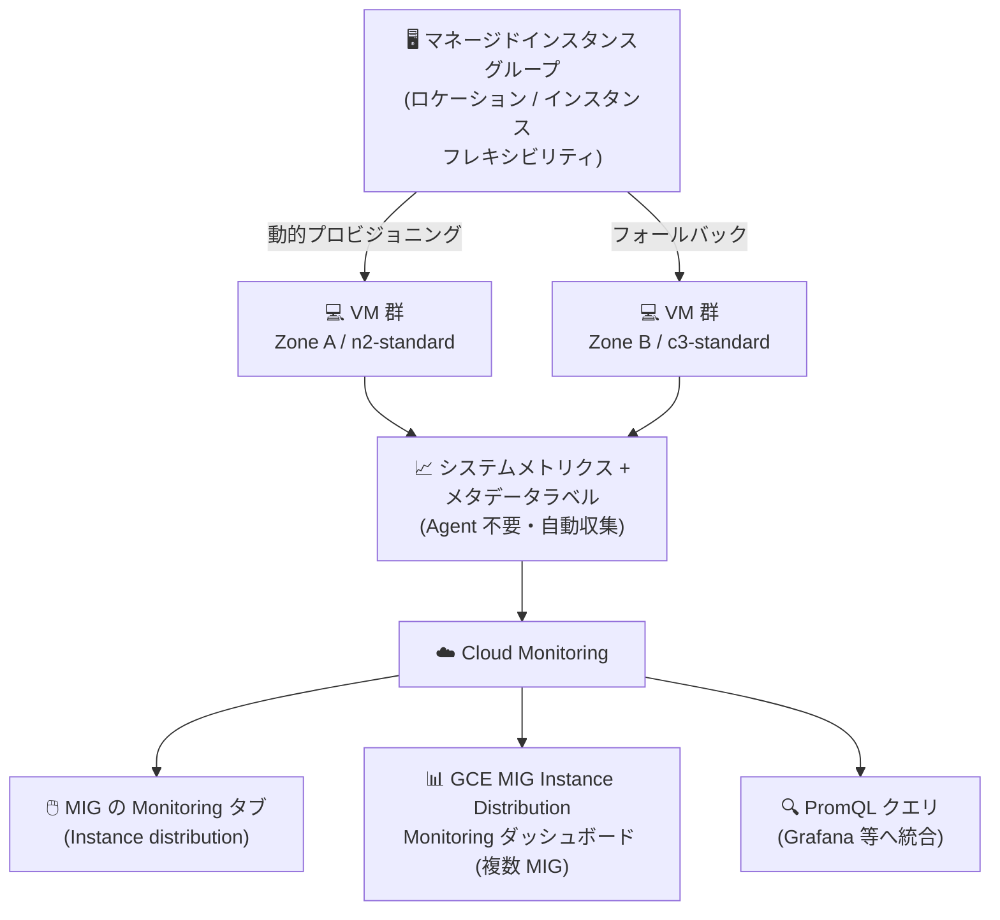

# Compute Engine: MIG インスタンス分散状況のモニタリング (Monitoring タブ)

**リリース日**: 2026-10-22

**サービス**: Compute Engine

**機能**: マネージドインスタンスグループ (MIG) のインスタンス分散状況モニタリング

**ステータス**: 一般提供 (Feature)

📊 [このアップデートのインフォグラフィックを見る](https://takech9203.github.io/google-cloud-news-summary/20261022-compute-engine-mig-instance-distribution-monitoring.html)

## 概要

Google Cloud コンソールの MIG 詳細ページにある **Monitoring タブ**から、マネージドインスタンスグループ (MIG) がインスタンスを**ゾーン別・マシンタイプ別にどのように分散配置しているか**を直接確認できるようになりました。単一の MIG に対するビューに加えて、Cloud Monitoring の事前構成済みダッシュボード「GCE MIG Instance Distribution Monitoring」を使えば、プロジェクト内の複数 MIG を横断した集約ビューも利用できます。

この機能が特に価値を発揮するのは、**ロケーションフレキシビリティ** (リージョナル MIG による複数ゾーンへの分散) や**インスタンスフレキシビリティ** (複数の互換マシンタイプの指定) を利用している MIG です。これらの構成では、MIG がリアルタイムのリソース可用性に基づいて動的にゾーンやマシンタイプを選択するため、「実際にどこで・どのマシンタイプで動いているか」の可視化が、キャパシティ確保状況・ゾーンバランス・フォールバック動作の診断に直結します。

ダッシュボードは Compute Engine の標準システムメトリクス (例: `compute.googleapis.com/instance/cpu/utilization`) とシステムメタデータラベル (例: `metadata.system_labels.machine_type`) に基づいて動作するため、**Ops Agent のインストールやゲスト内テレメトリの設定は不要**です。インフラ運用者や SRE が追加コストなしですぐに使い始められるアップデートです。

**アップデート前の課題**

- ロケーションフレキシビリティやインスタンスフレキシビリティを使う MIG では、ゾーンやマシンタイプがリソース可用性に応じて動的に選択されるため、実際の分散状況を時系列で把握する専用ビューがコンソールになかった
- フォールバックランクのマシンタイプがどの程度使われているか (= 第一希望のマシンタイプが確保できているか) を確認するには、インスタンス一覧やログを個別に調べる必要があった
- 複数 MIG を横断した分散状況の集約ビューを得るには、Cloud Monitoring でカスタムダッシュボードを自作する必要があった

**アップデート後の改善**

- MIG の Monitoring タブ内の「Instance distribution」ビューで、ゾーン別・マシンタイプ別のインスタンス数の推移をコンソールから直接確認できるようになった
- 事前構成済みの「GCE MIG Instance Distribution Monitoring」ダッシュボードにより、プロジェクト内の複数 MIG を横断した集約ビューと、region / zone / instance_group によるフィルタリングが可能になった
- PromQL による同等データのプログラマティックなクエリがドキュメント化され、Grafana などの外部モニタリングツールやカスタムダッシュボードへの統合が容易になった

## アーキテクチャ図



MIG が動的に配置した VM のシステムメトリクスを Cloud Monitoring が自動収集し、MIG の Monitoring タブ (単一 MIG)、事前構成済みダッシュボード (複数 MIG)、PromQL (プログラマティック) の 3 つの方法で分散状況を可視化できます。

## サービスアップデートの詳細

### 主要機能

1. **4 種類の専用チャート**
   - **Instance distribution by zone**: ゾーン別のインスタンス数。ロケーションフレキシビリティとゾーン分散の状況を表示
   - **Instance distribution by machine type**: マシンタイプ別のインスタンス数。インスタンスフレキシビリティによるキャパシティ配分を表示
   - **Active versus inactive instances**: アクティブ (`RUNNING`) と非アクティブ (`PROVISIONING`、`STAGING`、`SUSPENDED`、`STOPPED`、`TERMINATED`) のインスタンス数
   - **Total instance count**: 期間中の MIG 内インスタンス総数

2. **3 つの閲覧方法**
   - 単一 MIG: MIG 詳細ページの Monitoring タブ → 「Instance distribution」
   - 複数 MIG の集約ビュー: Cloud Monitoring の「GCE MIG Instance Distribution Monitoring」ダッシュボード (region / zone / instance_group の組み込みフィルタ変数つき)
   - プログラマティック: PromQL によるクエリで Grafana などの外部ツールに統合

3. **エージェント不要の自動収集**
   - チャートは Compute Engine の標準システムメトリクスとシステムメタデータラベルに基づいており、Cloud Monitoring がすべての Compute Engine インスタンスについて自動収集する
   - Ops Agent のインストールやゲスト内のカスタムテレメトリ設定は不要

4. **ダッシュボードのカスタマイズとイベント注釈**
   - 事前構成済みダッシュボードをコピーすれば、チャート・レイアウト・フィルタをカスタマイズ可能 (MIG の Monitoring タブ内のビュー自体は変更不可)
   - MIG 構成変更、ローリングアップデート、ゾーン障害、オートスケーリング判断などのイベント注釈をチャートに重ねて、キャパシティ変動と運用イベントを関連付けられる

## 技術仕様

### ダッシュボードの基盤

| 項目 | 詳細 |
|------|------|
| 利用メトリクスの例 | `compute.googleapis.com/instance/cpu/utilization` |
| 利用メタデータラベルの例 | `metadata.system_labels.machine_type` |
| 収集方法 | Cloud Monitoring が全 Compute Engine インスタンスで自動収集 (Ops Agent 不要) |
| ダッシュボード名 | GCE MIG Instance Distribution Monitoring (Type メニュー > Google Services カテゴリ) |
| フィルタ変数 | `region` / `zone` / `instance_group` |
| 対象 | MIG 専用 (`bulkInsert` で作成した独立インスタンスは対象外) |
| 位置づけ | オブザーバビリティ用途 (作成失敗やキャパシティ制約の根本原因調査はリソース可用性エラーのトラブルシューティングを参照) |

### 必要な IAM ロール

| 操作 | 必要なロール |
|------|-------------|
| Cloud Monitoring でダッシュボードを閲覧 | Monitoring Viewer (`roles/monitoring.viewer`) |
| Compute Engine で MIG の Monitoring タブに移動 | Compute Viewer (`roles/compute.viewer`) |

## 設定方法

### 前提条件

1. モニタリング対象の MIG が存在すること (ゾーン分散の観察にはリージョナル MIG、マシンタイプ分散の観察にはインスタンスフレキシビリティポリシーの構成が前提)
2. 閲覧者に `roles/monitoring.viewer` および `roles/compute.viewer` が付与されていること

### 手順

#### ステップ 1: 単一 MIG の分散状況を表示

1. Google Cloud コンソールで **[Instance groups]** ページに移動
2. モニタリングする MIG の名前をクリック
3. **[Monitoring]** タブをクリック
4. Monitoring タブのナビゲーションパネルで **[Instance distribution]** を選択

#### ステップ 2: 複数 MIG を横断した集約ビューを表示

1. Google Cloud コンソールで **[Monitoring] > [Dashboards]** ページに移動
2. フィルタで **GCE MIG Instance Distribution Monitoring** ダッシュボードを検索して選択 (Type メニュー > Google Services カテゴリからも選択可)
3. 必要に応じて `region` / `zone` / `instance_group` のフィルタ変数で絞り込み

#### ステップ 3 (任意): PromQL でプログラマティックにクエリ

Metrics Explorer の PromQL コードエディタで以下を実行します。

```promql
# ゾーン別のアクティブインスタンス数
count by (zone) (compute_googleapis_com:instance_cpu_utilization{metadata_system_instance_group="YOUR_MIG_NAME"})

# マシンタイプ別のアクティブインスタンス数
count by (metadata_system_machine_type) (compute_googleapis_com:instance_cpu_utilization{metadata_system_instance_group="YOUR_MIG_NAME"})
```

`YOUR_MIG_NAME` は対象の MIG 名に置き換えます。Grafana などの外部ツールへのデータ統合にも利用できます。

## メリット

### ビジネス面

- **コストとパフォーマンスのバランス改善**: どのマシンタイプが実際に選択されているかを追跡することで、支出とパフォーマンスの実態を把握し、より低コストな構成の優先や高性能マシンタイプへの寄せ替えといった改善機会を発見できる
- **運用工数の削減**: 事前構成済みダッシュボードとエージェント不要の自動収集により、カスタムダッシュボードの自作やテレメトリ設定なしで即座に可視化を開始できる

### 技術面

- **キャパシティ確保状況の検証**: スケールアウト時にリソースを確保できているかを確認できる。フォールバックランクでのインスタンス作成はインスタンスフレキシビリティポリシーが機能している証拠であり、フォールバックしても目標サイズに届かない場合はマシンタイプやゾーンの追加を検討する判断材料になる
- **ゾーンバランスの検証**: リージョナル MIG が意図どおり (`EVEN` / `BALANCED`) にゾーン間でバランスしているか、`ANY` / `ANY_SINGLE_ZONE` でキャパシティが動的にどう移動しているかを観察できる
- **運用イベントとの相関分析**: イベント注釈により、MIG 構成変更・ローリングアップデート・ゾーン障害・オートスケーリングと分散の変化を時系列で関連付けられる

## デメリット・制約事項

### 制限事項

- このダッシュボードはオブザーバビリティ用であり、**トラブルシューティング用ではない**。インスタンス作成失敗やキャパシティ制約の根本原因の特定には、リソース可用性エラーのトラブルシューティングドキュメントを参照する必要がある
- `bulkInsert` メソッドで作成した独立インスタンスのロケーション / インスタンスフレキシビリティのモニタリングには使用できない (MIG 専用)
- MIG の Monitoring タブ内のビューはカスタマイズ不可。チャートやフィルタを変更するには、Cloud Monitoring 側で事前構成済みダッシュボードをコピーしてから編集する必要がある

### 考慮すべき点

- スキップされたランクはストックアウトエラーをログに残さないため、「上位ランクのマシンタイプがなぜ使われなかったか」の詳細調査にはログだけでなく本ダッシュボードの分散データを併用するのが有効

## ユースケース

### ユースケース 1: インスタンスフレキシビリティのフォールバック動作の監視

**シナリオ**: 複数マシンタイプをランク付けして指定したインスタンスフレキシビリティポリシーを使う MIG で、第一希望のマシンタイプがどの程度確保できているかを把握したい。

**実装例**: MIG の Monitoring タブ → Instance distribution で「Instance distribution by machine type」チャートを確認。フォールバックランクのマシンタイプの比率が恒常的に高く、かつ目標サイズに届いていない場合は、許可マシンタイプやゾーンの追加を検討する。

**効果**: キャパシティ不足の予兆を可視化し、リソース可用性エラーの発生確率を下げる構成変更を事前に判断できる。

### ユースケース 2: リージョナル MIG のゾーンバランス検証とコスト最適化

**シナリオ**: `ANY` 分散シェイプのリージョナル MIG で、キャパシティがゾーン間でどのように移動しているかを観察しつつ、選択されているマシンタイプが過剰性能でないかを確認したい。

**効果**: 「Instance distribution by zone」でゾーン偏在を、「Instance distribution by machine type」で実際の機種構成を確認し、ワークロードが許容するなら低コスト機種の優先度を上げるなどの最適化につなげられる。

### ユースケース 3: Grafana への分散メトリクス統合

**シナリオ**: 既存の Grafana ベースの監視基盤に MIG の分散状況を組み込みたい。

**実装例**: PromQL クエリ (`count by (zone) (...)` / `count by (metadata_system_machine_type) (...)`) を使って、ゾーン別・マシンタイプ別のアクティブインスタンス数を外部ダッシュボードに取り込む。

**効果**: チームの既存オブザーバビリティワークフローを変えずに、MIG の分散データを一元的に監視できる。

## 料金

本ダッシュボードは Cloud Monitoring が自動収集する Compute Engine のシステムメトリクスとメタデータラベルを利用しており、Ops Agent のインストールやカスタムテレメトリの設定は不要です。Cloud Monitoring の料金体系の詳細は公式の料金ページを参照してください。

- [Google Cloud Observability の料金](https://cloud.google.com/stackdriver/pricing)

## 関連サービス・機能

- **Cloud Monitoring**: 本ダッシュボードの基盤。メトリクス収集、事前構成済みダッシュボード、PromQL クエリ、イベント注釈を提供
- **リージョナル MIG (ロケーションフレキシビリティ)**: 複数ゾーンへのインスタンス分散。本機能のゾーン別チャートの主な観察対象
- **インスタンスフレキシビリティ**: 複数の互換マシンタイプのランク付け指定。本機能のマシンタイプ別チャートの主な観察対象
- **Cloud Logging**: キャパシティ不足 (`ZONE_RESOURCE_POOL_EXHAUSTED`) などの VM 作成失敗ログの確認に使用。本ダッシュボードと補完関係

## 参考リンク

- 📊 [インフォグラフィック](https://takech9203.github.io/google-cloud-news-summary/20261022-compute-engine-mig-instance-distribution-monitoring.html)
- [公式リリースノート](https://docs.cloud.google.com/release-notes#October_22_2026)
- [Monitor instance distribution in MIGs](https://docs.cloud.google.com/compute/docs/instance-groups/monitor-instance-distribution)
- [リージョナル MIG (ロケーションフレキシビリティ)](https://docs.cloud.google.com/compute/docs/instance-groups/regional-migs)
- [インスタンスフレキシビリティについて](https://docs.cloud.google.com/compute/docs/instance-groups/about-instance-flexibility)
- [Google Cloud Observability の料金](https://cloud.google.com/stackdriver/pricing)

## まとめ

ロケーション / インスタンスフレキシビリティを使う MIG の「実際の配置」が、エージェント不要・追加設定なしでコンソールから直接可視化できるようになりました。リージョナル MIG やインスタンスフレキシビリティを運用しているチームは、まず MIG の Monitoring タブで Instance distribution ビューを確認し、フォールバック頻度やゾーン偏在に応じてマシンタイプ・ゾーン構成の見直しを検討することをお勧めします。

---

**タグ**: Compute Engine, MIG, マネージドインスタンスグループ, Cloud Monitoring, オブザーバビリティ, インスタンスフレキシビリティ, リージョナルMIG
