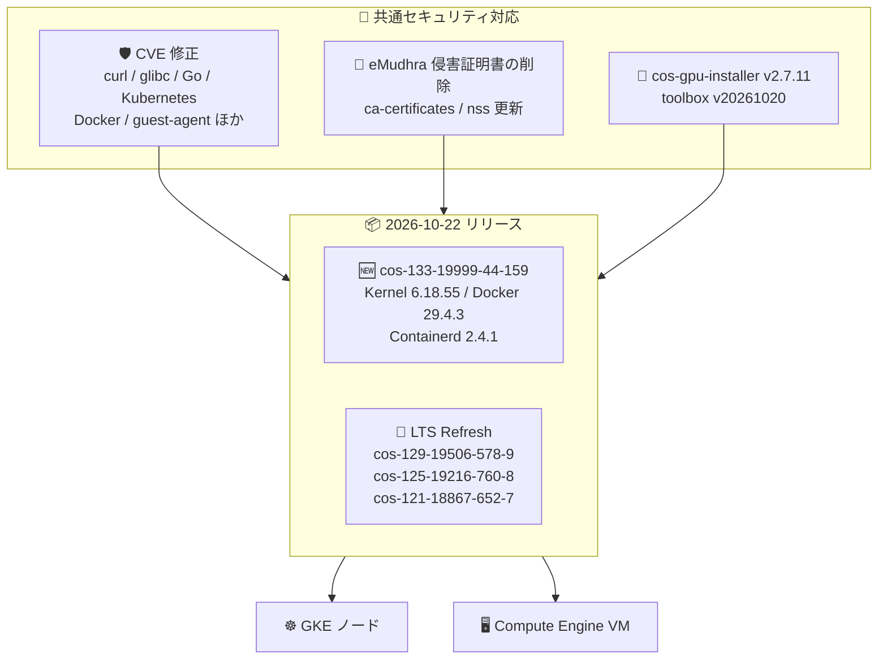

# Container-Optimized OS: cos-133 新リリースと LTS Refresh (cos-121/125/129) によるセキュリティ強化

**リリース日**: 2026-10-22

**サービス**: Container-Optimized OS

**機能**: cos-133-19999-44-159 リリースおよび cos-125/cos-121/cos-129 の LTS Refresh リリース

**ステータス**: GA (リリース済み)

📊 [このアップデートのインフォグラフィックを見る](https://takech9203.github.io/google-cloud-news-summary/20261022-container-optimized-os-cos-133-lts-refresh.html)

## 概要

2026 年 10 月 22 日、Container-Optimized OS (COS) の最新 LTS マイルストーンである **cos-133-19999-44-159** (Kernel COS-6.18.55、Docker v29.4.3、Containerd v2.4.1) がリリースされました。本リリースでは、AMD CPUID faulting に対する KVM 仮想化サポートの追加、ARM イメージへの nvidia-container-toolkit の追加という 2 つの新機能に加え、curl・glibc・Go・Kubernetes・Docker・guest-agent など広範囲なコンポーネントに対する多数の CVE 修正が含まれています。

同日、サポート中の他の LTS マイルストーンに対しても **LTS Refresh リリース** (cos-125-19216-760-8、cos-121-18867-652-7、cos-129-19506-578-9) が提供されました。LTS Refresh は約 3 か月ごとに中・低優先度のバグ修正とセキュリティ修正をまとめて提供する定期リリースで、今回は全マイルストーン共通で cos-gpu-installer v2.7.11 と toolbox v20261020 への更新、多数の CVE 修正が適用されています。

特筆すべきは、全リリース共通で **ca-certificates (v20260816.3.125) と nss (v3.131.1) のアップグレードにより、eMudhra 中間証明書侵害の影響を受けた証明書が削除された**点です。GKE ノードや Compute Engine 上で COS を利用するすべてのユーザーにとって、信頼ストアの健全性を保つための重要なセキュリティ対応となります。

**アップデート前の課題**

- cos-133 を含む各 LTS イメージには、curl の CVE-2026-80256、glibc の CVE-2026-5435、Go の CVE-2026-111943 をはじめとする多数の未修正 CVE が存在していた
- eMudhra 中間証明書侵害の影響を受けた証明書が OS の信頼ストア (ca-certificates / nss) に残存していた
- cos-133 の ARM イメージには nvidia-container-toolkit が含まれておらず、x86 イメージとの構成差分があった
- cos-133 の KVM 仮想化において AMD CPUID faulting がサポートされていなかった

**アップデート後の改善**

- 各 LTS マイルストーン (133/129/125/121) で広範な CVE 修正が適用され、最新イメージへの更新のみでセキュリティリスクを低減できるようになった
- eMudhra 侵害の影響を受けた証明書が ca-certificates / nss から削除され、信頼ストアが浄化された
- cos-133 の ARM イメージでも nvidia-container-toolkit が利用可能になり、ARM ベースの GPU ワークロード構成が容易になった
- cos-133 で AMD CPUID faulting の KVM 仮想化サポートが追加され、ネスト仮想化関連のユースケースで AMD CPU の機能を活用できるようになった

## アーキテクチャ図



cos-133 の新リリースと 3 つの LTS マイルストーンへの LTS Refresh に共通のセキュリティ修正 (CVE 対応、eMudhra 侵害証明書の削除、ツール更新) が適用され、GKE ノードおよび Compute Engine VM に展開されます。

## サービスアップデートの詳細

### 主要機能

1. **cos-133-19999-44-159 の新機能**
   - KVM 仮想化における AMD CPUID faulting のサポートを追加
   - ARM イメージに nvidia-container-toolkit を追加し、ARM 環境での NVIDIA GPU コンテナ利用を支援
   - net-fs/lustre-client-drivers v2.14.0_p262-r1 のサポートを追加
   - app-editors/vim および vim-core を v9.2.1152 にアップグレード

2. **全リリース共通のセキュリティ強化**
   - app-misc/ca-certificates を v20260816.3.125 にアップグレードし、eMudhra 中間証明書侵害の影響を受けた証明書を削除
   - dev-libs/nss を v3.131.1 にアップグレードし、同様に影響を受けた証明書を削除
   - cos-gpu-installer を v2.7.11、toolbox を v20261020 に更新

3. **cos-133 の主な CVE 修正**
   - CVE-2026-80256 (net-misc/curl)
   - CVE-2026-5435 (sys-libs/glibc)
   - CVE-2026-111943 (dev-lang/go を v1.26.10 にアップグレードして修正)
   - CVE-2026-33186 (cri-tools、google-osconfig-agent)
   - CVE-2026-39830〜39834、CVE-2026-42508、CVE-2026-46595 (cos-extensions、node-problem-detector、docker、google-guest-agent、kubernetes、nvidia-container-toolkit、cri-tools など)

4. **LTS Refresh リリース (cos-125 / cos-121 / cos-129)**
   - 約 3 か月ごとに提供される定期リリースで、中・低優先度のバグ修正とセキュリティ修正を一括適用
   - cos-125 / cos-121 では Kubernetes に対して CVE-2026-39833、CVE-2025-30204、CVE-2024-45337、CVE-2026-42508、CVE-2026-46595 など多数の CVE をまとめて修正
   - cos-129 では Go (CVE-2026-111943)、cri-tools (CVE-2026-33186、CVE-2026-46595、CVE-2026-39832)、node-problem-detector (CVE-2026-39831)、nvidia-container-toolkit (CVE-2026-39833) などを修正

## 技術仕様

### 各リリースのコンポーネントバージョン

| リリース | Kernel | Docker | Containerd | 種別 |
|----------|--------|--------|------------|------|
| cos-133-19999-44-159 | COS-6.18.55 | v29.4.3 | v2.4.1 | 通常リリース (新機能含む) |
| cos-129-19506-578-9 | COS-6.12.113 | v27.5.1 | v2.2.7 | LTS Refresh |
| cos-125-19216-760-8 | COS-6.12.113 | v27.5.1 | v2.2.7 | LTS Refresh |
| cos-121-18867-652-7 | COS-6.6.159 | v27.5.1 | v2.0.10 | LTS Refresh |

### LTS マイルストーンのサポート期間

| マイルストーン | イメージファミリー (x86 / Arm) | サポート終了 |
|----------------|-------------------------------|--------------|
| COS 133 LTS | cos-133-lts / cos-arm64-133-lts | 2028 年 11 月 |
| COS 129 LTS | cos-129-lts / cos-arm64-129-lts | 2028 年 7 月 |
| COS 125 LTS | cos-125-lts / cos-arm64-125-lts | 2028 年 2 月 |
| COS 121 LTS | cos-121-lts / cos-arm64-121-lts | 2027 年 3 月 |

各 LTS マイルストーンは LTS ファミリーへの昇格後 26 か月間サポートされ、セキュリティスキャンとパッチ適用が継続的に行われます。

## 設定方法

### 前提条件

1. Google Cloud プロジェクトで Compute Engine API が有効であること
2. GKE の場合はノードイメージタイプに Container-Optimized OS (containerd) を使用していること

### 手順

#### ステップ 1: 最新イメージの確認

```bash
# cos-cloud プロジェクトの最新イメージを一覧表示
gcloud compute images list \
  --project cos-cloud \
  --filter="family~cos-133-lts OR family~cos-125-lts OR family~cos-121-lts OR family~cos-129-lts" \
  --sort-by=~creationTimestamp
```

各 LTS ファミリーで公開されている最新イメージ (今回のリリースバージョン) を確認します。

#### ステップ 2: 新イメージでの VM 作成 (Compute Engine)

```bash
# 検証した特定イメージ名を指定して VM を作成 (本番環境では image-family ではなく特定イメージの指定を推奨)
gcloud compute instances create my-cos-instance \
  --image cos-133-19999-44-159 \
  --image-project cos-cloud \
  --zone asia-northeast1-a
```

公式ドキュメントでは、本番環境では Image Family API に依存せず、検証済みの特定イメージ名を指定することが推奨されています。

## メリット

### ビジネス面

- **セキュリティコンプライアンスの維持**: 多数の CVE 修正と eMudhra 侵害証明書の削除により、イメージ更新だけで脆弱性対応と信頼ストアの健全化を実現できる
- **更新リスクの管理**: LTS Refresh は四半期ごとの計画的なリリースであるため、更新作業のスケジュールを立てやすい

### 技術面

- **広範な CVE 修正の一括適用**: curl、glibc、Go、Kubernetes、Docker、ゲストエージェント群など OS 全域の脆弱性修正が 1 回のイメージ更新で適用される
- **ARM GPU 構成の簡素化**: cos-133 の ARM イメージに nvidia-container-toolkit が標準搭載され、ARM 環境での GPU コンテナ構成の手間が減る
- **全サポート対象マイルストーンへの同時対応**: 旧マイルストーン (121/125/129) を利用中でも、LTS Refresh により同等のセキュリティ修正を受けられる

## デメリット・制約事項

### 制限事項

- Container-Optimized OS にはパッケージマネージャーがなく、個別パッケージの更新はできないため、修正の適用にはイメージ (ノード) の更新が必要
- サポート終了が近いマイルストーン (COS 121 LTS は 2027 年 3 月終了) は、計画的な新マイルストーンへの移行が必要

### 考慮すべき点

- 公式ドキュメントによると、LTS Refresh リリースには中・低優先度の修正が含まれるため、リグレッションの可能性を考慮し、ロールアウト時には通常より慎重な検証が推奨される
- cos-133 と旧マイルストーンでは Docker / Containerd のメジャーバージョンが異なる (v29.4.3 / v2.4.1 と v27.5.1 / v2.2.x 系) ため、マイルストーン間の移行時はランタイム互換性の確認が必要

## ユースケース

### ユースケース 1: GKE ノードのセキュリティパッチ適用

**シナリオ**: GKE クラスタのノードイメージに Container-Optimized OS を使用しており、curl や glibc などの CVE への対応と eMudhra 侵害証明書の削除を速やかに適用したい。

**効果**: ノードの自動アップグレード (node auto-upgrades) または手動アップグレードにより、今回の修正を含む COS イメージへ更新するだけで、OS 全域の CVE 修正と信頼ストアの浄化が完了する。

### ユースケース 2: ARM ベースの GPU ワークロード構築

**シナリオ**: Arm (Axion など) ベースのインスタンスで NVIDIA GPU を使ったコンテナワークロードを実行したい。

**効果**: cos-133 の ARM イメージに nvidia-container-toolkit が追加されたことで、GPU コンテナランタイム構成の手作業が減り、ARM 環境での GPU ワークロード立ち上げが容易になる。

### ユースケース 3: 旧 LTS マイルストーン利用環境の定期更新

**シナリオ**: 安定性重視で cos-121 や cos-125 を固定利用しており、四半期ごとのメンテナンスウィンドウでまとめてパッチを適用したい。

**効果**: LTS Refresh リリース (cos-121-18867-652-7、cos-125-19216-760-8) を計画的に適用することで、マイルストーンを変えずに Kubernetes を含む多数の CVE 修正を取り込める。

## 料金

Container-Optimized OS のイメージ自体に追加のライセンス料金はなく、イメージを実行する Compute Engine / GKE のリソース料金のみが発生します。詳細は料金ページを参照してください。

- [Compute Engine の料金](https://cloud.google.com/compute/pricing)
- [GKE の料金](https://cloud.google.com/kubernetes-engine/pricing)

## 関連サービス・機能

- **Google Kubernetes Engine (GKE)**: COS は GKE のデフォルトノード OS イメージであり、ノード自動アップグレードで今回の修正を展開できる
- **Compute Engine**: cos-cloud プロジェクトのイメージファミリー経由で COS イメージを VM に利用できる
- **cos-gpu-installer / nvidia-container-toolkit**: GPU ドライバーのインストールと GPU コンテナ実行を支援するコンポーネント。今回それぞれ v2.7.11 への更新と ARM イメージへの追加が行われた
- **toolbox**: パッケージマネージャーを持たない COS 上でデバッグ・管理ツールを隔離コンテナとして実行するユーティリティ。v20261020 に更新された

## 参考リンク

- 📊 [インフォグラフィック](https://takech9203.github.io/google-cloud-news-summary/20261022-container-optimized-os-cos-133-lts-refresh.html)
- [公式リリースノート (Google Cloud Release Notes)](https://docs.cloud.google.com/release-notes#October_22_2026)
- [Container-Optimized OS リリースノート](https://docs.cloud.google.com/container-optimized-os/docs/release-notes)
- [Container-Optimized OS の概要](https://docs.cloud.google.com/container-optimized-os/docs/concepts/features-and-benefits)
- [バージョニングと LTS Refresh の説明](https://docs.cloud.google.com/container-optimized-os/docs/concepts/versioning)
- [サポートポリシー](https://docs.cloud.google.com/container-optimized-os/docs/resources/support-policy)
- [セキュリティの概要](https://docs.cloud.google.com/container-optimized-os/docs/concepts/security)

## まとめ

今回のリリースは、最新マイルストーン cos-133 への新機能追加 (AMD CPUID faulting の KVM サポート、ARM イメージへの nvidia-container-toolkit 追加) に加え、サポート中の全 LTS マイルストーンに対する広範な CVE 修正と eMudhra 侵害証明書の削除を含む、セキュリティ色の強いアップデートです。COS を GKE ノードや Compute Engine で利用している場合は、各マイルストーンの最新イメージへの更新を計画することを推奨します。特に LTS Refresh リリースは中・低優先度の修正を含むため、ステージング環境での検証を経てから本番へロールアウトしてください。

---

**タグ**: Container-Optimized OS, COS, LTS, LTS Refresh, セキュリティ, CVE, GKE, Compute Engine, eMudhra, Kernel, Docker, Containerd
