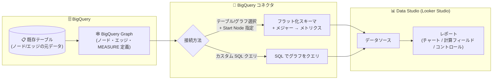

# Data Studio (Looker Studio): BigQuery コネクタが BigQuery Graph への接続に対応

**リリース日**: 2026-10-22

**サービス**: Data Studio (Looker Studio)

**機能**: BigQuery コネクタによる BigQuery Graph 接続とグラフメジャーのメトリクス取り込み

**ステータス**: Feature

📊 [このアップデートのインフォグラフィックを見る](https://takech9203.github.io/google-cloud-news-summary/20261022-data-studio-bigquery-graph-connector.html)

## 概要

Data Studio (Looker Studio) の BigQuery コネクタが、BigQuery Graph への接続に対応しました。データソース作成時にテーブルやビューと同様に BigQuery Graph を直接選択できるほか、カスタム SQL クエリを使ってグラフをクエリすることも可能です。グラフに定義されたメジャー (measure) は、データソースのメトリクスとして自動的にインポートされ、レポート内のチャート、計算フィールド、クエリ結果変数、コントロールで利用できます。

BigQuery Graph は、既存のテーブルを基にノードとエッジを定義してデータの関係性をモデリングできる BigQuery の機能です。グラフにはメジャー (集計プロパティ) を定義でき、結合によって行が重複した場合でもキー単位で正しく集計されることが保証されます。今回のアップデートにより、BigQuery 上でグラフとして定義したセマンティクス (集計ロジック) を、BI ツールである Data Studio のレポートでそのまま活用できるようになりました。

データエンジニアがグラフ側で集計定義を一元管理し、レポート作成者はそれをメトリクスとして利用するだけでよくなるため、集計ミス (結合によるダブルカウントなど) の防止とセマンティクスの一貫性確保に役立ちます。

**アップデート前の課題**

- BigQuery コネクタの接続対象はテーブル・ビュー・カスタム SQL クエリであり、BigQuery Graph をデータソースとして直接選択できなかった
- BigQuery Graph に定義したメジャー (集計プロパティ) を Data Studio のメトリクスとして利用する仕組みがなかった
- 結合によって行が重複するデータモデルでは、レポート側で集計を誤る (ダブルカウントする) リスクへの対処をレポート作成者が個別に行う必要があった

**アップデート後の改善**

- データソース作成時に、テーブル・ビューと並んで BigQuery Graph を直接選択できるようになった (データセット内でグラフとテーブルはアイコンで区別して表示される)
- グラフ選択時に Start Node (グラフ走査の起点) を指定でき、フラット化されたテーブルのスキーマを制御できるようになった
- グラフに定義されたメジャーがメトリクスとして自動インポートされ、チャート・計算フィールド・クエリ結果変数・コントロールで利用できるようになった
- カスタム SQL クエリでも BigQuery Graph に対するクエリを記述できるようになった

## アーキテクチャ図



BigQuery 上の既存テーブルから定義した BigQuery Graph に、BigQuery コネクタ経由 (直接選択またはカスタム SQL) で接続し、グラフのメジャーをメトリクスとして Data Studio のレポートで利用するデータフローです。

## サービスアップデートの詳細

### 主要機能

1. **BigQuery Graph への直接接続**
   - データソース作成時の「Table / Graph」リストから、テーブル・ビューと同様にグラフを選択可能
   - データセットにグラフが含まれる場合、テーブルとグラフは異なるアイコンで表示され区別できる
   - グラフ選択時には「Start Node」リストから走査の起点となるノードを選択できる。Start Node はグラフ走査の起点を決定し、フラット化されたテーブルのスキーマに影響する。グラフの定義によっては Start Node の選択が必須になる

2. **グラフメジャーのメトリクス自動インポート**
   - グラフに定義されたメジャーは、データソースのメトリクスとしてインポートされる
   - チャート、計算フィールド、クエリ結果変数、データソース横断のコントロールで利用可能
   - **集計タイプは固定**: グラフメジャーの集計タイプは BigQuery 側のグラフ定義で決まり、Data Studio 側では変更できない
   - **編集可能なプロパティ**: データ型と説明 (description) は Data Studio のデータソース側で編集可能

3. **カスタム SQL クエリによるグラフのクエリ**
   - CUSTOM QUERY オプションで、BigQuery Graph に対するクエリを含む SQL を記述して接続できる
   - クエリ構文は Standard SQL (GoogleSQL) に準拠
   - BigQuery コンソールで動作確認したクエリを Data Studio のカスタムクエリエディタに貼り付ける方法が推奨されている

4. **公開データセットでの試用**
   - 公開データセット `bigquery-public-data.thelook_ecommerce` の `graph` を使って本機能を試すことができる (SHARED PROJECTS で課金プロジェクトを指定して接続)

## 技術仕様

### BigQuery Graph のメジャー (measure)

| 項目 | 詳細 |
|------|------|
| 定義場所 | ノード/エッジテーブル定義の `PROPERTIES` 句内で `MEASURE()` キーワードを使用 |
| 対応集計関数 | `SUM`、`AVG`、`COUNT`、`MIN`、`MAX`、`AGG` (派生メジャー用) |
| DISTINCT | `AGG` 以外の集計関数で `DISTINCT` キーワードをサポート |
| 集計の粒度 | メジャーは定義されたノード/エッジテーブルの `KEY` を基準に集計され、結合で行が重複しても正しく集計される |
| SQL からのアクセス | `GRAPH_EXPAND` TVF でグラフをリレーショナル表現としてクエリし、メジャー列は `AGG()` 関数でラップして集計 |
| エディション要件 | GQL クエリの実行には Enterprise または Enterprise Plus エディションの予約が必要。オンデマンド料金の場合は `GRAPH_EXPAND` 関数による SQL クエリを利用可能 |

### メジャー定義の例 (BigQuery 側)

```sql
CREATE OR REPLACE PROPERTY GRAPH university.SchoolGraph
  NODE TABLES (
    university.Department
      KEY(dept_id)
      PROPERTIES(dept_id, dept_name, budget,
        MEASURE(SUM(budget)) AS total_budget),
    ...
  )
  EDGE TABLES (...);
```

### 必要な IAM ロール

Data Studio から BigQuery データをクエリするには、以下のロールが必要です。

| ロール | 用途 |
|--------|------|
| BigQuery データ閲覧者 (`roles/bigquery.dataViewer`) | テーブル・ビュー・グラフのデータとメタデータの読み取り |
| BigQuery ジョブユーザー (`roles/bigquery.jobUser`) | 課金プロジェクトでのクエリジョブの実行 |

データソースの認証情報モードがオーナーの認証情報 (デフォルト) の場合はデータソースのオーナーのみがこれらのロールを必要とし、レポート閲覧者は自身の BigQuery アクセス権なしでチャートを閲覧できます。

## 設定方法

### 前提条件

1. Google Cloud 請求先アカウントに関連付けられた Google Cloud プロジェクトがあること
2. 上記の IAM ロール (BigQuery データ閲覧者、BigQuery ジョブユーザー) が付与されていること
3. 接続対象の BigQuery Graph (`CREATE PROPERTY GRAPH`) が作成済みであること

### 手順 (グラフへの直接接続)

#### ステップ 1: データソースの作成

Data Studio でデータソースを作成し、BigQuery コネクタを選択します。

#### ステップ 2: プロジェクト・データセット・グラフの選択

1. プロジェクトを選択 (RECENT PROJECTS / MY PROJECTS / SHARED PROJECTS)
2. データセットを選択
3. 「Table / Graph」リストからグラフを選択 (グラフはテーブルと異なるアイコンで表示される)
4. 必要に応じて「Start Node」リストから起点ノードを選択

#### ステップ 3: レポートでメトリクスとして利用

グラフに定義されたメジャーがメトリクスとしてインポートされるので、チャートや計算フィールドで利用します。

### 手順 (カスタム SQL クエリでの接続)

CUSTOM QUERY オプションを選択し、BigQuery コンソールで検証済みのグラフクエリを貼り付けます。メジャーを SQL から扱う場合は `GRAPH_EXPAND` TVF と `AGG()` 関数を使用します。

```sql
SELECT
  College_college_name,
  AGG(Department_total_budget) AS college_budget
FROM GRAPH_EXPAND("university.SchoolGraph")
GROUP BY College_college_name;
```

## メリット

### ビジネス面

- **セマンティクスの一元管理**: 集計ロジック (メジャー) を BigQuery のグラフ定義に集約でき、レポート作成者ごとの集計定義のばらつきを防げる
- **集計ミスの防止**: メジャーはテーブルの KEY を基準に集計されるため、結合による行の重複があってもダブルカウントせず、レポートの数値の信頼性が向上する
- **BI 民主化**: グラフでモデリングした関係性データ (顧客・取引・サプライチェーンなど) を、無料で使える Looker Studio のレポートで広く共有できる

### 技術面

- **ETL 不要**: グラフを中間テーブルに展開するパイプラインを作らなくても、コネクタがグラフをフラット化したスキーマとして扱える
- **Start Node によるスキーマ制御**: グラフ走査の起点を選択することで、レポート用途に合わせたフラット化スキーマを得られる
- **カスタム SQL との併用**: 定義済みグラフの直接接続と、`GRAPH_EXPAND` などを使った柔軟なカスタムクエリを使い分けられる

## デメリット・制約事項

### 制限事項

- グラフメジャーの集計タイプは BigQuery 側のグラフ定義で固定され、Data Studio 側では変更できない (編集できるのはデータ型と説明のみ)
- BigQuery Graph のメジャー機能は、特定の BigQuery エディションで作成された予約では利用できない場合がある
- GQL クエリの実行には Enterprise または Enterprise Plus エディションの予約が必要 (オンデマンドの場合は `GRAPH_EXPAND` による SQL クエリを使用)
- `GRAPH_EXPAND` はすべてのグラフを入力として受け付けるわけではなく、入力制限がある (例: 多対多の中間テーブルをエッジテーブルとしてモデリングするとエッジが無視される)

### 考慮すべき点

- Data Studio 経由の BigQuery アクセスにはクエリ処理コストが発生し得るため、課金プロジェクトの設計 (データ参照プロジェクトと課金プロジェクトの分離など) を検討する
- 公開データセット `bigquery-public-data.thelook_ecommerce` の graph で事前に動作を確認してから本番データに適用するとよい

## ユースケース

### ユースケース 1: e コマースの顧客・注文分析レポート

**シナリオ**: 顧客、注文、商品の関係を BigQuery Graph でモデリングし、グラフに売上合計や注文数などのメジャーを定義。マーケティングチームが Looker Studio のダッシュボードで利用する。

**実装例**:
```
1. BigQuery で CREATE PROPERTY GRAPH により顧客-注文-商品のグラフを作成し、
   MEASURE(SUM(sale_price)) AS total_sales などのメジャーを定義
2. Looker Studio の BigQuery コネクタでグラフを選択し、Start Node を指定
3. インポートされた total_sales メトリクスをチャートに配置
```

**効果**: 結合による売上のダブルカウントを防ぎつつ、レポート作成者は集計ロジックを意識せずにメトリクスを利用できる。

### ユースケース 2: 公開データセットでの機能検証

**シナリオ**: 本番導入前に、公開データセット `bigquery-public-data.thelook_ecommerce` の `graph` に接続して、グラフ接続とメジャーのインポート動作を検証する。

**効果**: 自社データのグラフ化に先立ち、コネクタの挙動 (Start Node 選択、メトリクスのインポート、固定集計) を低リスクで確認できる。

## 料金

Looker Studio (Data Studio) 自体のこの機能に追加料金はありませんが、BigQuery は有料の分析プラットフォームであり、Data Studio のレポート経由で BigQuery データにアクセスするとクエリ処理コストが発生する場合があります。また、GQL クエリの実行には Enterprise または Enterprise Plus エディションの予約が必要です。

詳細は [BigQuery の料金ページ](https://cloud.google.com/bigquery/pricing) を参照してください。

## 関連サービス・機能

- **BigQuery Graph**: 既存テーブルからノードとエッジを定義してデータの関係性をモデリングする機能。GQL (ISO 標準のグラフクエリ言語) と SQL の両方で操作でき、本アップデートの接続対象
- **BigQuery グラフメジャー**: グラフのノード/エッジに定義する集計プロパティ。本アップデートで Data Studio のメトリクスとしてインポートされるようになった
- **Spanner Graph**: BigQuery Graph と同じグラフスキーマ・クエリ言語を共有。運用系グラフワークロードを Spanner で、分析を BigQuery で実行する構成が可能
- **Looker (LookML)**: `sql_analytic_model_name` パラメータで BigQuery Graph をインデータベース分析モデルとして LookML Explore の基盤に利用可能。ガバナンスされたセマンティックレイヤーが必要な場合の選択肢
- **BigQuery Conversational Analytics**: グラフに対して自然言語で質問でき、エージェントがグラフに定義されたメジャーを利用して回答品質を向上させる

## 参考リンク

- 📊 [インフォグラフィック](https://takech9203.github.io/google-cloud-news-summary/20261022-data-studio-bigquery-graph-connector.html)
- [公式リリースノート](https://docs.cloud.google.com/release-notes#October_22_2026)
- [ドキュメント: Connect to Google BigQuery](https://docs.cloud.google.com/data-studio/connect-to-google-bigquery#connect-to-a-bigquery-table-or-view)
- [ドキュメント: BigQuery Graph の概要](https://docs.cloud.google.com/bigquery/docs/graph-overview)
- [ドキュメント: グラフメジャーの定義とクエリ](https://docs.cloud.google.com/bigquery/docs/graph-measures)
- [料金ページ: BigQuery pricing](https://cloud.google.com/bigquery/pricing)

## まとめ

BigQuery Graph でモデリングした関係性データとメジャーを、Looker Studio のレポートでそのままメトリクスとして利用できるようになり、集計ロジックの一元管理とダブルカウント防止を BI レイヤーまで一貫して実現できます。まずは公開データセット `thelook_ecommerce` の graph で接続とメジャーのインポートを試し、自社のグラフモデルへの適用を検討することを推奨します。

---

**タグ**: #DataStudio #LookerStudio #BigQuery #BigQueryGraph #GraphMeasures #BI #データ可視化
