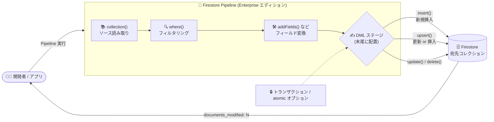

# Firestore: Pipeline DML オペレーションが GA、insert / upsert ステージを追加

**リリース日**: 2026-10-22

**サービス**: Firestore

**機能**: Pipeline Data Manipulation Language (DML) オペレーションの一般提供開始と insert / upsert ステージの追加

**ステータス**: GA (一般提供)

📊 [このアップデートのインフォグラフィックを見る](https://takech9203.github.io/google-cloud-news-summary/20261022-firestore-pipeline-dml-ga.html)

## 概要

Firestore の Pipeline オペレーションにおける Data Manipulation Language (DML) オペレーションが一般提供 (GA) となりました。あわせて、新しい出力ステージとして `insert()` と `upsert()` のサポートが追加されました。これにより、Pipeline クエリの末尾に DML ステージを接続し、クエリ結果に対して直接サーバーサイドでドキュメントの挿入・更新・削除を実行できます。

Pipeline オペレーションは Firestore Enterprise エディションの中核機能で、ステージベースの合成可能な構文により、集計・結合・複雑なフィルタリングなど従来の Core オペレーションでは表現できなかった高度なクエリを実現します。今回の DML の GA により、Pipeline は「読み取り」だけでなく「書き込み」までを 1 つのパイプラインで完結できるようになり、データモデル変更のバックフィル、コレクション間のデータ移行、条件付き一括削除といった運用タスクをクエリ 1 本で記述できます。

対象ユーザーは、Firestore Enterprise エディションを利用し、大量ドキュメントの一括変更・移行・クリーンアップを効率化したいアプリケーション開発者やデータ運用担当者です。

**アップデート前の課題**

- Pipeline オペレーションはクエリ (読み取り) が中心であり、クエリ結果に基づいてドキュメントを書き換えるには、クライアント側で結果を受け取ったうえでドキュメント API (Core オペレーションの書き込み) を使って個別に書き込む必要があった
- 一括更新や移行処理では「読み取り → アプリケーション側で変換 → 書き込み」という往復が発生し、アプリケーションコードが複雑になりがちだった
- クエリ結果を別コレクションへ挿入する、存在すれば更新・なければ挿入する (upsert) といった操作を、サーバーサイドのパイプラインとして宣言的に表現する手段がなかった

**アップデート後の改善**

- DML ステージ (`insert()` / `upsert()` / `update()` / `delete()`) が GA となり、本番ワークロードで利用できるようになった
- 新たに `insert()` (新規ドキュメントの追加) と `upsert()` (存在すれば更新・なければ挿入) がサポートされ、クエリ結果をそのまま別コレクションへ書き込むデータ移行・コピーが 1 パイプラインで完結するようになった
- DML ステージをトランザクション内で実行できるようになり、`atomic` オプションを使えば新しいトランザクション内での自動実行・コミットも可能になった
- トランザクション内で実行する場合、`where`、`addFields`、`union`、`findNearest`、集計サブクエリなど他のステージとの組み合わせに制限がなくなった

## アーキテクチャ図



Pipeline の末尾に DML ステージを接続することで、クエリ・変換・書き込みをサーバーサイドの 1 つのパイプラインとして実行できます。`insert()` と `upsert()` は原則としてトランザクション内 (または `atomic` オプション付き) での実行が必要です。

## サービスアップデートの詳細

### 主要機能

1. **insert() ステージ (新規追加)**
   - クエリ結果やリテラル値を新規ドキュメントとして Firestore に追加する DML ステージ
   - 引数パターン: `insert(collectionName, documentIdExpression)` (式でドキュメント ID を決定)、`insert(collectionName)` (ID を自動生成)、`insert()` (入力ドキュメントの `__name__` フィールドで宛先コレクションと ID を決定)
   - `users/u1/posts` のようなフルパス指定でサブコレクションへの直接挿入も可能
   - 挿入先に同一ドキュメントが既に存在する場合は `ALREADY_EXISTS` エラーで失敗する
   - パイプラインの最終ステージである必要があり、後続ステージは追加できない

2. **upsert() ステージ (新規追加)**
   - 既存ドキュメントがあれば更新、なければ新規挿入する DML ステージ
   - 引数パターン: `upsert(collectionName, documentIdExpression, ...transformations)`、`upsert(collectionName, ...transformations)`、`upsert(...transformations)` (後者 2 つは入力の `__name__` フィールドで ID / 宛先を決定)
   - 前段のステージが同一ドキュメント ID を複数生成した場合は「後勝ち (last one wins)」セマンティクスで順次処理される

3. **update() / delete() ステージ (GA)**
   - `update()`: クエリで絞り込んだドキュメントにフィールドの追加・変更を適用。入力ドキュメントに `__name__` フィールドが必要で、対象が存在しない場合は失敗
   - `delete()`: クエリ条件に一致するドキュメントを削除。誤った一括削除を防ぐため、少なくとも 1 つの `where()` ステージを含めることが推奨されている

4. **トランザクション実行と atomic オプション**
   - 明示的な read-write トランザクション内で DML パイプラインを実行可能
   - `atomic` オプション (Java では `withAtomic(true)`) を指定すると、新しいトランザクション内で自動実行し、成功時に自動コミットする
   - `insert()` と `upsert()` はほとんどのケースでトランザクション内での実行が必要

## 技術仕様

### DML ステージの比較

| ステージ | 動作 | 同一 ID が複数回対象になった場合 |
|------|------|------|
| `insert()` | 新規ドキュメントを追加 (既存なら `ALREADY_EXISTS` エラー) | 最初の試行で作成、以降は `ALREADY_EXISTS` で失敗 |
| `upsert()` | 既存なら更新、なければ挿入 | 後勝ち (last one wins) |
| `update()` | 既存ドキュメントを変更 (存在しなければ失敗) | 後勝ち (last one wins) |
| `delete()` | ドキュメントを削除 | 最初の試行で削除、以降は no-op |

### 実行モードによる挙動の違い

| 項目 | トランザクション内 | トランザクション外 |
|------|------|------|
| 原子性 | トランザクションとして原子的にコミット | ドキュメントごとに独立して書き込み (ドキュメント間の原子性なし)。最初のエラーで停止し、部分的成功が発生しうる |
| 利用できるステージ | 制限なし (`where`、`addFields`、`union`、`findNearest`、集計サブクエリなども利用可) | 高度なマルチクエリステージ (`aggregate`、`distinct`、`unnest`、`find_nearest`、`union`、join、サブクエリ) は非対応 |
| 制約 | Enterprise エディションのトランザクション上限に従う。書き込み後の読み取りは不可 (`FAILED_PRECONDITION` エラー) | — |

### レスポンス

DML ステージは変更したドキュメント数のサマリーを 1 ドキュメントとして返します。

```json
{ "documents_modified": 3 }
```

## 設定方法

### 前提条件

1. Firestore Enterprise エディションのデータベースを使用していること (DML オペレーションは Enterprise エディションが必要)
2. Pipeline オペレーションでのクエリ方法に習熟していること

### 手順

#### ステップ 1: クエリ結果を別コレクションへ upsert する

```javascript
// Node.js: users コレクションから age >= 25 のドキュメントを抽出し、
// processed フィールドを付与して new_users へ upsert (トランザクション内)
const results = await db.runTransaction(async (transaction) => {
  return transaction.execute(
    db.pipeline()
      .collection("users")
      .where(field("age").greaterThanOrEqual(25))
      .addFields(constant(true).as("processed"))
      .upsert({ collection: "new_users", documentId: field("name") })
  );
});
```

クエリ・変換・書き込みが 1 つのパイプラインで完結します。

#### ステップ 2: リテラル値から新規ドキュメントを insert する

```javascript
// Node.js: ID を指定して新規ドキュメントを挿入
const results = await db.pipeline()
  .literals([
    { foo: "bar", id: "doc1" },
    { foo: "baz", id: "doc2" }
  ])
  .insert({ collection: "users", documentId: field("id") })
  .execute();
```

`insert({ collection: "users" })` のように ID 式を省略すると、ドキュメント ID は自動生成されます。

#### ステップ 3: atomic オプションで自動トランザクション実行する

```javascript
// Node.js: atomic オプションで新しいトランザクション内で実行し、成功時に自動コミット
const results = await db.pipeline()
  .collection("users")
  .where(field("active").equal(false))
  .addFields(constant("inactive").as("status"))
  .update()
  .execute({ atomic: true });
```

明示的なトランザクション管理コードを書かずに、原子的な DML 実行が可能です。

## メリット

### ビジネス面

- **運用タスクの省力化**: データモデル変更のバックフィルやコレクション間移行をパイプライン 1 本で記述でき、専用のバッチ処理コードの開発・運用コストを削減できる
- **GA による本番適用**: 一般提供となったことで、本番ワークロードでの採用判断がしやすくなった

### 技術面

- **サーバーサイドでの読み書き完結**: クライアントへの読み取り結果の往復が不要になり、クエリ結果に対する書き込みをサーバーサイドで宣言的に表現できる
- **高度なクエリとの組み合わせ**: トランザクション内であれば `search` や `findNearest` などの高度なクエリステージの結果をそのまま書き込みに接続できる
- **原子的実行の選択肢**: 明示的トランザクションと `atomic` オプションの 2 通りで原子的な実行を選択できる

## デメリット・制約事項

### 制限事項

- Firestore Enterprise エディションが必要 (Standard エディションでは利用不可)
- DML ステージはパイプラインの末尾に配置する必要がある
- `insert()` と `upsert()` はほとんどのケースでトランザクション内での実行が必要
- トランザクションでは最初の書き込み以降の読み取りができないため、1 つのトランザクション内で DML パイプラインを複数回呼び出したり、DML 実行後にドキュメントを読み取ったりすることはできない (`FAILED_PRECONDITION` エラー)
- トランザクション外で実行する場合、書き込みはドキュメント間で原子的ではなく、最初のエラーで停止するため部分的成功が発生しうる。また `aggregate`、`distinct`、`unnest`、`find_nearest`、`union`、join、サブクエリなどの高度なステージは利用できない

### 考慮すべき点

- Firebase Security Rules 環境では、ドキュメントのバッチごとにルールが再評価される。ルールで `get()` / `exists()` を使っている場合、約 200 ドキュメントの書き込みでグローバルな 20 ルックアップ上限に達し `PERMISSION_DENIED` で失敗するため、Custom Claims の利用が推奨される
- `delete()` を使うパイプラインでは、誤った一括削除を防ぐため少なくとも 1 つの `where()` ステージを含めるべき
- 前段ステージが同一ドキュメント ID を複数生成した場合のセマンティクス (upsert / update は後勝ち、insert は 2 回目以降エラー、delete は 2 回目以降 no-op) を理解して設計する必要がある

## ユースケース

### ユースケース 1: データモデル変更のバックフィル

**シナリオ**: `users` コレクショングループの全ドキュメントに新しいフィールド `preferences.color` を追加するスキーマ変更を行い、既存ドキュメントをバックフィルしたい。

**実装例**:
```javascript
const snapshot = await db.pipeline()
  .collectionGroup("users")
  .where(not(exists(field("preferences.color"))))
  .addFields(constant(null).as("preferences.color"))
  .removeFields("color")
  .update()
  .execute();
```

**効果**: 対象ドキュメントの抽出・変換・更新がサーバーサイドの 1 パイプラインで完結し、専用のバッチ処理コードが不要になる。

### ユースケース 2: 条件に基づくコレクション間のデータ移行

**シナリオ**: `source_coll` のアクティブなドキュメントにフィールドを付与して `target_coll` へコピーしたい。

**実装例**:
```javascript
const results = await db.runTransaction(async (transaction) => {
  return transaction.execute(
    db.pipeline()
      .collection("source_coll")
      .where(field("active").equal(true))
      .addFields(constant("val").as("new_field"))
      .insert({ collection: "target_coll" })
  );
});
```

**効果**: 読み取り・変換・別コレクションへの書き込みがトランザクション内で原子的に実行され、移行処理の信頼性が向上する。

### ユースケース 3: 古いデータの定期クリーンアップ

**シナリオ**: 作成から 10 日以上経過した特定条件のドキュメントを削除したい。

**実装例**:
```javascript
const pipeline = db.pipeline()
  .collectionGroup("users")
  .where(field("address.country").equal("USA"))
  .where(field("__create_time__").timestampAdd("day", 10).lessThan(currentTimestamp()))
  .delete();
await pipeline.execute();
```

**効果**: クライアント側で対象を列挙して個別削除する処理が不要になり、クリーンアップ処理をクエリとして宣言的に管理できる。

## 料金

DML オペレーションは Firestore Enterprise エディションの機能です。Enterprise エディションはユニットベースの課金モデルを採用しており、公式ドキュメントによると Read Unit は 4 KB 単位、Write Unit は 1 KB 単位で課金されます (ドキュメントの書き込みではデータ分に加えて更新されるインデックスエントリ分のユニットも消費されます)。

最新の詳細な料金は公式料金ページを参照してください。

- [Firestore 料金ページ](https://cloud.google.com/firestore/pricing)

## 関連サービス・機能

- **Firestore Pipeline オペレーション**: 今回 GA となった DML の基盤。ステージベースの合成可能な構文で、集計・結合・複雑なフィルタリング・ベクトル検索 (`findNearest`) などをサポート
- **Firestore Core オペレーション**: 従来のドキュメント CRUD・リアルタイムリスナー・オフライン永続化のインターフェース。リアルタイム / オフライン要件には引き続き Core オペレーションを使用
- **Firestore Enterprise エディション**: DML を含む Pipeline オペレーションの前提となるエディション。Query Explain / Query Insights、sparse / unique などの新しいインデックスタイプも提供
- **Firebase Security Rules**: クライアントからの DML 実行時にバッチごとにルールが再評価されるため、設計上の考慮が必要

## 参考リンク

- 📊 [インフォグラフィック](https://takech9203.github.io/google-cloud-news-summary/20261022-firestore-pipeline-dml-ga.html)
- [公式リリースノート](https://docs.cloud.google.com/release-notes#October_22_2026)
- [ドキュメント: Pipeline DML でのデータ変更](https://docs.cloud.google.com/firestore/native/docs/pipeline/dml)
- [ドキュメント: insert (Output Stage)](https://docs.cloud.google.com/firestore/native/docs/pipeline/stages/output/insert)
- [ドキュメント: upsert (Output Stage)](https://docs.cloud.google.com/firestore/native/docs/pipeline/stages/output/upsert)
- [料金ページ](https://cloud.google.com/firestore/pricing)

## まとめ

Firestore Pipeline の DML オペレーションが GA となり、`insert()` / `upsert()` の追加によってクエリ結果の挿入・更新・削除までをサーバーサイドの 1 パイプラインで完結できるようになりました。Enterprise エディションを利用している場合は、バックフィルやデータ移行などのバッチ処理を DML パイプラインへ置き換えることで、アプリケーションコードの簡素化と運用効率の向上が期待できます。トランザクション要件やセキュリティルールのルックアップ上限などの制約を確認したうえで導入を検討してください。

---

**タグ**: Firestore, Pipeline, DML, insert, upsert, GA, Enterprise エディション, データベース
