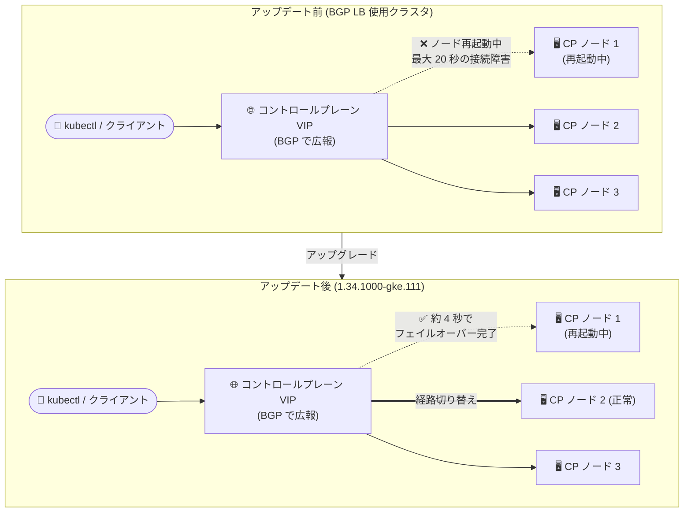

# Google Distributed Cloud (software only) for bare metal: バージョン 1.34.1000-gke.111 リリース

**リリース日**: 2026-10-22

**サービス**: Google Distributed Cloud (software only) for bare metal

**機能**: バージョン 1.34.1000-gke.111 リリース (BGP ロードバランシングのフェイルオーバー改善を含む)

**ステータス**: Announcement + Feature + Fixes

📊 [このアップデートのインフォグラフィックを見る](https://takech9203.github.io/google-cloud-news-summary/20261022-gdc-bare-metal-1-34-1000-gke-111.html)

## 概要

Google Distributed Cloud (software only) for bare metal のバージョン **1.34.1000-gke.111** がダウンロード可能になりました。本バージョンは **Kubernetes v1.34.7-gke.200** 上で動作します。リリース後、GKE On-Prem API クライアント (Google Cloud コンソール、gcloud CLI、Terraform) でインストールやアップグレードに利用可能になるまで、約 7〜14 日かかります。サードパーティのストレージベンダーを利用している場合は、事前認定済みストレージパートナーの一覧の確認が推奨されています。

本リリースの最大の改善点は、**バンドル型 BGP ロードバランシングを使用するクラスタにおけるコントロールプレーンのフェイルオーバー動作の改善**です。従来はコントロールプレーンのアップグレードや構成更新の際に、コントロールプレーンノードの再起動中、最大 20 秒間 API サーバーへの接続障害が発生する可能性がありました。修正後は、正常なコントロールプレーンノードへのフェイルオーバーが約 4 秒で完了します。

このほか、NodePool コントローラーの修正、メンテナンスモード移行時の BareMetalMachine コンディションの修正、コントロールプレーン構成更新時に複数の API サーバーが同時に再起動する問題の修正、および脆弱性の修正が含まれています。オンプレミスのベアメタル環境で Kubernetes クラスタを運用する組織、特にコントロールプレーンの可用性が重要な本番環境のプラットフォーム管理者に関係するアップデートです。

なお、同日にリリースされた VMware 版 (Google Distributed Cloud for VMware) のアップデートは別レポートで扱います。本レポートはベアメタル版のみを対象とします。

**アップデート前の課題**

- バンドル型 BGP ロードバランシングを使用するクラスタでは、コントロールプレーンのアップグレードや構成更新時にコントロールプレーンノードが再起動すると、最大 20 秒間 API サーバーへの接続障害が発生する可能性があった
- コントロールプレーン構成を更新すると、複数の API サーバーが同時に再起動し、コントロールプレーンが一時的に利用不能になる問題があった
- NodePool コントローラーが部分的な reconciliation 失敗時に `Status.ManagedFields` を早期に更新してしまい、削除されたはずの taint やラベルが対象ノードに残留する問題があった
- メンテナンスモード移行時の BareMetalMachine コンディションに問題があった

**アップデート後の改善**

- バンドル型 BGP ロードバランシング使用時、正常なコントロールプレーンノードへのフェイルオーバーが約 4 秒で完了するようになり、API サーバー接続断の時間が大幅に短縮された (最大 20 秒 → 約 4 秒)
- コントロールプレーン構成の更新時に API サーバーがローリングで再起動されるようになり、一時的なコントロールプレーン全体の停止が解消された
- 削除された taint やラベルがノードに残留する問題が解消された
- 「Vulnerability fixes」に記載されている脆弱性が修正された

## アーキテクチャ図



バンドル型 BGP ロードバランシングでは、各コントロールプレーンノードが外部ピア (ToR スイッチなど) と BGP セッションを確立してコントロールプレーン VIP を広報します。本アップデートにより、アップグレードや構成更新でノードが再起動した際の正常ノードへのフェイルオーバーが最大 20 秒から約 4 秒に短縮されました。

## サービスアップデートの詳細

### 主要機能

1. **バージョン 1.34.1000-gke.111 の提供開始 (Announcement)**
   - Kubernetes v1.34.7-gke.200 上で動作
   - アップグレード方法は公式ドキュメント「Upgrade clusters」を参照
   - リリース後、GKE On-Prem API クライアント (Google Cloud コンソール、gcloud CLI、Terraform) でのインストール・アップグレードに利用可能になるまで約 7〜14 日を要する
   - サードパーティストレージベンダー利用時は、事前認定済みストレージパートナーの一覧を確認

2. **バンドル型 BGP ロードバランシングにおけるフェイルオーバー改善 (Feature)**
   - コントロールプレーンのアップグレードまたは構成更新時に、コントロールプレーンノードの再起動中、最大 20 秒間 API サーバー接続障害が発生し得る問題を修正
   - 修正後は、正常なコントロールプレーンノードへのフェイルオーバーが約 4 秒で完了

3. **NodePool コントローラーの修正 (Feature)**
   - 部分的な reconciliation 失敗時に NodePool コントローラーが `Status.ManagedFields` を早期に更新し、削除された taint やラベルが対象ノードに残留する問題を修正

4. **バグ修正 (Fixes)**
   - 「Vulnerability fixes」に記載された脆弱性を修正
   - メンテナンスモード移行時の BareMetalMachine コンディションを修正
   - コントロールプレーン構成の更新時に複数の API サーバーが同時に再起動し、コントロールプレーンが一時的に利用不能になる問題を修正

## 技術仕様

### リリース概要

| 項目 | 詳細 |
|------|------|
| バージョン | 1.34.1000-gke.111 |
| Kubernetes バージョン | v1.34.7-gke.200 |
| GKE On-Prem API クライアントでの利用可能時期 | リリース後約 7〜14 日 |
| 対象クライアント | Google Cloud コンソール、gcloud CLI、Terraform |
| BGP LB フェイルオーバー時間 | 最大 20 秒の接続障害 → 約 4 秒でフェイルオーバー完了 |

### バンドル型 BGP ロードバランシングの構成 (参考)

公式ドキュメントによると、バンドル型 BGP ロードバランシングはクラスタ構成ファイルの `loadBalancer` セクションで `mode: bundled`、`type: bgp` を指定して有効化します。各コントロールプレーンノードはインフラ内の 1 つ以上の外部ピアと BGP セッションを確立し、コントロールプレーン VIP の広報はコントロールプレーンノードの IP アドレスから開始されます。

```yaml
apiVersion: baremetal.cluster.gke.io/v1
kind: Cluster
spec:
  loadBalancer:
    mode: bundled
    type: bgp
    localASN: CLUSTER_ASN
    bgpPeers:
    - ip: PEER_IP
      asn: PEER_ASN
      controlPlaneNodes:   # 省略可。省略時は全 CP ノードが全ピアに接続
      - CP_NODE_IP
    ports:
      controlPlaneLBPort: 443
    vips:
      controlPlaneVIP: 10.0.0.8
      ingressVIP: 10.0.0.1
```

主な技術要件 (公式ドキュメントより):

- コントロールプレーン VIP 用と Service VIP 用のピアリングセッションは分離されている
- eBGP ピアリングのみサポート (マルチホップはデフォルトで有効)
- 高可用性のため、外部ピアは少なくとも 2 つ指定することが推奨されている
- BGP ADD-PATH (RFC 7911) の受信モードでの利用と、ネットワーク側での ECMP の有効化が推奨されている

## 設定方法

### 前提条件

1. 既存の Google Distributed Cloud (software only) for bare metal クラスタが稼働していること
2. アップグレードパスがサポートされていることを公式ドキュメント「Upgrade clusters」で確認すること
3. GKE On-Prem API クライアント (コンソール、gcloud CLI、Terraform) でアップグレードする場合は、リリース後約 7〜14 日でバージョンが利用可能になる点に留意すること

### 手順

#### ステップ 1: クラスタ構成ファイルのバージョン更新

```yaml
apiVersion: baremetal.cluster.gke.io/v1
kind: Cluster
metadata:
  name: CLUSTER_NAME
  namespace: cluster-CLUSTER_NAME
spec:
  anthosBareMetalVersion: 1.34.1000-gke.111
```

クラスタ構成ファイルの `anthosBareMetalVersion` をターゲットバージョンに更新します。ワーカーノードプールを選択的にアップグレードする場合は、NodePool スペックの `anthosBareMetalVersion` で制御できます (コントロールプレーンノードとロードバランサーノードプールは常にアップグレード対象)。

#### ステップ 2: アップグレードの実行

```bash
bmctl upgrade cluster -c CLUSTER_NAME --kubeconfig=ADMIN_KUBECONFIG
```

詳細な手順やアップグレードの一時停止・再開機能については、公式ドキュメント「Upgrade clusters」を参照してください。

## メリット

### ビジネス面

- **計画メンテナンス時の影響最小化**: コントロールプレーンのアップグレードや構成変更に伴う API サーバー接続断が最大 20 秒から約 4 秒に短縮され、メンテナンスウィンドウ中のサービス影響が低減される
- **セキュリティリスクの低減**: 脆弱性修正が含まれており、オンプレミス環境のセキュリティ態勢を維持できる

### 技術面

- **コントロールプレーンの可用性向上**: 構成更新時に複数の API サーバーが同時再起動する問題が修正され、ローリングでの再起動により一時的なコントロールプレーン全停止が解消された
- **BGP フェイルオーバーの高速化**: バンドル型 BGP ロードバランシング使用時の正常ノードへの経路切り替えが約 4 秒で完了する
- **ノード状態の整合性向上**: NodePool コントローラーの修正により、削除された taint やラベルがノードに残留しなくなり、スケジューリングの予期しない動作を防げる

## デメリット・制約事項

### 考慮すべき点

- リリース後、GKE On-Prem API クライアント (Google Cloud コンソール、gcloud CLI、Terraform) でこのバージョンが利用可能になるまで約 7〜14 日かかる
- BGP フェイルオーバー改善の恩恵を受けるのは、バンドル型 BGP ロードバランシング (`mode: bundled`、`type: bgp`) を使用するクラスタである
- サードパーティのストレージベンダーを使用している場合は、事前認定済みストレージパートナーの一覧を確認する必要がある

## ユースケース

### ユースケース 1: BGP ロードバランシングを使用する本番クラスタのアップグレード

**シナリオ**: ToR スイッチと BGP ピアリングするバンドル型 BGP ロードバランシング構成の HA クラスタで、定期的なバージョンアップグレードを実施する。従来はコントロールプレーンノードの再起動のたびに最大 20 秒の API 接続断が発生し、CI/CD パイプラインや運用ツールの kubectl 操作がタイムアウトすることがあった。

**効果**: 1.34.1000-gke.111 へのアップグレード以降は、フェイルオーバーが約 4 秒で完了するため、アップグレード中の API 操作への影響が大幅に軽減される。

### ユースケース 2: コントロールプレーン構成の変更作業

**シナリオ**: 本番稼働中のクラスタでコントロールプレーンの構成パラメータを更新する必要があるが、従来は複数の API サーバーが同時に再起動し、コントロールプレーンが一時的に利用不能になるリスクがあった。

**効果**: 本バージョンでは API サーバーの同時再起動問題が修正されており、構成更新作業をより安全に実施できる。

## 関連サービス・機能

- **GKE On-Prem API (Google Cloud コンソール / gcloud CLI / Terraform)**: Google Cloud からベアメタルクラスタのライフサイクル (インストール・アップグレード) を管理するクライアント。本バージョンの利用はリリース後約 7〜14 日で可能になる
- **Network Gateway for GDC**: バンドル型 BGP ロードバランシングにおいて、BGP の経路広報やピアリングセッションを管理するコンポーネント
- **MetalLB**: バンドル型 BGP ロードバランシングでは IP アドレス管理 (IPAM) のみに使用され、Service への VIP 割り当てを担う
- **Google Distributed Cloud (software only) for VMware**: 同日にアップデートがリリースされた VMware 環境向けの姉妹製品 (別レポートで解説)

## 参考リンク

- 📊 [インフォグラフィック](https://takech9203.github.io/google-cloud-news-summary/20261022-gdc-bare-metal-1-34-1000-gke-111.html)
- [公式リリースノート](https://docs.cloud.google.com/release-notes#October_22_2026)
- [バンドル型 BGP ロードバランシングの構成](https://docs.cloud.google.com/kubernetes-engine/distributed-cloud/bare-metal/docs/how-to/lb-bundled-bgp)
- [クラスタのアップグレード](https://docs.cloud.google.com/kubernetes-engine/distributed-cloud/bare-metal/docs/how-to/upgrade)
- [クラスタの更新](https://docs.cloud.google.com/kubernetes-engine/distributed-cloud/bare-metal/docs/how-to/update-clusters)

## まとめ

Google Distributed Cloud (software only) for bare metal 1.34.1000-gke.111 は、バンドル型 BGP ロードバランシング使用時のコントロールプレーンフェイルオーバーを最大 20 秒から約 4 秒へ大幅に改善し、構成更新時の API サーバー同時再起動問題や脆弱性も修正した、運用安定性を高めるリリースです。BGP ロードバランシングを使用する本番クラスタの管理者は、サポートされるアップグレードパスを確認のうえ、早期の適用を検討することを推奨します。bmctl でのアップグレードはすぐに可能ですが、GKE On-Prem API クライアント経由の場合はリリース後約 7〜14 日かかる点に注意してください。

---

**タグ**: #GoogleDistributedCloud #BareMetal #Kubernetes #BGP #LoadBalancing #ControlPlane #HybridCloud #OnPremises
