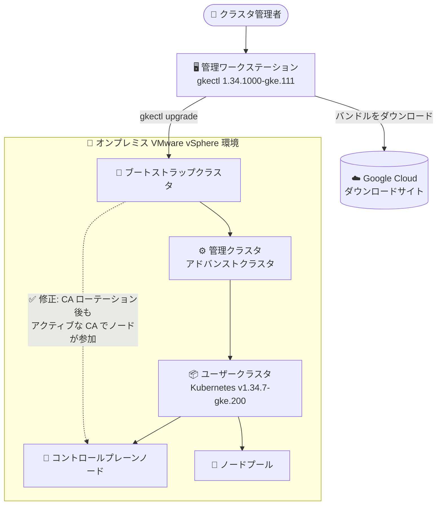

# Google Distributed Cloud (software only) for VMware: バージョン 1.34.1000-gke.111 リリース

**リリース日**: 2026-10-22

**サービス**: Google Distributed Cloud (software only) for VMware

**機能**: パッチリリース 1.34.1000-gke.111 (脆弱性修正 + CA ローテーション後のアップグレード問題修正)

**ステータス**: 一般提供 (GA)

📊 [このアップデートのインフォグラフィックを見る](https://takech9203.github.io/google-cloud-news-summary/20261022-gdc-vmware-1-34-1000-gke-111.html)

## 概要

Google Distributed Cloud (software only) for VMware のパッチバージョン **1.34.1000-gke.111** がダウンロード可能になりました。本バージョンは **Kubernetes v1.34.7-gke.200** 上で動作します。オンプレミスの VMware vSphere 環境で GKE クラスタを運用している IT 管理者・オペレーターが対象です。なお、ベアメタル版 (Google Distributed Cloud software only for bare metal) のアップデートは別レポートで扱っており、本レポートは VMware 版のみを対象とします。

本リリースには、[Vulnerability fixes](https://docs.cloud.google.com/kubernetes-engine/distributed-cloud/vmware/docs/vulnerabilities) に記載されたセキュリティ脆弱性の修正に加え、重要な不具合修正が含まれています。具体的には、クラスタの認証局 (CA) を過去にローテーションしていた場合に、アドバンストクラスタへの更新・アップグレード時にコントロールプレーンノードの参加 (join) が失敗する問題が修正されました。この問題はバージョン 1.33 および 1.34 で確認されていた既知の問題であり、公式の既知の問題ページでは「恒久的な修正は 1.34.1000 以降で利用可能」と明記されています。

サードパーティのストレージベンダーを利用している場合は、[認定済みストレージパートナーの一覧](https://docs.cloud.google.com/kubernetes-engine/enterprise/docs/resources/partner-storage)を確認してください。また、リリース後、GKE On-Prem API クライアント (Google Cloud コンソール、gcloud CLI、Terraform) でこのバージョンが利用可能になるまでには約 7〜14 日かかります。

**アップデート前の課題**

- `gkectl update credentials certificate-authorities rotate` で CA ローテーションを完了したクラスタでは、アクティブな CA 証明書と鍵がバージョン番号付きの Secret (`cluster-ca-cert-2`、`etcd-ca-cert-2`、`front-proxy-ca-cert-2` など) に格納されるが、アドバンストクラスタへの移行時に `gkectl` が `ca-rotation-stage` ConfigMap を確認せず、バージョン番号なしの Secret を参照していた
- バージョン番号なしの `cluster-ca-cert` Secret が存在しない場合 (ユーザークラスタで一般的)、`gkectl` がクラスタ準備中に `secrets "cluster-ca-cert" not found` エラーで失敗していた
- バージョン番号なしの Secret にローテーション前の古い CA が残っている場合 (管理クラスタで一般的)、古い CA でブートストラップクラスタがシードされ、古い公開鍵ハッシュが kubeadm join 構成にピン留めされるため、コントロールプレーンノードの参加が `none of the public keys ... are pinned` エラーで失敗していた
- `gkectl` がローカルの kubeconfig を古い CA で更新した場合、`kubectl` コマンドが `crypto/rsa: verification error` で失敗していた
- 回避策として、CA Secret の手動同期やブートストラップクラスタの再作成 (`--reuse-bootstrap-cluster=false`) といった複雑な手順が必要だった

**アップデート後の改善**

- 1.34.1000-gke.111 への更新・アップグレードでは、CA ローテーション済みのクラスタでもアドバンストクラスタへの移行時にコントロールプレーンノードが正しく参加できるようになった (恒久修正)
- [Vulnerability fixes](https://docs.cloud.google.com/kubernetes-engine/distributed-cloud/vmware/docs/vulnerabilities) に記載された脆弱性が修正され、セキュリティ態勢が改善された
- Kubernetes v1.34.7-gke.200 ベースへの更新により、最新のパッチが適用された状態で運用できる

## アーキテクチャ図



GDC (software only) for VMware のアップグレードフローを示した図です。管理ワークステーションの `gkectl` がブートストラップクラスタを介して管理クラスタ・ユーザークラスタをアップグレードします。本リリースにより、CA ローテーション済みクラスタでもコントロールプレーンノードの参加が正しく行われるようになりました。

## サービスアップデートの詳細

### 主要機能

1. **バージョン 1.34.1000-gke.111 の提供開始**
   - Kubernetes v1.34.7-gke.200 上で動作するパッチリリース
   - ダウンロードして利用可能。アップグレード手順は[クラスタのアップグレード](https://docs.cloud.google.com/kubernetes-engine/distributed-cloud/vmware/docs/how-to/upgrading)を参照
   - GKE On-Prem API クライアント (Google Cloud コンソール、gcloud CLI、Terraform) で利用可能になるまで約 7〜14 日

2. **セキュリティ脆弱性の修正**
   - [Vulnerability fixes](https://docs.cloud.google.com/kubernetes-engine/distributed-cloud/vmware/docs/vulnerabilities) に記載された脆弱性を修正

3. **CA ローテーション後のアドバンストクラスタ移行問題の修正**
   - CA を過去にローテーションしたクラスタ (`enableAdvancedCluster: true` を指定) を更新・アップグレードする際、コントロールプレーンノードの参加に失敗する問題を修正
   - 詳細は既知の問題「[Control plane nodes fail to join during an update or upgrade to an advanced cluster after CA rotation](https://docs.cloud.google.com/kubernetes-engine/distributed-cloud/vmware/docs/troubleshooting/known-issues)」を参照

## 技術仕様

### バージョン情報

| 項目 | 詳細 |
|------|------|
| GDC (software only) for VMware バージョン | 1.34.1000-gke.111 |
| Kubernetes バージョン | v1.34.7-gke.200 |
| バンドルされる cert-manager (1.34 系) | 1.19 |
| GKE On-Prem API クライアントでの利用可否 | リリース後約 7〜14 日で利用可能 |
| ストレージ | サードパーティベンダー利用時は[認定済みストレージパートナー](https://docs.cloud.google.com/kubernetes-engine/enterprise/docs/resources/partner-storage)を要確認 |

### 修正された CA ローテーション問題の症状 (1.33 / 1.34 で確認されていたもの)

| 発生シナリオ | 症状 |
|------|------|
| バージョン番号なしの `cluster-ca-cert` Secret が存在しない (ユーザークラスタで一般的) | クラスタ準備中に `failed to get user cluster ca secret from admin client: secrets "cluster-ca-cert" not found` で失敗 |
| バージョン番号なしの Secret にローテーション前の CA が残存 (管理クラスタで一般的) | 古い CA の公開鍵ハッシュが kubeadm join 構成にピン留めされ、ノード参加が `none of the public keys ... are pinned` で失敗 |
| `gkectl` が kubeconfig を古い CA で更新 | `kubectl` コマンドが `crypto/rsa: verification error` で失敗 |

## 設定方法

### 前提条件

1. アップグレード前に管理クラスタとユーザークラスタの最新バックアップを取得しておく ([アップグレードのベストプラクティス](https://docs.cloud.google.com/kubernetes-engine/distributed-cloud/vmware/docs/how-to/upgrade-overview)を参照)
2. [アップグレードの概要](https://docs.cloud.google.com/kubernetes-engine/distributed-cloud/vmware/docs/how-to/upgrade-overview)でサポートされるバージョンスキューとバージョンルールを確認する
3. 非アドバンストクラスタからアドバンストクラスタへのアップグレードでは、`gkectl` のバージョンをアップグレード先のターゲットバージョンと一致させる (この厳密なバージョン要件はアドバンストクラスタへのアップグレード時のみ適用)
4. 非アドバンストクラスタからのアップグレードでは、コントロールプレーンとすべてのノードプールを同時に同じターゲットバージョンへアップグレードする (バージョンスキュー不可)

### 手順

#### ステップ 1: 管理ワークステーションとバンドルの準備

[ダウンロードページ](https://docs.cloud.google.com/kubernetes-engine/distributed-cloud/vmware/docs/downloads)から 1.34.1000-gke.111 を取得し、管理ワークステーションをアップグレードします。

#### ステップ 2: クラスタのアップグレード

```bash
# ユーザークラスタのアップグレード
gkectl upgrade cluster --kubeconfig ADMIN_KUBECONFIG --config USER_CLUSTER_CONFIG

# 管理クラスタのアップグレード
gkectl upgrade admin --kubeconfig ADMIN_KUBECONFIG --config ADMIN_CLUSTER_CONFIG
```

詳細な手順 (コントロールプレーンとノードプールを別々にアップグレードする方法を含む) は[クラスタのアップグレード](https://docs.cloud.google.com/kubernetes-engine/distributed-cloud/vmware/docs/how-to/upgrading)を参照してください。

## メリット

### ビジネス面

- **セキュリティリスクの低減**: 既知の脆弱性が修正されたバージョンへ更新することで、オンプレミス Kubernetes 環境のセキュリティコンプライアンスを維持できる
- **運用コストの削減**: CA ローテーション後のアップグレード失敗に対する複雑な手動回避策 (CA Secret の手動同期、ブートストラップクラスタ再作成など) が不要になる

### 技術面

- **アドバンストクラスタ移行の信頼性向上**: CA ローテーションというセキュリティベストプラクティスを実施済みのクラスタでも、アドバンストクラスタへの更新・アップグレードが安全に完了する
- **最新 Kubernetes パッチの適用**: Kubernetes v1.34.7-gke.200 ベースで運用できる

## デメリット・制約事項

### 考慮すべき点

- GKE On-Prem API クライアント (Google Cloud コンソール、gcloud CLI、Terraform) でこのバージョンが利用可能になるまで、リリース後約 7〜14 日かかる
- サードパーティストレージベンダー利用時は、このリリースに対する認定状況を[ストレージパートナー一覧](https://docs.cloud.google.com/kubernetes-engine/enterprise/docs/resources/partner-storage)で確認する必要がある
- 非アドバンストクラスタを 1.33 から 1.34 にアップグレードすると、クラスタは必ずアドバンストクラスタに変換される (非アドバンストのまま維持できるのは 1.32 から 1.33 へのアップグレードのみ)
- アドバンストクラスタへの移行時、バンドルされた cert-manager が既存の cert-manager を自動的に上書きするため、カスタム構成がある場合は事前確認が必要

## ユースケース

### ユースケース 1: CA ローテーション実施済みクラスタのアドバンストクラスタへのアップグレード

**シナリオ**: セキュリティポリシーに従い `gkectl update credentials certificate-authorities rotate` で CA ローテーションを実施済みの 1.33 クラスタを、アドバンストクラスタ (1.34) へアップグレードしたい。これまでは既知の問題によりコントロールプレーンノードの参加が失敗し、手動での CA Secret 同期が必要だった。

**効果**: 1.34.1000-gke.111 には恒久修正が含まれるため、手動回避策なしでアップグレードを完了できる。

### ユースケース 2: 脆弱性対応としての定期パッチ適用

**シナリオ**: オンプレミスの VMware 環境で稼働する GDC クラスタに対し、セキュリティ運用の一環として最新パッチを適用する。

**効果**: [Vulnerability fixes](https://docs.cloud.google.com/kubernetes-engine/distributed-cloud/vmware/docs/vulnerabilities) に記載された脆弱性が解消され、セキュリティ態勢を維持できる。

## 関連サービス・機能

- **Google Distributed Cloud (software only) for bare metal**: ベアメタル版。アドバンストクラスタは GDC for Bare Metal を基盤フレームワークとして使用する統合アーキテクチャを採用しており、両製品でコントローラーやエージェントが共通化されている
- **GKE On-Prem API (Google Cloud コンソール / gcloud CLI / Terraform)**: クラスタのライフサイクル管理に利用できるクライアント。新バージョンはリリース後約 7〜14 日で利用可能になる
- **アドバンストクラスタ**: 1.32 で GA、1.33 以降は新規クラスタの標準アーキテクチャ。トポロジードメインなどの新機能が利用可能
- **cert-manager**: アドバンストクラスタに自動的にインストールされる (1.34 ではバージョン 1.19 がバンドル)

## 参考リンク

- 📊 [インフォグラフィック](https://takech9203.github.io/google-cloud-news-summary/20261022-gdc-vmware-1-34-1000-gke-111.html)
- [公式リリースノート](https://docs.cloud.google.com/release-notes#October_22_2026)
- [GDC (software only) for VMware リリースノート](https://docs.cloud.google.com/kubernetes-engine/distributed-cloud/vmware/docs/release-notes)
- [クラスタのアップグレード](https://docs.cloud.google.com/kubernetes-engine/distributed-cloud/vmware/docs/how-to/upgrading)
- [アップグレードの概要](https://docs.cloud.google.com/kubernetes-engine/distributed-cloud/vmware/docs/how-to/upgrade-overview)
- [既知の問題 (CA ローテーション後のノード参加失敗)](https://docs.cloud.google.com/kubernetes-engine/distributed-cloud/vmware/docs/troubleshooting/known-issues)
- [Vulnerability fixes](https://docs.cloud.google.com/kubernetes-engine/distributed-cloud/vmware/docs/vulnerabilities)
- [アドバンストクラスタの概要](https://docs.cloud.google.com/kubernetes-engine/distributed-cloud/vmware/docs/concepts/advanced-clusters)
- [認定済みストレージパートナー](https://docs.cloud.google.com/kubernetes-engine/enterprise/docs/resources/partner-storage)

## まとめ

GDC (software only) for VMware 1.34.1000-gke.111 は、脆弱性修正に加えて、CA ローテーション済みクラスタのアドバンストクラスタ移行を妨げていた既知の問題の恒久修正を含む重要なパッチリリースです。特に 1.33 / 1.34 で CA ローテーションを実施済みの環境では、本バージョンへのアップグレードにより手動回避策なしで安全にアドバンストクラスタへ移行できるため、早期の適用を推奨します。適用前にはバックアップの取得とストレージパートナーの認定状況の確認を忘れずに行ってください。

---

**タグ**: #GoogleDistributedCloud #VMware #GDC #Kubernetes #オンプレミス #セキュリティ #パッチリリース #アドバンストクラスタ #CAローテーション
